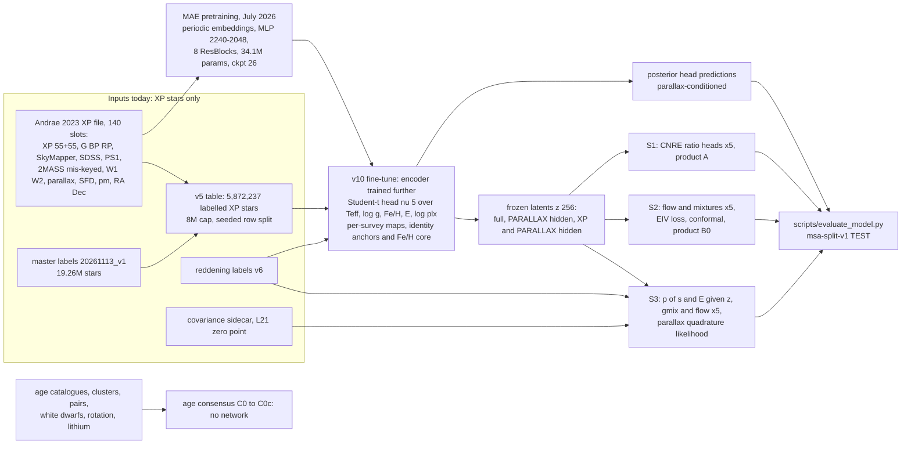
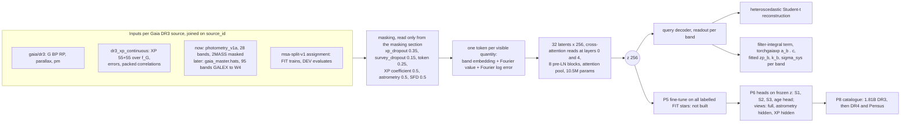

# MSA handoff: training and prediction (2026-11-24)

Start here in a new session. This page is self-contained: it says what the programme is for, how to
work, where every product lives, what the models and losses are, how to train and predict, what
passes and what fails, and what to do next. It supersedes the 8 Nov `HANDOFF.md` at the repository
root (that one names a deleted branch and the lost `k-pop/msa_runs` tree).

Written from `main` at `2116167` (sfabbro/masked-stellar-autoencoder), the CANFAR receipts in
`experiments/xp/decision-wave-20261106/`, the ARC run reports and manifests (read on 24 Nov), and the
session transcript of 10–24 Nov. Numbers carry their source; **(unverified)** marks what was not
re-checked. Companion documents, all in `docs/programme/`:

| Document | Use it for |
|---|---|
| [`README.md`](README.md) | programme plan P0–P8, ground rules, QA gates |
| [`experiment-history.md`](experiment-history.md) | every run since July, lessons L1–L57, architecture by era |
| [`architecture.md`](architecture.md) | the v10 chain read from the code, every loss with its formula |
| [`encoder-v11.md`](encoder-v11.md) | the v11 encoder: contract, model, masking, losses, pilot |
| [`data.md`](data.md), [`datasets.yaml`](datasets.yaml) | master labels, full-Gaia inputs, `msa-split-v1` |
| [`qa.md`](qa.md) | every QA check, acceptance criteria (§5.3) |
| [`../qa-v10-20261124/`](../qa-v10-20261124/README.md) | first single-evaluator report (v10 chain) |
| [`../hats-survey-audit-20261124.md`](../hats-survey-audit-20261124.md) | problems of the community HATS trees |
| [`../gaia-master-data.md`](../gaia-master-data.md) | P1 runbook: Gaia-anchored full-wavelength master |

---

## 1. Goal and ground rules

- **Products.** Teff, log g, [Fe/H] (later [α/Fe]), distance, E(B−V) and age, each with calibrated,
  non-Gaussian uncertainties.
- **Coverage.** Every Gaia star, with or without XP: DR3 now (1,811,709,771 sources), then DR4
  (due 2 Dec 2026; re-anchor on DR4 `gaia_source` + XP), then objects beyond Gaia from Pensus.
- **Data-driven.** No stellar model and no Galactic model inside the inference. Kinematics and sky
  position are a population prior: they stay out of the measurement product.
- **No label is ground truth.** Every label source, anchors included, enters through a fitted map and
  fitted noise (anchors: identity map, fitted noise). Quoted errors are data, not truth (S3 found the
  E(B−V) label errors 2–4× too large).
- **Products stay separate** (`docs/design-20261122-data-driven-inference.md`):
  - **A**, measurement likelihoods (S1 ratio heads; population-free; Neyman sets);
  - **B**, predictive distributions (S2, S3, the posterior head; conformal on CAL);
  - **C**, population estimands (PPI, NPMLE; not built yet).
- **Full data only.** Since 23 Nov 21:50 UTC the user's rule is: no more conclusions from small or
  less diverse subsets. Every result is produced on the full data sets and judged by the QA suite.

---

## 2. Working rules

### 2.1 Repositories and branches

| Repository (sfabbro fork) | Local checkout | Role |
|---|---|---|
| `masked-stellar-autoencoder` | `/home/user/masked-stellar-autoencoder` | this programme |
| `xmatcher` | `/home/user/xmatcher` (on `main`, `d651612`) | Gaia-anchored cross-match engine (`ray-anchor`); the user is reviewing it for Pensus separately |
| `torchregress` | `/home/user/torchregress` | regression maths (CNRE, conformal, coverage), a git dependency of MSA |
| `torchsky`, `uspm` | `/home/user/torchsky`, `/home/user/uspm` | siblings; not used by the MSA chain directly |

- **All work on `main` of the sfabbro forks. No `wip` branches.** Push with `git push origin main`.
  Never force-push. Before pushing: `git fetch origin main && git merge --no-edit origin/main`
  (merge commits also need the trailers: use `git merge -m "..."`).
- Do not push to `upstream` (aydanmckay) of the MSA fork.
- Commit messages end with
  ```
  Co-Authored-By: Claude Opus 5.5 <noreply@anthropic.com>
  Claude-Session: <the session URL given in the session's system reminder>
  ```
  Two merge commits on `main` (`3daf29a`, `b1f5827`) went out with git's default message and no
  trailers; fixing them would need a force-push, so they stay.
- **Shared checkout.** Several agents may work in `/home/user/masked-stellar-autoencoder` at once.
  If it has someone else's uncommitted edits or unpushed commits, work in a separate clone of
  `origin/main` (a sparse clone in the scratchpad is enough for docs) and push from there.
- **Sibling state at handoff (check before relying on it).** The local `torchregress`, `torchsky` and
  `uspm` checkouts are on `wip/intelligent-babbage-778ino`, not `main`. MSA pins
  `torchregress @ git+https://github.com/sfabbro/torchregress.git@edab00440c8a…` (`pyproject.toml`),
  and **that commit is only on torchregress's `wip/intelligent-babbage-778ino` (15 commits ahead of
  `origin/main` `a77df2c`), not on `main`.** Merge it into torchregress `main` before anyone deletes
  that branch, or the MSA environment stops resolving.
- Old branches the user was asked to delete in the GitHub UI (this session cannot delete remote
  branches): MSA `wip/intelligent-babbage-778ino` (identical to `main`), xmatcher
  `wip/intelligent-babbage-778ino` (its one commit is on `main` as `0518d3e`), uspm `wip/*` (in
  `main`), torchsky `wip/wizardly-tesla-c8wnq1` (1 commit not in `main`; check first). Not torchregress
  (see above).
- The age work tree `/home/user/msa-wt-age-c0` (`feat/age-c0`) is fully merged into `main`.

### 2.2 Pixi

```bash
export PATH=$HOME/.pixi/bin:$PATH PYTHONNOUSERSITE=1; unset PYTHONPATH
cd /home/user/masked-stellar-autoencoder
pixi run python ...            # default env (CPU torch locally, Python 3.13)
pixi run lint                  # ruff check .
pixi run ruff format --check <files you edited>
pixi run pytest tests/test_foo.py -q
```

Never `pip install --user`. Environments: `default`, `gpu`, `monitor` (launcher and status tools,
`no-default-feature`).

### 2.3 Launching on CANFAR

Every CANFAR job goes through one launcher, one step at a time:

```bash
pixi run -e monitor --no-install python scripts/launch_master_label_training_chain.py --step <step> [--dry-run]
pixi run -e monitor --no-install python scripts/launch_master_label_training_chain.py --step <step> --attempt 2   # retry
```

- The launcher refuses to submit unless HEAD is pushed to `origin/main` and the working tree is clean.
  The headless job (session name `msa-<run-id>`) clones the repository from GitHub at that commit;
  the step's config files are copied to `/arc/projects/astroai/msa/launcher/source_bundles/<run_id>[-attempt-N]/`.
- It writes a receipt `experiments/xp/decision-wave-20261106/<run_id>[-attempt-N].json` (session id,
  commit, command, resources). **Commit and push the receipt** right after the launch.
- An existing receipt blocks resubmission. A failed or never-created submission is first
  *reconciled*: record in its receipt what happened (`status: not_submitted_confirmed` for an
  outage), commit, then relaunch with `--attempt N` (N ≥ 2).
- Outputs go to `/arc/projects/astroai/msa/runs/<run_id>/` (plus `<run_id>.session.log`).
- `--slices N` runs a single-GPU step data-parallel through `scripts/run_multi_slice.py` (NCCL
  default). Only the 12 Nov master-label NSF trainer (`scripts/run_expanded_six_training.py`, via
  `training/slice_parallel.py`) implements it; the v10 fine-tune, the heads and **the v11 trainer
  have no distributed code.**
- Credentials, first match wins: `CANFAR_TOKEN`; `CANFAR_CERTIFICATE`; `CADC_PROXY_PEM`; a valid
  `~/.ssl/cadcproxy.pem`; `CADC_USERNAME` + `CADC_PASSWORD` (mints a fresh 10-day proxy certificate).
  **The certificate in this container expires 2026-11-25 02:30 UTC**
  (`openssl x509 -in ~/.ssl/cadcproxy.pem -noout -enddate`).
- Never touch other projects' sessions (e.g. `pensus-*`, which run on the same account).

### 2.4 Output locations

- Every MSA output (tables, cross-matches, runs, analysis) goes under `/arc/projects/astroai/msa`
  (`vos:astroai/msa`). Cross-match products: `/arc/projects/astroai/msa/xmatcher/`.
- xmatcher's catalogue cache (mirrors of remote HATS inputs) goes under `/arc/projects/astroai/hats`
  (`XMATCHER_CACHE_ROOT`, xmatcher's CANFAR default since `0518d3e`); those copies may later be promoted
  to community-ready HATS.
- `/arc/projects/hats` is the community tree: read it, never write to it (no outputs, no new mirrors,
  no syncs). xmatcher refuses every write under it.

### 2.5 Monitoring CANFAR and reading ARC

```bash
C="--cert $HOME/.ssl/cadcproxy.pem"
curl -sSL $C https://ws-uv.canfar.net/skaha/v1/session                     # all sessions (msa-*, pensus-*)
curl -sSL $C https://ws-uv.canfar.net/skaha/v1/session/<id>                # one session
curl -sSL $C "https://ws-uv.canfar.net/skaha/v1/session/<id>?view=logs"    # its log
A=https://ws-uv.canfar.net/arc
curl -sSL $C "$A/files/projects/astroai/msa/runs/<run>/report.md"          # read a file
curl -sSL $C "$A/nodes/projects/astroai/msa/runs?limit=500"                # list a directory (XML)
```

ARC is not mounted locally; all access is VOSpace over HTTPS. ARC ignores HTTP `Range`, so a Parquet
or HDF5 footer cannot be read without downloading the whole file. The CANFAR sessions API had
outages and HTTP 500s on 23–24 Nov (three receipts reconciled as never submitted).

### 2.6 This machine

- 4 cores, no GPU, no `/arc` mount, about 2.5 GB free disk at handoff (`df -h /`). The disk has
  filled once (23–24 Nov); keep large downloads out of it and delete local copies of ARC files.
- A stray, empty local `/arc/projects/astroai/msa/runs` was created by an agent at 05:13 UTC on
  24 Nov. It is harmless now (xmatcher's tests ignore a host `/arc` since `d651612`). Remove it with
  `rmdir -p /arc/projects/astroai/msa/runs` **only if the user agrees**.
- **Local-only products.** The age consensus fits of C0c (`fit_A.pkl`, `fit_C.pkl`,
  `consensus_stars.parquet`, about 0.5 GB) exist only in the previous session's scratchpad
  (`/tmp/claude-0/-home-user/d60e9c7a-7b13-5bb2-ade1-fb8da7adbc26/scratchpad/age_c0c/work/`), not on
  ARC. If that directory is gone, C0c is regenerated from ARC inputs (§5.4). The C0b work directory
  there (`age_c0b/work/`) no longer holds the `fit_{A,C}.pkl` that `--freeze-from` reads, so a
  regeneration runs C0b first.

---

## 3. Where everything is

All paths on ARC unless stated. `runs/` = `/arc/projects/astroai/msa/runs/`.

### 3.1 Data

| What | Where | Size / status |
|---|---|---|
| **Master spectroscopic labels** | `runs/master_spectroscopic_labels_20261113_v1/` (`stars.parquet`, `records/`, `manifest.json`, `catalogues.json`) | 44,576,092 records; 19,255,342 stars (19,205,652 with a Gaia DR3 id); 43 surveys and pipelines. Current and complete. `catalogues.json` still points at deleted `k-pop/msa_runs` paths. |
| **Frozen split `msa-split-v1`** | `runs/msa_split_v1/` (`assignment/Norder=*/Dir=*/Npix=*.parquet` in the Gaia HATS layout; `overrides.parquet`, `groups.parquet`, `counts.json`, `manifest.json`) | FIT 1,357,929,871 / DEV 90,537,669 / CAL 144,843,506 / TEST 217,273,992 / QA_RESERVED 1,124,733 (manifest, 23 Nov 23:07 UTC). Salt `msa-split-v1` = `0xb6f6e5353645106b`; u = splitmix64(source_id ⊕ salt) ≫ 11 × 2⁻⁵³; FIT < 0.75 ≤ DEV < 0.80 ≤ CAL < 0.88 ≤ TEST. Shared hash module: `src/masked_stellar_autoencoder/data/msa_split.py` (`MsaSplit`). Input classes: X 219,197,643; P 1,321,572,876; G 265,484,088; N 5,455,164. |
| **Full-Gaia v1a photometry (P3 input of v11)** | `runs/msa_tables_v2/photometry_v1a/` (2,016 partitions, Gaia DR3 HATS layout and row order) | 1,811,709,771 rows, 166.7 GB, 65 columns: Gaia G/BP/RP + astrometry, SFD E(B−V), SDSS, SkyMapper DR4, PS1, CatWISE, 2MASS (all null: masked). Every table pairing-validated (§7.2). |
| SFD maps | `/arc/projects/astroai/msa/catalogues/sfd/` | SFD98 NGP/SGP with `provenance.json` (dustmaps-identical) |
| Gaia DR3 (anchor) | `/arc/projects/hats/gaia/dr3` | 1,811,709,771 rows, 2,016 partitions, 152 columns |
| Gaia DR3 XP | `/arc/projects/hats/gaia/dr3_xp_continuous` | 219,197,643 rows, same partitions; no `properties`/`_metadata` files |
| Gaia-anchored master: pilots | `/arc/projects/astroai/msa/xmatcher/pilot_gaia_master.hats` (2/69, 6/42837; 1,513,619 rows), `pilot_gaia_master_v3.hats` (2/69, 2/133, 5/8283; 2,193,149 rows) | verified |
| Gaia-anchored master: full | `/arc/projects/astroai/msa/xmatcher/gaia_master.hats` (launcher step `gaia-master-full`, run `gaia_master_full_v1`) | **not launched**: waits for the PS1 OTMO rebuild; the DES rebuild renamed its collection to `y6_gold_rawrap`, which breaks xmatcher's `des_y6_gold` pin (the user is reviewing xmatcher for Pensus) |
| Corrected Gaia FGK benchmarks (GBS v3) | `/arc/projects/astroai/msa/catalogues/gaia_fgk_benchmarks_v3_dr3ids.parquet` (+ `.json`) | exact DR3 ids for 192 of 192 stored ids; the original `k-pop/catalogues/gaia_fgk_benchmarks.parquet` has float-rounded ids and is refused by the loader |
| Current training table (v10 lineage, to be retired) | `runs/multisurvey_table_20261117_v5/` (`finetune.fits`, `records.npz`, `unlabelled.npz`) | 5,872,237 labelled XP stars (8M cap; 2,128,095 labelled no-XP stars dropped); seeded row split 4,697,789 / 786,880 / 387,568 |
| Reddening labels | `runs/reddening_labels_20261118_v6/` (`v5_reddening.npz`: `ebv_star`, `e_ebv_star`) | 4,253,330 labelled rows of v5 |
| Covariance sidecar | `runs/covariance_sidecar_20261120/sidecar_table.h5` | per-row XP and astrometric covariances, L21 parallax zero point |
| Frozen [Fe/H] core (v5 rows) | `runs/rescore_20261119/rows.npy`, `rows_split.npz` | 39,073 rows, 7,740 held out |
| Co-natal QA inputs | `runs/consistency_table_20261118/` (1,209,544 stars), `runs/binary_pool_20261120_pairs/pool.npz`, `/arc/projects/astroai/msa/analysis/consistency/` | |
| Age inputs | `/arc/projects/astroai/msa/analysis/age_audit_20261122/` (records, 8.05M), `/arc/projects/astroai/msa/analysis/age_labels_20261122/` (clusters, pairs, WD, rotation, lithium) | |
| July pretraining | `/arc/projects/astroai/msa/pretrain/checkpoints/msa_pretrain_checkpoint_26.pth`; input `/arc/projects/k-pop/catalogues/andrae2023/sslset-realmags-full-052725.h5` | the only surviving pre-v11 encoder |
| Survey matches keyed by Gaia id | `/arc/projects/k-pop/catalogues/adql_matches/` | PS1, SDSS, CatWISE pass the pairing test; **`twomass.fits` is mis-keyed: never use it** |

### 3.2 Models and runs (v10 lineage and after)

From `STEPS` in `scripts/launch_master_label_training_chain.py`:

| Product | Run id (`runs/`) | Launcher step(s) | Key file |
|---|---|---|---|
| v10 anchored multi-survey fine-tune | `multisurvey_finetune_20261121_v10` | `ms-multi-v10` | `finetune_checkpoint_12.pth`; `multi_v10_test.npz`, `multi_v10_core.npz`, `consistency_v10.npz` |
| S1 likelihood heads (single, labels, latents) | `likelihood_head_s1_v10_20261121` | `ms-s1-v10` | `latent.npy`, `labels.npz` (common-scale labels used by S1, S2, S3, F2) |
| S1 diagnostics | `likelihood_head_s1_diagnostics_20261121` | `ms-s1-diagnostics` | `diagnostics.md` |
| S1 parallax arm, 5 heads (PARALLAX-hidden latents) | `likelihood_head_s1_v10_plx_ens_20261122` | `ms-s1-v10-plx-ens` | `latent.npy` (input of S3) |
| **S1 `all` arm, 5-head ensemble** (product A) | `likelihood_head_s1_v10_ens_20261122` | `ms-s1-v10-ens` | `s1_predictions.npz`, `report.md` |
| **S2 distributional heads** (product B0) | `distributional_heads_s2_v10_20261122` | `ms-s2-distributional-heads` | `s2_predictions_flow.npz` |
| S3 attempt 3 (+ XP-hidden latents in `noxp/`) | `distance_extinction_s3_v10_20261122` | `ms-s3-distance-extinction` | `noxp/latent.npy` |
| **S3 v2** (gmix + flow; flow adopted for distance) | `distance_extinction_s3_v2_20261123` | `ms-s3v2-gmix`, `ms-s3v2-gmix-{1..4}`, `ms-s3v2-flow-{0..4}`, `ms-s3v2-flow-{0..4}b`, `ms-s3v2-final`, `ms-s3v2-final-2` | `heads/`, `report.md` |
| S3 v2.1 (gmix, fitted outlier width) | `distance_extinction_s3_v21_20261123` | `ms-s3v21-gmix-{0..4}`, `ms-s3v21-final` | `s3_predictions_gmix.npz` |
| F2 XP forward model | `xp_forward_model_20261122`, `xp_forward_{diagnose,infer,scan}_20261122` | `ms-xp-forward-*` | not competitive |
| QA of the v10 chain | `qa_v10_20261124` (`out/`, `inputs/run_eval.sh`), `qa_v10_20261124_stage` | `qa-v10-stage` | repo copy `docs/qa-v10-20261124/` |
| v11 GPU pilot | `pretrain_v11_pilot_20261124/{l32,l16}` | `v11-pilot` | `metrics.jsonl`, `checkpoints/` |
| Split freeze | `msa_split_v1` | `msa-split-v1` (no `--force`: cannot overwrite) | `manifest.json` |
| v1a photometry | `photometry_v1a_20261124` (work), `msa_tables_v2/photometry_v1a` (output) | `photometry-v1a` | `manifest.json`, `validation.json` |
| Gaia master pilots / estimate / full | `gaia_master_pilot_20261124{,_v2,_v3}`, `gaia_master_estimate_20261124`, `gaia_master_full_v1` | `gaia-master-pilot`, `-pilot-v3`, `-estimate`, `-full` | `pilot_summary.{json,md}` |
| HATS audit | `hats_survey_audit_20261124` (+ `followup/`) | `hats-survey-audit`, `hats-survey-audit-followup` | `summary.json` |

Ages: `docs/age-c0-20261122/`, `docs/age-c0b-20261123/`, `docs/age-c0c-20261124/` (reports, maps, noise,
tiers, clusters; the per-star consensus is local-only, §2.6). Age audit: `docs/age-audit-20261122/`.

---

## 4. Architecture and losses

### 4.1 Today: the v10 chain



What runs is not always what the config says: every fine-tune v1–v10 ran masking ratios 0.3/0.3
(the configs set 0.9/0.6 under `training:`, which the fine-tune never read) and AdamW's default weight
decay 0.01 on the encoder (not the configured 1e-5). Both are fixed in code since 24 Nov
(`training/finetune_settings.py`), so **rerunning the v10 config today does not reproduce v10**; to
reproduce it set `finetuning.xp_masking_ratio: 0.3`, `finetuning.m_masking_ratio: 0.3`,
`finetuning.encoder_weight_decay: 0.01` and drop the `training:` copies. Pretraining did not load
measurement errors (now loaded by default, `training.load_errors`; losses unchanged).

### 4.2 Target: the v11 chain



- **Contract.** `src/masked_stellar_autoencoder/v11/contract.yaml` (`version: msa-in-v2-draft-1`) and
  `v11/schema.py` define 215 canonical bands: 101 magnitudes in 24 surveys (GALEX to AllWISE W4), 110
  XP coefficients and 4 conditioning values (parallax, pmra, pmdec, SFD). Two column mappings feed the
  same band list: `gaia_keyed_v1a` (28 bands; today's Gaia-keyed sources) and `gaia_master_v2`
  (95 bands; the xmatcher master). Switching is a config change; a checkpoint loads into a longer band
  list (band tables keyed by name). Absent or failing values are absent tokens, never −9999.
- **Model.** `v11/model.py`: encoder 8,663,856 + decoder 1,870,353 = **10,534,209 parameters**
  (+ 215 σ_model and 3 × n_FI nuisances). Permutation-invariant, independent of batch padding.
- **Masking** only from `masking:`; **strict config**: unknown keys fail at any depth (`v11/config.py`),
  so the v10 masking bug cannot recur silently.
- **Filter integral.** torchgaiaxp 0.3.0 `XPSpectra.integrate` (linear in the 110 coefficients, so
  `a_b` is exact, with the exact XP covariance). 46 qualifying bands in the master mapping, 11 in v1a
  (SDSS g r i; SkyMapper v g r i; PS1 g r i z). Each band gets a fitted zero point `zp_b`, colour term
  `k_b` and scatter `σ_sys,b`, starting at 0, 0, 0.02: never truth.

### 4.3 Losses per stage

| Stage | Trains on | Loss | Code |
|---|---|---|---|
| MAE pretraining (July, ckpt 26) | Andrae XP file, all shards but 5 validation shards (~2×10⁸ rows) | masked L1 (1) | `training/pretrain_msa.py`, `models/model.py` |
| v10 fine-tune | v5 table (labels, records), ≤ 5M unlabelled XP stars | 0.8 joint Student-t label likelihood (2) + 0.2 labelled L1 + 0.2 unlabelled L1 | `training/finetune_msa.py`, `anchored_multisurvey.py`, `anchored_survey_map.py` |
| S1 ratio heads | v5 train split on frozen v10 latents, common-scale labels | CNRE, K = 8 negatives, γ = 1 (3) | `scripts/s1_likelihood_head.py`, `training/likelihood_head.py` |
| S2 distributional heads | ≤ 2M split-0 rows | errors-in-variables NLL (4); split and Mondrian conformal on half of split 1 | `scripts/s2_distributional_heads.py`, `training/distributional_heads.py` |
| S3 distance and E(B−V) | 4,697,789 v5 train rows (all parallaxes, 3,402,525 E labels), PARALLAX-hidden latents mixed 50/50 with XP-hidden ones | exact marginal likelihood by quadrature (5) | `scripts/s3_distance_extinction.py`, `training/distance_extinction.py` |
| Age consensus C0–C0c | age records (7,456,035 good records → 1.67M representative) | Student-t record model, profile objective, REML noise (6) | `scripts/age_consensus_c0.py`, `training/age_consensus.py` |
| **v11 pretraining** | REC = FIT objects of msa-split-v1, all input classes; REC-DEV for evaluation | Student-t reconstruction (7) + 0.1 × filter integral (8) | `training/pretrain_v11.py`, `v11/losses.py` |
| v11 fine-tune (P5, planned) | FIT labels of all 19.2M master stars + REC; DEV for stopping | 0.8 label NLL (survey maps, fitted noise, censoring, identity anchors) + 0.2 rec (labelled) + 0.2 rec (REC) + λ_c two-masking consistency incl. XP-hidden view (README §4.3; if reinstated, teacher–student form, lesson L20) | not built |

(1) Masked L1, mask m_ij = masked ∧ observed over the 136 reconstructed slots; the denominator counts
the whole optimiser batch:

$$
\mathcal L_\mathrm{MAE}=\frac{\sum_{ij} m_{ij}\,\lvert\hat x_{ij}-x_{ij}\rvert}{\sum_{ij} m_{ij}} .
$$

(2) v10 joint likelihood per labelled star i. The head gives (μ_i, L_i) over P = 5 labels; the star's
own labels (E(B−V), log10 parallax) and every survey record r are stacked in z_i; survey maps
g_s(x) = x + b_s + L_s x + C_s φ(x) are linearised at μ_i (Jacobian J_s); anchors and, in v10, the
high-resolution [Fe/H] core use the identity map:

$$
\Sigma_i=A_iL_iL_i^\top A_i^\top+D_i,\quad D_i=\mathrm{diag}\big(e^2+\sigma_{s,p}^2\big),\quad
\mathrm{NLL}_i=-\log t_{\nu=5}\big(z_i-m_i;\,0,\Sigma_i\big),
$$

$$
\mathcal L_\mathrm{joint}=\overline{\mathrm{NLL}_i+\textstyle\sum_r-\log\Phi\!\Big(\tfrac{u_r-g_s(\mu_i)_p}{\sqrt{(J_sL_i)(J_sL_i)^\top_{pp}+\sigma^2_{s,p}+e_r^2}}\Big)}
+10^{-3}R_\mathrm{map}+0.01\,P_\mathrm{slope}+1.0\,P_\mathrm{mono},
$$

$$
\mathcal L_\mathrm{v10}=0.8\,\mathcal L_\mathrm{joint}+0.2\,\mathcal L^\mathrm{lab}_\mathrm{MAE}+0.2\,\mathcal L^\mathrm{unl}_\mathrm{MAE}\quad(\text{consistency weight }0).
$$

The bar is the mean over stars with at least one record or limit. Censored records (survey [Fe/H]
floors) enter as upper limits u_r. Map capacity by record count:
identity (anchors, core), offset (< 5,000), linear (5,000–49,999), full (≥ 50,000).

(3) CNRE with K = 8 negatives (labels of random training stars), γ = 1; its optimum is
s = log p(z | θ) − log p(z), so the training population cancels:

$$
q(y{=}k\mid\Theta,z)=\frac{(\gamma/K)\,e^{s(\theta_k,z)}}{1+(\gamma/K)\sum_j e^{s(\theta_j,z)}},\qquad
\mathcal L=-\tfrac{\gamma}{1+\gamma}\log q(y{=}1\mid\theta_+,\theta^-,z)-\tfrac{1}{1+\gamma}\log q(y{=}0\mid\theta^-_{1:K},z).
$$

Inference: support-restricted MLE, profile intervals, Neyman critical values C(θ, G) fitted on the
valid split.

(4) Errors in variables (closed form for mixtures, 8-draw Monte Carlo for flows):

$$
\mathcal L_i=-\log\int p_\phi(\theta\mid z_i)\,\mathcal N\big(y_i\mid\theta,\mathrm{diag}\,\sigma_i^2\big)\,d\theta .
$$

(5) S3, s = ln(d / kpc), trapezoid on 40 s nodes (24 inner E nodes for the flow; gmix integrates E in
closed form):

$$
L_i=\iint p(s,E\mid z_i)\,\mathcal N\big(\varpi_i-\mathrm{zp}_i\mid e^{-s},\sigma^2_{\mathrm{eff},i}\big)\Big[(1-\varepsilon)\,\mathcal N\big(E^\mathrm{obs}_i\mid E,(\kappa_{E,g}e_i)^2\big)+\varepsilon\,\mathcal N\big(E^\mathrm{obs}_i\mid E,(\lambda e_i)^2\big)\Big]ds\,dE,
$$

with σ²_eff = (κ_g σ_ϖ)² + σ²_zp; κ_g and κ_E fitted per G bin, ε, λ (v2.1; v2 used 4 κ_E e) and σ_zp
fitted scalars; zp = L21 from the sidecar (−0.017 mas where missing). No parallax cut, no inversion,
negative parallaxes kept. Rollback on divergence (`9261a5b`, `ee7f356`).

(6) Age record model: y_r = f_k(t_i + u_ie; x) + e_r, e_r ~ t₅(0, κ²σ_r² + ω²), shared input-family
errors u ~ N(0, η²), co-natal t_i − T_g ~ t₄(0, s_g); maps fitted by a profile (Deming) objective
with Gauss–Newton + L-BFGS, noise by REML; gauge A = APOKASC-3 identity, gauge C = Xiang 2024.

(7) v11 reconstruction, per masked present entry in scaled units (no quoted error → σ_meas = 0;
ν = 5; σ_model,b = 10⁻³ + e^{θ_b} fitted per band and per XP coefficient):

$$
s^2_{ib}=\sigma^2_{\mathrm{meas},ib}+\sigma^2_{\mathrm{model},b},\qquad
\mathrm{NLL}_{ib}=-\log t_\nu(x_{ib}-\hat x_{ib};0,s_{ib}),\qquad
\mathcal L_\mathrm{rec}=\sum_{g\in\{\mathrm{xp},\mathrm{phot}\}}\frac{w_g}{N_g}\sum_{(i,b)\in g}\mathrm{NLL}_{ib}.
$$

(8) v11 filter integral for bands inside 336–1020 nm (Student-t NLL of the residual):

$$
m^\mathrm{syn}_b=G-2.5\log_{10}(a'_b\cdot c/f_G),\quad
r=m_b-\big[m^\mathrm{syn}_b+\mathrm{zp}_b+k_b(\mathrm{BP{-}RP}^\mathrm{syn}-1)\big],\quad
s^2=\sigma^2_\mathrm{meas}+\sigma^2_\mathrm{XP}+\sigma^2_{\mathrm{sys},b},
$$

$$
\mathcal L_\mathrm{v11}=\mathcal L_\mathrm{rec}+0.1\,(\mathcal L_\mathrm{sed}+\mathcal L_\mathrm{phot})+\mathcal L_\mathrm{cal}.
$$

Modes: `calibrate` (observed XP with exact covariance vs observed magnitude; fits only zp_b, k_b,
σ_sys,b), `sed` (decoded XP vs observed magnitude), `phot` (observed XP vs decoded magnitude of a
hidden band). In `sed`/`phot` the nuisances are detached; observed-XP pairs need σ_XP ≤ 0.2 mag.

---

## 5. How to train

Run everything with the environment of §2.2. Smoke and tests run locally; real training runs on
CANFAR through the launcher (§2.3), from a clean, pushed `main`.

### 5.1 v11 pretraining (P4)

1. **Local checks** (CPU):
   ```bash
   pixi run pytest tests/test_v11_config_schema.py tests/test_v11_model_masking_losses.py \
     tests/test_v11_filter_integral.py tests/test_v11_data_train.py tests/test_msa_split.py -q
   pixi run python -m masked_stellar_autoencoder.training.pretrain_v11 --config configs/pretrain-v11-smoke.yaml   # ~46 s, synthetic sky
   pixi run python -m masked_stellar_autoencoder.training.pretrain_v11 --config configs/pretrain-v11.yaml --describe   # bands, FI bands, parameters (builds the reader)
   pixi run python -m masked_stellar_autoencoder.training.pretrain_v11 --config configs/pretrain-v11.yaml --estimate   # FLOPs, memory, projected rows/s (writes nothing)
   ```
2. **Config.** `configs/pretrain-v11.yaml`: trees `gaia/dr3` + `dr3_xp_continuous` +
   `msa_tables_v2/photometry_v1a`; assignment `runs/msa_split_v1/assignment`; `train_partitions: [FIT]`
   (REC), `eval_partitions: [DEV]`; 32,768 rows per step; `presentations: 1360000000` (one REC pass,
   41,467 steps); AdamW lr 3e-4, wd 0.05, warm-up 2,000, cosine to 0.05×; bf16, gradient
   checkpointing; output `runs/pretrain_v11_rec_v1a/`, `resume: true` (from `checkpoints/latest.pt`).
   `--max-steps N` stops early and stays resumable (the schedule keeps its length). For the master,
   set `contract: gaia_master_v2` and the anchor to `/arc/projects/astroai/msa/xmatcher/gaia_master.hats`;
   nothing else changes.
3. **GPU pilot result** (`pretrain_v11_pilot_20261124`, session `j6qd4aat`, H100 NVL MIG 1g.12gb,
   FIT rows of the first 200 partitions, encoder-v11.md §9): **5,300 rows/s** with 32 latents
   (7,700 with 16), 6.2 s per step, data wait 0.03 %, peak 7.4 GiB allocated; MFU ≈ 9 %, 4–6× below
   the 19k–34k projection. **One REC pass ≈ 71 h on one 1g slice** (49 h with 16 latents). Every loss
   fell; resume from `latest.pt` worked.
4. **Before launching the full pass** (code work, then a short re-pilot):
   - mix token buckets *within* each step (the loader now emits runs of > 100 photometry-only steps
     followed by XP-heavy ones);
   - profile the ~2/3 of the step outside the latent stack (per-micro-batch host syncs, the dense XP
     decode of the `sed` term, `torch.compile`, fused AdamW);
   - set `PYTORCH_CUDA_ALLOC_CONF=expandable_segments:True` (six failed-then-retried allocations of
     0.65–1 GiB in the pilot);
   - keep `n_latents: 32` until a matched wall-clock comparison says otherwise;
   - **decide the GPU resources (user decision):** a full H100 or a larger MIG profile (estimated
     10–20 h per pass), or data parallelism across slices (not implemented in v11), or 71 h on one
     1g slice in resumable segments;
   - add a launcher step for the full run, modelled on `v11-pilot` (wall-limited segments that resume).
     None exists yet.
5. **Launch** (after the step exists and HEAD is pushed):
   `pixi run -e monitor --no-install python scripts/launch_master_label_training_chain.py --step <new-v11-step>`;
   commit and push the receipt; monitor `metrics.jsonl` (`win_rows_per_s`, `data_wait_frac`,
   `gpu_mem_peak_gb`, `xp_row_frac`, every loss term, DEV filter-integral zero points).

### 5.2 Fine-tune on all labelled stars (P5): not yet wired for v11

What exists is the v10-era path for the old encoder:

```bash
python -u -m masked_stellar_autoencoder.training.finetune_msa --config configs/finetune-multisurvey-20261121-v10.yaml
```

- `configs/finetune-multisurvey-20261121-v10.yaml` is generated by `scripts/make_v10_config.py`;
  `multisurvey.formulation: anchored` selects `AnchoredMultiSurveyWrapper`
  (`training/anchored_multisurvey.py`, maps in `anchored_survey_map.py`). v1–v5 used
  `MultiSurveyWrapper` (`training/multisurvey_finetune.py`).
- `training/finetune_settings.py` (24 Nov) resolves the masking ratios from `finetuning:` or
  `training:` (disagreement stops the run), applies the encoder weight decay, logs the effective
  values to `<log>_effective_settings.json` and prints the config keys the fine-tune never reads.
- It reads FITS tables in the 140-slot layout and trains on a seeded row split, not on msa-split-v1.

What P5 needs (not built): a fine-tune entry that loads a v11 checkpoint and streams the HATS inputs
like `v11/data.py`; labelled FIT/DEV/CAL/TEST tables from all 19.2M master stars joined on
`source_id` with msa-split-v1 roles and X/P/G input classes (P3, not built); the anchored Student-t
head and survey maps reused from `anchored_survey_map.py`; the loss of §4.3; epoch choice on DEV
anchor scores, never CAL.

### 5.3 Heads on frozen latents (P6)

Today the heads exist for v10 latents only; on v11 they must be retrained on FIT with CAL for
calibration.

- **S1** (`scripts/s1_likelihood_head.py`; stages `latents,labels,parallax,train,infer,report`):
  ```bash
  python -u scripts/s1_likelihood_head.py --config configs/finetune-multisurvey-20261121-v10.yaml \
    --checkpoint <run>/finetune_checkpoint_12.pth --fits <v5>/finetune.fits --records <v5>/records.npz \
    --labels <s1_v10>/labels.npz --arms all --ensemble 5 --profile-rows core \
    --device cuda --threads 8 --chunk-size 32768 --output "$experiment_output"
  ```
  Launcher steps `ms-s1-v10` (latents + labels + single heads), `ms-s1-v10-ens` (the adopted 5-head
  `all` arm), `ms-s1-v10-plx-ens` (`--parallax-nuisance`: PARALLAX-hidden latents, parallax arm; its
  parallax/error ≥ 10 training cut broke the metal-poor end, lesson L1).
- **S2** (`scripts/s2_distributional_heads.py`, step `ms-s2-distributional-heads`):
  `--inputs <s1_v10> --heads flow,tmix,gmix,t,flow_noeiv --ensemble 5 --max-train 2000000`.
- **S3** (`scripts/s3_distance_extinction.py`). v2 settings (steps `ms-s3v2-*`):
  ```bash
  R=/arc/projects/astroai/msa/runs; OC=/arc/projects/k-pop/catalogues/OpenClusters
  python -u scripts/s3_distance_extinction.py --inputs $R/likelihood_head_s1_v10_plx_ens_20261122 \
    --labels $R/likelihood_head_s1_v10_20261121/labels.npz --config configs/finetune-multisurvey-20261121-v10.yaml \
    --fits $R/multisurvey_table_20261117_v5/finetune.fits --sidecar $R/covariance_sidecar_20261120/sidecar_table.h5 \
    --reddening $R/reddening_labels_20261118_v6/v5_reddening.npz --core-rows $R/rescore_20261119/rows.npy \
    --members $OC/members.fits --clusters-table $OC/clusters.fits \
    --families gmix,flow --ensemble 5 --max-train 4700000 \
    --e-noise fit --fit-zp-sigma --xp-mix 0.5 --noxp-inputs $R/distance_extinction_s3_v10_20261122/noxp \
    --device cuda --threads 8 --output $R/distance_extinction_s3_v2_20261123 --stages data,clusters
  ```
  Then one session per ensemble member: `--wait-for <out>/data_ready --stages train --families flow
  --train-members k --epochs 12` (and `gmix`), then `--stages predict,noxp,report`. The data session
  writes the `data_ready` sentinel. **Flow instability:** 4 of the 5 original v2 flows diverged
  (attempt 3: 3 of 5). Training skips non-finite steps, and an unhealthy epoch rolls back to the last
  healthy state with half the step (stops after 3 rollbacks); diverged members were retrained with
  `--seed 100 --lr 5e-4 --force` (steps `ms-s3v2-flow-{k}b`). v2.1 (`ms-s3v21-*`) fits the outlier
  width λ separately; heads load with or without it (`269f53d`).
- **F2** XP forward model (`scripts/run_xp_forward_model.py`, steps `ms-xp-forward-*`): parked; the most
  biased estimator so far.

### 5.4 Ages

```bash
pixi run python scripts/age_consensus_c0.py run --records <records.parquet> \
  --targets consistency_targets_20261118.npz --clusters <OpenClusters/clusters.fits> \
  --labels <age_labels_20261122 dir> --work <WORK_C0b> --docs docs/age-c0b-20261123 --n-outer 30 --threads 4
pixi run python scripts/age_consensus_c0.py run ... --work <WORK_C0c> --docs docs/age-c0c-20261124 \
  --n-outer 15 --threads 3 --freeze-from <WORK_C0b>     # C0c: age maps, noise, shared errors frozen from C0b
pixi run python scripts/age_consensus_c0.py plots --work <WORK> --docs <DOCS> --clusters <clusters.fits> [--labels ...]
pixi run python scripts/age_metal_poor_check.py ...    # chemistry check of the gauges
```

CPU only, run locally on files downloaded from ARC: the age-audit records
(`analysis/age_audit_20261122/records_part{0..5}.parquet`, written by `scripts/age_label_audit.py
ingest` as one `records.parquet`; concatenating the parts is assumed equivalent, **unverified**),
`analysis/age_labels_20261122/`, `runs/consistency_targets_20261118.npz` and the HR23 `clusters.fits`.
`--quick` fits the main solutions only; `--resume` reuses saved fits. The planned age head B (a 1-D density p(τ | z) trained through the frozen C0 maps;
`docs/design-20261122-age-consensus.md` §5) is not implemented.

---

## 6. How to predict

- **v10 frozen latents and posterior predictions.** `training/frozen_latents.py` (`encode_table`)
  processes a FITS table in 262,144-row chunks with the checkpoint's scaler, error fill, parallax
  policy and dropped inputs; it writes `latent.npy` (float16) and `predictions.npz` (posterior
  quantiles, conditioned on parallax where ϖ/σ ≥ 5). `hide=("PARALLAX",)` or the XP slots give the
  S3 and photometry-only views. `scripts/predict_fits_rows.py --config <cfg> --checkpoint <ckpt>
  --fits <table> [--rows rows.npy | --test-split <config>] --condition-parallax 5 [--irfm] [--feh-prior ...]
  --out <file>.npz` runs the posterior head (used in `ms-multi-v10`).
- **S3 over a whole table:** `--stages predict --predict-rows all` (default `eval`) predicts every row
  of the table (the 5.87M v5 rows), not every Gaia star.
- **v11 latents:** `v11.train.encode_views(model, values, errors, groups)` returns z for the views
  `full`, `astrometry`, `xp`, `xp+astrometry` (rows with nothing visible get NaN). There is no batch
  CLI over the HATS tree yet.
- **Evaluator** `scripts/evaluate_model.py` (one driver for qa.md §5): reads saved predictions only
  (canonical npz, or the v10-era posterior / S2 / S3 adapters) and the frozen split; scores **TEST rows
  only** (`--partition dev --allow-dev` for DEV); QA-reserved objects report-only; strata G, BP−RP,
  [Fe/H] (reference and predicted), stage, |b|, SFD, input class, RUWE; held-out labels, frozen core,
  co-natal (wide binaries, binary pool, open and globular clusters), physical references (IRFM,
  seismic, GBS v3 exact ids), competitors (Andrae 2023 without its training stars, SHBoost, StarHorse
  2023, GSP-Phot). `--exclude-table-splits 0,1` drops rows a v5-lineage model saw. The exact v10 call is
  `runs/qa_v10_20261124/inputs/run_eval.sh`; competitor rows are staged on CANFAR with
  `--stage-competitors` (step `qa-v10-stage`). Outputs: `metrics.json`, `report.md`, `plots/`.
- **Throughput** (one GPU slice): encoding ≈ 17,600 stars/s (README §6, source log not re-checked:
  **unverified**), i.e. ≈ 29 slice-hours for 1.81B; S3 gmix 2,027 stars/s and flow 759 stars/s with all
  summaries and scores (S3 v2 report); S2 summaries: posterior 181k, gmix 118k, t-mixture 11.7k,
  flow 2.2k stars/s (qa.md N6). The QA target is ≥ 10⁵ stars/s for summaries.
- **What a full-Gaia prediction run needs** (none of it exists yet):
  1. an encoder that reads every Gaia star: v11 on `photometry_v1a` / the master (the v10 encoder reads
     the 140-slot Andrae layout, which covers only XP stars);
  2. a batch-encoding job over the 2,016 HATS partitions writing latents per partition (four views);
  3. heads retrained on those latents (FIT; CAL conformal);
  4. a slim output schema (quantiles, interval bounds, a few density summaries; no validation
     extras) in the Gaia HATS layout under `/arc/projects/astroai/msa/`;
  5. 20–50 parallel GPU slices for the flow heads (≈ 11–30 slice-days at 760–2,000 stars/s), or
     gmix/summary heads at ≥ 10⁵ stars/s;
  6. catalogue integrity QA (0 duplicate `source_id`, counts per HEALPix, monotone quantiles).

---

## 7. Status of every product

### 7.1 Products against acceptance (qa.md §5.3)

No product passes all of its own acceptance rules. Numbers: `docs/qa-v10-20261124/report.md`
(msa-split-v1 TEST minus v5 train/valid), qa.md §1 (K-checks), S3 reports on ARC.

| Product | Latest numbers | Verdict |
|---|---|---|
| **v10 posterior head** (B, interim prior) | TEST v1-table rows (15,473): Teff +21 / 121 K, log g −0.023 / 0.139, [Fe/H] −0.004 / 0.121 (native survey labels); 16–84 % coverage 0.34–0.53; IRFM −4 / 34 K (3,150; training anchor); seismic APOKASC-3 −0.007 / 0.088 (109) | fails coverage (no label-noise term); co-natal fails (below) |
| **S1 `all`, 5 heads** (A) | qa.md K2: bias worst 0.051 dex (pass), Neyman 68 % in every bin (pass), bulk NMAD 0.158 vs 0.153 (pass), **seismic log g 0.117 vs 0.078 (fail)**. TEST: Teff −6 / 79 K, log g +0.004 / 0.194, [Fe/H] +0.001 / 0.117; joint set 0.664 / 0.923 (68 / 95 %), 14 of 39 strata outside ±0.03 (reference and predicted [Fe/H] < −1.5, BP−RP < 0.5 and 1.8–2.5, G 18–19, |b| < 15°, RUWE ≥ 1.4, turn-off/subgiant) | 3 of 4 |
| **S2 flow** (B0) | K5: beats the posterior on log and energy scores; fails Mondrian coverage at label [Fe/H] < −1 (0.257 / 0.36 / 0.585 at [−9,−3) / [−3,−2.5) / [−2.5,−2)) and 14–20 per-cell bias/NMAD cells. TEST: Teff −5 / 71 K, log g −0.007 / 0.151, [Fe/H] −0.001 / 0.101; joint 0.661 / 0.922, 25 of 39 strata fail | fails; best point accuracy |
| **S3 v2 flow** (distance) | held-out NLL −2.304 (best); precise-parallax Δμ +0.007 / 0.208 mag; parallax 68 % coverage 0.710 (fails 1 G and 1 S/N bin); 95 open clusters Δμ +0.002 / 0.136; XP hidden: Δμ NMAD 0.587, coverage 0.684 | distance adopted; calibration fails narrowly |
| S3 v2.1 gmix | NLL −2.282; parallax coverage 0.721 (fails 4 G, 4 S/N bins); E(B−V) +0.001 / 0.031, **68 % coverage 0.899** (fails every G bin); fitted λ 1.39–1.46 (one member 3.20), ε 0.082–0.088 (one 0.026) | E(B−V) intervals fail |
| F2 XP forward model | held-out Teff NMAD 231 K, 68 % coverage 0.18; MP [Fe/H] bias +0.55 to +1.27 | fails; parked |
| Ages C0b/C0c | leave-one-catalogue-out bias ≤ 0.03 dex in class `all` except APOKASC-2 (+0.034, n = 45); arbitration (gauge A): EB +0.077 ± 0.017, LDB −0.157 ± 0.055, WD+MS −0.008 ± 0.111; GC benchmarks: 0 records; no per-star head | consensus only; gauge open |
| v11 encoder | pilot only (§5.1) | not trained |

### 7.2 Data products

| Product | State |
|---|---|
| msa-split-v1 | frozen; verification passed (0 duplicate ids, 0 groups split, 1 pair split as expected, test vectors) |
| photometry_v1a | complete. Pairing validation (G − x about a cubic in BP − RP, G < 19, against a permuted-pairing null): PS1 r NMAD 0.030 mag (ratio 0.019), SDSS r 0.029 (0.017), SkyMapper r 0.036 (0.018), CatWISE W1 0.145 (0.079). Partitions masked by the per-partition gate: PS1 16, CatWISE 17, SDSS 1 (plane). Usable rows: PS1 r 892M, SkyMapper r 382M, SDSS r 114M, CatWISE W1 677M, 2MASS 0 |
| Gaia-anchored master | pilots pass; full run ≈ 32 task-hours, 3–5 h on 16 cores / 128 GiB, ≈ 0.45 TB; not launched |

### 7.3 Open problems

- **Open clusters:** giants read **+0.33 dex** more metal-rich than dwarfs (+0.328, 224 TEST clusters;
  v7 was +0.18); acceptance |giant − dwarf| ≤ 0.05.
- **Cool wide-binary companions** read **0.26–0.31 dex too metal-poor** (held-out pool: primary −
  companion +0.312 at 3000–3700 K, +0.256 at 3700–4200 K); acceptance |median Δ| ≤ 0.05 per bin. A
  temperature-dependent survey scale error passes into the common scale (lesson L21).
- **S3 E(B−V) 68 % coverage 0.90** (should be 0.68): fitted noise (κ_E 0.20–0.47 at G ≤ 18, ~9 % outliers) and
  the separate outlier width (v2.1) did not fix it; the predicted E distribution itself is too wide.
- **Metal-poor distances** read +0.05–0.09 mag too far at [Fe/H] < −1 (S3 v2 core, flow
  +0.055 to +0.094 in [−2.5, −1)).
- **Fitted parallax-error inflation** κ_g ≈ 2.2–2.3 at G ≤ 13 and ≈ 1.2 at 17–18, against ≈ 1.3 in the
  literature (unexplained).
- **Age bridge** between the isochrone (subgiant) and seismic (giant) scales depends on age: ≈ 0.20 dex
  at 3 Gyr → ≈ 0.05 dex at 10 Gyr. EBs and LDB favour gauge A, old high-α chemistry favours gauge C;
  a constant offset cannot fit both.
- **Benchmark leakage:** 74 of the 192 GBS stars are rows of the v5 fine-tune table, 63 in its train
  split (the builder excluded them by float-rounded ids). Only 4–5 unseen GBS stars were scored.
  107,026 consistency-set stars also have labels in training; the July encoder saw every XP star's
  inputs, so TEST is label-fresh but not input-fresh until a REC-v1 encoder exists.
- **2MASS:** `adql_matches/twomass.fits` pairs each Gaia source with another 2MASS star (its
  `tmass_oid` holds DR3 `clean_tmass_psc_xsc_oid`, joined to DR1 `tmass_original_valid`): corr(G, Ks)
  0.002–0.0045 against 0.948 for the designation join. The Andrae-file J/H/Ks used by every v1–v10
  model are the same wrong values. Correct path: the designation join (`data/twomass_gaia.py`; ~40
  stars/s through the archive, too slow for whole tables) or the full master's positional match.
- **SkyMapper DR4** `gaia_dr3_id1` went through float64 upstream (233.8M ids matched no DR3 source in
  photometry attempt 1); v1a matches by exact or rounded id plus a 1″ position check (530,651,861
  Gaia rows).
- **HATS community trees** (`docs/hats-survey-audit-20261124.md`), to handle in P2 before using them:
  HSC PDR3 forced has no primary flags (87–95 % of matched Gaia stars with ≥ 2 rows in full-depth fields;
  fluxes in counts, ZP ≈ 27); ATLAS DR5 has 10 unreadable partitions (6,613,768 rows); SDSS `id` is
  THING_ID, not objID (unique key RUN, CAMCOL, FIELD, ID); PS1 OTMO 67.8 % single-detection rows,
  not rebuilt yet; Legacy Surveys DR11 stores ~22M overlap objects twice (RELEASE 11010/11011);
  Euclid DR1 MER 16–28 % of matched Gaia stars ambiguous; S-PLUS DR4 9.6 % field-overlap duplicates; J-PLUS /
  J-PAS numbers as strings in filter-ID order; DES/UHS rebuilt (DES pin broken), DELVE 8 rows at
  RA = 360; VISTA/UKIRT trees: −999999500 sentinels, no epochs or flags, VHS without Y/Z; GALEX
  `*_mag_auto` missing the zero point; Pristine 58,177 duplicated `source_id` pairs.
- **Faint end:** every estimator fails [Fe/H] < −2 at G > 16 (experiment-history L37); the S/N-degradation test was never
  run.
- **Survey-scale references:** competitors are compared against survey labels on the models' own common
  scale, which favours the models; Zhang/Green/Rix 2023, Survey of Surveys DR3, Bailer-Jones 2021,
  Bayestar/Edenhofer, Ye 2025 and Gaia Net are not on ARC.
- **Stale docs:** `docs/master-spectroscopic-labels.md` still names v3; data.md §3.10 gives a proposed
  freeze location (`/arc/projects/astroai/msa/splits/…`) while the freeze is at `runs/msa_split_v1/`.

---

## 8. Next steps (P0–P8 of README §6 as they now stand)

| Step | State on 24 Nov | Next action |
|---|---|---|
| P0 split | **done** (`runs/msa_split_v1`) | none; minor versions may only move FIT → held-out |
| P1 master | pilots done; `gaia-master-full` ready | launch when PS1 OTMO is rebuilt and xmatcher's pins resolve (DES `y6_gold_rawrap`); validate with xmatcher's `validate_anchor_output.py --expected-rows 1811709771` |
| P2 input contract | `v11/contract.yaml` draft exists; `docs/programme/input-contract.md` not written | write it; apply the HATS-audit cleaning rules (LS one release per object, HSC `deblend_nChild == 0` + flux calibration, Euclid flags, S-PLUS field twins, VISTA sentinels, GALEX zero points); xmatcher entries for ATLAS and CFIS, VHS Y and VVVX Z/Y; check J-PLUS array order; final quality rules and bright limits |
| P3 tables | REC input `photometry_v1a` **done**; labelled tables not built | build labelled FIT/DEV/CAL/TEST from all 19.2M master stars (no cap, X/P/G classes, records for the maps) |
| P4 v11 pretraining | implemented, piloted | bucket mixing + profiling + allocator setting, re-pilot, then the full REC pass on the GPU the user chooses |
| P5 v11 fine-tune | not built | implement (§5.2) |
| P6 heads | v10 heads only | S1/S2/S3/age head on v11 z, FIT training, CAL calibration; S3 on all FIT parallaxes (no labels needed); fix E(B−V) intervals (first measure coverage with the parallax included, else per-G conformal recalibration) |
| P7 QA | evaluator exists; v10 report done | run on v11 products per input class X/P/G; add the missing competitors; score GBS on unseen stars only |
| P8 catalogue | not started | batch encoder over HATS, slim output, parallel slices (§6); DR4 re-anchor after 2 Dec |

Ordered next actions:
1. **P4 code:** mix token buckets within each step; profile the time outside the latent stack; set the
   allocator flag; add a full-run launcher step; re-pilot on one slice.
2. **P3 labelled tables** from all 19.2M master stars with msa-split-v1 roles (CPU job), while P4 runs.
3. **P5 v11 fine-tune** code, tested on a synthetic sky like the v11 smoke run.
4. **P1 full master** as soon as PS1 OTMO and the xmatcher pins are ready; then P2 contract on the
   master and a v11 continuation into the longer band list.
5. **P6 heads** on the v11 latents (S3 E(B−V) intervals first), **P7** QA, **P8** catalogue.

### 8.1 Decisions waiting on the user

1. **GPU resources for v11 pretraining:** full H100 or a larger MIG profile (≈ 10–20 h per REC pass),
   data parallelism across slices (to be implemented), or one 1g.12gb slice (≈ 71 h in resumable
   segments).
2. **Full cross-match timing:** wait for the PS1 OTMO rebuild and the xmatcher pin fixes (recommended:
   one 3–5 h run with every survey; adding an input later reruns everything), or run now without PS1,
   DES, DELVE and UHS.
3. **Age gauge:** A, C, or an age-dependent bridge constrained by chemistry cells and benchmarks (the
   QA has no fixed gauge pass mark by the user's choice).
4. **Globular clusters:** keep VB21 members reserved, or release them to the group rule (a major split
   version; frees a few thousand labelled giants between [Fe/H] −1 and −2.3, data.md §3.5).
5. **Branch clean-up:** merge torchregress `wip/intelligent-babbage-778ino` (holds the MSA pin
   `edab004`) into `main` before deleting it; delete the other `wip` branches in the GitHub UI.
6. **Stray local `/arc`:** `rmdir -p /arc/projects/astroai/msa/runs` if agreed.
7. **Age C0c work:** copy the local-only fits to ARC (e.g. `analysis/age_consensus_c0c/`) or accept
   regenerating them.

### 8.2 First hour in a new session

1. `export PATH=$HOME/.pixi/bin:$PATH PYTHONNOUSERSITE=1; unset PYTHONPATH`; `cd
   /home/user/masked-stellar-autoencoder && git status -sb && git fetch origin main && git log --oneline -8 origin/main`.
   If the checkout has others' edits, work in a clean clone of `origin/main`.
2. Read this page, then `encoder-v11.md` §9–11 and `README.md` §5–7.
3. Credentials: `openssl x509 -in ~/.ssl/cadcproxy.pem -noout -enddate`; if expired, have
   `CADC_USERNAME`/`CADC_PASSWORD` (or `CADC_PROXY_PEM`) in the environment so the launcher mints one.
4. Sessions: `curl -sSL --cert ~/.ssl/cadcproxy.pem https://ws-uv.canfar.net/skaha/v1/session` — any
   `msa-*` still running? Are the `pensus-*` PS1/DES/DELVE rebuilds finished?
5. PS1 OTMO state: `curl -sSL --cert ~/.ssl/cadcproxy.pem
   https://ws-uv.canfar.net/arc/files/projects/hats/ps1/otmo/properties` (row count, creation date).
6. Siblings: `git -C /home/user/torchregress status -sb` (still on `wip`? is `edab004` on `main` yet?).
7. Local checks: `pixi run pytest tests/test_v11_*.py tests/test_msa_split.py -q` and the v11 smoke run
   (§5.1); `df -h /` (≈ 2.5 GB free at handoff).
8. Ask the user the open decisions of §8.1, then start on ordered action 1.
