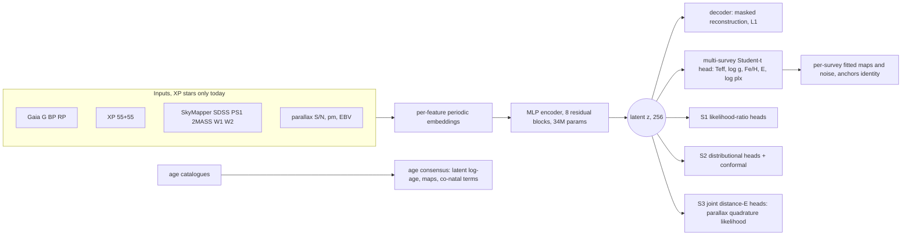
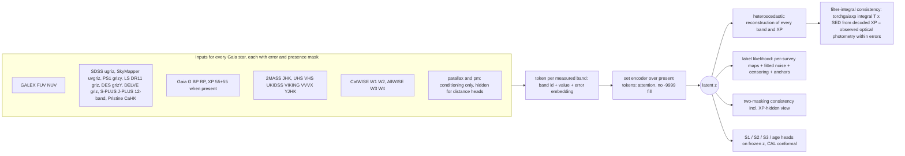

# MSA programme: stellar parameters for every Gaia star and beyond (2026-11-23)

Programme home. It ties four reference documents to the production plan:
- what has been tried: [`experiment-history.md`](experiment-history.md);
- what the models are: [`architecture.md`](architecture.md);
- what data they use: [`data.md`](data.md), [`datasets.yaml`](datasets.yaml);
- how results are judged: [`qa.md`](qa.md).

From now on, every result is produced on the full data sets defined here and judged by the QA suite in `qa.md`. No more conclusions drawn from small or less diverse subsets.

## 1. Goal and ground rules

- **Products.** Teff, log g, [Fe/H], later [α/Fe]; distance; E(B−V); age. Each comes with calibrated, non-Gaussian uncertainties.
- **Coverage.** Every Gaia star (DR3: 1,811,709,771 sources; DR4 from 2 Dec 2026), with or without XP. Later, objects beyond Gaia from Pensus.
- **Science drivers:** outer halo and metal-poor stars, distances, Milky Way structure and dark matter, cluster discovery, follow-up targeting.
- **Data-driven.** No stellar or Galactic model inside the inference.
- **No label is ground truth.** Every label source has a fitted map and fitted noise.
- **Products stay separate** (`design-20261122-data-driven-inference.md`):
  - A: measurement likelihoods;
  - B: predictive distributions;
  - C: population estimands (PPI, NPMLE).

## 2. Where things are

Output rule: every MSA output (tables, cross-matches, runs) is written under `/arc/projects/astroai/msa` (`vos:astroai/msa`); xmatcher's catalogue cache goes under `/arc/projects/astroai/hats` (candidates for promotion to community-ready HATS). `/arc/projects/hats` is read-only for us; it is reserved for the community to access HATS catalogues.

| What | Where | Size |
|---|---|---|
| Master label set (current, complete) | `/arc/projects/astroai/msa/runs/master_spectroscopic_labels_20261113_v1/` (`stars.parquet`, `records/`, `manifest.json`, `catalogues.json`) | 44,576,092 records; 19,255,342 stars (19,205,652 with Gaia DR3 id); 43 surveys/pipelines |
| Labels outside the master | E(B−V): `runs/reddening_labels_20261118_v6/`; anchors: `/arc/projects/k-pop/catalogues/`; ages: `analysis/age_labels_20261122/`, age consensus `docs/age-c0*` | see `data.md` §1.3 |
| Gaia DR3, all sources | `/arc/projects/hats/gaia/dr3` (HATS, 152 cols); also `/arc/projects/k-pop/gaia/GaiaSource/` (3,386 HDF5) | 1,811,709,771 |
| Gaia DR3 XP continuous | `/arc/projects/hats/gaia/dr3_xp_continuous` | 219,197,643 |
| Gaia-keyed survey matches (all Gaia) | `/arc/projects/k-pop/catalogues/adql_matches/`: 2MASS, PS1, SDSS, CatWISE (SkyMapper via its DR4 master) | 469M / 951M / 120M / 679M |
| Survey mirrors for the full-wavelength match | `/arc/projects/hats/`: GALEX, SkyMapper DR4, SDSS, PS1, Legacy Surveys DR11, DES, DELVE, 2MASS, UHS, VHS, UKIDSS, VIKING, VVVX, CatWISE, AllWISE, S-PLUS, J-PLUS, Pristine | `data.md` §2.4 |
| Current training table (to be retired) | `runs/multisurvey_table_20261117_v5/` | 5,872,237 labelled XP stars (8M cap; 2.13M no-XP stars dropped) |

## 3. Data sets (`msa-split-v1`, `data.md` §3)

Every Gaia object is assigned to one partition by a salted hash of its `source_id`. Assignment is stable across DR3, DR4 and Pensus, and never depends on a table's row order.
- Open clusters (Hunt & Reffert) and wide binaries (El-Badry 2021) are hashed by a group key, so a group is never split.
- Reserved objects are never fitted, used for selection or used for calibration.

| Set | Rule | Used for | Labelled target size |
|---|---|---|--:|
| FIT | hash < 0.75 | training of every trained component (labels: label losses; all objects: reconstruction) | ≈ 14.4M |
| DEV | 0.75–0.80 | early stopping, model and family selection | ≈ 0.96M |
| CAL | 0.80–0.88 | conformal and recalibration only (never selection) | ≈ 1.54M |
| TEST | 0.88–1.00 | final numbers; never used for a decision | ≈ 2.30M |
| REC | FIT ∩ all Gaia (1.36B) | unlabelled masked reconstruction and pretraining | — |
| PRED | all Gaia (later Pensus) | the catalogue | 1.81B |
| QA-reserved | Gaia benchmarks, GC members (VB21), age-benchmark clusters, Kepler LEGACY, WD+MS pairs | validation only | — |

- **Input class** of each row: X (XP + photometry), P (photometry without XP), G (Gaia G/BP/RP only).
- **Labelled stars without XP** are P rows in every set. They are no longer dropped.

Today's splits break these rules, and the docs record each break:
- the v5 split is a seeded row shuffle;
- the valid split serves both selection and calibration;
- 107,026 consistency-set stars have their labels in training;
- the July encoder saw the inputs of every XP star.

## 4. Architecture (`architecture.md`)

### 4.1 Today (v10 chain)

### 4.2 Target for the full-Gaia run (v11)

Why the target departs from today's encoder:
- **Missing data.** With full wavelength coverage, which bands are present varies by star. The flattened MLP with −9999 fill tokens cannot represent missingness honestly. A token encoder over present measurements can, and it lets bands be added later (Pensus, DR4) without re-pretraining from scratch.
- **Measurement errors.** Today's pretraining does not use them at all; the target makes them inputs and gives reconstruction a heteroscedastic likelihood.
- **Photometry-only stars.** XP-absent rows are part of training from the start, as P/G classes plus whole-XP dropout. Last night's S3 v2 run showed that mixing XP-hidden rows is what makes photometry-only predictions calibrated: photometry-only distance error 1.37 → 0.58 mag.
- **Filter integrals.** The filter-integral term ties the XP-decoded SED to every optical survey through its passband: torchgaiaxp 0.3.0 provides a differentiable `integrate` with the exact XP covariance. It applies only to bands fully inside 336–1020 nm, and each survey gets a fitted zero point and colour term, never truth. It is also the SED factor of the factorised likelihood L_XP × L_SED × L_parallax.

### 4.3 Losses (formulas in `architecture.md` §§3–9)

| Stage | Loss | Data set |
|---|---|---|
| Pretraining | Σ over masked present entries of Student-t NLL((x − x̂)/σ_eff), σ_eff² = σ_meas² + σ_model² (fitted per band); band dropout + whole-XP dropout; + λ_FI × filter-integral NLL | REC (all classes) |
| Fine-tune | 0.8 × label NLL (Student-t, per-survey maps and fitted noise, identity anchors, censored floors) + 0.2 × reconstruction (labelled) + 0.2 × reconstruction (unlabelled REC) + λ_c × two-masking consistency (incl. XP-hidden); map penalties | FIT (labels), REC; DEV for stopping |
| S1 | contrastive likelihood-ratio (8 negatives), 5-member ensemble, parallax arm | FIT labels on frozen z |
| S2 | errors-in-variables NLL (flow / Student-t mixture), conformal on CAL | FIT, CAL |
| S3 | exact parallax-quadrature marginal likelihood with fitted κ_g, κ_E, outlier mixture, σ_zp, XP-hidden flag | all FIT objects with a parallax (no labels needed), E labels where present |
| Ages | consensus likelihood (records → latent log-age, fitted maps and noise, shared effects, co-natal terms); then an age head on z | age catalogues; FIT |

## 5. Fixes required before the full-scale run

Found while writing these documents; each one changes results.
1. **Masking ratios are not applied.** The v10 config's fine-tune masking ratios (0.9 XP / 0.6 other) sit under `training:`, but the code reads `finetuning:`, so every v10 run used 0.3 / 0.3. *Fixed 2026-11-24* (`training/finetune_settings.py`: both locations accepted, a disagreement stops the run, effective values logged; the encoder weight decay now applies too, and the keys the fine-tune never reads are printed).
2. **Wrong 2MASS stars.** 2MASS J/H/Ks in the Andrae input file belong to other stars (Ks–G correlation 0.016), yet they are encoder inputs and targets everywhere. *2026-11-24:* the "Gaia-keyed" `adql_matches/twomass.fits` is the source of the error (its join used `clean_tmass_psc_xsc_oid` as `tmass_oid`), so it is refused; the correct designation join (`data/twomass_gaia.py`, Gaia archive) gives Ks–G correlation 0.95; table builders mask 2MASS by default until the full-wavelength master supersedes it.
3. **Measurement errors are unused in pretraining;** they are not even loaded. *2026-11-24:* loaded by default (`training.load_errors`); losses unchanged.
4. **Scaler and parallax.** The input scaler is refitted between pretraining and fine-tune, and parallax changes from raw mas to S/N clipped at 10. A single input contract is needed.
5. **Splits** are replaced by `msa-split-v1`: frozen, with the assignment file and override list on ARC.
6. **QA plumbing.**
   - The single evaluator (`scripts/evaluate_model.py`, promised on 20 Nov) does not exist. *Done 2026-11-24*; first report on v10: `docs/qa-v10-20261124/`.
   - Several QA scripts live only on ARC; they move into the repo with tests. *Done* (`src/masked_stellar_autoencoder/qa/`).
   - GBS v3 ids were rounded through float64 (109 of 192 wrong or missing): exact ids in `/arc/projects/astroai/msa/catalogues/gaia_fgk_benchmarks_v3_dr3ids.parquet`; the loader refuses rounded ids.
   - Every run before 13 Nov is gone, so old numbers must be recomputed before any comparison.
7. **Master documentation** still names v3 and the old counts, and `catalogues.json` points at deleted paths.
8. **The 8M row cap** and the other caps (5M unlabelled, 4.7M S3, 2M S2, 1M forward model) are removed.

## 6. Production plan (full Gaia, full wavelength)

| Step | What | Output | Depends on |
|---|---|---|---|
| P0 | Freeze `msa-split-v1` for all 1.81B DR3 sources + group and override lists | `runs/msa_split_v1/` | — |
| P1 | **Gaia-anchored full-wavelength master**: xmatcher `ray-anchor` with `hats/gaia/dr3` as anchor and every community tree in §2 read in place (runbook `docs/gaia-master-data.md`; pilot verified 2026-11-24, full run proposed: 3–5 h on 16 cores, ≈ 0.45 TB) | `/arc/projects/astroai/msa/xmatcher/gaia_master.hats` (never under `/arc/projects/hats`) | disk check |
| P2 | Input contract v2: band list UV→MIR, errors, presence masks, epochs and quality flags per survey; XP joined from `dr3_xp_continuous`; SFD E(B−V); parallax/pm as conditioning | `docs/programme/input-contract.md`, builder | P1 |
| P3 | Training tables: REC (all FIT objects, streamed from HATS, no row cap); labelled FIT/DEV/CAL/TEST from all 19.2M master stars, X/P/G classes | `runs/msa_tables_v2/` | P0, P2 |
| P4 | Encoder v11 (token set encoder, heteroscedastic reconstruction, XP dropout, filter-integral term) pretrained on REC | checkpoint | P3 |
| P5 | Fine-tune v11 on FIT labels + REC (fixes of §5) | checkpoint | P4 |
| P6 | Heads on frozen z: S1, S2, S3 (on all FIT parallaxes), age head; CAL conformal | heads | P5 |
| P7 | Full QA suite (`qa.md` §5) through one evaluator, per stratum and input class, plus competitor comparisons | QA report | P6 |
| P8 | PRED: catalogue for all 1.81B DR3 stars; repeat at DR4 (re-anchor; keys carry over) and at Pensus | catalogue | P7 |

**Before DR4 (2 Dec).**
- P0 and P1 start now. P1 is the long pole.
- In parallel, P4 is prototyped on the bands already Gaia-keyed (G/BP/RP, XP, 2MASS fixed, PS1, SDSS, CatWISE, SkyMapper) over all 1.81B stars, using `data.md` §2.7 v1a. That validates the encoder, the losses and the QA at full scale while P1 runs.
- At DR4 the anchor switches to DR4 `gaia_source` + XP.

**Compute.**
- Encoding runs at ≈ 17,600 stars/s on one GPU slice: 1.81B stars ≈ 29 slice-hours.
- S3 prediction runs at ≈ 2,000 stars/s per slice (Gaussian mixture), so a slim production output and 20–50 parallel slices are needed.
- Pretraining on REC is budgeted in presentations, not epochs.

## 7. QA gates (`qa.md` §5)

Every product is judged per stratum: G, colour, [Fe/H], evolutionary stage, sky and extinction, input class X/P/G, and RUWE. Checks:
- open and globular clusters;
- wide binaries;
- physical references: IRFM, seismic log g, GBS (validation-only);
- the frozen metal-poor core;
- coverage within Wilson bands (±0.03);
- competitor comparisons: Andrae 2023, Zhang/Green/Rix 2023, SHBoost, Survey of Surveys DR3, Bailer-Jones, StarHorse, Bayestar/SFD.

Acceptance criteria are pre-registered in `qa.md`.

Status today: no product passes its own acceptance rule.
- S1 fails only seismic log g.
- S2 fails metal-poor coverage.
- S3 fails E(B−V) coverage.
- v10 open clusters read giants 0.34 dex more metal-rich than dwarfs, and cool wide-binary companions read 0.26–0.32 dex too metal-poor.
