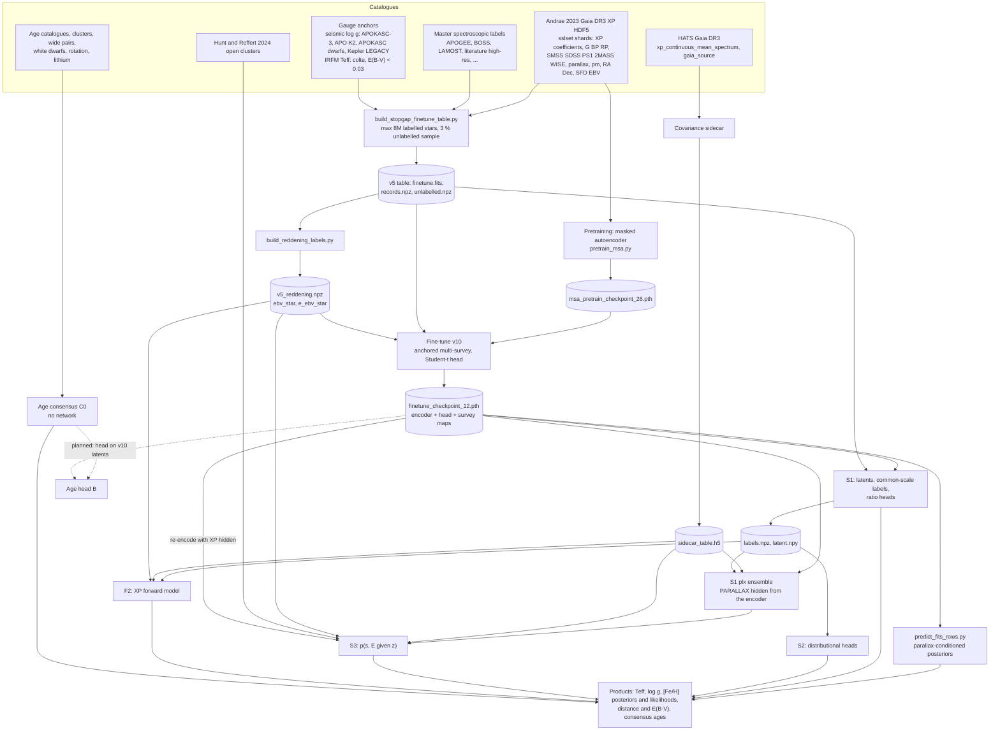
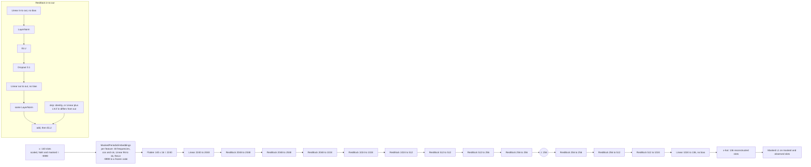
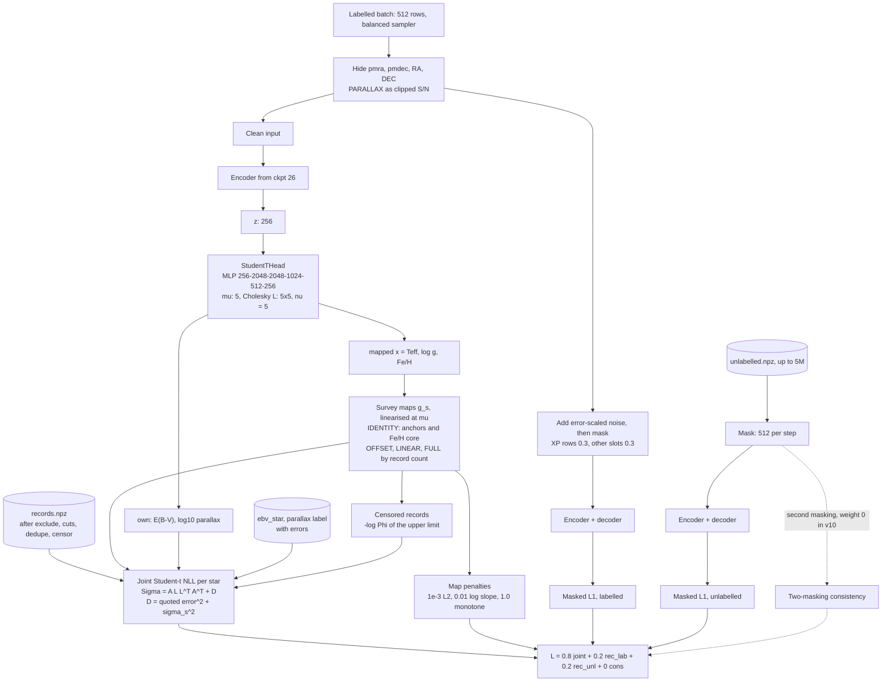
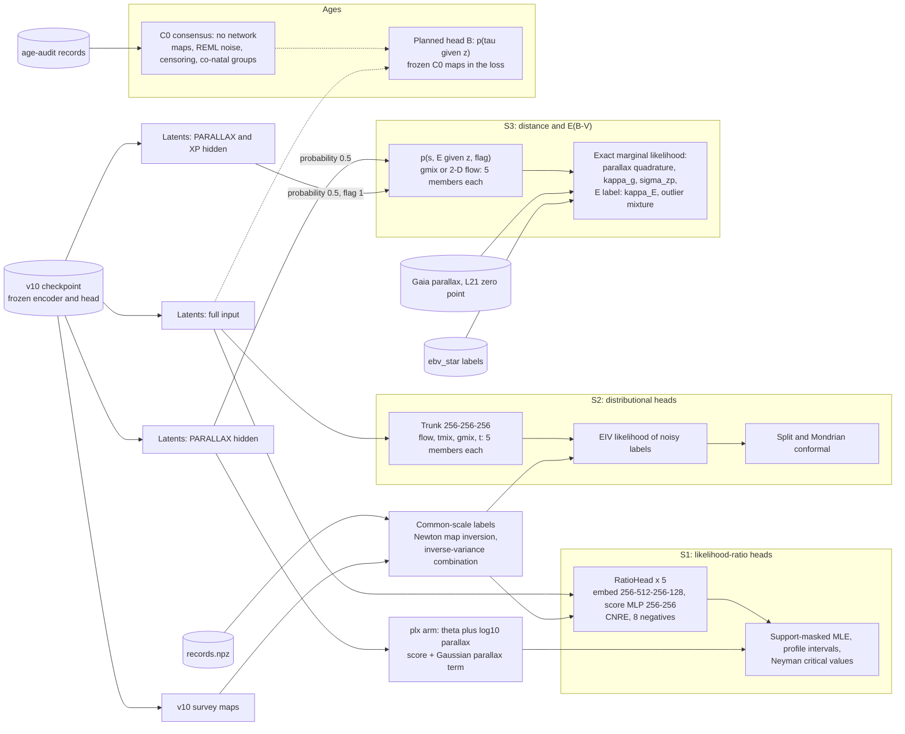
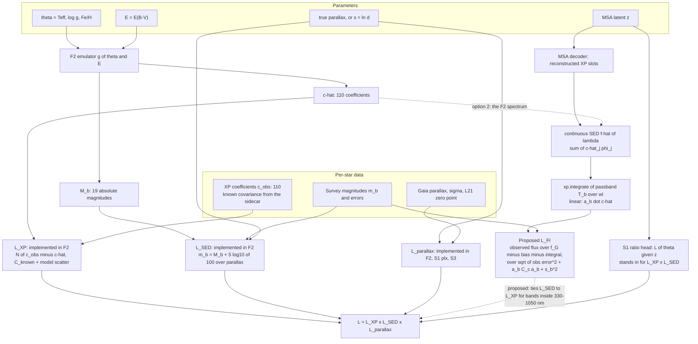

# MSA stellar-parameter programme: architecture reference

As of 2026-11-23, branch `wip/intelligent-babbage-778ino`, commit `21af14b`.

This page is written from the code and configs, not from earlier notes. Each
statement points to the file that implements it. Where a design note or an older
doc disagrees with the code, the code wins and the gap is flagged (section 13).
"Production chain" means the steps in `STEPS` of
`scripts/launch_master_label_training_chain.py` that lead to the v10 checkpoint and
the S1/S2/S3 heads, plus the age consensus (`scripts/age_consensus_c0.py`).

Contents

1. [Chain overview and data flow](#1-chain-overview-and-data-flow)
2. [Inputs, preprocessing and masking](#2-inputs-preprocessing-and-masking)
3. [Masked autoencoder (pretraining)](#3-masked-autoencoder-pretraining)
4. [Multi-survey anchored fine-tune (v10)](#4-multi-survey-anchored-fine-tune-v10)
5. [Frozen latents](#5-frozen-latents)
6. [S1: likelihood-ratio heads](#6-s1-likelihood-ratio-heads)
7. [S2: distributional heads](#7-s2-distributional-heads)
8. [F2: XP forward model](#8-f2-xp-forward-model)
9. [S3: distance and E(B-V) heads](#9-s3-distance-and-ebv-heads)
10. [Age consensus (C0) and the planned age head](#10-age-consensus-c0-and-the-planned-age-head)
11. [Factorised likelihood and a proposed filter-integral term](#11-factorised-likelihood-and-a-proposed-filter-integral-term)
12. [Parameter counts](#12-parameter-counts)
13. [Known limitations visible in the code](#13-known-limitations-visible-in-the-code)
14. [Code index](#14-code-index)

Conventions

- **Scaled feature units.** Inputs go through a `RobustScaler`: (x - median) / IQR.
  Feature errors are divided by the same IQR.
- **Scaled label units.** Each label has its own `StandardScaler` (`finetune_data.py`,
  `label_scaler: standard` by default). Every head and map in section 4 works in these
  units.
- **Missing values.** NaN becomes the token `-9999`. The encoder gives that token a
  fixed embedding (section 3.1). "Hidden" or "dropped" inputs are set to NaN, so they
  reach the encoder as the same token.
- **Splits.** `finetune_data.split_row_positions` calls `train_test_split` twice with
  `random_state=42`: 80 % train, 13.4 % valid, 6.6 % test (split codes 0/1/2). The
  downstream stages reuse these codes.

---

## 1. Chain overview and data flow

| Stage | Code | Config / launcher step | Trains on | Main outputs |
|---|---|---|---|---|
| Pretraining (MAE) | `training/pretrain_msa.py`, `models/model.py`, `models/blocks.py` | `configs/pretrain.canfar.yaml` | Andrae 2023 Gaia DR3 XP set, `sslset-realmags-full-052725.h5`: every shard except 5 validation shards | `msa_pretrain_checkpoint_26.pth` (epoch 26 of a 100-epoch target) |
| Fine-tune table | `scripts/build_stopgap_finetune_table.py`, `training/stopgap_labels.py`, `training/irfm_teff.py` | step `ms-table-v5` | Master spectroscopic labels `master_spectroscopic_labels_20261113_v1`, seismic anchors, IRFM Teff, raw XP HDF5 | `multisurvey_table_20261117_v5/{finetune.fits, records.npz, unlabelled.npz}` |
| Reddening labels | `scripts/build_reddening_labels.py`, `training/reddening_labels.py` | step `ms-reddening-v6` | v5 table labels and BP-RP | `reddening_labels_20261118_v6/v5_reddening.npz` (`ebv_star`, `e_ebv_star`) |
| Multi-survey fine-tune v10 | `training/finetune_msa.py`, `training/anchored_multisurvey.py`, `training/anchored_survey_map.py`, `training/multisurvey_finetune.py` | `configs/finetune-multisurvey-20261121-v10.yaml`, step `ms-multi-v10` | v5 table, its survey records, up to 5M unlabelled stars, reddening labels | `multisurvey_finetune_20261121_v10/finetune_checkpoint_12.pth` |
| Posterior predictions | `scripts/predict_fits_rows.py`, `training/anchored_predict.py` | inside `ms-multi-v10` | (inference) | `multi_v10_{test,core}.npz`, `consistency_v10.npz` |
| Covariance sidecar | `scripts/build_covariance_sidecar.py`, `data/covariance_sidecar.py` | step `covariance-sidecar` | HATS Gaia DR3 `xp_continuous_mean_spectrum`, `gaia_source` | per-row XP covariances, astrometric covariances, L21 parallax zero point |
| S1 likelihood heads | `scripts/s1_likelihood_head.py`, `training/likelihood_head.py`, `training/common_scale_labels.py`, `training/frozen_latents.py` | steps `ms-s1-v10`, `ms-s1-v10-plx-ens`, `ms-s1-v10-ens` | frozen v10 latents of every v5 table row; common-scale labels from the v10 maps | `latent.npy`, `labels.npz`, ratio heads, MLE and interval tables |
| S2 distributional heads | `scripts/s2_distributional_heads.py`, `training/distributional_heads.py` | step `ms-s2-distributional-heads` | S1 v10 latents and labels, up to 2M split-0 rows | flow / Student-t mixture / Gaussian mixture / t ensembles, conformal thresholds |
| F2 XP forward model | `scripts/run_xp_forward_model.py`, `training/xp_forward_model.py` | steps `ms-xp-forward-model`, `-diagnose`, `-infer`, `-scan` | v5 table XP + photometry + parallax, S1 v10 labels, reddening labels, sidecar; up to 1M stars | emulator `model.pt`, per-star MLE and profile intervals |
| S3 distance and E(B-V) | `scripts/s3_distance_extinction.py`, `training/distance_extinction.py` | steps `ms-s3-distance-extinction`, `ms-s3v2-*`, `ms-s3v21-*` | S1 plx-ensemble latents (PARALLAX hidden), XP-hidden latents, Gaia parallaxes, reddening labels; up to 4.7M train rows | `p(s, E \| z)` ensembles (gmix, flow), predictions, QA |
| Age consensus C0 | `scripts/age_consensus_c0.py`, `training/age_consensus.py` | run by hand (`docs/age-c0*`) | age-audit records (catalogue ages, clusters, wide pairs, white dwarfs, rotation, lithium) | per-star latent log age, maps, noise models |

### (a) End-to-end data flow

The master-label "six NSF" branch at the top of the same launcher (`features`,
`source`, `fullinputs`, `train` with `run_expanded_six_training.py`) is a separate
trainer and is not covered here.

---

## 2. Inputs, preprocessing and masking

### 2.1 Feature set (140 encoder slots, 136 reconstructed)

From `data.feature_cols`, `data.error_cols` and `data.recon_cols` (identical in
`pretrain.canfar.yaml` and the v10 config).

| Group | Columns | Error column | Reconstructed | In v10 encoder |
|---|---|---|---|---|
| WISE | `W1`, `W2` | none | yes | yes |
| Gaia photometry | `G`, `BP`, `RP` | none | yes | yes |
| Gaia XP | `bp_1..bp_55`, `rp_1..rp_55` (G-normalised, table units) | `bpe_*`, `rpe_*` | yes | yes |
| SkyMapper | `U_SMSS`, `V_SMSS`, `G_SMSS`, `R_SMSS`, `I_SMSS`, `Z_SMSS` | `E_*_SMSS` | yes | yes |
| SDSS | `U_SDSS`, `G_SDSS`, `R_SDSS`, `I_SDSS`, `Z_SDSS` | `E_*_SDSS` | yes | yes |
| Pan-STARRS1 | `G_PS1`, `R_PS1`, `I_PS1`, `Z_PS1`, `Y_PS1` | `E_*_PS1` | yes | yes |
| 2MASS | `J`, `H`, `KS` | `E_J`, `E_H`, `E_KS` | yes | yes |
| Astrometry | `PARALLAX` | `e_parallax` | yes | yes (as clipped S/N, 2.3) |
| Dust map | `EBV` (SFD) | none | yes | yes |
| Kinematics | `pmra`, `pmdec` | `e_pmra`, `e_pmdec` | no | no (dropped) |
| Position | `RA`, `DEC` | none | no | no (dropped) |

`diff = len(feature_cols) - len(recon_cols) = 4`, so the last four slots are inputs
only. v10 sets `multisurvey.drop_input_features: [pmra, pmdec, RA, DEC]`. These slots
are set to NaN for the labelled rows (`AnchoredMultiSurveyWrapper._compute_finetune_batch_loss`),
for the unlabelled pool (`finetune_msa._multisurvey_setup`) and at inference
(`anchored_predict.encoder_input`). The v10 encoder therefore never sees sky position
or proper motion.

### 2.2 Scaling and the missing token

- **Pretraining** (`pretrain_msa.fit_pretrain_scaler`): a `RobustScaler` fitted on up
  to 1M seeded rows of the training shards. All-NaN columns get centre 0 and scale 1.
  `PARALLAX` stays in raw mas.
- **Fine-tuning** (`finetune_data._scale_features`): a new `RobustScaler` fitted on
  the fine-tune table's train split. The pretraining scaler is not reused (section 13).
  Missing feature errors are filled with the per-feature 90th percentile
  (`error_fill_values`). Non-positive errors get the train-split maximum. Errors of
  features without an error column are set to 1 (scaled).
- **Missing token.** `_apply_mask` and `encoder_input` turn NaN into `-9999`.
  `MaskedPeriodicEmbeddings` maps exactly `-9999` to a frozen periodic code (a buffer
  computed from the frequencies at initialisation), so the token stays stable while the
  frequencies learn.

### 2.3 Parallax input policy

`preprocessing.astrometry_input_policy: snr_clipped` (v10,
`astrometry_features.apply_parallax_input_policy`). The `PARALLAX` slot becomes
`clip(parallax / max(sigma, 1e-6), -10, 10)` and its error is set to 1. The encoder
gets parallax significance, capped at 10, not the value. The parallax *label* is
`log10(parallax / mas)` for parallax > 0 (`parallax_target_space: log10_mas`, floor
1e-4 mas), with error `sigma / (parallax ln 10)`.

### 2.4 Masking and input noise

`TabResnetWrapper._apply_mask` (`models/model.py`):

- **XP block, by row.** A random fraction `xp_masking_ratio` of the batch rows has
  all 110 XP slots masked.
- **Every other slot, element-wise.** Masked with probability `m_masking_ratio`. This
  covers columns 0-4 and 115-139, so photometry, PARALLAX, EBV, pm and RA/Dec.
- **Original NaNs** become the token too. The reconstruction mask is
  `masked AND originally observed`, over the 136 reconstructed slots.

| | `xp_masking_ratio` | `m_masking_ratio` | Error-scaled noise |
|---|---|---|---|
| Pretraining (`pretrain.canfar.yaml`) | 0.5 | 0.2 | off (`pert_features: false`) |
| Fine-tune v10 (as run) | 0.3 | 0.3 | on: `x + N(0, (sigma_x * pert_scale)^2)`, `pert_scale 1.0` |

The v10 file sets `training.xp_masking_ratio: 0.9` and `m_masking_ratio: 0.6`.
`finetune_msa._finetune_one_seed` ignores them: it reads
`finetuning.xp_masking_ratio` / `m_masking_ratio`, which v10 does not set, so the
defaults 0.3 / 0.3 apply. The noise multiplier is 0 for slots without an error
column (`_error_available_np`): W1, W2, G, BP, RP, EBV, RA, DEC. In v10 masking and
noise reach only the reconstruction branch (`label_input: clean`, section 4).

---

## 3. Masked autoencoder (pretraining)

### 3.1 Architecture

`make_model(..., encoder_type="resnet")` builds `TabResnet` (`models/blocks.py`) with
`layer_dims [2048, 2048, 1024, 1024, 512, 512, 256, 256]`, `decoder_dims [256, 512, 1024]`,
`rtdl_embed 16`, ELU, LayerNorm. The latent size is `layer_dims[-1] = 256`.

- **Tokenisation.** Each of the 140 scalars is its own token.
  `MaskedPeriodicEmbeddings` (from `rtdl_num_embeddings.PeriodicEmbeddings`,
  `lite=False`) gives 48 learned frequencies per feature, then `[cos, sin]` (96), then
  a per-feature linear 96 -> 16 and a ReLU.
- **No attention, no pooling, no positional encoding.** A feature's identity is its
  slot: its own frequencies and linear map, and its place in the flattened vector.
- **Trunk.** Flatten to 140 x 16 = 2240, then `Linear(2240, 2048)`, then 8 residual
  blocks.
- **ResBlock(in, out).** `Linear(in,out,bias=False)`, LN, ELU, Dropout(0.1),
  `Linear(out,out,bias=False)`, then the *same* LN module again. The skip path is
  `Linear+LN` when `in != out`. Add, then ELU.
- **Latent.** `z` is the 256-d output of the last block (post-ELU, so each component is
  greater than -1). `cosine_latent: false`.
- **Decoder.** ResBlocks 256 -> 256 -> 512 -> 1024, then `Linear(1024, 136, bias=False)`.
  The output covers the reconstructed slots only.

Parameter counts (instantiated with the config dims): encoder 31,243,520 (periodic
embedding 224,000; input linear 4,589,568; ResBlocks 26,429,952); decoder 2,759,168;
reconstruction layer 139,264; **total 34,141,952**.

### 3.2 Pretraining loss

`loss_fn: mae` (`EncoderDecoderLoss(lf="mae")`, `_pretrain_reconstruction_loss`), with
`m_ij = masked_ij AND observed_ij` over the 136 reconstructed slots j:

$$
\mathcal{L}_\mathrm{MAE} = \frac{\sum_{i,j} m_{ij}\,\lvert \hat x_{ij} - x_{ij}\rvert}{\sum_{i,j} m_{ij}} \;+\; \lambda_\mathrm{lasso}\sum_i \lVert z_i\rVert_1 ,\qquad \lambda_\mathrm{lasso}=0 .
$$

- **Batch normalisation.** The denominator is the count of masked entries over the
  whole optimiser batch (`global_mask_count`), so micro-batch accumulation gives the
  same gradient as one batch.
- **Measurement errors are not in this loss.** `wmae` / `wmse` (weights
  `1/(sigma^2 + 1e-8)`) and `gnll` (heteroscedastic decoder) exist but are not used.
  `_pretrain_io_error_cols` does not even load the error columns when the loss is
  unweighted and noise is off.
- **Huber** does not appear in the production chain. It is used only in experiment
  modules (e.g. `xp_photometry.py`, `prediction_mechanisms.py`).

### 3.3 Data, optimiser, schedule

| Item | Value (`pretrain.canfar.yaml`, `TabResnetWrapper`) |
|---|---|
| Data | `$MSA_PRETRAIN_DATA` = `/arc/projects/k-pop/catalogues/andrae2023/sslset-realmags-full-052725.h5`. Training shards: every key except the validation keys `sslset{11,14,2,5,20}_part0`. The config notes that the 140 float32 inputs of all training rows fit in about 117 GB, i.e. about 2 x 10^8 rows. |
| Optimiser | AdamW, lr 1e-5. Weight decay 1e-5 on weights, 0 on biases and norms. |
| Schedule | `CosineAnnealingWarmRestarts(T_0=10, T_mult=2, eta_min=1e-7)`, stepped per epoch. Restarts at epochs 10, 30 and 70. Epoch 26 falls in the second cycle. |
| Batch | 32,768 rows per step, accumulated in 16,384-row micro-batches. Gradient clip 1.0. |
| I/O | `ProjectedHDF5Store`: a local cache of the projected columns, using at most 80 % of free scratch and at most 150 GB. Cached blocks are shuffled each epoch, then rows within a 256 MiB buffer. |
| Checkpoint used | `/arc/projects/astroai/msa/pretrain/checkpoints/msa_pretrain_checkpoint_26.pth` (`model.saved_weights` in every v2-v10 fine-tune config) |

---

## 4. Multi-survey anchored fine-tune (v10)

`finetune_msa.main` sees `multisurvey.formulation: anchored` and builds
`AnchoredMultiSurveyWrapper` (`anchored_multisurvey.py`). The encoder and decoder
start from checkpoint 26 and are trained further, not frozen.

### 4.1 Labels and survey records

- **Head labels, P = 5, scaled.** `teff, logg, fe_h, ebv_star, parallax`
  (`data.classes` plus `parallax` from `finetune_data.prepare_finetune_arrays`).
  - **Mapped:** `teff, logg, fe_h`. They are observed through the survey records via
    per-survey maps.
  - **Own:** `ebv_star` (the empirical reddening label, from `data.extra_columns`) and
    `parallax` (log10 mas). Their table value enters with its quoted error plus a
    learned noise.
- **Records.** `records.npz` holds one row per (star, survey) with
  `value`/`error` for each parameter, `survey_is_anchor` and the survey names
  (`stopgap_labels.survey_records`). `AnchoredRecords` then:
  - drops `exclude_surveys` entirely (v10: `sdss_dr19_astra_thepayne`,
    `sdss_dr19_astra_apogeenet`, `sdss_dr19_astra_astronn`);
  - applies `record_cuts`: `sdss_dr20_astra_slam` keeps only records with
    Teff < 3800 K;
  - keeps, for each `spectra_groups` entry (pipelines on the same spectra: apogee,
    boss, lamost_lrs, literature), one value per (star, parameter): that of the first
    pipeline in the list that has it (`dedupe_spectra_groups`);
  - turns `censor` floors into upper limits. A record whose [Fe/H] is below
    -2.2 (LAMOST DR12 LRS/MRS, ASPCAP, APOGEE DR17), -1.7 (RAVE DR6) or the floors of
    the excluded pipelines becomes "[Fe/H] <= floor".
- **Anchors.** `anchor_apokasc3`, `anchor_apok2`, `anchor_apokasc_dwarfs` and
  `anchor_kepler_legacy` give seismic log g (`anchor_labels.py`); `anchor_irfm_colte`
  gives photometric IRFM Teff (`irfm_teff.py`, `--irfm-anchors`).
- **[Fe/H] core.** Surveys whose names start with a `fe_h_core` prefix: high-resolution
  catalogues, Gaia-ESO DR5, SAGA, PASTEL, JINAbase, R-Process Alliance, and others.

### 4.2 Student-t head

`StudentTHead` (`anchored_survey_map.py`) with `n_components=1` and
`full_covariance=True` (v10 defaults):

- **Trunk.** `z` (256) -> 2048 -> 2048 -> 1024 -> 512 -> 256, ReLU
  (`finetuning.active: relu`).
- **Outputs.**
  - location `mu` = `Linear(256, P)`;
  - diagonal scale = `softplus(Linear(256, P)) + 1e-3`;
  - strictly lower off-diagonal entries = `Linear(256, P(P-1)/2)`;
  - all assembled into the Cholesky factor `L`, with `S = L L^T`.
- **Distribution.** `x ~ t_nu(mu, S)` with `nu = 5` (`multisurvey.nu`).
- **Parameters.** 7,482,132 for P = 5.
- **Options off in v10.**
  - Mixture of K Student-t (`n_components > 1`, log-softmax weights, a weak prior
    `-mix_prior * mean(log w)`).
  - Head context: `ContextLatent`, `z' = z + g([v * vis, vis])` with `g` = Linear(2c, 64),
    GELU, Linear(64, 256), last layer zero-initialised. Its inputs come from
    `ContextInputs`: selected features and errors, own labels, Galactic-position random
    Fourier features (`SphereFourier`), and a dust branch with its own loss
    (`dust_weight`). v10 has no `multisurvey.context`.

### 4.3 Survey maps and gauge

Survey s reports the mapped parameters
`y_s = g_s(x) + noise`, with

$$
g_s(x) = x + b_s + L_s x + C_s\,\phi(x),\qquad
\phi:\mathbb{R}^3\to\mathbb{R}^8 = \tanh\circ\mathrm{Lin}\circ\mathrm{SiLU}\circ\mathrm{Lin}\circ\mathrm{SiLU}\circ\mathrm{Lin}\ (3\to64\to64\to8),
$$

`x` = (Teff, log g, [Fe/H]) in scaled units, `phi` shared by all surveys.

**Tiers** are set per (survey, parameter) by `assign_tiers` from the record counts:

| Tier | Coefficients | Assigned when |
|---|---|---|
| IDENTITY | none (`g_s(x) = x`) | anchor surveys; [Fe/H] core with `fe_h_core_mode: identity` (v10); zero counts |
| OFFSET | `b` | fewer than 5,000 records (`linear_min`) |
| LINEAR | `b`, row of `L_s` (with cross terms) | 5,000 to 49,999 records |
| FULL | `b`, `L_s`, `C_s` | at least 50,000 records (`full_min`) |

- **Gauge.**
  - Teff scale: the IRFM anchor (identity).
  - log g scale: the seismic anchors (identity).
  - [Fe/H] scale: the high-resolution core. In v10 the core maps are identity
    (`core_mode="identity"`).
  - Before v10 (`core_mode="offset"`) the core got offsets that summed to zero,
    weighted by star counts (`AnchoredSurveyMaps.coefficients`).
- **Noise.** Each (survey, parameter) has a learned `sigma_s = exp(log_sigma)`
  (start 0.1, floor 1e-3). The two own labels share `own_log_sigma` (start
  log 0.05). Quoted errors add in quadrature.
- **Map size.** 39 parameters per survey (3 + 9 + 24 + 3); tier masks zero the
  unused ones. Plus 4,936 for the shared `phi`.

### 4.4 Joint per-star likelihood (labelled rows)

`AnchoredMultiSurveyWrapper._joint_loss`. For star i the head gives `(mu_i, L_i)`.
All of the star's observations are stacked in `z_i`: its two own labels, and for each
record r (survey s(r)) the three mapped values. The maps are linearised at `mu_i`:

$$
z_i = \begin{pmatrix} y^\mathrm{own}_i \\ y_{r_1} \\ \vdots\end{pmatrix},\quad
m_i = \begin{pmatrix} \mu^\mathrm{own}_i \\ g_{s(r_1)}(\mu^\mathrm{map}_i) \\ \vdots\end{pmatrix},\quad
A_i = \begin{pmatrix} E_\mathrm{own} \\ J_{s(r_1)}(\mu_i) \\ \vdots\end{pmatrix},\quad
\Sigma_i = A_i L_i L_i^\top A_i^\top + D_i ,
$$

$$
D_i = \mathrm{diag}\big(e^2_\mathrm{own} + \sigma^2_\mathrm{own},\; e_r^2 + \sigma_{s(r),p}^2,\ \dots\big),
$$

`J_s = I + L_s + C_s dphi/dx` (computed with `torch.func.jacrev`). Unobserved or
censored components get zero residual and unit variance, so they drop out exactly.
With `d_i` observed components and `q_i = r_i^T Sigma_i^{-1} r_i`, where
`r_i = z_i - m_i`:

$$
\mathrm{NLL}_i = -\log\Gamma\!\Big(\tfrac{\nu+d_i}{2}\Big) + \log\Gamma\!\Big(\tfrac{\nu}{2}\Big) + \tfrac{d_i}{2}\log(\nu\pi) + \tfrac12\log\lvert\Sigma_i\rvert + \tfrac{\nu+d_i}{2}\log\!\Big(1+\tfrac{q_i}{\nu}\Big) \quad(\nu=5).
$$

Records of one star are conditionally independent given the star, so overlaps
between surveys identify each `sigma_s`.

**Censored records** (an upper limit `u` at a survey floor) add the Gaussian
probability that the mapped value lies below `u`:

$$
\mathrm{NLL}^\mathrm{cens}_{r} = -\log\Phi\!\left(\frac{u - g_s(\mu)_p}{\sqrt{(J_s L)(J_s L)^\top_{pp} + \sigma_{s,p}^2 + e_r^2}}\right).
$$

The code uses the Gaussian CDF because torch has no Student-t CDF.

**Map penalties:**

- `R_map` = (‖b‖^2 + ‖L‖^2 + ‖C‖^2) / (number of active coefficients), an L2 pull
  towards the identity;
- `P_slope` = the mean over records of `(log diag J_s)^2`;
- `P_mono` = the mean of `max(0, 0.25 - diag J_s)^2`, a monotonicity shortfall.

The labelled-row term is

$$
\mathcal{L}_\mathrm{joint} = \frac{1}{N_\mathrm{has}}\sum_{i:\,d_i>0\,\lor\,\mathrm{cens}} \big(\mathrm{NLL}_i + \textstyle\sum_r \mathrm{NLL}^\mathrm{cens}_r\big)
+ 10^{-3}\,R_\mathrm{map} + 0.01\,P_\mathrm{slope} + 1.0\,P_\mathrm{mono}.
$$

The weights are `map_reg_weight`, `slope_weight` and `monotone_weight` in v10.

### 4.5 Semi-supervised and auxiliary terms

- **Clean label branch** (`label_input: clean`). The head sees
  `encoder(encoder_input(X_in))`: the unmasked, noise-free input with the dropped slots
  hidden. A second pass runs masked, noisy input through the full autoencoder for
  reconstruction. Both passes share the encoder.
- **Labelled reconstruction** (`finetuning.multitask: true`). The same masked L1 as
  section 3.2 (`training.loss_fn: mae`), on the labelled batch.
- **Unlabelled reconstruction** (`multisurvey.unlabelled`).
  - Pool: `unlabelled.npz`, a 3 % random sample of raw-HDF5 stars outside the table,
    capped at 5M with seed 0.
  - Preprocessing: the same as the table (fine-tune scaler, parallax policy, dropped
    slots NaN).
  - Each step draws `n = round(ratio * batch) = 512` stars, masks them and
    reconstructs them (`MultiSurveyWrapper._unlabelled_loss`).
- **Two-masking consistency** (`consistency_weight`, **0 in v10**, so not computed).
  Two independent maskings of the same unlabelled stars go through the encoder and
  the head. `m^(1)` and `m^(2)` are the head medians of the first four labels, which
  for the anchored head are Teff, log g, [Fe/H] and **E(B-V)** (`SURVEY_LABELS = 4`):

  $$
  \mathcal{L}_\mathrm{cons} = \frac14\sum_{j=1}^{4}\frac{\tfrac1n\sum_i \lvert m^{(1)}_{ij}-m^{(2)}_{ij}\rvert}{\tfrac12\big(\mathrm{sd}_i\,m^{(1)}_{\cdot j}+\mathrm{sd}_i\,m^{(2)}_{\cdot j}\big)+10^{-6}} .
  $$

  The batch spread in the denominator removes the incentive to shrink the common
  scale, which the maps could otherwise absorb. That shrinkage was seen in v5.
- **Balanced sampling** (`balance: {power: 0.5, cap: 10}`). A `WeightedRandomSampler`
  draws training rows with weight `clip((max dens / dens)^0.5, 1, 10)`, where `dens` is
  the table [Fe/H] density in 0.1-dex bins on [-5, 1], smoothed over 0.2 dex. The head
  therefore learns under this sampling prior. The prior ratio is saved as
  `sampling_ratio`, and `predict_fits_rows --feh-prior` gives prior-free [Fe/H]
  quantiles.
- **Off in v10:** `reference_pool` (fixed references or wide-binary pairs, v8/v9),
  head context, dust branch.

### 4.6 Total fine-tune loss (v10 weights)

$$
\mathcal{L}_\mathrm{v10} = 0.8\,\mathcal{L}_\mathrm{joint} + 0.2\,\mathcal{L}^\mathrm{lab}_\mathrm{MAE} + 0.2\,\mathcal{L}^\mathrm{unl}_\mathrm{MAE} + 0\cdot\mathcal{L}_\mathrm{cons}.
$$

- 0.8 and 0.2 are `finetuning.lambda_pred` and `lambda_rec`.
- The unlabelled weight is `unlabelled.rec_weight = 0.2`, added outside the 0.8 / 0.2
  split.
- The map penalties sit inside `L_joint`, so they are also scaled by 0.8.

### 4.7 Data, optimiser, schedule, epoch choice

| Item | Value |
|---|---|
| Labelled data | `multisurvey_table_20261117_v5/finetune.fits`: up to 8M stars. It keeps every high-res, APOGEE, GALAH and metal-poor star and fills the rest at random. Its features are copied from the raw pretraining HDF5. The test stars of `multisurvey_table_20261113_v1` are left out. Splits 80 / 13.4 / 6.6 % (section conventions). |
| Unlabelled data | `unlabelled.npz`, at most 5M stars |
| Optimiser | AdamW with three groups. Autoencoder: lr 1e-5 (`training.lr`, because `encoder_lr: null`) with AdamW's default weight decay 0.01. Head: lr 1e-4, wd 0 (`l2: 0`). Survey maps: lr 1e-4, wd 0. |
| Schedule (per epoch) | Autoencoder `0.95^epoch`. Head and maps `0.5^(floor(epoch / 4))`. |
| Epochs, batch | 12 epochs, batch 512, gradient clip 1.0 over all parameters including the maps |
| Epoch choice | After every epoch, `anchor_metrics` on the valid split computes `score = sum_k (abs(bias_k) + NMAD_k) / unit_k`. The checks and units are: Teff anchors 50 K, log g anchors 0.05, [Fe/H] core 0.05, E(B-V) 0.02, [Fe/H] core below -2 at 0.1. The chain uses `finetune_checkpoint_12.pth`. |
| Checkpoint contents | autoencoder, head, survey maps with tiers, core and counts; feature and label scalers; label names; `nu`; dropped inputs; `error_fill`; `sampling_ratio` |

### 4.8 Inference and common-scale labels

- **Posterior head** (`anchored_predict`): location and scale per label, or exact
  mixture quantiles.
- **Parallax conditioning** (`predict_fits_rows --condition-parallax 5`,
  `condition_on_observation`). For stars with `parallax / sigma >= 5`, the joint t is
  conditioned on the measured `log10 parallax` (label index j, variance `var`):

  $$
  s_{jj}=S_{jj}+\mathrm{var},\quad \mu'=\mu+S_{:,j}\frac{z-\mu_j}{s_{jj}},\quad
  S'=\Big(S-\frac{S_{:,j}S_{j,:}}{s_{jj}}\Big)\frac{\nu+q}{\nu+1},\quad q=\frac{(z-\mu_j)^2}{s_{jj}},\quad \nu'=\nu+1 .
  $$

  The head was trained with parallax as an own label, so its covariance carries the
  parallax to log g / Teff coupling without a stellar model.
- **Common-scale labels** (`common_scale_labels.py`, S1 `labels` stage). Each
  uncensored record is inverted through its survey's map:
  - Newton solve of `g_s(x) = y_s`, starting from the posterior head (5 iterations);
  - variance `J^{-1} diag(e^2 + sigma_s^2) J^{-T}`;
  - records combined per parameter by inverse variance.

  `fe_h_core` is the frozen high-resolution reference (`CORE_PRIORITY`) mapped to the
  common scale. These labels train S1, S2, F2 and S3.

### (c) Fine-tune heads with per-survey maps

Earlier formulations: v1-v5 used `MultiSurveyWrapper` (`multisurvey_finetune.py`) with
a quantile head and pinball loss, monotone spline or conditional maps and a consensus
gauge. v6 introduced the anchored formulation. v8 and v9 added a reference pool, which
v10 removed.

---

## 5. Frozen latents

`frozen_latents.encode_table` processes the v5 table in 262,144-row chunks:

- **Preprocessing** is that of `predict_fits_rows`: checkpoint scaler, error fill,
  parallax policy, dropped slots.
- **Outputs.**
  - `latent.npy`: float16, (N, 256).
  - `predictions.npz`: posterior-head (Teff, log g, [Fe/H]) quantiles, conditioned on
    the parallax where `parallax / sigma >= 5`.
- **`hide`** sets extra slots to NaN for the latent only; the posterior comparator
  keeps the full input. Three latent sets feed the downstream heads:

| Latent set | Hidden slots | Produced by | Used by |
|---|---|---|---|
| full | (v10 drops only) | `ms-s1-v10` | S1 `all` / `core` arms, S2 |
| PARALLAX hidden | `PARALLAX` | `ms-s1-v10-plx-ens` (`--parallax-nuisance`) | S1 `plx` arm, S3 |
| XP hidden | `PARALLAX`, `bp_*`, `rp_*` | S3 `noxp` stage (re-encode with the v10 checkpoint) | S3 "beyond XP" and the `xp_mix` training |

The encoder is frozen from here on. No downstream stage changes the v10 weights.

---

## 6. S1: likelihood-ratio heads

`likelihood_head.py`, `scripts/s1_likelihood_head.py`.

**Purpose:** a population-free measurement `L(theta | z)`, product A in the design
note, for `theta = (Teff, log g, [Fe/H])`.

### Architecture (`RatioHead`)

- **Standardisation.** The latent is standardised with train-split mean and sd;
  `theta` is standardised.
- **Embedder.** `E(z)`: 256 -> 512 -> 256 -> 128, SiLU.
- **Score.** `s(theta, z) = score_net([theta_std, E(z)])`, with
  `torchregress.losses.build_ratio_classifier(P, 128, hidden=(256, 256), activation="silu")`.
  The embedding is computed once per star, so the search only evaluates the small MLP.
- **Size.** 395,649 parameters (P = 3), 395,905 (P = 4).

### Loss: CNRE

`torchregress.losses.NeuralRatioLoss(criterion="cnre")`, with `K = 8` negatives (the
labels of random training stars) and `gamma = 1`:

$$
q(y=k\mid\Theta,z)=\frac{(\gamma/K)\,e^{s(\theta_k,z)}}{1+(\gamma/K)\sum_{j=1}^K e^{s(\theta_j,z)}},\qquad
\mathcal{L}=-\tfrac{\gamma}{1+\gamma}\log q(y{=}1\mid\theta_+,\theta^-_{1:K-1},z)-\tfrac{1}{1+\gamma}\log q(y{=}0\mid\theta^-_{1:K},z).
$$

The optimum is `s = log p(z | theta) - log p(z)` for every K. The training population
therefore cancels, and `argmax_theta s` is the maximum-likelihood estimate.

### Arms and ensemble

| Arm | Training labels | Latent |
|---|---|---|
| `core` | rows with a high-resolution [Fe/H] reference plus Teff and log g | full |
| `all` | every row with complete mapped labels | full |
| `plx` | `theta' = (Teff, log g, [Fe/H], u = log10 parallax)`, trained on corrected `parallax / sigma >= 10` | PARALLAX hidden |

- **Ensemble** (`--ensemble 5`): the mean of the members' log-ratios.
- **`plx` score.** The arm's score adds the Gaussian parallax measurement term with the
  L21 zero point:

  $$
  \bar s(\theta,u,z) = \frac1K\sum_k s_k(\theta,u,z) - \frac12\Big(\frac{\varpi_\mathrm{obs}-\mathrm{zp}-10^{u}}{\sigma_\varpi}\Big)^2 .
  $$

  `u` is searched in a per-row window of ±8 sigma (`parallax_window`). The window keeps
  the curvature of a precise parallax from stalling the theta directions.

### Inference

- **Support.** `Support` is a dilated occupancy grid of the training labels, with cells
  of 100 K, 0.1 dex, 0.1 dex (and 0.1 in u). Outside it the score is NaN.
- **MLE.** `torchregress.inference.maximize_score`: multistart Newton from the posterior
  median or a candidate bank of 256 to 512.
- **Profile intervals.** `profile_interval` at `s_max - s = 0.5` (68 %) and 1.92 (95 %).
  The joint 3-parameter threshold is 1.7634.
- **Neyman sets.** `torchregress.inference.CriticalValueRegressor` learns critical
  values `C(theta, G)` on the valid split.
- **Report:** `likelihood_validation.py`.

### Training

AdamW (lr 1e-3, wd 1e-4), cosine annealing over at most 60 epochs, early stopping
with patience 6 on a fixed-negative validation loss, batch `min(4096, max(256, n/100))`,
gradient clip 5. The data are every v5 table row through the v10 latents, with labels
from the v10 maps (section 4.8).

---

## 7. S2: distributional heads

`distributional_heads.py`, `scripts/s2_distributional_heads.py`.

**Purpose:** a predictive `p(Teff, log g, [Fe/H] | z)` under the natural training
population (product B, intrinsic data only).

Each member is an MLP trunk (256 -> 256 -> 256, GELU) on the standardised latent,
followed by a torchregress density head on the standardised 3-D target.

| Head | Density | Per-member parameters |
|---|---|---|
| `flow` | conditional rational-quadratic spline flow (`create_flow_model("nsf")`): 3 transforms, hidden (128, 128), 16 bins, context 64 | 278,247 |
| `tmix` | mixture of 4 multivariate Student-t, full scale (precision Cholesky), learned df (start 5) | 141,865 |
| `gmix` | mixture of 4 full-covariance Gaussians (df = inf) | 141,864 |
| `t` | one multivariate Student-t | 134,155 |
| `flow_noeiv` | `flow` fitted to the noisy labels | 278,247 |

Each head is a 5-member ensemble whose density is the equal-weight mixture of the
members.

**Loss: errors in variables.** Members are fitted to the noisy common-scale label `y`
with its error `sigma`:

$$
\mathcal{L}_i = -\log\int p_\phi(\theta\mid z_i)\,\mathcal{N}\big(y_i\mid\theta,\mathrm{diag}\,\sigma_i^2\big)\,d\theta .
$$

- For mixtures the integral is closed form: each component's covariance plus
  `diag sigma^2` (`component_observation_log_prob`).
- For flows it is a Monte Carlo log-mean-exp over 8 draws (`NoiseAwareDensityLoss`).
- Label errors are floored at (10 K, 0.01, 0.01) and capped at (500 K, 0.5, 0.5).

**Training.**

- Data: at most 2M random split-0 rows, no balancing.
- Early stopping on half of split 1. The other half is the conformal calibration set.
- AdamW (lr 1e-3, wd 1e-4; df parameters lr 1e-2), `ReduceLROnPlateau(0.5, 1)`, batch
  4096, at most 30 epochs, patience 4, clip 5.

**Calibration.** Split-conformal level sets of `-log p` of the label predictive
(`ConformalizedDensity`): marginal, Mondrian by G, and Mondrian by G x predicted
[Fe/H].

---

## 8. F2: XP forward model

`xp_forward_model.py`, `scripts/run_xp_forward_model.py`. This is a data-driven
emulator of the observables. It does not use the MSA latent.

### Emulator

`g(theta, E) -> (c, M)`, with `theta = (Teff, log g, [Fe/H])` and `E = E(B-V)`:

$$
c(\theta,E) = h_0(\theta) + E\,h_1(\theta,E),\qquad
M_b(\theta,E) = \mu_b + \sigma_b\,h_{0,b}(\theta) + E\,\mathrm{softplus}\big(h_{1,b}(\theta,E)\big).
$$

- `c` holds the 110 XP coefficients normalised to G = 8.5 and divided by a
  per-coefficient scale.
- `M_b` are absolute magnitudes in 19 bands (`LIKELIHOOD_BANDS`): G, W1, W2, PS1 grizy,
  SDSS ugriz, SMSS uvgriz. 2MASS is excluded because it is mismatched in the tables.
- `h_0` and `h_1` are SiLU MLPs with 4 layers of width 512 (3 -> 239 and 4 -> 239
  outputs).
- Size: 1,713,357 parameters, of which 459 are scatter terms.

### Likelihood per star

$$
-\log L = \underbrace{\sum_{k\in\{BP,RP\}}\mathrm{NLL}\big(c^\mathrm{obs}_k-c_k \mid C^\mathrm{known}_k+\mathrm{diag}((a c_k)^2+b^2)+(c_kV)(c_kV)^\top\big)}_{L_\mathrm{XP}}
+\underbrace{\sum_b \tfrac12\Big[\tfrac{(m_b-M_b-\mu)^2}{\sigma_b^2+s_b^2}+\log(\sigma_b^2+s_b^2)\Big]}_{L_\mathrm{phot}}
+\underbrace{\tfrac12\tfrac{(\varpi_\mathrm{obs}-\mathrm{zp}-\varpi)^2}{\sigma_\varpi^2}}_{L_\varpi}
$$

- `mu = 5 log10(100 / parallax)`.
- `C_known` is the Gaia per-star XP covariance from the sidecar.
- `a`, `b` and a rank-2 factor `V` are learned (`torchregress.losses.KnownCovarianceGaussianNLL`)
  and evaluated at the prediction, not at the observation.
- `s_b` is a learned per-band scatter.
- Missing dimensions drop out.

### Training and inference

- **E gauge.** With `ebv_mode: label`, the reddening label fixes `E` for every labelled
  training star.
- **Per-star nuisances.** `(E, mu)` get 3 projected Gauss-Newton steps per batch
  (`fit_nuisances`).
- **Optimiser.** AdamW: lr 1e-3 for the networks, 3e-3 for the scatter terms; wd 1e-5;
  cosine schedule; 20 epochs; batch 2048; clip 10.
- **Data.** At most 1M training stars and 50k held-out stars.
- **Inference.** `maximize_score` over `(Teff, log g, [Fe/H], u_E, u_p)` from a
  candidate bank, then Wilks profile intervals.
- **Status (launcher comments).** Run 2 inference gave MLE chi^2/dof of 2-5. Ranking
  the starts under the learned covariance raised the Teff correlation with the labels
  to 0.81. A likelihood scan step exists (`ms-xp-forward-scan`).

---

## 9. S3: distance and E(B-V) heads

`distance_extinction.py`, `scripts/s3_distance_extinction.py`.

**Purpose:** a joint predictive `p(s, E | z)` with `s = ln(d / kpc)` and
`E = E(B-V)`, trained on Gaia parallaxes through their measurement likelihood. There
is no parallax cut and no inversion, and negative parallaxes stay in.

**Input.** The latent with PARALLAX hidden, so the target cannot leak through the
input. With `--xp-mix 0.5` (S3 v2 and v2.1), each training row uses its XP-hidden
latent with probability 0.5, and a 0/1 flag is appended to the input
(`Member.inputs`, `in_dim = 257`).

| Family | Density | Per-member parameters (with flag and all noise terms) |
|---|---|---|
| `gmix` | trunk 257 -> 256 -> 256 -> mixture of 4 full-covariance 2-D Gaussians in `(s, e)`, `e = (E - e_loc) / e_scale` | 138,023 |
| `flow` | trunk -> context 64; `p(s \| c) p(e \| s, c)` from two 1-D NSF flows (3 transforms, hidden 128, 128, 16 bins) | 334,057 |

Each family is a 5-member ensemble.

### Loss: exact marginal likelihood

$$
L_i=\iint p(s,E\mid z_i)\,\mathcal{N}\big(\varpi_i-\mathrm{zp}_i\mid e^{-s},\sigma^2_{\mathrm{eff},i}\big)\Big[(1-\varepsilon)\,\mathcal{N}\big(E^\mathrm{obs}_i\mid E,(\kappa_{E,g}e_i)^2\big)+\varepsilon\,\mathcal{N}\big(E^\mathrm{obs}_i\mid E,(\lambda e_i)^2\big)\Big]\,ds\,dE,
$$

$$
\sigma^2_{\mathrm{eff},i}=(\kappa_{g}\,\sigma_{\varpi,i})^2+\sigma^2_\mathrm{zp},\qquad \mathcal{L}=\frac{1}{N}\sum_{i:\ \varpi\ \mathrm{or}\ E^\mathrm{obs}}-\log L_i .
$$

The fitted nuisance parameters are scalars shared by all stars:

| Parameter | Form | Start | Bins |
|---|---|---|---|
| `kappa_g` (parallax error scale) | 0.3 + softplus | 1 | 6 G bins, edges 13, 15, 17, 18, 19 |
| `kappa_E` (E-label error scale) | 0.1 + softplus | 1 | the same 6 G bins |
| `epsilon` (outlier fraction) | 0.5 sigmoid | 0.05 | none |
| `lambda` (outlier error multiplier) | 1 + softplus | 4 | none; fitted in v2.1 (in v2 the outlier error was 4 x `kappa_E` e) |
| `sigma_zp` (zero-point uncertainty) | softplus | 0.005 mas | none |

- The zero point is the L21 value from the sidecar, or -0.017 mas where it is missing.
- Without an E label the E integral is exactly 1.
- **Quadrature** (`log_marginal_likelihood`): trapezoid on 40 `s` nodes over a window
  that holds the product's mass (`combine_windows` of the predictive and ±7 sigma
  measurement windows).
  - Flows use nodes uniform in the base coordinate.
  - The inner E integral uses 24 base-coordinate nodes.
  - `gmix` handles the E label in closed form (`condition`).
  - `quadrature_check` measures the discretisation error against 4x the nodes.

### Training

- AdamW: lr 1e-3, wd 1e-4; noise parameters lr x10 with no decay.
- `ReduceLROnPlateau(0.5, 1)`, at most 15 epochs (12 for flow), patience 3, batch 2048
  in 512-row micro-batches, clip 5.
- Rollback to the last healthy state on divergence.
- Data: at most 4.7M train-split rows with a parallax or an E label.

### Validation

- Parallax PIT and coverage by G and predicted S/N.
- E against the labels and against SFD at |b| > 60°.
- Hunt+24 open-cluster members.
- The held-out frozen core.

---

## 10. Age consensus (C0) and the planned age head

`age_consensus.py`, `scripts/age_consensus_c0.py`.

C0 fits one latent `t_i = log10(age / Gyr)` per star from many catalogue records,
**with no network and no latents**. Every record, the gauge anchor included, is a
noisy measurement through a fitted map and noise model.

### Record model

$$
y_r = f_{k(r)}\big(t_i+u_{i,e}+u_{i,e'};\,x,z,c\big)+e_r,\qquad e_r\sim t_{\nu=5}\big(0,\ \kappa_n^2\sigma_r^2+\omega_n^2\big),\qquad u_{i,e}\sim\mathcal{N}(0,\eta_e^2).
$$

- `u` is a shared error per star and per input family: isochrone pipelines on the
  same Gaia data, with nested sub-families for pipelines on the same spectra.
- **Age maps** (`AgeMaps`), with `u = t - 0.6`:

  $$
  f = t + b + \delta b_c + (A + \delta A_c)\,u + \beta x + g_1 u^2 + g_3 x u + g_4 x^2 .
  $$

  - Tiers: identity, offset, linear, flex.
  - Slope kept at or above 0.2.
  - Flat below each map's data edge, so a catalogue gives no information below the
    range it was calibrated on.
- **Monotone maps** (`MonotoneMaps`) for non-age observables: `ln P_rot` (increasing
  in t) and `A(Li)` (decreasing in t). Each is a non-negative combination of smoothed
  ramps, with one map per Teff bin.
- **Censoring.** Values at a catalogue cap are right-censored; interval records are
  allowed. Both are handled by EM imputation.
- **Co-natal groups** (clusters, wide pairs): `t_i - T_g ~ t_4(0, s_g)`, weighted by a
  fixed membership prior. `T_g` has a flat prior. Literature cluster ages are records
  of a cluster node.

### Estimation

- **Maps.** A profile (errors-in-variables, Deming) objective with latents, shared
  errors and group ages profiled out by generalised least squares. The maps are
  linearised in `t`, with an outer Gauss-Newton loop and L-BFGS:

  $$
  F(\theta)=\sum_r \frac{w_r}{v_r}\big(y'_r-a_r(\hat t_{i}+\hat u)\big)^2+\sum\frac{\hat u^2}{\eta^2}+\sum_{\mathrm{members}}\frac{\rho_i}{s_g^2}(\hat t_i-\hat T_g)^2+\Big\lVert\frac{\theta-\theta_0}{\sigma_\theta}\Big\rVert^2+\mathrm{pen} .
  $$

- **Noise** (`kappa`, `omega`, `eta`): REML, i.e. the restricted likelihood with
  latents integrated under flat priors.
- **Student-t tails:** EM weights `(nu + 1) / (nu + r^2 / v)`.
- **Gauges.** Gauge A takes APOKASC-3 as the identity anchor. Gauge C takes Xiang 2024.

### Data

The age-audit `records.parquet` combines:

- StarHorse 2023, APOKASC-3 and -2, APO-K2, Willett 2026, LEGACY 2017, Chaplin 2014,
  Xiang 2024 and GALAH DR4;
- cluster catalogues HR23, CG20 and Dias21;
- benchmark LDB, eclipsing-binary and globular-cluster ages;
- El-Badry 2021 wide pairs;
- white-dwarf ages;
- rotation catalogues (Santos, McQuillan, Reinhold) and lithium (GALAH DR4, GES DR5).

Leung 2023 and Martig 2016 are validation only.

### Planned head B

`docs/design-20261122-age-consensus.md` §5 describes a 1-D density `p(tau | z)` on the
**v10 latent** (a Student-t mixture and an NSF flow, K = 5). It would be trained by
the consensus measurement model with the C0 maps frozen, integrating over `tau` by
quadrature. It is not implemented yet. `age_heads.py` and `multi_teacher_age.py` are
earlier code paths.

### (d) Downstream heads on frozen latents

---

## 11. Factorised likelihood and a proposed filter-integral term

`docs/design-20261122-data-driven-inference.md` §0 factorises the measurement by
data source:

$$
L(\theta,E,\varpi)=L_\mathrm{XP}(\theta,E)\times L_\mathrm{SED}(\theta,E,\varpi)\times L_\varpi(\varpi)\ [\times L_\mathrm{RVS}\dots]
$$

Each factor drops out when its data are missing. Where it lives in the code today:

| Factor | Implemented in | Form |
|---|---|---|
| `L_XP` | F2 (`star_nll`, `nll_xp`) | known Gaia covariance plus learned fractional, floor and rank-2 model scatter |
| `L_SED` | F2 (`nll_phot`) | `m_b = M_b(theta, E) + 5 log10(100 / parallax)`, with free emulated `M_b` per band |
| `L_parallax` | F2 (`nll_parallax`); S1 `plx` arm (`EnsembleScore.measurement`); S3 (`parallax_log_likelihood` inside the quadrature) | `N(parallax_obs - zp \| parallax, sigma^2)`; in S3 `sigma` is inflated by `kappa_g` and `sigma_zp` |
| `L_ratio(theta \| z)` | S1 (stands in for the product of `L_XP` and `L_SED` when the latent hides the parallax) | CNRE log-ratio |

In F2, `L_SED` has no link to the XP spectrum: the optical `M_b` are free outputs of
the emulator, separate from `c(theta, E)`. In the MSA, the decoder reconstructs the
XP coefficients and the survey magnitudes as separate slots, with nothing tying them
together.

### Proposed term

A filter-integral consistency term (not implemented) would provide that link. With
`f_hat(lambda)` the continuous SED decoded from the latent, i.e. the XP basis
expansion `f_hat(lambda) = sum_j c_hat_j phi_j(lambda)` of the reconstructed (or
emulated) coefficients, the term reads:

$$
\mathcal{L}_\mathrm{FI}=\sum_{b\in B_\mathrm{XP}}\rho\!\left(\frac{F_b^\mathrm{obs}/f_G-\beta_b-\mathcal{I}_b[\hat f]}{\sqrt{\sigma_{b,\mathrm{obs}}^2+a_b^\top C_c\,a_b+s_b^2}}\right),\qquad
\mathcal{I}_b[\hat f]=\frac{\int T_b(\lambda)\,\hat f(\lambda)\,\lambda\,d\lambda}{\int T_b(\lambda)\,\lambda\,d\lambda}=a_b^\top\hat c .
$$

- **The integral.** `I_b` is torchgaiaxp 0.3.0 `xp.integrate(passband, wl)`, the API
  named in the brief. torchgaiaxp is not installed in this environment, so the call
  signature is not checked here.
- **Linearity.** The integral is linear in the coefficients, so `a_b` is a fixed
  110-vector per band. The XP-model error is then exactly `a_b^T C_c a_b`, where
  `C_c` is the coefficients' covariance: the known Gaia covariance for observed
  coefficients, or the decoder or F2 model covariance for predicted ones.
- **Normalisation.** `f_G = 10^((8.5 - G) / 2.5)` matches the table's G-normalised
  coefficients. `beta_b` and `s_b` are a training-only band bias and scatter.
  `rho` is a Gaussian or Student-t NLL.
- **Bands.** `B_XP` should contain only bands inside the XP range (about
  330-1050 nm): SDSS g, r, i, z; PS1 g, r, i, z (y at the red edge); SMSS v, g, r, i, z
  (u and SDSS u at the blue edge). 2MASS and WISE lie outside the XP basis. They stay
  as free `M_b` in `L_SED` until a decoder of a wider continuous SED exists.

**Where it would attach:**

1. **MSA fine-tune (or pretraining).** An extra term on the decoder output for the
   110 XP slots, compared with the *observed* survey photometry of the same star. The
   gradient flows only through the reconstructed coefficients; the observed
   photometry is the target. A precedent exists: the experiment-only
   `training/xp_photometry.py` (raw torchgaiaxp SDSS / PS1 / SkyMapper g, r, i
   matrices; Huber with delta 1 at weight 0.01; training-only bias and scatter; used
   by `scripts/run_pretrain_experiments.py`, not by production).
2. **F2 `L_SED`.** For in-range bands, replace the free `M_b(theta, E)` with
   `-2.5 log10 I_b[c(theta, E)] + zp_b` plus a learned residual. The SED factor and
   the XP factor then share one spectrum, and `E`'s wavelength dependence is
   constrained in both.
3. **S3 / product A.** No change: the parallax factor already enters through its
   measurement likelihood.

### (e) Factorised likelihood and the proposed filter-integral term

---

## 12. Parameter counts

The counts below come from instantiating each class with the configured dimensions
(`.pixi/envs/default` Python, torch 2.14). Ensemble totals are 5 times the member
count.

| Component | Parameters | Notes |
|---|---|---|
| MAE encoder | 31,243,520 | periodic embedding 224,000; input linear 4,589,568; 8 ResBlocks 26,429,952 |
| MAE decoder + reconstruction layer | 2,898,432 | 2,759,168 + 139,264 |
| **MAE total** | **34,141,952** | trained in pretraining and again in v10 |
| v10 Student-t head (P = 5) | 7,482,132 | |
| v10 survey maps | 39 x M surveys + 4,936 + 2 | M comes from `records.npz` (not in the repo); tiers mask unused coefficients |
| S1 RatioHead | 395,649 (P = 3), 395,905 (P = 4) | x 5 per arm |
| S2 member | flow 278,247; tmix 141,865; gmix 141,864; t 134,155 | x 5 per head |
| S3 member | gmix 138,023; flow 334,057 | with the XP flag and all 15 noise scalars; x 5 per family |
| F2 emulator | 1,713,357 | intrinsic 856,193; extinction 856,705; scatter 459 |
| Age C0 | map coefficients only | `AgeMaps`: 3 + 2 x n_class + 4 per map; `MonotoneMaps`: 3 + 8 knots per map |

---

## 13. Known limitations visible in the code

1. **Fixed input set.** The 140 slots have no GALEX, UKIDSS, VHS, CatWISE, WISE W3/W4,
   DES, Legacy Survey or Gaia RVS columns. W1 and W2 come without error columns. A
   new band changes the input dimension of `MaskedPeriodicEmbeddings` and of the first
   `Linear(2240, 2048)`, so the pretrained weights do not load as they are (the
   per-feature `_NLinear` and the input linear have fixed shapes).
2. **Training stars all have XP.**
   - The pretraining HDF5, the v5 table and the unlabelled pool are rows of the same
     Andrae 2023 XP file (`build_stopgap_finetune_table.RAW`).
   - The encoder learns photometry-only stars only through artificial row-wise XP
     masking of XP stars, so faint no-XP stars are out of distribution.
   - The v10 head is trained on clean, unmasked inputs (`label_input: clean`), so it
     never sees an XP-hidden latent. S1 and S2 inherit this.
   - Only S3 v2 mixes XP-hidden latents (`xp_mix 0.5`) into its training.
3. **Coverage and missingness.**
   - Missingness is carried only by the `-9999` token in fixed slots. There are no
     mask-indicator channels: the `use_mask_indicators` / `force_mask_cols` options
     described in `docs/training-and-finetuning.md` are not in the code.
   - A star whose bands are missing is encoded from whatever slots remain, through the
     masking the encoder saw (XP by row, everything else at random with p 0.2-0.3).
   - Coverage patterns far from that distribution are extrapolations. Examples:
     infrared only, or no Gaia photometry.
4. **Measurement errors are unused in the MAE losses.** Pretraining and the v10
   reconstruction terms are plain L1 (`loss_fn: mae`). Pretraining does not even read
   the error columns. In v10 the errors enter only through input noise.
5. **Scaling mismatch between stages.**
   - The fine-tune refits a `RobustScaler` on the labelled table, a brighter and
     different population than the one the encoder was pretrained under.
   - `PARALLAX` changes from raw mas (pretraining) to clipped `parallax / sigma`
     (v10).
   - The encoder adapts during fine-tuning, but frozen latents of stars outside the
     table's range inherit the shift.
6. **2MASS is mismatched.** `reddening_labels.py` records (2026-11-18) that the
   tables' J/H/Ks are matched to the wrong stars. They remain encoder inputs and
   reconstruction targets in pretraining and v10. Only F2 and the reddening labels
   leave them out.
7. **Row caps.**
   - Fine-tune table: `--max-stars 8000000`, set by the 192 GB session RAM. The whole
     table is held as GPU tensors (`_prepare_finetune_loader`).
   - Unlabelled pool: a 3 % sample capped at 5M.
   - S2 at most 2M rows; S3 at most 4.7M; F2 at most 1M training stars and 50k
     held-out.
   - Pretraining relies on all training rows fitting the 150 GB cache. Above that the
     loader samples per shard.
8. **Config keys that are not read.** v10's `training.xp_masking_ratio: 0.9` and
   `m_masking_ratio: 0.6` are ignored by the fine-tune, which uses 0.3 / 0.3
   (section 2.4). The autoencoder group also gets AdamW's default weight decay 0.01,
   not `training.weight_decay`.
9. **Approximations in the v10 likelihood.**
   - The maps are linearised at the head location (each component for a mixture).
   - Censored records use a Gaussian CDF.
   - The own-label noise `own_log_sigma` is a single scale for each of the two own
     labels.
   - The consistency term is off (weight 0), so nothing regularises the head on
     unlabelled stars.
10. **Population dependence of the head.** Balanced [Fe/H] sampling puts the posterior
    head under a sampling prior. Prior-free [Fe/H] needs `--feh-prior`. S1 (a ratio)
    and S2 (natural distribution) avoid this; the v10 posterior does not.
11. **No sky or kinematic context in v10.** RA, Dec and pm are dropped, and
    `ContextInputs` (position Fourier features, dust branch) is off.
12. **F2 status.** SFD sets the upper bound on `E`. Inference on real stars had
    chi^2/dof 2-5 (launcher notes on `ms-xp-forward-diagnose`).
13. **Parallax quadrature lives in this repo.** S3's window-adaptive trapezoid
    belongs upstream in torchregress, as the module docstring says. The separate
    `parallax_quadrature.py` and `parallax_likelihood.py` (Gauss-Hermite, signed
    parallax) are not wired into any stage.
14. **Ages.** C0 is a catalogue-level consensus. The latent age head (B) is a design,
    not code yet.

---

## 14. Code index

Paths are relative to the repository root.

| Area | Files |
|---|---|
| Launcher | `scripts/launch_master_label_training_chain.py` |
| Configs | `configs/pretrain.canfar.yaml`, `configs/finetune-multisurvey-20261121-v10.yaml` (generated by `scripts/make_v10_config.py`) |
| MAE | `src/masked_stellar_autoencoder/models/blocks.py`, `models/model.py` (`TabResnetWrapper`, `EncoderDecoderLoss`, `make_model`), `training/pretrain_msa.py`, `training/hdf5_io.py` |
| Fine-tune data | `training/finetune_data.py`, `training/astrometry_features.py`, `training/feature_noise.py`, `scripts/build_stopgap_finetune_table.py`, `training/stopgap_labels.py`, `training/anchor_labels.py`, `training/irfm_teff.py`, `training/reddening_labels.py` |
| Fine-tune v10 | `training/finetune_msa.py`, `training/anchored_multisurvey.py`, `training/anchored_survey_map.py`, `training/multisurvey_finetune.py`, `training/anchored_predict.py`, `training/context_inputs.py`, `training/context_latent.py` |
| Inference | `scripts/predict_fits_rows.py`, `training/frozen_latents.py`, `training/common_scale_labels.py` |
| S1 | `scripts/s1_likelihood_head.py`, `training/likelihood_head.py`, `training/likelihood_validation.py` |
| S2 | `scripts/s2_distributional_heads.py`, `training/distributional_heads.py` |
| F2 | `scripts/run_xp_forward_model.py`, `training/xp_forward_model.py`, `data/covariance_sidecar.py` |
| S3 | `scripts/s3_distance_extinction.py`, `training/distance_extinction.py` |
| Ages | `scripts/age_consensus_c0.py`, `training/age_consensus.py` |
| Filter-integral precedent | `training/xp_photometry.py`, `scripts/run_pretrain_experiments.py`, `docs/xp-photometry-experiments.md` |
| Design notes | `docs/design-20261120-likelihood-inference.md`, `docs/design-20261122-data-driven-inference.md`, `docs/design-20261122-age-consensus.md` |
