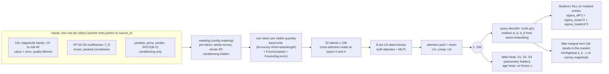

# Encoder v11: token set encoder for every Gaia star (P4)

Status 2026-11-24: implemented, CPU smoke-tested, and run for the first time on real data:
a GPU pilot on one H100 MIG 1g.12gb slice with the v1a input tree (§9, measured). Full
pretraining not launched. Target design: [README](README.md) §4.2–4.3. Today's
model: [architecture.md](architecture.md). Code: `src/masked_stellar_autoencoder/v11/`,
entry point `python -m masked_stellar_autoencoder.training.pretrain_v11 --config ...`.

Goal: one encoder for every Gaia star, with or without XP and with any subset of bands from
the UV to the mid-IR, trained on all of REC (no row caps). Its 256-d latent `z` is the input
of the existing heads (multi-survey label head, S1/S2/S3, age head).

## 1. Diagram

## 2. Input contract (`v11/schema.py`, `v11/contract.yaml`)

- **Bands.** 215 canonical bands: 101 magnitudes in 24 surveys (GALEX; Gaia G/BP/RP; SDSS;
  SkyMapper; PS1; Legacy Surveys DR11 south = DECam and north = BASS/MzLS as separate bands,
  plus forced unWISE; DES; DELVE; ATLAS; CFIS; S-PLUS; J-PLUS; Pristine CaHK₀; 2MASS; UHS;
  VHS; UKIDSS; VIKING; VVVX; CatWISE W1/W2; AllWISE W3/W4), 110 XP coefficients and 4
  conditioning values. Each magnitude band has its pivot wavelength and, where one exists,
  an SVO curve and a torchgaiaxp system.
- **Contracts.** `gaia_keyed_v1a` reads today's Gaia-keyed sources in their native column
  names (data.md §2.7 v1a: Gaia DR3 HATS, `dr3_xp_continuous`, adql_matches 2MASS/PS1/SDSS/
  CatWISE, SkyMapper DR4; 28 bands). `gaia_master_v2` reads the xmatcher `ray-anchor` master
  (`<column>_<tag>`, `<tag>_quality`; 95 bands; tags overridable with `data.survey_tags`).
  Both feed the same band list, so changing contract (or adding a band) needs no code change;
  checkpoints key band tables by band name and load into a longer list.
- **Reading rules.** Magnitudes, nanomaggy fluxes with inverse variances (SDSS, LS),
  flux-over-error errors (Gaia), list elements (J-PLUS), `where` selectors (LS PHOTSYS),
  coalesced alternatives (UKIDSS LAS then GCS), quality rules (`in`, `bits_none`,
  `bits_any`, `range`, `char_in`, e.g. 2MASS `ph_qual`, PS1 `qualityFlag`, xmatcher match
  quality), bright limits, `max_error_mag` 0.5. A value that fails becomes absent. A missing
  quality column fails loudly; mappings marked `verified: false` (J-PLUS array order) are
  refused unless `data.allow_unverified_columns`.
- **Units.** Magnitudes as published; XP coefficients divided by `f_G = 10^((8.5−G)/2.5)`
  (errors too); parallax in mas, pm in mas/yr. A robust scaler (median, IQR/1.349 per band,
  `scalers.json`) is a model buffer, fitted once on the REC stream and reused for
  fine-tuning (fixes README §5.4).

## 3. Model (`v11/model.py`)

| Part | Definition | Default |
|---|---|---|
| Token | `h = e_band + W_v φ(v) + [W_e φ(log s) or e_no_error]`, `token = h + MLP(LN h)`; φ = learned Fourier features shared by all bands | d = 256, 16 frequencies |
| Band embedding | learned id + survey + kind (mag / XP-BP / XP-RP / cond) + projection of Fourier(log pivot) or Fourier(coefficient index) | new bands start from their wavelength |
| Encoder | `M` latents; cross-attention to the visible tokens (key-padding mask) at `cross_attn_layers`; pre-LN self-attention + MLP blocks | M = 32, 8 layers, reads at 0 and 4, 8 heads |
| Latent | attention pooling (1 query) ⊕ latent mean → LN → Linear → LN | `z` ∈ ℝ²⁵⁶ |
| Decoder | `x̂_b = ⟨g(z), w_b⟩ + b_b`; `g` = MLP trunk; `(w_b, b_b)` from the decoder's band embedding | hidden 512, 2 residual layers |
| Parameters | encoder 8,663,856; decoder 1,870,353; **total 10,534,209** (+ 215 σ_model + 3×n_FI) | |

Absent and masked quantities are not tokens (no −9999 fill); the encoder is permutation
invariant, a row's `z` does not depend on the batch's padding, and garbage behind a False
mask cannot reach it (tests). Cost is linear in the tokens and the latent stack does not
depend on them, which suits batches mixing ~130-token XP rows with 5–25-token photometry
rows. Views for downstream heads: `train.encode_views` gives `z` for full input,
astrometry hidden (S3), XP hidden and both.

**Deviations, justified.** Survey epochs are not tokens: in v1a they are constant per
survey and absorbed by the survey embedding; per-row epochs become an extra token channel
when the master carries them. XP coefficients are individual tokens (not an XP sub-encoder)
so per-coefficient masking and errors stay exact; the Perceiver reads keep their cost
linear. `z` stays 256-d (the size every head takes).

## 4. Masking (`v11/masking.py`, config `masking:` only)

Per row: (1) whole-XP dropout `xp_dropout` = 0.35; (2) each present magnitude survey dropped
whole with `survey_dropout` = 0.15; (3) remaining magnitudes masked with `token_ratio` =
0.25 and, if the XP block was kept, each coefficient with `xp_token_ratio` = 0.5; (4)
astrometry (parallax, pmra, pmdec together) hidden with `astrometry_hide` = 0.5, SFD with
`sfd_hide` = 0.5; (5) at least `min_visible` = 2 visible reconstructable tokens. Targets =
masked ∩ present ∩ reconstructable (conditioning is never a target). Photometry-only rows
are native (P/G classes) and XP rows learn the XP-off path through (1).

The ratios live only in `masking:`; a key such as `training.xp_masking_ratio` is an unknown
key and fails (the v10 bug, README §5.1).

## 5. Losses (`v11/losses.py`)

**Reconstruction.** For a masked present entry (i, b) in scaled units, r = x − x̂,

$$
s^2_{ib}=\sigma^2_{\mathrm{meas},ib}+\sigma^2_{\mathrm{model},b},\qquad
\mathrm{NLL}_{ib}=\log\Gamma\!\big(\tfrac{\nu}{2}\big)-\log\Gamma\!\big(\tfrac{\nu+1}{2}\big)+\tfrac12\log(\nu\pi s^2_{ib})+\tfrac{\nu+1}{2}\log\!\Big(1+\frac{r^2}{\nu s^2_{ib}}\Big),
$$

ν = 5, σ_model,b = 10⁻³ + exp(θ_b) fitted per band (per coefficient for XP); no quoted error
→ σ_meas = 0. XP errors enter diagonally here (correlations are used exactly in the
filter-integral term).
$\mathcal L_\mathrm{rec}=\sum_{g\in\{\mathrm{xp},\mathrm{phot}\}} w_g\,\frac{1}{N_g}\sum_{(i,b)\in g}\mathrm{NLL}_{ib}$, with `N_g` counted over the whole optimiser batch.

**Filter integral.** For band b inside 336–1020 nm, with `a'_b` the torchgaiaxp integral
vector (§6) and c_norm = c / f_G,

$$
m^\mathrm{syn}_b(c)=G-2.5\log_{10}(a'_b\cdot c_\mathrm{norm}),\qquad
r=m_b-\big[m^\mathrm{syn}_b+\mathrm{zp}_b+k_b\,(\mathrm{BP{-}RP}^\mathrm{syn}(c)-1)\big],\qquad
s^2=\sigma^2_\mathrm{meas}+\sigma^2_\mathrm{XP}+\sigma^2_{\mathrm{sys},b},
$$

and the Student-t NLL above, in three modes:

| Mode | XP side | Magnitude side | σ_XP | σ_meas | Learns |
|---|---|---|---|---|---|
| `calibrate` | observed, exact covariance | observed | `1.0857 √(a'ᵀC a')/(a'·c)` | survey error | zp_b, k_b, σ_sys,b only (both sides data; start 0, 0, 0.02) |
| `sed` | decoded | observed (any star with G and the band) | decoded σ_model of the coefficients, propagated | survey error ⊕ σ_G | encoder + decoder |
| `phot` | observed, exact covariance | decoded, band not visible | exact | decoded σ_model,b | encoder + decoder |

In `sed`/`phot` the nuisances and decoder scatters are detached, so the calibration is
identified by data alone. Observed-XP pairs need σ_XP ≤ 0.2 mag (`max_sigma_xp_mag`): beyond
it the first-order magnitude error of a noisy integral fails and its logarithm is biased.
In `sed` a decoded flux below 0.1 × the observed flux continues the magnitude linearly in
flux (C¹), so non-positive decoded fluxes early in training get a finite, restoring
gradient. BP−RP^syn is torchgaiaxp's `DR3_Gaia_Vega` BP and RP from the same coefficients.

**Total.** $\mathcal L=\mathcal L_\mathrm{rec}+\lambda_\mathrm{FI}(\mathcal L_\mathrm{sed}+\mathcal L_\mathrm{phot})+\mathcal L_\mathrm{cal}$, λ_FI = 0.1; each term normalised by its pair count over the step.

## 6. Passbands (`v11/filters.py`, `v11/filters/`)

- The integral is torchgaiaxp 0.3.0's `XPSpectra.integrate(passband, wl)`
  (`⟨f_λ⟩ = ∫f T λ dλ / ∫T λ dλ`, AB: `m = −2.5 log₁₀(⟨f_λ⟩ λ_p²/c) − 56.10`). It is linear
  in the 110 coefficients, so `a_b` is obtained exactly by integrating the unit coefficient
  vectors; the variance is `Σ_{BP,RP} aᵀ diag(e) R diag(e) a` with the packed correlations
  (one `[N,1485]@[1485,K]` product). Tests match `integrate` (flux and error) and
  `torchgaiaxp.generate` to 1e-9 mag.
- Packaged systems (GaiaXPy designs: SDSS, SkyMapper, PanSTARRS1, DECam for DES/DELVE/LS-S,
  JPLUS) are used where available; BASS g/r, MzLS z, OmegaCAM (ATLAS), MegaCam u/r (CFIS)
  and S-PLUS integrate SVO curves stored in `v11/filters/` (58 curves; `provenance.json` with
  filter ID, URL, retrieval time, VOTable sha256; regenerate or verify with
  `scripts/fetch_svo_filters.py [--check]`).
- Selection: SVO support (T > 1 % of peak) inside 336–1020 nm and not dereddened. Result:
  SDSS g r i; SkyMapper v g r i; PS1 g r i z; DECam g r i z (LS-S, DES, DELVE); BASS g r,
  MzLS z; OmegaCAM g r i z; MegaCam r; S-PLUS and J-PLUS 7 narrow + g r i. 51 bands in the
  registry, 46 read by the master contract, 11 by v1a. Excluded: all u, SDSS/SkyMapper z,
  PS1 y, DES Y, Gaia G/BP/RP, Pristine CaHK₀.

## 7. Data sets and streaming (`v11/data.py`)

| Set | Rule | Use |
|---|---|---|
| REC | assignment partition FIT (u < 0.75), reserved excluded | training (`data.train_partitions: [FIT]`) |
| REC-DEV | partition DEV | evaluation, early stopping (`eval_partitions: [DEV]`) |
| nested REC sample | `unit(source_id, "msa-rec-v1") < rate` | optional (`rec_sample_rate`) |

- Trees with the `gaia/dr3` HATS layout; the first is the anchor, the others are joined on
  `source_id` inside the same partition; the msa-split-v1 assignment
  (`/arc/projects/astroai/msa/runs/msa_split_v1/assignment`) is joined the same way. An
  anchor row missing from the assignment fails.
- Each worker takes an epoch-shuffled share of the partitions, interleaves 4 of them, reads
  16k-row chunks and the matching secondary row ranges; rows pass a shuffle buffer and leave
  in token-count buckets as micro-batches of ≤ 512k tokens and ≤ 8192 rows. No row cap.
- The loader computes the observed-XP synthetic fluxes `a'·c_norm` and their exact variances
  per filter-integral band (CPU, from the packed correlations), so the GPU never sees the
  2×1485 correlations.
- v1a's P3 product exists: `/arc/projects/astroai/msa/runs/msa_tables_v2/photometry_v1a`
  (`scripts/build_photometry_v1a.py`, launcher step `photometry-v1a`, 17 min on 16 cores):
  all 1,811,709,771 Gaia DR3 rows in the `gaia/dr3` layout and order, exactly the
  `gaia_keyed_v1a` columns, `sfd_ebv` (dustmaps-identical SFD98), absent = null. **2MASS is
  masked** (`adql_matches/twomass.fits` is mis-keyed, `data/twomass_gaia.py`). SkyMapper
  DR4's `gaia_dr3_id1` went through float64 upstream, so its rows are matched by exact or
  rounded id plus a 1″ position check. Every table passed a whole-sky pairing validation
  (residual NMAD of G − x about a cubic in BP − RP: PS1 r 0.030, SDSS r 0.029, SkyMapper
  r 0.036, CatWISE W1 0.145 mag, 1.7–7.9 % of the random-pairing null); partitions failing
  the per-partition gate (PS1 16, CatWISE 17, SDSS 1: bulge and plane, ~1M rows each) are
  masked for that survey. Rows with a value: PS1 r 900M, SkyMapper r 412M, SDSS r 120M,
  CatWISE W1 677M. Numbers in its `manifest.json`.

## 8. Config (`v11/config.py`)

One YAML file; every key declared; unknown keys fail at any depth; ranges validated.
Sections: `run`, `data` (+ `synthetic`, `scalers`), `masking`, `model`, `loss`,
`filter_integral`, `optim` (AdamW, warmup + cosine, loss nuisances at 10× lr), `train`
(`batch_rows` 32,768 per step; schedule length in presentations, default one REC pass).
Files: `configs/pretrain-v11.yaml` (REC, v1a; switch `contract` and the anchor for the
master), `configs/pretrain-v11-smoke.yaml` (CPU, synthetic). A run writes `config.yaml`,
`manifest.json`, `scalers.json`, `metrics.jsonl`, `checkpoints/` and resumes from
`checkpoints/latest.pt`. `--describe` prints bands and parameters; `--estimate` the budget.

## 9. Throughput and memory on an H100 MIG 1g.12gb (estimate)

Measured on CPU (`--estimate`): FLOPs of forward + backward with the configured masks, and
bytes autograd saves; projected with 16/132 of the H100 dense bf16 peak (≈ 120 TFLOPS) and
25–45 % MFU.

| Rows | Visible tokens | Train GFLOP/row | Act. MB/row (bf16, ckpt) | Max rows/µbatch (ckpt) | Rows/s (MFU 25–45 %) |
|---|--:|--:|--:|--:|--:|
| XP + v1a photometry | 47 | 1.77 (2.16 ckpt) | 1.3 | 7.8k | 17k–31k |
| photometry only, v1a | 12 | 1.56 (1.92) | 0.5 | 20.5k | 19k–35k |
| photometry only, master | 25 | 1.61 (1.98) | 0.6 | 15.5k | 19k–34k |
| REC mix (12.1 % XP), v1a | — | 1.58 (1.95) | — | — | 19k–34k (15k–28k ckpt) |

One REC pass (1.36 × 10⁹ rows, 41,467 steps of 32,768) takes ≈ 11–20 h on one slice
(14–25 h with checkpointing). Parameters plus AdamW state are 0.17 GB; with checkpointing
an XP micro-batch of 3.3k rows needs ≈ 4.3 GB. The latent stack dominates (cost nearly flat
in tokens); `n_latents: 16` halves it. Loader: XP correlations dominate I/O (≈ 2.7 TB per
pass, ≈ 40 MB/s at 20 h).

**Measured (pilot 2026-11-24, `configs/pretrain-v11-pilot*.yaml`, launcher step
`v11-pilot`, session j6qd4aat).** NVIDIA H100 NVL MIG 1g.12gb (10.75 GiB), production
model and step (32,768 rows, bf16, checkpointing), trees `gaia/dr3` + `dr3_xp_continuous`
+ `photometry_v1a`, FIT rows of the first 200 Gaia partitions (179M rows), 6 loader
workers, a 2,000-step schedule (warm-up 200) run in wall-limited segments.

| | `n_latents` 32 | `n_latents` 16 |
|---|--:|--:|
| rows/s (median of 25-step windows, eval excluded) | **5,300** (4,810–5,330) | **7,700** |
| s per step | 6.2 | 4.3 |
| data wait (share of step time) | 0.03 % | 0.04 % |
| GPU memory, peak allocated / reserved | 7.4 / 8.1–9.1 GiB | 5.1 / 7.2–9.7 GiB |
| steps logged | 725 (resumed at 250) | 250 |
| DEV NLL at step 250: phot / XP / XP hidden | 1.92 / 1.98 / 1.97 | 3.16 / 2.10 / 2.08 |
| DEV NLL at step 500: phot / XP / XP hidden | 0.92 / 1.86 / 1.86 | — |

- Throughput is ~4–6× below the projection (19k–34k rows/s; 15k–28k with
  checkpointing): ≈ 10 TFLOPS, MFU ≈ 9 %. The run is compute-bound (the loader waits
  0.03 % of the time) and the rate does not depend on the step's XP share, so the cost is
  per row; halving the latents gains only 45 %, so about two thirds of the step is outside
  the latent stack. One REC pass at 5.3k rows/s is **71 h** on one slice (49 h with 16
  latents).
- 16 latents learn slower per step (DEV photometry NLL 3.16 vs 1.92 at step 250); at equal
  wall time (16-latent step 250 ≈ 32-latent step 172) this short pilot does not decide
  between them: keep 32 until a matched wall-clock run says otherwise.
- Steps alternate between photometry-only and XP-heavy compositions (`xp_row_frac` 0 for
  > 100 consecutive steps, then up to 1.0): the token buckets leave the loader in runs.
- Training losses (l32, step 25 → 725): photometry NLL 7.7 → −0.32, XP 2.0 → 1.68, `sed`
  3.4 → −0.08, `phot` 10.3 → 0.38, `calibrate` −2.0 → −2.55; gradient norms 30–500
  (always clipped at 1).
- Filter-integral zero points on DEV at step 500 (start 0): SDSS g/r/i −0.044/−0.010/
  −0.026, SkyMapper v/g/r/i −0.017/−0.010/−0.002/−0.003, PS1 g/r/i/z −0.014/−0.000/
  −0.000/+0.012; colour terms |k| ≤ 0.07; σ_sys 0.012–0.023 mag; residual NMAD 0.011–
  0.056 mag.
- Checkpoint/resume: segment 1 stopped by its wall limit after the step-250 checkpoint;
  segment 2 resumed from `latest.pt` at step 250 (same learning-rate schedule) and saved
  step 500. The caching allocator logged six failed-then-retried allocations of 0.65–1 GiB.

## 10. Verification

- `tests/test_v11_config_schema.py`: config strictness (misplaced masking ratios), ranges,
  registry, SVO pivots and provenance, v1a and master reading (quality, PHOTSYS, coalesce,
  unverified refusal, fail-closed quality columns).
- `tests/test_v11_model_masking_losses.py`: shapes, absent-band handling, padding and
  permutation invariance, checkpointing parity, masking invariants, Student-t NLL vs
  `torch.distributions`, σ_model recovery, micro-batch normalisation.
- `tests/test_v11_filter_integral.py`: operators vs `generate` and `integrate` with full
  covariance, band selection, packaged vs SVO agreement, zero-point and colour-term
  recovery from zero, mode gradients.
- `tests/test_v11_data_train.py`: split hash test vectors, partition selection and reserved
  exclusion, join correctness with shuffled XP rows, worker sharding, budgets, scalers,
  smoke training with resume, checkpoint into a longer band list.
- Smoke (`configs/pretrain-v11-smoke.yaml`, 6,000 synthetic stars, 60 steps, CPU 2 threads,
  46 s): reconstruction NLL 6.5 → 1.0 (photometry), 6.1 → 4.9 (XP); `sed` 2.8 → 1.0; `phot`
  11.8 → 3.1; DEV photometry NLL 2.7 → 0.86. Fitted zero points of the high-S/N bands match
  the injected offsets: SDSS i 0.019 (0.020), SkyMapper i −0.031 (−0.030), PS1 i/z
  0.015/0.015 (0.015).

## 11. Open items

- v1a has no 2MASS until the master's designation join; the master needs xmatcher entries
  for ATLAS and CFIS, VHS Y and VVVX Z/Y columns, and a check of the J-PLUS array order.
- Before the full pass: mix token buckets within each step; find the two thirds of the
  step outside the latent stack (profile; per-micro-batch host syncs, the dense XP decode
  of the `sed` term, `torch.compile`, fused AdamW); `PYTORCH_CUDA_ALLOC_CONF=
  expandable_segments:True`. At the measured rate one pass needs 71 slice-hours: use a
  larger GPU or data parallelism (not wired in v11 yet).
- Quality rules and bright limits are provisional until the P2 input contract.
- Not yet wired: fine-tune (P5) on v11 latents, two-masking consistency, label head inputs.
- The pilot measured MFU ≈ 9 % (not 25–45 %); `n_latents` stays 32 pending a matched
  wall-clock comparison (§9).
