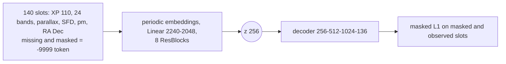
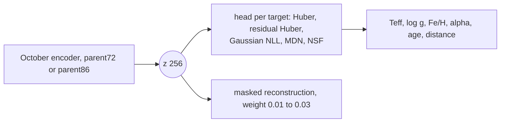
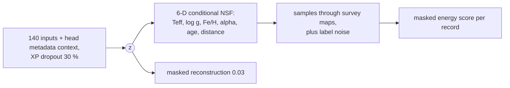
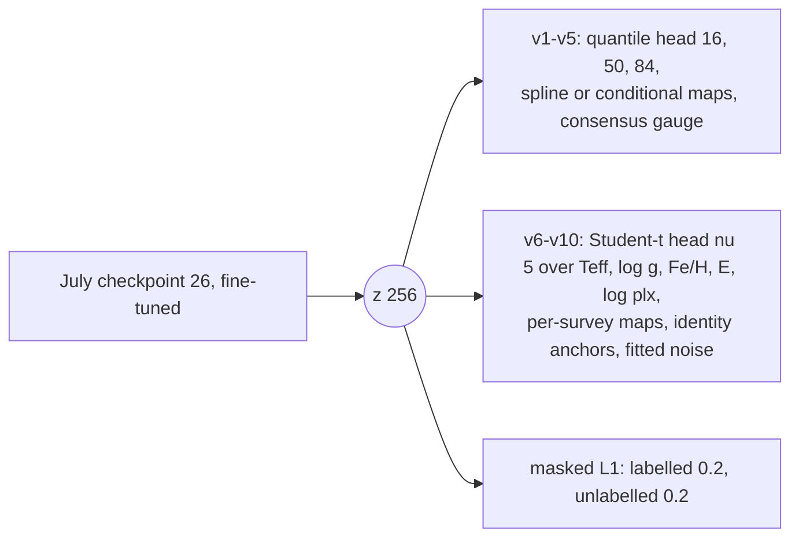
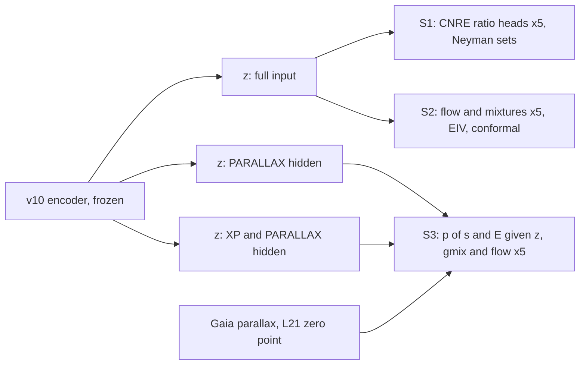
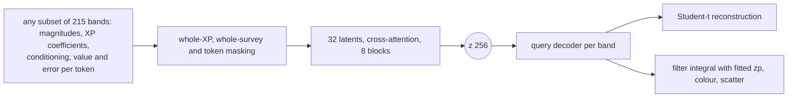

# MSA stellar-parameter programme: complete experiment history

Compiled 23 November 2026 from the repository (`wip/intelligent-babbage-778ino` at `21af14b`,
with the age work merged from `feat/age-c0`), the CANFAR launch receipts, the run outputs on ARC
(`/arc/projects/astroai/msa/runs/`), and the session transcript of 10–23 November.

Extended on 24 November 2026 from `main` at `2116167`, the receipts, the ARC run reports and manifests,
and the transcript to 24 Nov 16:10 UTC: status (§1.1), runs of 23 Nov evening – 24 Nov (§2.6, §3.13),
architecture by era (§3.14), lessons L49–L57 and new unverified items (§6). The 23 Nov text is kept as
it was. The handoff for a new session is [`HANDOFF.md`](HANDOFF.md).

This is a reference document. Its purpose is that no lesson is forgotten or re-simplified.
Every number carries its source. Anything not verified is marked **(unverified)**.

## How to read the sources

| Tag | Meaning |
|---|---|
| `[R:path]` | file in this repository |
| `[C:sha]` | commit in this repository (`git show <sha>`) |
| `[A:run/file]` | run output under `/arc/projects/astroai/msa/runs/` (read with `curl --cert ~/.ssl/cadcproxy.pem https://ws-uv.canfar.net/arc/files/projects/astroai/msa/runs/<run>/<file>`) |
| `[X:path]` | CANFAR launch receipt under `experiments/xp/decision-wave-20261106/` unless a full path is given |
| `[XM:sha]` | commit in sfabbro/xmatcher (`/home/user/xmatcher`) |
| `[T:yyyy-mm-dd hh:mm]` | assistant message at that UTC time in the session transcript `/root/.claude/projects/-home-user/d60e9c7a-7b13-5bb2-ade1-fb8da7adbc26.jsonl`; numbers there were read from run outputs at the time, many of which survive only in scratch files |

Notation: bias / NMAD in dex for [Fe/H] and log g, K for Teff. "Core" means the frozen held-out
high-resolution [Fe/H] reference set (7,740 held-out stars; 646 below −2) defined on 19 Nov
(`[A:rescore_20261119/rows_split.npz]`, `[T:2026-11-19 04:13]`). "MP" means metal-poor.

---

## 1. Status

### 1.1 Status on 24 November 2026

- **The programme changed course on 23 Nov at 21:50 UTC.** The user stopped experiments on small or
  less diverse sets ("you keep forgetting and re-simplifying because you are dealing with a less
  diverse dataset") and asked for the full programme: this history, a master label set, defined data
  sets, a QA catalogue, all of Gaia with and without XP, and full wavelength coverage ("don't be cheap.
  this is not a pet project"). The plan is P0–P8 of `README.md` §6. A new session starts from
  `HANDOFF.md`.
- **No model was trained between 23 Nov 12:49 and 24 Nov 16:10 UTC.** The products of §1.2 still
  stand. Their first scoring through the single evaluator on `msa-split-v1` TEST
  (`[R:docs/qa-v10-20261124/report.md]`):
  - S1 5-head ensemble: joint Neyman set 0.664 / 0.923 at 68 / 95 %;
  - S2 flow: conformal set 0.661 / 0.922;
  - S3 v2.1 gmix: parallax PIT 68 % coverage 0.720, E(B−V) 0.898;
  - open-cluster giants +0.328 dex above dwarfs; held-out cool companions 0.26–0.31 dex too metal-poor.
- **Built** (§3.13):
  - `msa-split-v1`, frozen for all 1,811,709,771 Gaia DR3 sources;
  - `photometry_v1a`: Gaia-keyed SDSS, SkyMapper, PS1 and CatWISE photometry plus SFD for every DR3
    source in the Gaia HATS layout, each table's pairing validated over the sky, 2MASS masked;
  - encoder v11 (token set encoder, heteroscedastic Student-t reconstruction, whole-survey and
    whole-XP dropout, torchgaiaxp filter-integral term), smoke-tested and piloted on one GPU slice:
    5,300 rows/s, about 71 h per REC pass;
  - the single evaluator `scripts/evaluate_model.py`, with the ARC-only QA scripts moved into
    `src/masked_stellar_autoencoder/qa/`;
  - xmatcher reads the community HATS trees in place; the Gaia-anchored master pilot passed; the full
    run (3–5 h, ≈ 0.45 TB) waits for the PS1 OTMO rebuild;
  - an audit of every community HATS tree.
- **Found** (§3.13):
  - every fine-tune v1–v10 ran masking 0.3 / 0.3 and encoder weight decay 0.01, not the configured
    0.9 / 0.6 and 1e-5; pretraining never loaded measurement errors;
  - the "Gaia-keyed" 2MASS table is mis-keyed: corr(G, Ks) 0.002–0.0045 against 0.948 for the
    designation join;
  - Gaia ids rounded through float64 in GBS v3, SkyMapper DR4 and the white-dwarf companion list;
  - 74 of the 192 GBS benchmark stars are rows of the v5 fine-tune table, 63 in its train split.
- **Blocking the full-Gaia run:** the GPU resources for v11 pretraining (a user decision), the P5
  fine-tune code, the P3 labelled tables from all 19.2M master stars, and, for the full master, the
  PS1 OTMO rebuild and xmatcher's catalogue pins.

### 1.2 Status on 23 November 2026 (as compiled)

The programme has a working but partial stack, all trained on one experiment-scale table.
- **Best posterior model:** multi-survey fine-tune **v10** (`multisurvey_finetune_20261121_v10`, epoch 12).
  It is anchored by identity-mapped IRFM Teff, seismic log g and a high-resolution [Fe/H] core.
  Its head is a joint Student-t (ν = 5) over Teff, log g, [Fe/H], E(B−V) and log parallax.
  It still reads +0.39 dex too metal-rich below [Fe/H] = −3 on the held-out core, which is shrinkage
  toward the training population, plus a 0.1–0.45 dex cool-dwarf offset seen in wide binaries.
- **Unbiased per-star measurement:** the **S1 likelihood (ratio) head, 5-member ensemble**, on frozen v10 latents.
  Its [Fe/H] bias is within ±0.05 dex in every bin down to −3, and its Neyman 68 % coverage is 0.68 overall and within 0.68 ± 0.08 in every bin.
  It fails only the log g anchor test (0.117 against 0.078 dex), because it does not yet use the parallax
  measurement without a parallax cut.
- **Predictive distributions (S2):** a full-covariance Gaussian mixture, or a spline flow where speed allows.
  Both beat the posterior head on log and energy scores. Like every predictive distribution, both fail
  coverage in bins of the *true* [Fe/H].
- **Distance and E(B−V) (S3 v2 / v2.1):** distances are calibrated against Gaia parallaxes with no parallax cut,
  and one model serves stars with and without XP (photometry-only distance error 0.58 mag).
  E(B−V) intervals still over-cover (68 % interval holds 0.90).
- **Ages:** a consensus age scale from the labels alone (**C0 → C0b → C0c**). Within-regime maps are solid.
  The giant–subgiant bridge is age-dependent and unresolved.
- **The data problem.** Every model above was trained on the 5,872,237 XP stars of `multisurvey_table_20261117_v5`.
  That table was built with an 8M-star cap and an XP requirement, from a master label set of about 19.2M
  Gaia-linked stars. So about 11M labelled stars and 2.13M labelled no-XP stars were never used.
  The encoder is still the July 2026 checkpoint 26, because the October encoders were lost with `msa_runs` on 12–13 Nov.
- **What the user asked next (23 Nov 21:50 UTC):** stop experimenting on small, less diverse sets; define the master
  label set and the data splits (FIT/DEV/TEST/CAL/REC/PRED); document all QA; and train on all of Gaia, with and
  without XP and with full wavelength coverage. Gaia DR4 is due on 2 December; Pensus comes later.

---

## 2. Chronological table of experiments and runs

Rows group runs that differ only by attempt number. Session IDs and receipts are in the cited files.

### 2.1 Infrastructure, pretraining and XP experiments (July – 16 Oct)

| Date | Run id | Purpose | Data | Architecture / loss | Key results | Verdict |
|---|---|---|---|---|---|---|
| 2026-07-16 → ~Aug | July pretraining (`k-pop/msa_pretrain`, now `/arc/projects/astroai/msa/pretrain`) | Self-supervised encoder | Andrae 2023 `sslset-realmags-full-052725.h5` (218,131,884 rows, 135 shards; `[R:docs/reports/msa-andrae-seismic-20261106.md]`) | 140 inputs (110 XP + 24 bands + 6 astrometry/EBV) → periodic embeddings → ResNet encoder → 256-D latent → decoder; masked MAE | 27 of 100 planned epochs, about 12.1 h per epoch; val loss 0.903 (ep 1) → 0.838 (ep 26) → 0.831 (ep 27) `[A:../pretrain/metrics.jsonl]` | **Survives.** `msa_pretrain_checkpoint_26.pth` is the encoder of every model since 13 Nov. Masking ratios used in July: (unverified) |
| 2026-09-26 | CANFAR smoke | Execution check | 2 shards × 512 rows; 8,192 fine-tune rows | — | pretrain train/val 0.906/0.900; finetune 0.408/0.397 `[R:docs/EXPERIMENT_LOG.md]` | Plumbing only |
| 09-27 → 10-09 | pretraining memory, I/O, monitor; paired pretraining experiments; low-mask arm; isolated mask arms; seed replication | Choose pretraining settings | bounded subsets | masked MAE | Half masking (XP 0.5, other 0.2) adopted for the full run `[C:f2e11ad]`; numbers survive only as `[R:docs/reports/mask-comparison.png]` (unverified) | Half mask adopted |
| 10-10 → ~10-20 | `pretrain-e21-full100-maskhalf-20261010-ram128-mb16k` (session `rrrc2ihf`) | Main October pretraining | full input | as above, masks 0.5/0.2, microbatch 16k–24k | epoch 72 by 16 Oct; epoch 86 = "parent86", the October production parent `[R:docs/plan-20261022/01-current-state.md §3]` | **Lost** with `msa_runs` (local copy at the 22 Oct audit machine: unverified) |
| 10-11 → 10-12 | `xp-benchmark-10m-20261012-hdf5-r3` | Fixed 10M benchmark | 9M train / 1M val, seed 42 | — | Error-unit correction: XP errors are raw, coefficients G-normalised; divide errors by 10^((8.5−G)/2.5) `[R:docs/xp-benchmark-dataset.md]` | Used by all October continuations; lost |
| 10-11/13 | `xp-reconstruction` (7 arms from epoch 27) | Masking and XP loss variants | benchmark, 20M presentations | MAE vs mixed masks, MSE, NoisyTargetGaussianNLL, signal-weighted | Outcome not recorded in surviving docs `[R:docs/xp-reconstruction-experiments.md]` | Unknown |
| 10-13 | `xp-covariance` (3 arms from epoch 27) | XP covariance in reconstruction | benchmark, 20M, 612 steps | diagonal NLL v = 0.1 + σ²; per-band full covariance | "Neither improves XP coefficient MAE" `[R:docs/design-20261120-likelihood-inference.md §4.1]` | Rejected, but the test was flawed (lesson L33) |
| 10-13 | `xp-photometry-e47` (5 arms), `xp-next-e47` (5 arms) | Photometric and spectral auxiliaries, Adam reset | benchmark, 20M | MAE + auxiliaries | Photometry outcome not recorded; spectral auxiliary carried into follow-up | — |
| 10-14 | `xp-lr-batch-e57` (13 arms) | LR × effective batch | benchmark, 20M | MAE | Best XP MAE 0.750220 at batch 32768, LR 1.23e-6, against 0.750835 at the inherited LR; higher LR worse; smaller batches not better `[R:docs/continuation-decision-20261016.md]` | Conservative LR |
| 10-14 | `xp-followup-e47` (20 arms, 3 seeds) | Spectral auxiliary, dropout, latent regularisation | benchmark, 20M | MAE + spectral 0.1 | Spectral 0.1 improved XP MAE in all 3 seeds (mean 0.614 %) and spectral error (2.714 %); photometric auxiliary did not replicate; dropout 0 and spectral 0.3 not better `[R:docs/continuation-decision-20261016.md]` | Small gain; not adopted in production |
| 10-14 | representation probes, latent refinement | Frozen-encoder label probes | Andrae fine-tune FITS | ridge, MLP | Not recorded | Unknown |

### 2.2 Native-label screens, long runs and density work (15 Oct – 9 Nov)

| Date | Run id | Purpose | Data | Architecture / loss | Key results | Verdict |
|---|---|---|---|---|---|---|
| 10-15 → 10-16 | stellar-improvement wave (151-job ledger `[R:experiments/xp/launch-stellar-improvement-20261015.json]`) | Native FeH SFT, age, distance pilots | label registry v2: 737,001 FeH stars (GALAH 550,854, APOGEE 210,990) | Huber heads; ridge for distance | Recon weight 0.01: FeH MAE 0.0799 → 0.0780, 184-star tail 0.3743 → 0.3619. Age: 4,440 fit stars, native MAE 1.02 Gyr, **+1.68 to +2.34 Gyr too old** vs seismic. Distance ridge MAE 3.23 mas vs raw Gaia 0.96 mas on 4,166 Hipparcos stars `[R:docs/plan-20261022/01-current-state.md §2]` | Age and distance heads worse than doing nothing |
| 10-16 → 10-17 | `prediction_e72_*_10m_v1` (6 heads + LDS, label-error NLL, contrastive flow, RC/SIMEX v1/v2) | Head and loss comparison | epoch-72 parent; 19,859 fit / 100,620 test; 10M reconstruction presentations | Huber, Gaussian NLL, CRPS, RnC, residual MLP, BatchEnsemble | Residual-Huber became the "verified FeH winner"; FeH MAE 0.0854 on the 100,620 test, tail (n = 185) 0.5158 `[R:docs/plan-20261022/01-current-state.md §1a]`. RC/SIMEX v1 failed on a missing import `[R:docs/prediction-comparison-10m-20261016.md]` | Residual Huber kept |
| 10-17 → 10-19 | mechanisms, frozen heads, VIR, CNF, forward EIV, BMC/RankSim, targeted XP mask, test-time screen, conditional flow | Mechanism screens | same cohort | various | Frozen raw MSE vs shaped CNF: FeH MAE 0.0990/0.0990, below −2 0.553/0.549 `[R:experiments/xp/stellar-improvement-progress.md]`. Forward EIV failed: Gauss–Hermite NLL not converged from 16 to 256 nodes. All-XP-masked Huber: 0.0823 → 0.0921, tail 0.449 → 0.588 `[R:docs/plan-20261022/02-failures.md, 01 §2d]` | No robust gain; forward inversion demoted |
| 10-18 | `residual_huber_long_30e_v1` | Extend the winner | 270M presentations | residual Huber | (unverified; not in the 22 Oct audit) | Unknown |
| 10-20 → ~10-24 | `residual_huber_e86_150m_30e_v1` (session `dd27e718`) | Large reconstruction continuation | parent86; 150M distinct rows, 87 GB cache | residual Huber + masked recon 0.01 | Completed 4.5B presentations `[R:docs/reports/msa-final-six-summary-20261024.md]` | "Large parent" for the late-October waves (link to the name "c544": unverified). **Lost** |
| 10-20 | multilabel screen (13 arms from parent86) | 3-label heads | 19,299 fit / 2,118 tune / 2,046 cal / 97,695 test (141 below −2) | Huber, Gaussian, MAF, cINN, NSF, BPF, noise-aware NSF, forward inversion | Huber Teff 71.6 K / log g 0.144 / FeH 0.0915; flows no better on MAE (FeH: MAF 0.105, cINN 0.101, NSF 0.101, BPF 0.103 vs Gaussian 0.097) but better joint NLL (MAF 4.27 vs 4.69) `[R:docs/plan-20261022/01-current-state.md §1]` | Flows: density only |
| 10-20 → 10-21 | `multi_gaussian_noise_recon_30e_v1` (`fp0qj7pm`) | Long 3-label run | parent86, 270M presentations; selected at 99M on tune NLL | diagonal Gaussian, quoted label errors convolved, recon 0.03 | **Best October point model:** Teff MAE 58.8 K, log g 0.120, FeH 0.0758; tail FeH bias **+0.388**, Teff +155 K; FeH 90 % CP tail coverage 0.21 `[R:docs/plan-20261022/01-current-state.md §1]` | Best point model; density replay failed; lost |
| 10-21 → 10-22 | density wave NSF NLL / contrastive / NLL+0.1 (`lnxaovw5`, `x0m40mgn`, `pu0bbxpb`) | Joint density + level-set CP | same cohort | conditional NSF | Level-set CP 90 %: global 0.890, tail 0.18–0.21; strict replay failed (float32 / device) `[R:docs/plan-20261022/02-failures.md F1–F2]` | Density not certifiable |
| 10-22 | fair comparison with released catalogues | Same-star comparison | 67,667 stars common with GSP-Phot | — | Long Gaussian: Teff MAE 59.4 K, log g 0.118, FeH 0.074; tail (56) FeH bias +0.38 `[R:docs/reports/fair-comparison-released-20261022.md]` | MSA trained on the same label families: not a truth test |
| 10-23 | multitarget summary (10M, seed 45) | Gaussian / MDN4 / NSF | 97,695 test | — | FeH MAE 0.0963 / 0.0948 / 0.1070; MP FeH MAE 0.808 / 0.738 / 0.752; joint NLL 4.72 / 4.65 / 4.17 `[R:docs/reports/msa-multitarget-summary-20261023.md]` | No family wins everything |
| 10-24 | six-target wave (40 recipes) | Teff, log g, FeH, α, age, distance | large parent | Gaussian, MDN, scalar NSF + auxiliaries | Chosen NSF: MP FeH MAE 0.239 (Gaussian 0.390, MDN 0.480); global 67.3 K / 0.130 / 0.073 / α 0.044 / age 0.91 Gyr / distance 0.075 kpc; conformal tail coverage 50.7 % of 140 MP labels; learned 90 % intervals 90.0 % (width 0.798 dex). Age and distance = StarHorse posterior targets `[R:docs/reports/msa-final-six-summary-20261024.md]` | Keep Gaussian, MDN, NSF families |
| 10-24 → 10-25 | final large-sample review (4 heads) | Scale-up evaluation | 4,412,982 feature-eligible identities | — | XP removed from the same dwarfs (log g 4.5–4.75): MAE 0.071 → 0.732; FIT held only 19,236 distinct log g labels; parallax masked from inputs `[R:docs/reports/msa-logg-failure-diagnosis-20261025.md]` | log g unreliable, especially without XP |
| 10-26 → 10-29 | remediation wave (14 joint-head pilots, coupled 6-D NSF with QMC, copula6), multisurvey foundations, DESI/RVS/LAMOST DR12/RAVE/Gaia-ESO staging, NSF6 energy prototype | Repair labels, inputs, joint heads | sparse uncapped source | Huber, full-cov Gaussian, MDN, 6-D NSF | Sparse/noisy NSF NLL estimator failed its gates `[R:experiments/xp/remediation-nsf-selected-gate-failure-20261027.json]`; switched to a masked sample energy score `[R:docs/reports/msa-nsf6-energy-prototype-20261028.md]` | NSF trained by energy score from here |
| 11-04 | multisurvey distribution pilots | Survey-mapped Gaussian | 62,827 FIT, 1,024 TUNE | Gaussian + relative maps | Joint NLL 5.698 → 5.484 after fine-tuning `[R:docs/reports/msa-multisurvey-distribution-20261104.md]` | Gaussian baseline |
| 11-05 | non-Gaussian screens | Head comparison, frozen encoder | 64,000 FIT, 2,048 CAL | 4-component mixture vs Gaussian vs NSF vs copula flow | Mixture CAL NLL 5.322 vs Gaussian 5.399 (−0.077) `[R:docs/reports/msa-nongaussian-morning-20261105.md]` | 4-component mixture adopted |
| 11-05 | full-FIT three-target joint training | Scaled multi-survey run | 1,736,618 FIT stars, 3 passes, 5,088 updates | 4-component mixture, zero-sum gauge over APOGEE / DESI RVS / GALAH | TUNE NLL 4.768; predictions for 2,523,274 stars `[R:docs/reports/msa-fullfit-results-20261105.md]` | Gauge relative, not physical; lost |
| 11-06 | decision wave (8 arms × 10,000 updates) | Gaussian / MDN / 6-D NSF × with/without parallax | 1,736,618 FIT pool | energy score for NSF | Adding parallax: mixture log g CRPS 0.0886 → 0.0561 (−36.7 %); best NSF+parallax seismic log g MAE 0.0698; NSF LR 3e-4 worse (coverage 61.7 %) `[R:docs/reports/msa-andrae-seismic-20261106.md, msa-completed-wave-20261106.md]` | Parallax is essential for log g |
| 11-06 | Andrae full-footprint census | Coverage | 174,922,161 Andrae stars | — | All in the 218,131,884-row raw input; 150M cache covers 120,181,886 `[R:docs/reports/msa-completed-wave-20261106.md]`. On 46,640 GALAH devtest stars Andrae log g MAE 0.0726 vs MSA 0.1045 `[R:docs/reports/msa-andrae-seismic-20261106.md]` | — |
| 11-07 | seismic supervision controls (17 fits, 1,500 updates) | Seismic log g treatment | expanded source v5 | 6-D NSF | Seismic loss off: TESS DEV log g MAE 0.212 vs identity map 0.098; affine and context maps worse than identity `[R:docs/reports/msa-insights-20261108/insights.md]` | Keep seismic identity anchor |
| 11-07 | expanded source v5 + parallax repair | Data | 9,198,809 rows, 7,240,111 with inputs, 5,303,250 FIT | — | Parallax was missing for 1,244,233 FIT stars that have one; repaired by exact ID (4,035,167 → 5,279,400) `[R:docs/reports/msa-morning-20261107.md]` | — |
| 11-07 → | `expanded_six_nsf_fullfit_20261107_v1` | October-lineage production | 7,693,002 FIT stars, 9,203,880 records per epoch; only 0.31 % without XP | 6-D NSF; seismic identity; learned survey maps; EBV, RA/Dec, pm inactive `[R:docs/reports/msa-current-production-contract-20261108.md]` | Epoch 1 (update 35,953) vs older NSF: APOKASC log g MAE 0.0631 vs 0.0692; TESS 0.0847 vs 0.0869; benchmark Teff MAE 251 vs 325 K `[R:docs/reports/msa-insights-20261108/epoch1-update.md]` | Final result unknown; lost |

### 2.3 Master labels and the master-label NSF runs (10 – 13 Nov)

| Date | Run id | Purpose | Data | Architecture / loss | Key results | Verdict |
|---|---|---|---|---|---|---|
| 11-10 | `master_label_census_20261110_v1..v3` | Union of spectroscopic labels | 18,191,859-star audit + 20 new sources | — | +554,068 new stars → **18,745,927** unique Gaia stars; new MP stars 26,681 below −2, 1,824 below −3 `[T:2026-11-10 21:35]` | Done |
| 11-10 | `master_label_overlap_20261110_v1` | Survey vs high-res [Fe/H] | 21,465 reference stars | — | Below −3: LAMOST LRS +0.93, BOSSNet +1.07, DESI +0.26, GALAH +0.45 dex; sources with < 100 overlap stars support only an offset `[R:docs/reports/master-label-overlap-20261110/README.md]`, `[T:2026-11-10 23:28]` | Map complexity must scale with overlap |
| 11-11 | `master_spectroscopic_labels_20261111_v1` → v2 → **v3** | Consolidated master table with trace-back | 43 surveys and pipelines | — | v1: 29,307,497 records, 19,138,656 stars. v2 counted DESI SP sentinels (−10, −5, −3.5) as fits: 198,822 stars below −4 vs 154. v3: **44,576,092 records, 19,255,342 stars, 19,205,652 with a Gaia DR3 ID** `[T:2026-11-11 17:00, 17:38, 18:06]` | v3 is the master table; lost and rebuilt on 13 Nov |
| 11-11 | `loose_survey_labels_20261111_v1`, `chemistry_labels_20261111_v1/v2`, `gaia_noxp_unlabelled_pool_20261111_v1` | Looser label cuts; declared-quantity chemistry; no-XP pool | DESI, LAMOST, BOSSNet; GSP-Spec [M/H], α | — | +5.73M stars from loosened S/N cuts; no-XP pool 1-in-8 of 1.81B GaiaSource rows (≈190M expected) `[T:2026-11-11 15:30, 15:43]` | Built; lost |
| 11-11 | `expanded_six_source_20261111_v6/v7` | Training source | 13.52M stars | — | FIT 8,545,728; TUNE 1,155,269; CAL 883,669; DEV 974,986; external 7,872; about 1.96M ineligible `[T:2026-11-11 03:46]` | Lost |
| 11-11 → 11-12 | `master_label_six_nsf_fullfit_20261111_v1/v2`, **v2b** | Master-label six-target run | source v7; 849k no-XP labelled stars; 150M cache + 257,016 no-XP rows | 6-D NSF (energy score), all 140 inputs, head metadata context, XP dropout 30 %, recon 0.03 | v1 failed its library-pin admission. v2b (256-star chunks, about 10 h): mean CRPS TUNE 0.3287 → 0.3261, CAL 0.3248, DEVTEST 0.3174; [Fe/H] CRPS 0.15–0.25 for large surveys vs 0.5–1.0 for MP catalogues `[T:2026-11-12 15:46]` | Lost before full evaluation |
| 11-11 → 11-12 | `master_label_six_nsf_fullfit_20261111_v3` → **v4** (XP-only) | XP-only variant | 9.6M stars, 19.3M records per epoch; 883,461 no-XP records removed | as above, no XP dropout | Epoch-1 TUNE 0.3291 `[T:2026-11-12 02:52, 15:46]` | Outcome lost |
| 11-12 | timing and multi-slice probes | Speed | — | — | 16 / 64 / 256-star supervised chunks: 2.53 / 0.67 / 0.47 s per update; 4 slices with Gloo 0.39 s, with NCCL **0.185 s**; 7 slices 0.179 s `[T:2026-11-12 03:20, 05:34]` | 256-star chunks; 4 slices with NCCL |
| 11-12/13 | **`/arc/projects/k-pop/msa_runs` removed** | — | — | — | "no more msa_runs, disk was full, and had to remove whatever file could not be regenerated" (user, 13 Nov 02:09) | See §5.3 |
| 11-13 | `master_survey_stage_20261113_v1`, `master_label_census_20261113_v1` (no SAGA) → v2, **`master_spectroscopic_labels_20261113_v1`** | Rebuild the master table from public downloads | — | — | Same totals as v3: 44,576,092 records, 19,255,342 stars, 19,205,652 with Gaia; `training_performed: false` `[A:master_spectroscopic_labels_20261113_v1/manifest.json]` | **Current master label table** |

### 2.4 Stopgap and multi-survey fine-tunes v1–v10 (13 – 21 Nov)

All use the July checkpoint 26 and `masked_stellar_autoencoder.training.finetune_msa`.
Until v4 they use the 1.97M-star v1 table; from v5 the 5.87M-star v5 table. All are evaluated on the
same 129,9xx v1-table test stars (excluded from the v5 table).

| Date | Run id | Purpose | Data | Architecture / loss | Key results | Verdict |
|---|---|---|---|---|---|---|
| 11-13 | `stopgap_finetune_table_20261113_v1/v2`, `stopgap_finetune_20261113_v1/v2`, `stopgap_eval_*` | Fast replacement model after the loss | 3M-star cap: every high-res, APOGEE, GALAH and MP star plus random fill; 1,888,814 (v1) / 1,968,598 (v2) with inputs `[A:stopgap_finetune_table_*/manifest.json]` | Best single label per star (priority tiers); quantile head 16/50/84 (×0.8) + masked recon on labelled stars (×0.2); 30 epochs | v1 test (124,662): NMAD Teff 78 K, log g 0.130, FeH 0.099, α 0.058; XP removed 117 K / 0.229 / 0.200; 1σ coverage 0.68–0.69; FeH < −2 NMAD 0.36. A DESI SP grid-floor stripe of 413 stars was learned; v2 dropped second pipelines (stripe 6 stars); FeH < −2 bias +0.31; The Payne labels +0.90 dex off `[T:2026-11-13 14:49, 16:31]` | Working stopgap; no survey calibration |
| 11-13 | `multisurvey_table_20261113_v1` | Shared table for paired runs | 1,968,578 stars with inputs; 6,082,235 records; 17,900 seismic anchors; 63 of 192 Gaia benchmark stars have inputs `[A:multisurvey_table_20261113_v1/manifest.json]`; split ≈ 1.57M / 264k / 129,908 `[T:2026-11-16 00:29]` | — | — | Basis for stopgap v3 and multi v1–v4 |
| 11-13 → 11-15 | `stopgap_finetune_20261113_v3` vs **multi v1** (`multisurvey_finetune_20261113_v1`) | Survey maps vs single label | v1 table | multi: every record through its survey's monotone 8-bin spline map; gauge B+C: equal-weight consensus of all 41 surveys + seismic logg anchors | Seismic log g (1,217): stopgap +0.035/0.085, v1 +0.111/0.103; FeH < −2 (137): +0.24/0.36 vs +0.39/0.32; v1 coverage 0.337; all surveys sit +0.16 dex and +100 K off the common scale `[T:2026-11-15 02:55, 05:45]` | v1 loses: equal-vote consensus drifted |
| 11-15 | multi **v2** | Restricted consensus | v1 table | consensus over 11 surveys with ≥ 100k records, one vote per spectra group; seismic full weight; soft log g consensus 0.1 | log g +0.092/0.101; FeH < −2 +0.46/0.31; coverage 0.656; common offsets +0.05 dex FeH, +60 K, +0.08 log g `[T:2026-11-15 05:45]` | Still loses; equal votes land between camps |
| 11-15 → 11-16 | multi **v3** | Maps conditioned on all parameters | v1 table | δ_s(x) = offset + 4×4 linear + mix × shared 8-function NN basis; soft local gauge; precision from residuals; high-res trust ×10 | log g +0.035/0.091; FeH < −2 +0.29/0.29; Teff NMAD 178 K, α 0.14; coverage 0.577; precision estimate gave PASTEL a Teff weight of 18,000 vs APOGEE 14 `[T:2026-11-16 01:45]` | Gauge too weak for the new freedom |
| 11-16 | multi **v4** | Exact local gauge, fixed precision | v1 table | exact zero weighted correction at every point; three-cornered-hat precision weights fixed before training | FeH > −1 −0.002; FeH < −2 **+0.215**/0.30 (best so far); Teff 125 K; coverage 0.637; log g +0.064/0.088; benchmark Teff +126 K `[T:2026-11-16 06:16]` | FeH scale tied to high-res; Teff scale unanchored |
| 11-17 | `multisurvey_table_20261117_v5` | Larger, semi-supervised table | **8M cap** (`--max-stars 8000000`): 8,000,140 labelled, **5,872,237 with inputs, 2,128,095 without (dropped)**; 12,890,518 records incl. 898,839 IRFM anchor stars; 6,362,706 unlabelled (3 % sample); v1 test stars (129,927) excluded `[A:multisurvey_table_20261117_v5/manifest.json]` | — | Splits 4,697,789 / 786,880 / 387,568 `[A:likelihood_head_s1_20261120/labels_diagnostics.json]` | **The table every current model uses** |
| 11-17 | multi **v5** | Semi-supervised + IRFM Teff | v5 table + 5M unlabelled | v4 maps + recon on unlabelled (0.2) + masked-view consistency 0.1 + IRFM anchors | Failed: log g +0.288/0.190; FeH > −1 −0.203; FeH < −2 +0.84; FeH slope 0.43, survey map slopes ≈ 2 (SAGA 0.28); IRFM Teff +7/58 K. Evaluation took 7 CANFAR attempts `[T:2026-11-17 09:27]` | Consistency term squeezed the scale |
| 11-17 | formulation review | — | — | — | High-trust sparse references held ≈ 80–85 % of the gauge; anchors and consensus fought (10–35 K step in Teff with reddening); validation loss in survey space was blind to it `[T:2026-11-17 16:40]` | Rewrite as anchored formulation |
| 11-18 | `reddening_labels_20261118_v6` | Empirical E(B−V) labels | intrinsic BP−RP fitted on 4,697,789 train rows at SFD < 0.02 | — | v5 table: 4,253,330 labelled (72 %); low-map bias 0.0001, NMAD 0.031; ratio to SFD 1.04 / 0.95 / 0.83 / 0.46 for SFD 0.05–0.1 / 0.1–0.3 / 0.3–1 / > 1 `[A:reddening_labels_20261118_v6/diagnostics.json]` | Labels for v6+ and S3 |
| 11-18 | multi **v6** (`..._20261118_v6`, epoch 10) | Anchored formulation | v5 table + 5M unlabelled (recon only) | IRFM Teff and seismic log g on identity; 14-source high-res FeH core with offsets summing to zero; map capacity by sample size; joint Student-t (ν = 5) over Teff, log g, FeH, E(B−V), log parallax; learned per-survey noise; one value per spectra group | Teff vs IRFM +6/40 K; log g +0.022/0.113 (+0.005/0.084 when conditioned on measured parallax at prediction); FeH > −1 −0.002/0.110; FeH < −2 +0.315/0.318; benchmarks NMAD 141 K / 0.197 / 0.100; E(B−V) NMAD 0.024; coverage 0.62–0.63; SLAM −770 K (out of domain) `[T:2026-11-18 08:55, 18:05]` | Scale fixed; MP tail still biased |
| 11-18 | `consistency_pred_20261118_v6/v7` | Label-free FeH consistency | 434k El-Badry pairs (R_chance < 0.1, both G < 17.65) and 574k Hunt & Reffert members; 1,440,253 targets, 1,209,544 with inputs `[A:consistency_table_20261118/manifest.json]` | — | Cool companions read too metal-poor: +0.11 (4200–4800 K) to +0.45 (3000–3700 K); globular clusters +0.23 below −2; open clusters giants +0.18 vs dwarfs `[T:2026-11-19 00:30]` | Permanent label-free check |
| 11-18 → 11-19 | multi **v7** (epoch 9) | v6 + fixes | v5 table | label loss on clean inputs; FeH floors censored; SLAM < 3,800 K; no pm/RA/Dec; parallax conditioning at evaluation | log g +0.004/**0.075**; FeH < −2 +0.205/0.290; Teff IRFM +3.2/36.7 K; benchmarks 98 K / 0.092 / 0.094 `[T:2026-11-19 00:04]`; frozen core: < −3 +0.60/0.46, coverage below −2 0.44, bulk 0.142 `[T:2026-11-19 20:47]` | Best until v8_nopool |
| 11-18 → 11-19 | `multisurvey_ablation_20261118_v7` (17 variants a01–c03; d00–d03; e01–e03) | One change each | 1.2M rows (25 %), 6 epochs | v6/v7 variants; 3-component Student-t / Gaussian mixtures | See §3.7. Rescoring on the frozen core reversed the dedupe gain; full data mattered most (v7 +0.35 at 25 % → +0.21 full) `[T:2026-11-19 04:13]` | Mixtures rejected; balanced sampling kept |
| 11-19 | `rescore_pred_20261119{,_2,_3,_4}` | Like-for-like scoring | frozen core rows `[A:rescore_20261119]` | — | v7: < −2 +0.213/0.325, coverage 44 %; no memorisation (train/held-out scatter ratio 0.95–1.06); linear probe on v7 latents overshoots to −0.21 below −2 where the head gives +0.21 `[T:2026-11-19 04:13]` | Latent holds MP information |
| 11-19 | multi **v8** (+ `_nopool`, `_nobalance`) | c03 sources + cool binary pool + balanced FeH sampling | v5 table | single Student-t | v8: bulk 0.185, scale −0.05 dex. **v8_nopool:** bulk 0.149, Brier(P < −2.5) 0.0176, 95 stars at P > 0.9 (95 % pure). v8_nobalance: < −3 +0.68 `[T:2026-11-20 03:06]` | Pool caused the regression |
| 11-20 | multi **v9** | v8_nopool + binary self-consistency | v5 table | companion tied to the model's own primary prediction | Binaries fixed (−0.02 at 3000–3700 K); test FeH bias **−0.168**, bulk 0.171, < −3 +0.70 `[T:2026-11-20 11:53]` | Fails: moving target, pair weight ≈ 10 stars |
| 11-21 | multi **v10** (`multisurvey_finetune_20261121_v10`, epoch 12) | High-res FeH core on the identity map | v5 table | `fe_h_core_mode: identity`; else v8_nopool | Core: < −3 **+0.39**/0.35, −3..−2.5 +0.15/0.27, −2.5..−2 +0.01/0.21; coverage below −2 0.45; bulk 0.155 (0.148 population-corrected); Brier 0.0161, 129 at P > 0.9 (93 %); Teff vs IRFM 36.3 K; cool binaries unchanged (+0.32) `[T:2026-11-21 08:30]` | **Current best posterior model** |

### 2.5 Likelihood, distributional, forward-model, distance and age work (19 – 23 Nov)

| Date | Run id | Purpose | Data | Architecture / loss | Key results | Verdict |
|---|---|---|---|---|---|---|
| 11-19 | NRE prototype (local; `analysis/ratio_head` on ARC) | Estimate likelihood, not posterior | frozen v7 latents; 31k high-res FeH stars; 3 seeds | torchregress `NeuralRatioLoss(cnre)`, 1-D [Fe/H] | < −3: +0.09 to +0.11 (v7 head +0.58); Neyman coverage 0.59–0.76 per bin; bulk scatter 0.119 vs 0.111. On 32 PCs the contrastive flow was no better and 15× slower `[T:2026-11-19 21:30, 2026-11-20 04:00]` | Likelihood route opened |
| 11-20 | `arc_migration_copy/delete_20261120` | Move data to `/arc/projects/astroai/msa` | — | — | 100 entries, 1,258 files, 300.47 GB verified before delete `[T:2026-11-20 05:44]` | Done |
| 11-20 | `covariance_sidecar_20261120` | Per-star XP and astrometric covariances, L21 zero point | 5,872,237 table rows + 1M unlabelled | — | All matrices positive definite; zero point matches reference to 6×10⁻⁷ mas `[T:2026-11-20 21:53]`, `[A:covariance_sidecar_20261120/validation.json]` | Input for F2, S1-plx, S3 |
| 11-20 → 11-21 | `likelihood_head_s1_20261120` (attempt 2) | 3-D ratio head on frozen v8_nopool latents | 5.87M rows; 9,032,667 mapped records `[A:.../labels_diagnostics.json]` | CNRE, MLE, profile and Neyman via torchregress | `all` arm: Neyman 68 % within 0.68 ± 0.08 in every bin, but bulk NMAD 0.345 vs 0.141; maxima at the [Fe/H] = +1 edge for 10.8 % of held-out stars and 34 % of core `[A:likelihood_head_s1_20261120/report.md]`, `[T:2026-11-21 02:02]` | Fail: no support restriction |
| 11-21 | `likelihood_head_s1_diagnostics_20261121` | Separate the causes | same latents | 1-D/3-D, raw vs mapped labels | Raw high-res labels: < −3 **+0.03**; same labels mapped to the common scale: **+0.33**. Support restriction cuts edge maxima from 34 % to 1.5 % `[A:likelihood_head_s1_diagnostics_20261121/diagnostics.md]` | The FeH core offsets absorbed the bias → v10 |
| 11-21 → 11-22 | `likelihood_head_s1_v10_20261121` | S1 on v10 latents with support restriction | as above | as above | `all` arm passes bias (worst 0.071) and Neyman coverage; fails bulk NMAD (0.172 vs 0.153) and log g anchor (0.124 vs 0.078); Teff 33.6 vs 35.6 K `[A:likelihood_head_s1_v10_20261121/report.md]` | 2 of 4 criteria |
| 11-22 | `likelihood_head_s1_v10_plx_ens_20261122` (P1) | Parallax as profiled nuisance + 5 heads | heads trained on **parallax/error ≥ 10 only** | 4-D ratio heads, L21 zero point | log g anchor 0.124 → 0.088; but < −3 bias +0.40; the cut kept 85 % above −0.5, 22–31 % between −3 and −1, 47 % below −3; 57 % of G > 16 fits at the support edge `[A:likelihood_head_s1_v10_plx_ens_20261122/report.md]`, `[T:2026-11-22 09:02]` | Fail: selection on a correlated quantity |
| 11-22 | `likelihood_head_s1_v10_ens_20261122` | 5-head ensemble, all stars | as S1 v10 | mean log-ratio of 5 heads | Bias worst 0.051 (< −3 +0.05/0.34); Neyman 0.68 everywhere; bulk 0.158 vs 0.153 (pass); Teff 32 vs 36 K; log g 0.117 vs 0.078 (fail) `[A:likelihood_head_s1_v10_ens_20261122/report.md]` | **Best unbiased product**; fails log g only |
| 11-22 | `distributional_heads_s2_v10_20261122` (attempt 2 adds gmix) | Product B on frozen v10 latents | 2M split-0 stars; conformal on split 1 | spline flow ± EIV, Student-t mixture, Gaussian mixture, single Student-t; 5-member ensembles | Log score: flow (no EIV) −2.080, gmix −1.934, tmix −1.934, t −1.866, posterior −1.501; flow PIT KS 0.004; summaries per s: gmix 118k, flow 2.2k; no head passes (MP coverage 0.24–0.40 after conformal) `[A:distributional_heads_s2_v10_20261122/report.md]`, `[T:2026-11-22 22:43]` | gmix for speed, flow for accuracy |
| 11-20 → 11-22 | `xp_forward_model_20261120` (run 1) | Data-driven XP emulator + known-covariance likelihood | 1M train stars; sidecar | emulator (Teff, log g, FeH, E) → XP + absolute mags; `KnownCovarianceGaussianNLL` | XP χ²/dof 0.9–1.1; held-out FeH scatter 0.31 dex (0.64 core), Teff 215 K; E at a bound for 42–54 % of stars `[T:2026-11-22 04:01]` | Fits spectra, does not identify parameters |
| 11-22 | `xp_forward_model_20261122` (attempts 1–3), `xp_forward_diagnose_20261122` (×4), `xp_forward_scan_20261122`, `xp_forward_infer_20261122` | Fix E scale, nuisances, start | as run 1, v10 labels, train-split core stars included, 2MASS dropped | scatter at the prediction (`[C:25a7bcb]`); labelled stars' E held at the reddening label (`[C:a3a0689]`) | Started from labels: Teff r 0.97 / 71 K; normal start: r −0.07, 81 % at the E bound. Fixed start ranking: r 0.81 / 173 K on 2,000 stars. Full 50k held-out: Teff NMAD 231 K, 68 % coverage 0.18; MP FeH bias +1.27 / +0.83 / +0.55 `[A:xp_forward_infer_20261122/report.md]`, `[T:2026-11-22 16:22, 17:33]` | Not competitive; most biased estimator |
| 11-22 → 11-23 | `distance_extinction_s3_v10_20261122` (attempts 1–3) | Joint p(ln d, E(B−V) given z) from parallaxes | frozen S1-plx latents (no parallax input); 3M train | Gaussian mixture and spline flow, 5 members; exact parallax likelihood, L21 zero point, fitted error inflation per G; E labels with quoted errors | Attempts 1–2 OOM (`[C:4d9f39a]`, `[C:d6930c5]`). Attempt 3, gmix: precise-parallax DM +0.013/0.205 mag; parallax 68/95 % coverage 0.706/0.958; 95 open clusters +0.015/0.117; E bias +0.001, scatter 0.040, 68 % coverage 0.90; XP hidden: 1.3 mag, coverage ≈ 0.60; 3 of 5 flow members diverged `[T:2026-11-23 04:47]` | Distances on track; photometry-only unusable |
| 11-23 | `distance_extinction_s3_v2_20261123` (gmix, gmix1–4, flow0–4, flow1b–4b, final, final2 attempts 1–2) | Fitted label noise, XP-hidden mixing | **4.70M train**; XP hidden for 50 % of rows (flag input) | + fitted κ_E per G and outlier fraction; fitted parallax zero-point σ; rollback on divergence (`[C:ee7f356]`) | gmix log −2.284, flow −2.304; XP hidden: 0.58 mag, coverage 0.70 (gmix); flow clusters +0.002/0.136; E 68 % coverage 0.90 (gmix) / 0.94 (flow); κ_E 0.26–0.5; 4 of 5 flows diverged and were retrained `[T:2026-11-23 13:29]` | Flow adopted for distance |
| 11-23 | `distance_extinction_s3_v21_20261123` (gmix0–4, final) | Separate fitted outlier width λ | as v2 | gmix only | NLL −2.282; E 68 % coverage still 0.89–0.92 per G bin; outlier fraction ≈ 0.088 `[A:distance_extinction_s3_v21_20261123/report.md]` | E intervals still too wide |
| 11-22 | age audit (`analysis/age_audit_20261122` on ARC) | Inventory and systematics | 8.05M age records, 3.61M stars | — | APOKASC-3 vs Willett 0.065 dex scatter; StarHorse vs Xiang 0.088; FLAME giants unusable (+0.89 dex); field pipelines put clusters < 1 Gyr at their prior `[T:2026-11-22 19:45]`, `[R:docs/design-20261122-age-consensus.md]` | Design for consensus |
| 11-22 → 11-23 | **C0** | Age consensus from labels alone | 7,456,035 good records → 1.67M representative | latent log age, per-catalogue maps, fitted noise, co-natal terms; gauge A = APOKASC-3, C = Xiang | Held-out mapped NMAD 0.035–0.10 dex; shared isochrone error η = 0.123 dex; bridge −0.026 ± 0.002 statistical but ≥ 0.25 dex systematic; Pleiades 2.75 Gyr `[R:docs/age-c0-20261122/report.md]` | Within-regime solid; bridge not |
| 11-23 | **C0b** | Priority labels as fitted sources | + benchmark clusters, cluster catalogues, wide pairs, WD+MS, K2 GAP/TESS | + age-validity windows, ≥ 3-catalogue rule for slopes | EBs favour gauge A (+0.060 ± 0.018 vs −0.129 ± 0.024 dex); isochrone ages ≈ +0.25 dex vs APOKASC-3; Pleiades 0.142 Gyr; NGC 188 3.75 vs 6.2 Gyr `[R:docs/age-c0b-20261123/report.md]`, `[T:2026-11-23 05:16]` | Gauge A for < 4 Gyr |
| 11-23 | **C0c** (outputs in `docs/age-c0c-20261124/`) | Rotation and Li as fitted maps; residual QA; chemistry check | C0b frozen ages | monotone maps of the latent | Old-age "ceiling" is regression to the mean; bridge ≈ 0.20 dex at 3 Gyr → ≈ 0.05 dex at 10 Gyr; Praesepe 1.13 → 0.68 Gyr; ≈ 270k dwarfs gain an age (26k with σ < 0.3 dex) `[R:docs/age-c0c-20261124/report.md]` | Age-dependent bridge needed |

### 2.6 Programme reset, data foundations and the v11 encoder (23 Nov evening – 24 Nov)

Sessions and commits are in the cited receipts; `[XM:sha]` is a commit of sfabbro/xmatcher. Narrative in §3.13.

| Date (UTC) | Run id | Purpose | Data | Architecture / loss | Key results | Verdict |
|---|---|---|---|---|---|---|
| 11-23 22:10–22:29 | programme documents (`[C:214bff7]`, `[C:5c88fb9]`, `[C:9638db6]`, `[C:abea751]`) | Reference set after the reset | code, configs, receipts, ARC, transcript | — | `architecture.md`, `experiment-history.md`, `qa.md`, `data.md` + `datasets.yaml`, `README.md` (plan P0–P8). Found: v10 masking ratios unread; 2MASS mismatched; errors unused in pretraining; no product passes its own acceptance rule | Done |
| 11-23 22:50 / 23:02 | `msa_split_v1` (sessions `fekqgpk6`, `l1eiaf80`; `[X:msa_split_v1{,-attempt-2}.json]`) | P0: freeze FIT/DEV/CAL/TEST for every DR3 source | Gaia DR3 HATS (2,016 partitions); HR23, EB21, VB21, GBS v3, age benchmarks, LEGACY, WD lists | salted splitmix64 of `source_id`; group keys | FIT 1,357,929,871; DEV 90,537,669; CAL 144,843,506; TEST 217,273,992; QA_RESERVED 1,124,733; 0 groups split; 1 pair split (expected); 4.3M-row independent recomputation identical `[A:msa_split_v1/manifest.json]`, `[T:2026-11-23 23:28]` | **Frozen** (`[C:6d1afb8]` removed `--force`) |
| 11-23 22:53–23:09 | output-location rules (`[C:1cf4560]`, `[C:0188491]`; `[XM:0518d3e]`, first as `c0699cc` on the wip branch) | Where MSA writes | — | — | MSA outputs only under `/arc/projects/astroai/msa`; xmatcher cache `/arc/projects/astroai/hats`; `/arc/projects/hats` read-only (user, 22:52 and 23:05) | Rule |
| 11-23 23:28 | P1 preflight (local, wrote nothing) | Can the master run? | community trees | — | planner bug: each task's cone sized by the coarsest partition of any input; ≈ 0.75 TB selected columns; 50–150 core-h (estimate) `[T:2026-11-23 23:28]` | Planner fixed in `[XM:cf819f2]` |
| 11-24 00:06–00:23 | xmatcher community trees (`[XM:cf819f2]`, `[XM:fc99b42]`) | Read `/arc/projects/hats` in place | — | — | read-only community roots, `local_paths`, `xmatcher adopt hats`, 28 bundled entries, per-partition cones, write protection; 1,192 tests pass `[T:2026-11-24 00:23]` | On xmatcher `main` |
| 11-24 04:06 | fine-tune and pretraining fixes (`[C:2f8750e]`, `[C:9d200a6]`) | Config keys that were never read | — | — | v1–v10 (and stopgap, v7 grid) ran masking 0.3 / 0.3 and encoder weight decay 0.01; errors now loaded (cache ≈ 225 GB vs 117 GB) | Fixed |
| 11-24 04:26 | `gaia_master_pilot_20261124` (`ozv1t6ad`, `[XM:9b2d810]`) | P1 pilot | Gaia 2/69, 6/42837 × 21 surveys | ray-anchor, 1.5″, J2016.0 | stopped in its first task: AllWISE's motion fit, used as proper motion, moved a source by 1,630″ | Fixed in `[XM:ffa5e23]` |
| 11-24 04:33 | `gaia_master_pilot_20261124_v2` (`ufvwfkmc`, `[XM:ffa5e23]`) | Pilot rerun | same | same | passed; 1,513,619 rows; every input read in place; nothing written under `/arc/projects/hats` `[R:docs/gaia-master-data.md]` | Pass |
| 11-24 04:35 | `gaia_master_estimate_20261124` (`zm3mjlkm`) | Full-run cost | footers of all 2,016 anchor partitions | — | 90.9B candidate rows, 4.63 TB compressed reads | Basis of the extrapolation |
| 11-24 04:34 | encoder v11 (`[C:07b21c5]`) | P4 code | synthetic sky | token set encoder 10.5M; Student-t reconstruction + filter integral | 48 tests; CPU smoke recovers injected zero points (SDSS i 0.019 vs 0.020) | Implemented |
| 11-24 04:37 | GBS ids (`[C:3c84d32]`), 2MASS (`[C:7fd6e17]`), one split hash (`[C:0eb2133]`) | Data correctness | Gaia archive | — | GBS: 192 of 192 stored ids recovered; 74 GBS stars in the v5 table, 63 in train. 2MASS: corr(G, Ks) 0.010 (Andrae file) vs 0.948 (designation join) | Fixed / mis-keyed file refused |
| 11-24 04:50–05:15 | `qa_v10_20261124` (+ `_stage`: `uajdsmxr`, `l9io9zc5`, `f8txmamq`) | First single-evaluator QA | TEST minus v5 train/valid | — | S1 joint 0.664 / 0.923; S2 flow 0.661 / 0.922; S3 parallax 0.720, E 0.898; OC giant − dwarf +0.328; cool companions +0.26 to +0.31; core TEST 296 rows `[R:docs/qa-v10-20261124/report.md]` | Report |
| 11-24 05:10 | `gaia_master_pilot_20261124_v3` (`d0680ko2`, `[XM:6d65857]`) | Worst cases | 2/69, 2/133 (289M Euclid candidates), 5/8283 (LMC) | memory-aware Ray tasks, concurrent reads | passed; 2,193,149 rows; 2/133 peak 59.5 GiB; full run ≈ 32 task-h, 3–5 h on 16 cores / 128 GiB, ≈ 0.45 TB | Full run proposed (`gaia-master-full`), not launched |
| 11-24 05:10–07:16 | `photometry_v1a_20261124` (`z2lilwcf`, `t35rl8o3`, attempt 3 not submitted, `jhyv5gfi`) | P3: v11 input for every DR3 source | Gaia DR3 HATS; adql PS1, SDSS, CatWISE; SkyMapper DR4; SFD | — | attempt 1: r(G, Ks) 0.0045 on 329M pairs, SkyMapper float ids; attempt 4: 1,811,709,771 rows, 166.7 GB, built in 17.4 min; pairing NMAD PS1 r 0.030, SDSS r 0.029, SkyMapper r 0.036, CatWISE W1 0.145 mag `[A:msa_tables_v2/photometry_v1a/manifest.json]` | **Built** |
| 11-24 05:47–06:33 | xmatcher `[XM:665f484]`, `[XM:266e85c]`, `[XM:d651612]` | Memory model, plan footers, test isolation | — | — | task estimate 1.17× the 2/133 peak; ~36k footers read concurrently; tests no longer switch to CANFAR mode when a host `/arc` exists | On xmatcher `main` |
| 11-24 07:37 | `pretrain_v11_pilot_20261124` (`j6qd4aat`) | P4 GPU pilot | FIT rows of the first 200 partitions (179M) | v11 production config, 32 vs 16 latents | 5,300 vs 7,700 rows/s; MFU ≈ 9 %; data wait 0.03 %; one REC pass ≈ 71 h on one 1g.12gb slice `[R:docs/programme/encoder-v11.md §9]` | Full pretraining awaits a GPU decision |
| 11-24 07:38–08:57 | `hats_survey_audit_20261124` (`umd2ni2t`) + `_followup` (`dlec1oky`) | Audit the community trees | 74 roots (54 public), 24.07 TB | — | 10 top problems (§3.13.6) `[R:docs/hats-survey-audit-20261124.md]` | Report |

---

## 3. Narrative by phase

### 3.1 Pretraining and XP experiments (July – 16 Oct)

The encoder is a masked autoencoder on Gaia XP coefficients plus photometry and astrometry
(140 input slots: 55 BP + 55 RP, W1/W2, 2MASS JHKs, SkyMapper uvgriz, SDSS ugriz, PS1 grizy,
G/BP/RP, parallax, SFD E(B−V), pmra, pmdec, RA, Dec; `[T:2026-11-18 17:25]`). It has
periodic feature embeddings, a dense ResNet encoder to a 256-D latent, and a decoder.
Missing values enter as a frozen "missing" embedding triggered by the internal −9999 token
(`models/model.py`, `models/blocks.py`; `[T:2026-11-10 23:57]`).

- **July run** (`k-pop/msa_pretrain`): 27 epochs at about 12 h each. Its checkpoint 26 is the only encoder that survived the 12–13 Nov loss.
- **October run** (`pretrain-e21-full100-maskhalf-...`): half masking after the mask-arm experiments (`[C:f2e11ad]`).
  It produced parent72, parent85 and parent86, and the 150M-row residual-Huber continuation (4.5B presentations).
  All of it is lost.
- **Short continuations** from epochs 27, 47 and 57 on the fixed 10M benchmark tested masking, losses, LR and batch,
  and spectral or photometric auxiliaries. The only replicated gain was the spectral auxiliary (0.6 % XP MAE).
  Conservative LR was best. The XP covariance losses did not improve XP MAE, for reasons now understood to be
  experimental design (§4, L33).

### 3.2 Native-label screens and the October production candidates (15 Oct – 22 Oct)

On a small native APOGEE/GALAH cohort (about 19–20k fit stars, 97,695 or 100,620 test stars), about 150 CANFAR jobs
compared heads, losses, test-time adaptation, errors-in-variables and imbalance methods.
- **Results:** the long noise-aware Gaussian (fp0qj7pm) was the best point model (FeH MAE 0.076).
  Residual Huber was the best matched-budget FeH model. Flows improved joint NLL but not point error, and their
  density scores could not be certified (float32 and device replay failures, `[R:docs/plan-20261022/02-failures.md]`).
- **Persistent failure:** the metal-poor tail was biased (+0.39 dex below −2 for the best model) and its intervals
  were confidently wrong (FeH 90 % CP tail coverage 0 to 21 %).
- **Distance and age pilots:** both worse than trivial baselines. The ridge distance head scored 3.23 mas against
  0.96 mas for raw Gaia. Ages were about 2 Gyr too old against seismology.

### 3.3 Six-target programme and remediation (23 Oct – 9 Nov)

The programme widened to six targets: Teff, log g, [Fe/H], α, age and distance. Age and distance were StarHorse
posterior labels. It ran 40 recipes, then a 4.4M-identity evaluation.
- **The log g diagnosis (25 Oct)** found three structural problems:
  - The input excluded parallax.
  - FIT held only 19,236 distinct log g labels: "large training" was large reconstruction exposure, not labelled coverage.
  - Removing XP from the same dwarfs raised log g MAE tenfold.
- **Follow-up waves (26 Oct – 8 Nov):**
  - enlarged the labels (expanded sources up to 7.7M FIT stars);
  - showed parallax lowers log g CRPS by 37 %;
  - showed seismic supervision with an identity map protects log g;
  - repaired 1.24M missing parallaxes;
  - moved NSF training to an energy score after its sparse-label NLL failed.
- **The production run** `expanded_six_nsf_fullfit_20261107_v1` was still restricted:
  - XP + 5 bands + parallax only; EBV, positions and proper motions inactive;
  - 0.31 % no-XP stars;
  - a full-Gaia correction note was written on 8 Nov.

### 3.4 Master labels (10 – 13 Nov)

- **Census:** about 18.75M unique Gaia-linked labelled stars after adding 20 sources.
- **Master table v3 (11 Nov):** 43 surveys and pipelines, 44.6M records, 19.26M stars, trace-back to native rows.
  - Second pipelines on the same spectra are kept, with `dependency_group`.
  - Grid-edge and sentinel values are flagged (`flag_text`).
  - `fe_h_median_highres` gives reliable MP counts: 3,101 high-res stars below −2, 706 below −3.
- **Found along the way:**
  - DESI SP sentinels inflated MP counts by a factor of 1,000.
  - APOGEE DR19 stops at −2.50.
  - LAMOST and BOSSNet are 0.9–1.2 dex too metal-rich below −3.
  - Small surveys support only an offset map.
- **After the loss:** the table was rebuilt identically on 13 Nov as `master_spectroscopic_labels_20261113_v1`.
  That is the current master label table. It has no training-role annotations, because the training sources they
  came from were lost.

### 3.5 Master-label NSF runs and the loss (11 – 13 Nov)

- **v2/v2b:**
  - Source v7: 13.5M stars, 8.55M FIT, about 0.85M of them without XP.
  - Model: all 140 inputs, head metadata context, XP dropout with realistic no-XP views, 6-D NSF.
  - v2b finished in about 10 h after the 256-star chunk fix (it would have taken 2.8 days at 16-star chunks).
- **v4 (XP-only):** reached epoch 2.
- **The loss:** both, the master table v3, every training source and the October encoders were in
  `/arc/projects/k-pop/msa_runs`, which was deleted when the disk filled (§5.3).

### 3.6 Stopgap and multi-survey v1–v10 (13 – 21 Nov)

- **Stopgap:** the old fine-tuner on the July checkpoint, a best-single-label table (3M cap, 1.97M with inputs) and a quantile head. It is good in bulk and weak below −2.
- **Survey-map formulation, in four gauge iterations:**
  - **v1:** equal-vote consensus of all 41 surveys. Scale drifted +0.16 dex.
  - **v2:** consensus restricted to large surveys, one vote per spectra group. The vote landed between the DESI/BOSSNet and APOGEE/GALAH camps.
  - **v3:** maps conditioned on all parameters, soft gauge, precision from residuals. Teff and α drifted; PASTEL received an 18,000× weight.
  - **v4:** exact gauge and fixed precision weights. The [Fe/H] scale tied to high-res, the Teff scale floated.
- **v5:** IRFM Teff anchors, an 8M-cap table, 5M unlabelled stars for reconstruction, and a masked-view consistency term.
  The consistency term squeezed the common scale to half its range, and the survey maps stretched it back (slopes ≈ 2).
- **v6 (rewrite):**
  - anchors on the identity map (IRFM Teff, seismic log g), plus a [Fe/H] core with offsets summing to zero;
  - map capacity by sample size;
  - a joint Student-t likelihood with learned per-survey noise;
  - one value per star per spectra group;
  - E(B−V) and parallax as outputs.
  - Result: the scale was fixed and Teff was much better (40 K against IRFM). The MP bias remained.
- **v7:** clean label input, censored survey floors, a SLAM domain cut, no proper motions or positions, and parallax
  conditioning at prediction. Best model of its day.
- **v8:** a fixed cool-binary pool (v7 primaries as labels) plus balanced sampling. The pool caused a bulk regression and a
  −0.05 dex scale shift. **v8_nopool** became the best.
- **v9:** binary self-consistency. It fixed binaries but shifted [Fe/H] by −0.17.
- **v10:** put the high-res [Fe/H] core on the identity map. The S1 diagnostic had shown that core offsets for MP-only
  catalogues were absorbing the head's bias. MP bias fell 0.09–0.15 dex and every other metric held or improved.

### 3.7 v7 ablations, rescoring, mixtures and consistency (18 – 20 Nov)

- **Setup:** 17 single-change variants at 25 % data (1.2M rows) and 6 epochs, in 5 GPU sessions.
  The sessions were killed once between 18:30 and 18:56 UTC on 18 Nov and relaunched.
- **25 %-data table (before rescoring) `[T:2026-11-18 22:36]`:**
  - clean label input: score 20.55 → 18.43, Teff bias −19 → 0 K;
  - censored floors alone: 19.77;
  - no pm/RA/Dec: neutral;
  - dropping small sources: neutral, but worse when the small MP sets are dropped too (+0.65, coverage 15 %);
  - Galactic positional encoding: best conditioned log g (0.084);
  - SFD context and dust branch: no gain;
  - c03 (literature dedupe, no The Payne / ApogeeNet / astroNN): +0.34 / 37 % below −2.
- **Rescoring on one frozen reference set, one value per star (19 Nov):**
  - The dedupe gain was an artefact of a changed evaluation set.
  - v7's changes help together, not individually.
  - Full data matters most.
  - The latent holds MP information (E4 probe).
  - After re-weighting to the reference set's MP share, v7's remaining bias at G < 16.5 is consistent with plain shrinkage (E1).
- **Mixture heads (e01–e03):** 3-component Student-t and Gaussian mixtures did not beat the single head below −2
  (e01 coverage 0.17). Balanced sampling (d02) did.
- **Harness study:** fixed df = 5 is a poor default; learned df is safe; rare-population detection needs components,
  not heavy tails (`[T:2026-11-19 08:07]`, `/home/user/torchregress-harness/reports/student_t_mixture/REPORT.md`).
- **Prior-free [Fe/H]:** posterior divided by the training-label prior on the MP side, plus P([Fe/H] < −2.5).
  On v7 it moved the < −3 bias from +0.60 to +0.07, but over-corrects by −0.14 between −2.5 and −1.
  It fails with mixture heads.
- **Wide binaries and clusters:** they exposed a temperature-dependent scale error: cool dwarfs read too metal-poor
  by up to 0.45 dex.

### 3.8 S1 likelihood heads (19 – 22 Nov)

- **Why:** any network trained on labels learns p(θ | x) under the training population, whatever its density family.
  For a rare, noisy star the correct posterior median *is* pulled toward the bulk (`[R:docs/design-20261120-likelihood-inference.md §2]`).
- **The ratio head:** CNRE estimates the likelihood instead. The population cancels, and Neyman sets with θ- and
  G-dependent critical values give coverage conditional on the true parameter.
- **Sequence:**
  - prototype on v7 latents (works);
  - S1 on v8_nopool (spurious edge maxima, label mapping bias);
  - diagnostics (raw labels unbiased, mapped labels +0.33);
  - v10 (gauge fix);
  - S1 on v10 (passes bias and coverage);
  - P1 with parallax nuisance and 5 heads (parallax/error ≥ 10 cut broke MP);
  - 5-head ensemble without the cut (passes 3 of 4; log g fails).
- **Remaining gap:** log g needs the parallax measurement through its likelihood with no cut, i.e. the factorised
  likelihood with a distance term (S3 machinery).

### 3.9 S2 distributional heads (22 Nov)

- **Setup:** five heads, each a 5-member ensemble on frozen v10 latents, trained on the natural distribution with no
  balanced sampling, with split and Mondrian conformal calibration.
- **Results:**
  - Gaussian and Student-t mixtures tie exactly (−1.934), so heavy tails buy nothing.
  - The flow without the label-noise term is best on every score but about 50× slower than the Gaussian mixture.
  - Bimodal predictions are rare (1–3.5 %, mostly G > 15, dwarf/giant).
- **Why none passes:** no predictive distribution can pass coverage in bins of the *true* [Fe/H].
  That requirement belongs to the likelihood product (`[T:2026-11-22 22:43]`).

### 3.10 XP forward model (F1/F2, 20 – 22 Nov)

- **What it is:** an emulator from (Teff, log g, [Fe/H], E) to XP coefficients and absolute magnitudes.
  The likelihood uses each star's published XP covariance, a learned fractional plus low-rank scatter, and
  parallax with the L21 zero point.
- **Training worked:** χ²/dof ≈ 1, and the likelihood peaks at the labels.
- **Inference failed, for a chain of reasons:**
  - The E scale was unidentified until labelled stars' E was held at the label.
  - The learned scatter was first evaluated at the observation, which collapsed χ²/dof to 0.05.
  - Start ranking used only published errors, so E was driven to its bound.
  - Even after the start fix, the full run is the most biased estimator: MP [Fe/H] +0.55 to +1.27 dex.
    The 7 % learned scatter swamps weak metal lines, and the emulator was trained on 1M mostly near-solar stars.
- **Legitimate fix still open:** metal-poor oversampling of the emulator. It changes where the emulator is accurate, not a prior.

### 3.11 S3 distance and E(B−V) (22 – 23 Nov)

- **Model:** joint p(s = ln d/kpc, E | z) on frozen latents with parallax hidden from the encoder. Every parallax enters
  through its exact likelihood, with no cut, no inversion and negative parallaxes kept. In a synthetic test this made the
  faint end unbiased (−0.008 in ln d) where a cut gives −2.36 (`[T:2026-11-22 19:07]`).
- **Attempt 3:** good distances (0.205 mag, calibrated parallax coverage, open clusters +0.015/0.117).
  Photometry-only failed (1.3 mag), because the heads never saw XP-hidden latents.
- **v2:**
  - trained on all 4.70M train rows;
  - mixed XP-hidden latents 50/50 with a flag;
  - fitted E-label noise and the parallax floor;
  - rolled back on divergence.
  - Result: photometry-only error fell to 0.58 mag with calibrated coverage, and the flow became the best distance model.
- **Still open:**
  - E(B−V) 68 % coverage stays at 0.90 even with fitted noise (v2.1 adds a separate outlier width). The predicted E
    distribution itself is too wide.
  - MP distances are 0.05–0.09 mag too far.
  - The fitted parallax error inflation is 2.1 (G ≤ 13) and 1.7 (13–15), against about 1.3 in the literature.

### 3.12 Ages: audit, C0, C0b, C0c (22 – 23 Nov)

- **Machinery:** the same as for [Fe/H]. Each star has a latent log age. Each catalogue has its own map with fitted
  noise (Student-t). Clusters and pairs are co-natal latents. Anchors are identity-mapped but keep fitted noise.
  "No label is ground truth" (`[C:812a86f]`).
- **C0:** within-regime calibration works, but the giant–subgiant bridge is uncertain by ±0.3 dex. Young clusters
  follow the pipelines' priors.
- **C0b:**
  - priority labels enter as fitted sources;
  - catalogue ages below their valid range are treated as missing;
  - slope corrections need at least 3 overlapping catalogues.
  - Young clusters are fixed. Eclipsing binaries favour gauge A.
- **C0c:**
  - The old-age "ceiling" was a regression-to-the-mean artefact of binning by the noisy consensus.
  - The chemistry check (giants and subgiants at fixed [Fe/H] and [α/M]) favours gauge C for old high-α stars.
  - So the bridge must depend on age.
  - Rotation and lithium add about 270k dwarf ages, mostly with wide uncertainties.
  - TARS rotation periods are truncated above about 10–13 d and biased older clusters young, so they were dropped (`[C:7d11992]`).

### 3.13 From experiments to the full-Gaia programme (23 Nov evening – 24 Nov)

#### 3.13.1 The reset and the programme documents

- **Trigger.** At 18:11 UTC on 23 Nov the user asked why only about 4M labelled stars were being used
  out of 18M, whether runs were experiments or full-data training, and whether a torchgaiaxp
  filter-integral term was worth adding. The answer (`[T:2026-11-23 18:16]`): 5.87M labelled XP stars
  of 19.1M (8M cap, XP requirement), up to 5M unlabelled stars in reconstruction, zero in consistency.
- **The reset (user, 21:50 UTC).** Stop small-set experiments; document the history, the master label
  set, defined data sets and all QA; train on all of Gaia with and without XP and with full wavelength
  coverage; give architecture diagrams, losses and data sets.
- **Five documents in 40 minutes**, written by four parallel agents and checked by the coordinator:
  `architecture.md` (`[C:214bff7]`), this history (`[C:5c88fb9]`), `qa.md` (`[C:9638db6]`), `data.md`,
  `datasets.yaml` and `README.md` (`[C:abea751]`). They found the problems that drove the next day:
  the fine-tune masking ratios were never read, 2MASS was matched to the wrong stars, pretraining
  ignored measurement errors, no single evaluator existed, and no product passed its own acceptance
  rule. The data document also corrected this history: the v5 split is a seeded row shuffle, not a
  `source_id` hash (`[T:2026-11-23 22:26]`).

#### 3.13.2 `msa-split-v1` frozen (P0)

- **Rule** (`data.md` §3): u = splitmix64(`source_id` ⊕ salt) ≫ 11 × 2⁻⁵³ with salt
  `sha256("msa-split-v1")[:8]` = `0xb6f6e5353645106b`; FIT u < 0.75, DEV < 0.80, CAL < 0.88, TEST
  otherwise. Open clusters (HR23, p ≥ 0.7) and wide binaries (EB21, R_chance < 0.1) take the
  partition of a group key; reserved QA objects (GBS v3, VB21 globular members, 35 age-benchmark
  clusters, Kepler LEGACY, WD+MS pairs and WD ages) are never fitted.
- **Attempt 1** (`fekqgpk6`, `[C:676bd78]`) reserved the GBS stars by their stored ids. Those ids had
  gone through float64 upstream (every one float-exact; median 10 trailing zero bits against 7 for
  real Gaia ids), and only 85 of the 192 existed in DR3. **Attempt 2** (`l1eiaf80`, `[C:ae719af]`)
  reserves every Gaia source whose id rounds to the same float64 (198 sources for 192 ids), as for the
  978 float-stored white-dwarf companion ids (734 sources), and fails closed on any other id list that
  looks float-rounded.
- **Result** (`[A:msa_split_v1/manifest.json]`, 23 Nov 23:07 UTC, 5 min on 8 cores): FIT
  1,357,929,871; DEV 90,537,669; CAL 144,843,506; TEST 217,273,992; QA_RESERVED 1,124,733. Input class
  X 219,197,643, P 1,321,572,876, G 265,484,088, N 5,455,164. 1,263,567 groups (7,167 clusters,
  1,256,400 pairs), 0 split; one pair split as expected (its stars sit in two clusters). `--force` was
  then removed from the launcher step so a relaunch cannot overwrite the freeze (`[C:6d1afb8]`).
- One shared implementation of the hash, `data/msa_split.py`, now serves the evaluator and v11
  (`[C:0eb2133]`); the frozen builder keeps its own checksummed copy.

#### 3.13.3 Output locations and branches

- **User rules** (22:52 and 23:05 UTC): MSA outputs only under `/arc/projects/astroai/msa`
  (`vos:astroai/msa`); `/arc/projects/hats` is reserved for the community to read HATS catalogues; the
  xmatcher cache goes under `/arc/projects/astroai/hats`, for later promotion to community-ready HATS.
  Applied in the runbook, scripts, README and `AGENTS.md` (`[C:1cf4560]`, `[C:0188491]`) and as
  xmatcher's CANFAR defaults (`[XM:0518d3e]`; it also moved xmatcher's default output out of
  `/arc/projects/hats/xmatcher` to `/arc/projects/astroai/xmatcher`).
- **Branches** (user, 23:27 and 23:33): all work on `main` of the sfabbro forks, no `wip` branches.
  MSA `origin/main` was fast-forwarded to the wip branch without a force-push, and `AGENTS.md` now says
  so (`[C:6b80223]`); branch deletion on GitHub is refused from this session, so the user deletes old
  branches in the UI.

#### 3.13.4 xmatcher: reading the community trees in place

- **Why it did not use them** (`[T:2026-11-23 23:16]`): a named survey resolves to a remote URL, and
  `locate_mirrored` looked only at `<cache_root>/<name>/hats-<scheme>-<sha1(url)[:12]>/`. The community
  trees sit at `<survey>/<product>`, so the lookup missed (2MASS PSC is a byte-identical copy whose
  `PENSUS_SYNC.json` even carries xmatcher's own version name). Pointing at a bare folder lost the
  entry's epoch, motion, error and column settings; extra cache roots were written to; and several
  trees are other releases than the bundled entries (SDSS DR13 tree vs DR16 entry, PS1 OTMO vs CDS DR2,
  VHS DR7 vs DR5).
- **Fix** (`[XM:cf819f2]`, pushed before a container restart lost the agent's summary): read-only
  community roots (`XMATCHER_COMMUNITY_ROOTS`, default `/arc/projects/hats` on CANFAR) indexed by their
  sync records; `local_paths` on entries, checked against `hats_nrows` and `obs_collection`;
  `xmatcher adopt hats <path>`; 28 bundled entries for the community trees; `cache.replica_roots`
  separate from read-only roots, with every write into a read-only root refused; per-partition cones
  (each Gaia anchor partition reads only the survey partitions it overlaps); invalid survey rows dropped
  and counted. `[XM:fc99b42]` renamed a test whose nonsense catalogue name now fuzzy-matched an entry;
  1,192 tests passed.
- **Pilot fixes:** `--anchor-partitions` and per-task stats (`[XM:9b2d810]`); AllWISE's motion fit is
  not astrometry and no longer moves AllWISE positions (`[XM:ffa5e23]`); memory-aware Ray tasks,
  8 concurrent partition reads, no propagation of surveys without motions (`[XM:6d65857]`); a
  conservative task memory model from the Euclid worst case (`[XM:665f484]`); concurrent plan footers
  (`[XM:266e85c]`).
- **Test isolation** (`[XM:d651612]`): with any `/arc` on the host (a CANFAR session, or the stray empty
  local `/arc` an agent created at 05:13 UTC) the suite switched to the CANFAR defaults and would have
  written test files into `/arc/projects/astroai`.
- The user is reviewing xmatcher for Pensus separately (06:37 UTC).

#### 3.13.5 The Gaia-anchored master: preflight and pilot (P1)

- **Preflight** (23 Nov 23:28, local, nothing written): every needed tree was complete; the planner sized
  every task's cone by the coarsest partition of any input, so with whole-sky-scale partitions (SDSS,
  SkyMapper, S-PLUS, J-PAS) each of the 2,016 tasks would have read every survey over the whole sky.
  First estimates: ≈ 0.75 TB of selected columns and 50–150 core-hours.
- **Pilots** (`[R:docs/gaia-master-data.md]`; receipts `gaia_master_pilot_20261124{,_v2,_v3}.json`,
  `gaia_master_estimate_20261124.json`), 16 cores / 128 GiB, CPU only, 22 inputs (Gaia + 21 surveys;
  PS1 OTMO, DES, DELVE, UHS left out while Pensus rebuilt them; J-PLUS/J-PAS left out for string
  magnitudes):

  | Run | Session | xmatcher | Partitions | Outcome |
  |---|---|---|---|---|
  | `gaia_master_pilot_20261124` | `ozv1t6ad` | 9b2d810 | 2/69, 6/42837 | stopped: AllWISE motion fit moved a source by 1,630″ (halo check) |
  | `gaia_master_pilot_20261124_v2` | `ufvwfkmc` | ffa5e23 | 2/69, 6/42837 | passed; `xmatcher/pilot_gaia_master.hats`, 1,513,619 rows |
  | `gaia_master_estimate_20261124` | `zm3mjlkm` | ffa5e23 | footers only | candidate rows and bytes for all 2,016 anchor partitions |
  | `gaia_master_pilot_20261124_v3` | `d0680ko2` | 6d65857 | 2/69, 2/133, 5/8283 | passed; `xmatcher/pilot_gaia_master_v3.hats`, 2,193,149 rows |

- **Checks:** every input logged "in place (read-only; no mirror)"; snapshots of `/arc/projects/hats`
  before and after each run differed only by new `des/y6_gold` partitions written by Pensus's own
  `pensus-des-delve-import` session; the cache gained only `registry/community_index.json`; 0 null or
  duplicate `source_id`; 2/69 written by v2 and v3 is byte-identical in size (565,159,810 bytes).
- **Match fraction within 1.5″, % of Gaia rows (crowded = n_within > 1 in brackets):**

  | Survey | 2/69 (637,729) | 6/42837 bulge (875,890) | 2/133 (1,424,509) | 5/8283 LMC (130,911) |
  |---|--:|--:|--:|--:|
  | 2MASS PSC | 50.5 (0.01) | 11.7 (0.01) | 44.3 (0.01) | 13.5 (0.00) |
  | AllWISE | 77.0 (0.00) | 3.2 (0.00) | 73.9 (0.00) | 27.9 (0.00) |
  | CatWISE2020 | 86.7 (0.07) | 9.7 (0.02) | 89.1 (0.07) | 47.5 (0.02) |
  | SkyMapper DR4 | 86.3 (0.04) | 25.9 (0.18) | 89.0 (0.05) | 59.9 (0.10) |
  | SDSS DR16 | 97.4 (0.60) | – | 0 | – |
  | LS DR11 | 100.0 (23.46) | – | 100.0 (5.55) | 100.0 (9.77) |
  | GALEX | 12.3 (0.00) | 0 | 10.0 (0.00) | 1.5 (0.00) |
  | VHS DR7 | 62.8 (0.40) | 66.6 (1.26) | 98.9 (0.47) | 85.7 (0.39) |
  | UKIDSS LAS | 61.8 (0.79) | – | – | – |
  | VIKING DR5 | 4.1 (0.04) | – | 0 | – |
  | VVVX DR1 | – | 94.7 (13.13) | – | – |
  | VMC DR7 | – | – | – | 39.8 (0.57) |
  | S-PLUS DR4 | 26.5 (0.45) | 0 | 12.9 (1.39) | 55.7 (4.48) |
  | Pristine DR2 | 49.3 (0.12) | – | 0 | – |
  | HSC g / r / i / z / y | 67.9 / 71.1 / 59.7 / 67.1 / 58.7 (52–63) | – | – | – |
  | Euclid DR1 MER | – | – | 93.7 (16.34) | 22.1 (6.02) |

- **Full-run extrapolation:** 90.9B candidate rows and 4.63 TB of compressed reads (3.9× the 23.6B survey
  rows); about **32 task-hours** (median task ≈ 45 s, largest 4–5 min); memory per task median 7.6 GiB,
  max 64.9 GiB; **3–5 h on 16 cores / 128 GiB**; output **≈ 0.45 TB** (0.35–0.6), not the 3–5 TB
  budgeted before. Launcher step `gaia-master-full` (xmatcher 266e85c) exists and was not launched. The
  coordinator recommended waiting for the PS1 OTMO rebuild, because adding an input later reruns
  everything (`[T:2026-11-24 06:34]`); the DES rebuild has since renamed its `obs_collection` to
  `y6_gold_rawrap`, which breaks xmatcher's pin.

#### 3.13.6 HATS community audit

`[R:docs/hats-survey-audit-20261124.md]`. Read-only CPU jobs `umd2ni2t` (main, 07:38–08:15 UTC, commit
`3f1ab3c`) and `dlec1oky` (tree-wide follow-up counts, 08:42–08:57, `cd6e4ed`); both first submissions
were never created during a CANFAR outage and are reconciled in their receipts. Scope: 74 catalogue
roots (54 public), 5 collections, about 24.07 TB of the 27.7 TB quota; every partition footer read,
347 partitions sampled with a Gaia-anchored multiplicity check at 1.5″. Script
`scripts/audit_hats_community.py` (refuses an output under the audited root). Top problems:

1. **HSC PDR3 forced (g r i z y):** no primary, inner or pixel flags; in full-depth fields 87–95 % of
   the matched Gaia stars have ≥ 2 rows within 1.5″; the best match is a deblend parent for 26–44 %;
   `instFlux` in coadd counts (ZP ≈ 27). Blocker.
2. **ATLAS DR5:** 10 of 385 partitions unreadable (6,613,768 rows, 4.4 %); MJD columns null. Blocker.
3. **SDSS photoPrimary:** `id` equals THING_ID, not objID, and is not unique; the unique key is
   (RUN, CAMCOL, FIELD, ID). Blocker for xmatcher's pin.
4. **PS1 OTMO:** 67.8 % of rows single-detection, 7.6 % zero; 19–36 % ambiguous Gaia matches; −999
   sentinels; not yet rebuilt.
5. **Legacy Surveys DR11:** ≈ 22M north/south overlap objects stored twice (RELEASE 11010 and 11011).
6. **Euclid DR1 MER / Q1:** 16–28 % of the matched Gaia stars have a second row in the same tile.
7. **S-PLUS DR4:** 9.6 % of rows are field-overlap twins.
8. **J-PLUS / J-PAS:** numbers stored as strings; arrays in CEFCA filter-ID order, not wavelength.
9. **Rebuilds:** DES Y6 and UHS clean, but DES's collection is now `y6_gold_rawrap`; DELVE has 8 rows at
   RA = 360.0; 1.39 TB and 27 GB of pre-fix backups sit in the public tree.
10. **VISTA/UKIRT trees:** −999999500 sentinels, no epochs, position errors or quality bits; VHS has no
   Y or Z.

Also: the XP tree has no `properties` or metadata files; GALEX `*_mag_auto` lacks the zero point;
Pristine has 58,177 duplicated `source_id` pairs.

#### 3.13.7 Correctness fixes (24 Nov 04:06–04:37)

- **Masking ratios and weight decay** (`[C:2f8750e]`). Every fine-tune config (v1–v10, stopgap, the v7
  ablation grid) set `xp_masking_ratio` / `m_masking_ratio` under `training:`, but `finetune_msa` read
  `finetuning:` with defaults 0.3 / 0.3; so **v1–v10 all ran 0.3 / 0.3** (v10 configured 0.9 / 0.6).
  The autoencoder parameter group had no `weight_decay`, so it took **AdamW's default 0.01**, not
  `training.weight_decay` 1e-5. `training/finetune_settings.py` now reads either location, stops on a
  disagreement, logs the effective values to `<log>_effective_settings.json`, and prints the keys the
  fine-tune never reads.
- **Silently ignored keys** found by that audit: `training.lasso`, `optimizer`, `mini_batch_size`,
  `micro_batch_size`, `epochs`, `presaved`, the I/O-cache and monitor keys, `pert_features`, `pert_scale`,
  `pert_ebv_scale` and the cosine-schedule keys (pretraining only); `data.valid_keys` (the datafile is
  opened, no row read); under the anchored formulation also `finetuning.lf`, `rncloss`, `pert_labels`
  and the `quantile_*` keys; `ensemble_seed/size` when the ensemble is off.
- **Errors in pretraining** (`[C:9d200a6]`). `_pretrain_io_error_cols` dropped every error column unless
  the loss was weighted or noise was on, so the July pretraining never read any E_*, `e_parallax` or XP
  error. `training.load_errors` (default true) now loads them; losses unchanged; the input cache grows
  from about 117 GB to 225 GB (the 150 GB cap then samples per shard). G, BP, RP, W1, W2 and EBV still
  have no error column in the Andrae file.

#### 3.13.8 GBS benchmark ids and leakage

- `gaia_fgk_benchmarks.parquet` stores `GaiaDR3` rounded through float64: 85 of the 192 stored ids exist
  in DR3, and 2 of those (η Ser, ψ Ser) are a faint neighbour without parallax, so the loader attached
  labels to **wrong or missing stars for 109 of 192** (`[C:3c84d32]`).
- `scripts/fix_gbs_dr3_ids.py` queries the Gaia archive for every source whose id rounds to the stored
  float64 and accepts the one whose propagated position lies within 1.5″ and whose parallax agrees:
  **192 of 192 stored ids recovered** (191 by superset + position + parallax, median 0.13″; one lone
  2-parameter source). 9 rows without a stored id stay unmatched. Output:
  `/arc/projects/astroai/msa/catalogues/gaia_fgk_benchmarks_v3_dr3ids.parquet`; the loader now refuses
  float-typed or float-rounded id lists.
- **Leakage:** 74 of the 192 GBS stars are rows of the v5 fine-tune table, **63 in its train split**,
  because the table builder excluded the benchmarks by their rounded ids. Every past "independent"
  benchmark check was partly on training stars; the v10 QA scores only the 4–5 unseen ones
  (`[R:docs/qa-v10-20261124/README.md]`).

#### 3.13.9 2MASS: the "Gaia-keyed" table is mis-keyed

- The Andrae-file J/H/Ks equal those of `/arc/projects/k-pop/catalogues/adql_matches/twomass.fits` for
  4,086 of 4,086 stars compared. That file's `tmass_oid` holds DR3 `clean_tmass_psc_xsc_oid`, but its
  photometry is that of the DR1 `tmass_original_valid` row with the same number; both count up with
  declination and coincide only for the first rows near the south pole (10 of 100 sampled rows right:
  the first 10) (`[C:7fd6e17]`).
- **Evidence:** corr(Ks, G) 0.010 for the Andrae values against **0.948** for the designation join
  through the Gaia archive (2,000 random wide-binary companions); 0.0045 on 329M good-quality pairs in
  photometry attempt 1; 0.002–0.016 in the HATS audit's appendix. Replacing the Andrae columns with
  `twomass.fits` changes nothing (−0.004 → +0.002).
- **Consequence:** every model since July has had wrong 2MASS J/H/Ks as inputs and reconstruction targets.
  `data/twomass_gaia.py` refuses the mis-keyed files; the archive designation join works but runs at
  about 40 stars/s; table builders default to masking 2MASS (missing, not wrong). Correct 2MASS for all
  Gaia comes from the master's positional match.

#### 3.13.10 The single evaluator and the v10 QA

- `scripts/evaluate_model.py` (`[C:d056113]`, follow-ups `efe632f`, `1835760`, `f01fcb8`, `8e377f7`)
  reads saved predictions and the frozen split, scores TEST rows only, reports QA-reserved objects only,
  and drops rows a legacy model has seen (`--exclude-table-splits 0,1`). The six ARC-only scripts are now
  `src/masked_stellar_autoencoder/qa/` with tests. Competitor rows were staged on CANFAR (step
  `qa-v10-stage`; attempt 1 SHBoost reader failed; attempt 3 parsed Andrae's `in_training_sample` text
  flag, which attempt 2 had read as always true).
- **Headline** (`[R:docs/qa-v10-20261124/report.md]`; TEST minus v5 train/valid):

  | Set | n | Teff bias / NMAD | log g | [Fe/H] | 68 / 95 % coverage |
  |---|--:|---|---|---|---|
  | posterior head, v1-table test | 15,473 | +21 / 121 K | −0.023 / 0.139 | −0.004 / 0.121 | 0.34–0.53 / – |
  | S1 `all`, 5 heads | 46,148 | −6 / 79 K | +0.004 / 0.194 | +0.001 / 0.117 | joint 0.664 / 0.923 |
  | S2 flow | 46,148 | −5 / 71 K | −0.007 / 0.151 | −0.001 / 0.101 | joint 0.661 / 0.922 |
  | S3 v2.1 gmix | 46,491 | parallax PIT | | | 0.720 (E(B−V) 0.898) |

  - frozen core under TEST minus v5 train/valid: 296 rows, 12 below −2.5, so every metal-poor cell is
    descriptive; worst |bias| at G ≤ 16 0.031–0.057 dex;
  - wide binaries (33,321 pairs): Δ[Fe/H] +0.086 / 0.189, |z| < 1 for 0.57; held-out pool: +0.312
    (3000–3700 K), +0.256 (3700–4200 K), +0.095 (4200–4800 K), +0.016 (4800–5500 K);
  - open clusters (637, HR23 p ≥ 0.7): giant − dwarf **+0.328** (224 clusters), median χ²/dof 2.63;
    globular clusters vs Harris within ±0.09 per bin;
  - competitors on exact-id overlap: the S2 flow has the smaller median absolute error than Andrae 2023
    (own training stars removed), GSP-Phot and SHBoost in every parameter, and than StarHorse except
    log g (+0.019); the references are survey labels on the models' own scale, which favours the models.

#### 3.13.11 Encoder v11 (P4 code)

`[C:07b21c5]`, `[R:docs/programme/encoder-v11.md]`. A token set encoder for any subset of 215 bands
(101 magnitudes in 24 surveys from GALEX to AllWISE W4, 110 XP coefficients, 4 conditioning values),
read through two mappings of one contract (`gaia_keyed_v1a`, 28 bands; `gaia_master_v2`, 95 bands).
One token per visible quantity (band embedding with wavelength, Fourier value and log-error features);
32 latents reading the tokens by cross-attention at layers 0 and 4; 8 pre-LN blocks; attention pooling
to z ∈ ℝ²⁵⁶; a decoder queried by band; 10,534,209 parameters. Losses: Student-t reconstruction with
σ² = σ²_meas + σ²_model,b and the torchgaiaxp filter-integral term in three modes with fitted zero
point, colour term and scatter per band (46 bands in the master, 11 in v1a). Strict config (unknown keys
fail), masking only from `masking:`, streaming from HATS with the frozen assignment and no row caps.
48 tests; the CPU smoke run recovers the injected zero points (SDSS i 0.019 vs 0.020, SkyMapper i −0.031
vs −0.030, PS1 i/z 0.015 vs 0.015). The agent committed from a temporary clone because the shared
checkout held other agents' unpushed commits and edits (`[T:2026-11-24 04:36]`).

#### 3.13.12 `photometry_v1a` (P3 input of v11)

`scripts/build_photometry_v1a.py`, step `photometry-v1a`, output
`/arc/projects/astroai/msa/runs/msa_tables_v2/photometry_v1a/` (`[A:msa_tables_v2/photometry_v1a/manifest.json]`).

- **Attempt 1** (`z2lilwcf`, 37 min) built the table with the mis-keyed 2MASS (r(G, Ks) 0.0045 on 329M
  pairs: checks failed) and SkyMapper joined on its float64-rounded `gaia_dr3_id1` (233.8M ids matched
  no DR3 source, as reported by the build agent). **Attempt 2** (`t35rl8o3`) masked 2MASS and validated
  every table, but read SkyMapper's `mean_epoch` (an MJD) as a year, so the 1″ position check failed;
  stopped before the build. **Attempt 3** was never submitted (outage). **Attempt 4** (`jhyv5gfi`,
  `[C:d7de92a]`) completed in 17.4 min.
- **Product:** 1,811,709,771 rows in the `gaia/dr3` partitioning and row order, 2,016 files, 166.7 GB,
  65 columns; absent and sentinel values null; 0 duplicate `source_id`; SFD identical to `dustmaps`
  (maps in `/arc/projects/astroai/msa/catalogues/sfd/`).
- **Pairing validation** before use: one random Gaia partition per order-1 HEALPix pixel; residual NMAD
  of G − x about a robust cubic in BP − RP for G < 19, against the same rows with x permuted:

  | Table | Residual NMAD | Ratio to random pairing | corr(G, x) | Id mode |
  |---|--:|--:|--:|---|
  | PS1 r | 0.030 mag | 0.019 | 0.985 | exact |
  | SDSS r | 0.029 mag | 0.017 | 0.967 | exact |
  | SkyMapper r | 0.036 mag | 0.018 | 0.991 | float64-rounded id + 1″ position |
  | CatWISE W1 | 0.145 mag | 0.079 | 0.836 | exact |

  A per-partition gate masks a survey where it fails: PS1 16, CatWISE 17, SDSS 1 partitions (low
  latitude; extinction or crowding, not keying). Contract-usable rows: PS1 r 892,417,764; SkyMapper r
  381,600,937; SDSS r 113,682,410; CatWISE W1 677,031,825; 2MASS 0. SkyMapper rows matched by exact or
  rounded id plus position: 530,651,861 Gaia sources.
- Caveat: the SDSS magnitudes in `sdss.fits` are probably model, not PSF, magnitudes (unverified).

#### 3.13.13 v11 GPU pilot

`pretrain_v11_pilot_20261124` (`j6qd4aat`, step `v11-pilot`; attempt 1 never submitted). One H100 NVL
MIG 1g.12gb slice; the production model and step (32,768 rows, bf16, checkpointing) on the FIT rows of
the first 200 Gaia partitions (179M rows); trees `gaia/dr3` + `dr3_xp_continuous` + `photometry_v1a`;
two wall-limited segments with a resume at step 250, then a 16-latent arm (250 steps logged)
(`[R:docs/programme/encoder-v11.md §9]`).

| | 32 latents | 16 latents |
|---|--:|--:|
| rows/s (median of 25-step windows) | **5,300** | **7,700** |
| s per step | 6.2 | 4.3 |
| data wait | 0.03 % | 0.04 % |
| peak GPU memory allocated | 7.4 GiB | 5.1 GiB |
| DEV NLL at step 250: phot / XP / XP hidden | 1.92 / 1.98 / 1.97 | 3.16 / 2.10 / 2.08 |

- 4–6× below the CPU-FLOP projection of 19k–34k rows/s: MFU ≈ 9 %, compute-bound, cost per row
  independent of the step's XP share; halving the latents gains only 45 %, so about two thirds of the
  step is outside the latent stack. **One REC pass: ≈ 71 h on one slice** (49 h with 16 latents).
- Losses fell (32 latents, steps 25 → 725): photometry NLL 7.7 → −0.32, XP 2.0 → 1.68, `sed` 3.4 → −0.08,
  `phot` 10.3 → 0.38, `calibrate` −2.0 → −2.55. DEV zero points at step 500 (start 0): SDSS g/r/i
  −0.044/−0.010/−0.026, SkyMapper v/g/r/i −0.017/−0.010/−0.002/−0.003, PS1 g/r/i/z
  −0.014/−0.000/−0.000/+0.012; |k| ≤ 0.07; σ_sys 0.012–0.023 mag.
- The loader emits token buckets in runs (> 100 consecutive photometry-only steps, then XP-heavy ones).
  The allocator retried six 0.65–1 GiB allocations. Full pretraining needs bucket mixing, profiling and
  more GPU (full H100, larger MIG profile, or data parallelism, which v11 does not have): the user's
  decision.

#### 3.13.14 S3 v2 and v2.1: final results

The v2 final pass (`ms-s3v2-final-2`, attempt 2, 23 Nov 12:49) completed the flow ensemble after the
retrained members (`ms-s3v2-flow-{k}b`, seed 100, lr 5e-4); v2.1 (`ms-s3v21-*`) fitted the outlier
width λ separately (`[A:distance_extinction_s3_v2_20261123/report.md]`,
`[A:distance_extinction_s3_v21_20261123/report.md]`, `heads/history_gmix_k.json`; attempt 3 from
`[T:2026-11-23 13:29]`):

| | attempt 3 gmix | v2 gmix | **v2 flow** | v2.1 gmix |
|---|---|---|---|---|
| held-out NLL of the measurements | −2.192 | −2.284 | **−2.304** | −2.282 |
| precise-parallax Δμ bias / NMAD (mag) | +0.013 / 0.205 | +0.010 / 0.210 | +0.007 / 0.208 | +0.009 / 0.209 |
| parallax 68 % coverage (bins failing G; S/N) | 0.706 | 0.720 (4; 4) | 0.710 (1; 1) | 0.721 (4; 4) |
| 95 open clusters: Δμ bias / NMAD | +0.015 / 0.117 | +0.031 / 0.160 | **+0.002 / 0.136** | +0.029 / 0.161 |
| clusters: χ²/dof of s / E | – | 0.85 / 1.31 | 0.83 / 1.09 | 0.84 / 1.24 |
| XP hidden: Δμ NMAD | 1.37 | **0.578** | 0.587 | 0.578 |
| XP hidden: 68 % coverage | 0.61 | **0.699** | 0.684 | 0.699 |
| E(B−V) bias / NMAD vs labels | +0.001 / 0.040 | +0.001 / 0.033 | −0.004 / 0.040 | +0.001 / 0.031 |
| E(B−V) 68 % coverage | 0.90 | 0.902 | 0.935 | 0.899 |
| fitted κ_g, G ≤ 13 / 17–18 | – | 2.23–2.35 / 1.19–1.23 | 2.17–2.30 / 1.18–1.22 | – |
| fitted κ_E (6 G bins) | – | 0.17–0.67 | 0.20–1.03 | 0.19–0.67 |
| outlier fraction ε | – | 0.093–0.101 | 0.069–0.085 | 0.082–0.088 (one member 0.026) |
| outlier width | – | 4 κ_E e (fixed) | 4 κ_E e (fixed) | λ e, λ = 1.39–1.46 (one member 3.20) |
| fitted σ_zp | – | 0 | 0 | 0 |
| prediction speed (stars/s, 5 members, all summaries) | – | 2,027 | 759 | – |

- **The flow is the distance model:** best NLL, best cluster agreement, narrower intervals. Its weak
  spot: with XP hidden, 68 % coverage is 0.34 for stars whose predicted ϖ/σ < 1 (891 test stars) and
  0.56 at 1–3 (7,520), against 0.53 (1,997) and 0.68 (23,694) for the gmix (each family's own
  predicted-S/N classes).
- **E(B−V) intervals still over-cover** with every noise model: the cause is the predicted E
  distribution, not the label noise. Metal-poor distances remain 0.05–0.09 mag too far at
  [Fe/H] < −1. Training had to roll back divergent flows (4 of 5 original v2 flows).

### 3.14 Architecture by era

Six generations, each with its loss. Formulas and code references: `architecture.md`, `encoder-v11.md`.

**Era 1. July masked autoencoder (July – Oct; checkpoint 26 is the only survivor).** 140 scalar slots,
each with its own periodic embedding; a flattened residual MLP to z ∈ ℝ²⁵⁶; 34.1M parameters.

Loss: $\mathcal L=\sum_{ij}m_{ij}\lvert\hat x_{ij}-x_{ij}\rvert/\sum_{ij}m_{ij}$, masks XP by row and other
slots by element (config 0.5 / 0.2; the July run's ratios are unverified); no measurement errors.

**Era 2. October heads on the pretrained encoder (15 Oct – 9 Nov; all lost).** Parents 72 and 86 of
the October run; heads per target, compared in about 150 CANFAR jobs; six targets from 24 Oct, with
StarHorse ages and distances as labels.

Loss: Huber ℓ_δ(y − ŷ), or the label-noise Gaussian
$\tfrac12\big[(y-\mu)^2/(\sigma^2+e^2)+\log(\sigma^2+e^2)\big]$, or a mixture/flow NLL; plus λ_rec × the
masked L1. From 28 Oct NSF heads were trained by a masked energy score (era 3) after their sparse-label
NLL failed its gates.

**Era 3. Master-label six-target NSF (7 – 12 Nov; lost with `msa_runs`).** All 140 inputs plus head
metadata context; XP dropout 30 % (v2b); a 6-D conditional NSF; learned survey maps with seismic log g
on the identity map.

Loss per record r with observed block O_r, samples x_j ~ p(x | z), mapped and noise-convolved
ỹ_j = g_s(x_j) + ε_j, per-coordinate scales W:
$\mathrm{ES}=\tfrac1m\sum_j\lVert W(\tilde y_j-y_r)_{O_r}\rVert-\tfrac{1}{2m(m-1)}\sum_{j\ne k}\lVert W(\tilde y_j-\tilde y_k)_{O_r}\rVert$,
plus 0.03 × masked L1 and map regularisation (`docs/reports/msa-current-production-contract-20261108.md`).

**Era 4. Multi-survey fine-tunes v1–v10 (13 – 21 Nov).** The July checkpoint fine-tuned end to end on
the v1 or v5 table. v1–v5 (and the stopgap): a quantile head with monotone spline or conditional maps
and a consensus gauge. v6–v10: a joint Student-t head with per-survey maps by record count and
identity-mapped anchors (IRFM Teff, seismic log g; the high-resolution [Fe/H] core from v10).

Losses: stopgap and v1–v4 $0.8\sum_q\rho_q(y-\hat y_q)+0.2\,\mathcal L_\mathrm{MAE}$ with
ρ_q(u) = u(q − 1[u < 0]) through the survey maps (v5 added unlabelled reconstruction 0.2 and two-masking
consistency 0.1); v6–v10 $0.8\,\mathcal L_\mathrm{joint}+0.2\,\mathcal L^\mathrm{lab}_\mathrm{MAE}+0.2\,\mathcal L^\mathrm{unl}_\mathrm{MAE}$,
the joint multivariate Student-t likelihood of each star's records with Σ = A L Lᵀ Aᵀ + diag(e² + σ_s²),
censored floors and map penalties (`architecture.md` §4). All ran masking 0.3 / 0.3 and encoder weight
decay 0.01 (§3.13.7).

**Era 5. Heads on frozen v10 latents (19 – 23 Nov).** The encoder is frozen; three latent views (full,
PARALLAX hidden, XP and PARALLAX hidden) feed separate products.

Losses: S1 CNRE (K = 8, γ = 1), optimum log p(z | θ) − log p(z); S2
$-\log\int p(\theta\mid z)\,\mathcal N(y\mid\theta,\mathrm{diag}\,\sigma^2)\,d\theta$; S3 the exact
marginal likelihood of the parallax and the E(B−V) label by quadrature, with fitted κ_g, κ_E, ε, λ, σ_zp
(`architecture.md` §6, §7, §9).

**Era 6. v11 token set encoder (24 Nov; implemented and piloted, not trained).**

Loss: $\mathcal L=\mathcal L_\mathrm{rec}+0.1(\mathcal L_\mathrm{sed}+\mathcal L_\mathrm{phot})+\mathcal L_\mathrm{cal}$,
with Student-t (ν = 5) NLLs whose variance adds the quoted error and a fitted per-band model scatter
(`encoder-v11.md` §5).

---

## 4. Lessons that must not be forgotten

Each lesson gives the evidence and its source. Several were learned more than once.

### Data and selection

- **L1. Do not train on a sample selected on a quantity correlated with the target, unless weights undo the selection.**
  - *Evidence:* the S1 parallax ensemble trained only on parallax/error ≥ 10. That kept 85 % of stars above
    [Fe/H] = −0.5 but only 22–31 % between −3 and −1 and 47 % below −3. The bias below −3 returned to +0.40
    (from +0.05) and 57 % of G > 16 log g fits sat at the support edge.
  - *Source:* `[A:likelihood_head_s1_v10_plx_ens_20261122/report.md]`, `[T:2026-11-22 09:02, 17:33]`,
    `[R:docs/design-20261122-data-driven-inference.md §8]`.
- **L2. The 8M `--max-stars` cap and the XP requirement threw away most of the labels.**
  - *Evidence:* `multisurvey_table_20261117_v5` holds 8,000,140 labelled stars out of about 19.2M Gaia-linked master stars.
    So about 11M were never used. A further 2,128,095 labelled stars without XP were dropped.
  - Every current model (v10, S1, S2, S3) trains on the remaining 5,872,237.
  - The cap came from the stopgap table builder after the loss (preprocessing kept several float64 copies and would
    exceed the 192 GB session limit) and was never lifted.
  - *Source:* `[A:multisurvey_table_20261117_v5/manifest.json]`, `[R:scripts/launch_master_label_training_chain.py]` (`ms-table-v5`),
    `[T:2026-11-17 00:05, 2026-11-23 18:16]`.
  - *Note:* the chat says "19.1M"; the master manifest has 19,255,342 stars, 19,205,652 with a Gaia ID.
- **L3. Distance/E(B−V) training needs no labels, so it must not be tied to the labelled table.**
  - *Evidence:* S3 trained on 4.70M labelled rows although its signal is each star's own parallax.
  - *Source:* `[T:2026-11-23 18:16]`.
- **L4. Strict "provisional" admission cuts silently removed millions of labels.**
  - *Evidence:* the 11 Nov source held 11.56M eligible labelled stars against the 18.75M union. DESI lost 3.21M and
    LAMOST LRS 2.57M, because of S/N ≥ 30 and the DESI correction-range cut (4200–6600 K, log g 1.8–5.5), which
    removes every cool dwarf, hot star and luminous giant.
  - *Source:* `[T:2026-11-11 03:52, 14:14]`.
- **L5. "Large training" means nothing unless labelled coverage is large.**
  - *Evidence:* the 25 Oct runs had 450M reconstruction presentations but only 19,236 distinct log g labels. Each was
    repeated about 1,362 times per FIT star.
  - *Source:* `[R:docs/reports/msa-logg-failure-diagnosis-20261025.md]`.
- **L6. Second pipelines on the same spectra are not independent measurements.**
  - *Evidence:*
    - DESI SP (FERRE) grid-floor values created a 413-star artefact stripe at [Fe/H] ≈ −3.5 in stopgap v1.
    - The same sentinels (−10, −5, −3.5) inflated MP counts to 198,822 below −4 against 154.
    - On APOGEE stars 5 pipelines carried 100 % of the [Fe/H] weight before spectra groups existed.
  - *Rule:* one value per star per parameter per spectra group.
  - *Source:* `[T:2026-11-13 14:49, 2026-11-11 17:38, 2026-11-17 16:40]`.
- **L7. Literature compilations repeat the same measurements.**
  - *Evidence:* 1,605 of 3,079 MP reference stars carried the same value 2–4 times. SAGA holds 92 % of Placco+2019
    identically.
  - *Rule:* deduplicate, original papers first.
  - *But:* the apparent metal-poor *gain* from dedupe was an evaluation artefact (L22).
  - *Source:* `[T:2026-11-18 18:34, 2026-11-19 04:13]`.
- **L8. Survey [Fe/H] floors are upper limits.**
  - *Evidence:* LAMOST LRS/MRS, ASPCAP and APOGEE DR17 stop at −2.5, The Payne at −1.5 and astroNN at −1.76.
    APOGEE DR19 has nothing below −2.50 (652 stars pile up at it). A LAMOST value of −2.4 for a −3.2 star pulled the
    latent up with high confidence (its learned extra noise was only 0.02 dex).
  - *Rule:* censor (v7 onwards). In a synthetic test censoring cut the low-end bias from +0.35 to +0.02.
  - *Source:* `[T:2026-11-18 16:40, 18:05, 2026-11-10 18:55]`.
- **L9. Pipelines outside their domain must be cut, not mapped.**
  - *Evidence:* SDSS DR20 SLAM covers only M dwarfs (Teff ≤ 3,994 K, log g 4.65–4.81, [Fe/H] ≥ −0.94) but reports a
    value for every BOSS spectrum. It sat −770 K off; warmer stars were pinned near 4,000 K.
  - *Rule:* use SLAM only below 3,800 K.
  - *Source:* `[T:2026-11-18 16:40]`.
- **L10. The 2MASS J/H/Ks columns in the raw input file belong to the wrong stars.**
  - *Evidence:* Ks is uncorrelated with G (r = 0.016; median 14.7 whatever G is), while W1 tracks G (r = 0.91).
    Benchmark stars have J ≈ 13–17 at G ≈ 3–7.
  - E(B−V) labels use BP−RP only, and the XP forward model drops 2MASS.
  - **J/H/Ks are still encoder inputs in every model.** The raw file has not been traced.
  - *Source:* `[T:2026-11-18 01:14, 2026-11-17 00:05, 2026-11-22 05:48]`.
- **L11. Parallax handling decides log g.**
  - *Evidence:*
    - The encoder sees only parallax/error, clipped at ±10 (`astrometry_input_policy: snr_clipped`,
      `astrometry_snr_cap: 10` in the v10 config).
    - Conditioning the posterior on the measured parallax at prediction time took v6 log g from 0.113 to 0.084.
    - Adding parallax cut log g CRPS by 37 % (6 Nov).
    - 1,244,233 FIT stars had a parallax missing from the stored inputs until 7 Nov.
  - *Source:* `[T:2026-11-18 18:05]`, `[R:docs/reports/msa-andrae-seismic-20261106.md, msa-morning-20261107.md]`.
- **L12. Removing XP is a different problem.**
  - *Evidence:* the same dwarfs went from log g MAE 0.071 to 0.732 with XP removed (25 Oct).
  - XP-hidden training views must look like real no-XP stars: those are faint (G ≈ 20), have only Gaia columns, and lack
    BP/RP 19 % and astrometry 18 % of the time.
  - The heads must be trained on XP-hidden inputs: S3 attempt 3 scored 1.3 mag without that, v2 0.58 mag with 50 % mixing.
  - *Source:* `[R:docs/reports/msa-logg-failure-diagnosis-20261025.md]`, `[T:2026-11-11 00:54, 2026-11-23 13:29]`.
- **L13. Never store −9999 as data.**
  - *Rule:* store NaN plus an explicit `visible` mask and convert to the encoder's token only at the model input. The
    legacy path cast to float32 and filled −9999 with no persisted mask.
  - *Source:* `[T:2026-11-10 23:57]`, `[R:docs/plan-20261022/02-failures.md F19]`.
- **L14. Bright benchmark stars are a poor Teff test.**
  - *Evidence:* only 63 of 192 Gaia benchmark stars have XP inputs, their 2MASS photometry is wrong, and every model
    scatters by 170–200 K on them.
  - *Rule:* use IRFM Teff (26k low-reddening test stars) and keep the benchmarks as an independent but weak check.
  - *Source:* `[T:2026-11-16 06:16, 2026-11-17 00:05]`.
- **L15. Same-family comparisons are not truth tests.**
  - *Evidence:* MSA beat GSP-Phot on stars labelled by the same APOGEE/GALAH families it was trained on (22 Oct).
    Andrae beat MSA on log g partly because it uses parallax.
  - *Source:* `[R:docs/reports/fair-comparison-released-20261022.md, msa-andrae-seismic-20261106.md]`.

### Calibration, gauge and labels

- **L16. No label is ground truth: every label gets a fitted map and fitted noise.**
  - *Evidence:*
    - S3 attempt 3 took quoted E-label errors as true (68 % interval holds 0.90).
    - S3 v2 fitted them: quoted errors are 2–4× too large (κ_E 0.26–0.5) plus about 9 % outliers.
    - C0: Xiang errors 1.8× too small, StarHorse-APOGEE 1.7–2.0×, a shared isochrone error of 0.123 dex.
    - S1 coverage is of noisy labels; the label-noise term in S2 over-covers labels by design.
  - Rule stated by the user on 22 Nov and recorded in both design notes.
  - *Source:* `[C:812a86f]`, `[T:2026-11-23 13:29]`, `[R:docs/age-c0-20261122/report.md]`.
- **L17. Anchors define the scale only on the identity map. Zero-sum or consensus gauges drift.**
  - *Evidence:*
    - v1: +0.16 dex, +100 K. v2: equal votes land between camps.
    - v3: Teff NMAD 178 K.
    - v5: sparse high-trust references held 80–85 % of the gauge while the large-survey maps stretched by 2×.
    - v6 with identity anchors fixed it: IRFM Teff bias +6 K.
  - *Source:* `[T:2026-11-15 02:55, 05:45, 2026-11-16 01:45, 2026-11-17 16:40, 2026-11-18 08:55]`.
- **L18. An offset map for a catalogue that contains only metal-poor stars is degenerate with the model's metal-poor bias.**
  - *Evidence:* in v8_nopool's FeH core (the offsets-sum-to-zero design used in v6–v9), Yong 2013, Li 2022, SMSS and JINAbase received offsets of +0.25 to +0.33 dex,
    absorbing the head's pull. The common scale sat about 0.25 dex too high below −2.5. The S1 diagnostic showed raw
    labels unbiased (+0.03) against mapped ones (+0.33). v10 (identity core) cut the MP bias by 0.09–0.15 dex.
  - *Source:* `[A:likelihood_head_s1_diagnostics_20261121/diagnostics.md]`, `[T:2026-11-21 02:37, 08:30]`.
- **L19. Auxiliary constraints must enter as data with natural per-record weight, never as a separately weighted loss or with model-made labels.**
  - *Evidence:*
    - The binary pool was a mean over 10 % of the batch added with weight 1, so each pair counted as about 10 stars.
    - With fixed v7 labels (v8): bulk 0.142 → 0.185 and a −0.05 dex shift.
    - With the model's own primary (v9): −0.17 dex drift; its learned extra scatter shrank from 0.045 to 0.007 dex.
  - *Source:* `[T:2026-11-20 03:06, 11:53]`, `[R:docs/design-20261120-likelihood-inference.md §1]`.
- **L20. Masked-view consistency rewards regression to the mean.**
  - *Evidence:* v5 [Fe/H] predictions were squeezed to slope 0.43 and the maps compensated with slopes ≈ 2. The
    scale-invariant fix still pulls full-information predictions toward the masked view's prior.
  - *Rule:* if reinstated, use teacher–student form (unmasked teacher, stop-gradient). Consistency has been off since v6.
  - *Source:* `[T:2026-11-17 09:27, 16:40, 2026-11-18 22:48]`.
- **L21. Temperature-dependent survey errors pass straight into a common scale that one-parameter maps cannot correct.**
  - *Evidence:* wide binaries show cool companions reading too metal-poor, by +0.45 dex at 3000–3700 K, nearly
    regardless of magnitude. Open-cluster giants read +0.18 dex above dwarfs. This held in v6, v7, v8_nopool (+0.30)
    and v10 (+0.32).
  - *Source:* `[T:2026-11-19 00:30, 2026-11-21 08:30]`.

### Evaluation

- **L22. Evaluate every variant on one frozen reference set, with one value per star.**
  - *Evidence:* the training-time metrics were computed per reference record, so deduplication changed the evaluation
    set. The apparent dedupe gain (+0.48 → +0.34 below −2) vanished on the frozen core (+0.374 vs v7's +0.352 at 25 %).
  - *Source:* `[T:2026-11-18 23:50, 2026-11-19 04:13]`.
- **L23. Subsample ablations overstate problems, and their gains do not add at full data.**
  - *Evidence:* v7 at 25 % had +0.35 below −2 against +0.21 at full data. Balanced sampling bought about 0.2 dex at
    25 % but little at full data. No 25 % ablation predicted v8's bulk regression. A single seed moves MP bias by
    0.06 (c03 vs d00).
  - The user's 23 Nov conclusion: stop small-set experiments ("you keep forgetting and re-simplifying because you are
    dealing with a less diverse dataset").
  - *Source:* `[T:2026-11-19 04:13, 20:47, 07:27]`.
- **L24. Binned residuals are biased by regression to the mean.**
  - *Evidence:*
    - A calibrated posterior binned by its *true* value is biased; binned by its *predicted* value it should agree (v6: −0.001 above −1).
    - A perfect model reads high against a set selected for being metal-poor: +0.02 / +0.09 / +0.34 dex for bright /
      medium / faint stars in the agent's toy.
    - The C0b "old-age ceiling" was reproduced by a null simulation of binning by a noisy consensus; binned by the
      record value the residual is flat.
  - *Source:* `[T:2026-11-18 16:40, 23:50]`, `[R:docs/age-c0c-20261124/report.md §1]`.
- **L25. "NMAD against the chosen label" rewards matching the stopgap's mixed survey scale.**
  - *Rule:* use anchors (IRFM, seismic, high-res core), per-survey mapped residuals and label-free checks.
  - *Source:* `[T:2026-11-16 06:16, 2026-11-18 08:55]`.
- **L26. Validation loss in survey space is blind to scale drift.**
  - *Evidence:* v5 finished at 0.236 against v4's 0.231 while its scale was squeezed by half.
  - *Rule:* select epochs by held-out anchor scores (v6 onwards).
  - *Source:* `[T:2026-11-17 16:40]`.

### Estimands and heads

- **L27. Every posterior head shrinks toward the training population, whatever its family.**
  - *Evidence:*
    - Single Student-t, 3-component Student-t and Gaussian mixtures (e01–e03): bias below −3 of +0.54 to +0.89.
    - S2 flows and mixtures: +0.4 to +0.5 below −3.
    - The pull grows with noise: v7 below −2 is +0.10 at G < 13.5 and +0.41 at G 15–16.
  - Only changing the estimand removes it: a likelihood head brings it to ±0.05.
  - *Source:* `[R:docs/design-20261120-likelihood-inference.md §1]`, `[T:2026-11-22 22:43]`.
- **L28. Conformal calibration cannot give coverage in strata of the true value.**
  - *Evidence:* after Mondrian conformal, S2 MP coverage is still 0.24–0.40. Only Neyman sets on a likelihood give it
    (S1: 0.68 in every [Fe/H] bin).
  - *Source:* `[A:distributional_heads_s2_v10_20261122/report.md]`.
- **L29. Balanced sampling changes the estimand.**
  - *Evidence:* it helps MP selection (v8_nopool Brier 0.0176; 95 stars at P > 0.9 against 3 without), costs bulk
    precision, and needs a population correction. For a likelihood head it is unnecessary: the population cancels and
    balancing only adds variance (scatter below −3 0.25 → 0.40–0.46).
  - *Source:* `[T:2026-11-19 20:55]`, `[R:docs/design-20261120-likelihood-inference.md §1]`.
- **L30. A ratio or likelihood estimator is only defined inside its training support.**
  - *Evidence:* S1 without support restriction put the MLE at the [Fe/H] = +1.0 box edge for 10.8 % of held-out stars
    and 34 % of the core. With restriction: 1.5 %. The XP forward model wandered into (θ, E) regions it never saw when
    E's bound was lowered (73 % piled at −0.3).
  - *Source:* `[T:2026-11-21 02:02, 2026-11-22 09:33]`.
- **L31. Ensembles of 5 cut likelihood scatter without bias.**
  - *Evidence:* S1 scatter below −3 0.44 → 0.34 and bulk 0.17 → 0.15. About 70 % of the remaining scatter is shared
    across members, so a 6th head is worth about 0.001 dex.
  - *Source:* `[T:2026-11-22 17:44, 19:52]`.
- **L32. Mixture heads break the prior-free division, and fixed df = 5 is a poor default.**
  - *Evidence:* every mixture learned a wide outlier component (about 1.7 dex, under 1 % weight). Dividing by the prior
    sent 39 % of metal-rich stars below −3. Fixed df = 5 loses up to 0.13 nats against a Gaussian; learned df never more
    than 0.035.
  - *Source:* `[T:2026-11-19 07:33, 08:07]`.
- **L33. The October covariance experiments did not show that covariance hurts; they were not a valid test.**
  - *Evidence:*
    - A fixed variance floor of 0.1 erased the noise model.
    - The metric was the control's own MAE on noisy targets.
    - Inherited AdamW moments, and 612 steps.
    - Correlated noise leaked through partial masking.
    - The full-covariance label head used the Cholesky parameterisation that does not train; it scored −4.16 against
      diagonal −4.69, which is an optimisation failure.
  - *Rule:* covariance belongs inside a likelihood with learned fractional model scatter.
  - *Source:* `[R:docs/design-20261120-likelihood-inference.md §4.1]`.
- **L34. Forward-model rules.**
  - Evaluate a learned scatter at the prediction, never the observation: at the observation χ²/dof collapsed to 0.05.
  - Rank start candidates with the learned scatter: Teff r −0.07 → 0.81.
  - Anchor the E scale with labelled stars' E held at the label.
  - An emulator trained mostly on near-solar stars has a flat [Fe/H] likelihood at low metallicity: MP bias +0.55 to +1.27.
  - *Source:* `[C:25a7bcb, a3a0689, b0c77e3]`, `[A:xp_forward_infer_20261122/report.md]`.
- **L35. Training the label loss on corrupted inputs causes regression dilution.**
  - *Evidence:* before v7, inputs to the label loss were noise-doubled and 30 % masked. Clean label input alone removed
    a −19 K Teff bias and improved [Fe/H] NMAD from 0.195 to 0.178 (25 % ablation).
  - *Source:* `[T:2026-11-18 16:40, 22:36]`.
- **L36. The latent already holds the metal-poor information; the bottleneck is the head and the estimand.**
  - *Evidence:* a linear probe on v7 latents with all metallicities weighted equally overshoots to −0.21 below −2 where
    the head gives +0.21. The 1-D ratio head on raw high-res labels is unbiased. So ConR / Rank-N-Contrast are not
    indicated.
  - *Source:* `[T:2026-11-19 04:13, 2026-11-21 02:37]`.
- **L37. The faint end fails for every estimator so far.**
  - *Evidence:* [Fe/H] < −2 at G > 16 (84 stars): ratio MLE +0.25 / NMAD 0.53 against ≤ ±0.04 up to G = 16.
    It is unresolved whether this is an information limit or a supervision gap. The S/N-degradation test (S2 of the
    20 Nov design) was never run.
  - *Source:* `[R:docs/design-20261120-likelihood-inference.md §1]`.

### Training stability and operations

- **L38. Spline flows diverge without rollback.**
  - *Evidence:* S3 attempt 3: flow members 1–3 became non-finite after epochs 2, 6 and 8. S3 v2: 4 of 5 original flows
    blew up.
  - *Rule:* skip non-finite steps, roll back to the last healthy state at half LR, and give an empty stop set an infinite
    score (`[C:9261a5b, ee7f356]`).
  - Also: an NSF moment evaluation OOM in October (chunk the inverse spline), and float32/device replay failures for flow densities.
  - *Source:* `[T:2026-11-23 00:29, 13:29]`, `[R:docs/plan-20261022/02-failures.md F1, F10]`.
- **L39. GPU memory on 12 GB MIG slices.**
  - *Evidence:* S3 attempts 1 and 2 ran out of memory: stop-set evaluation of 8192 × 40 × 24 nodes, then 2048-row batches with gradients.
  - *Rule:* chunk evaluation and accumulate gradients over micro-batches (`[C:4d9f39a, d6930c5]`).
- **L40. Throughput.**
  - 16-star supervised chunks cost 2.53 s per update against 0.47 s for 256-star chunks; v2 would have taken 2.8 days instead of 10 h.
  - Multi-slice needs NCCL (0.185 s at 4 slices); Gloo gave only 17 %; more than 4 slices adds nothing.
  - *Source:* `[T:2026-11-12 03:20, 05:34]`.
- **L41. Keep what cannot be regenerated, and verify before deleting.**
  - *Evidence:* the `msa_runs` deletion (§5.3) cost every October encoder and the 150M cache. The 20 Nov migration
    copied, verified 1,258 files and 300.47 GB, and deleted only after verification.
  - *Source:* `[T:2026-11-13 02:10, 2026-11-20 05:44]`.
- **L42. CANFAR operational hazards seen.**
  - The `astroai` images became invisible: a pinned-pixi fallback was added (`[C:60be1a5]`).
  - The GPU node `keel-prod-g0123` had an NVML mismatch: small evaluations moved to CPU.
  - Sessions were killed under memory pressure (18 Nov, 18:30–18:56 UTC).
  - A 4-hour registry outage (18 Nov).
  - An expired `CADC_PROXY_PEM`: certificates are now minted from username and password (`[C:f61dd45]`).
  - Only the first chained command ran inside pixi (`[C:81872f9]`).
  - *Source:* `[T:2026-11-15 02:55, 2026-11-17 09:27, 2026-11-18 19:03]`.
- **L43. Verify before reporting.** The agent made these errors before checking the outputs:
  - reported a dead review job as running (11 Nov);
  - claimed the dedupe gain (18 Nov);
  - claimed the forward model fixed the MP bias (22 Nov);
  - claimed the per-epoch E check measured the E scale (22 Nov).
  - *Source:* `[T:2026-11-11 14:14, 2026-11-18 23:50, 2026-11-22 17:33, 09:02]`.

### Ages

- **L44. Isochrone catalogue ages of young-cluster members are prior-dominated, and can outvote the cluster age.**
  - *Evidence:* in the first C0b fit the Pleiades came out at 6.8 Gyr and M67 at 11.6 Gyr.
  - *Rule:* treat a catalogue age below its valid range as missing. Pleiades then 0.141–0.142 Gyr against 0.127–0.129 from Li depletion.
  - *Source:* `[T:2026-11-23 03:19, 03:34]`.
- **L45. Two overlapping catalogues cannot tell which one carries the error.**
  - *Evidence:* APO-K2's left-out scatter rose from 0.125 to 0.198 dex after its correction.
  - *Rule:* slope or [Fe/H] corrections only where at least 3 catalogues overlap.
  - *Source:* `[T:2026-11-23 02:08, 03:19]`.
- **L46. The gauge choice changes the ages, and no constant bridge fits.**
  - *Evidence:* turn-off and subgiant ages differ by 0.26 dex between gauges A and C, giants by 0.055. EBs favour A;
    old high-α chemistry favours C. So the bridge falls from about 0.20 dex at 3 Gyr to about 0.05 dex at 10 Gyr.
  - The link between regimes is thin: 33 giant–subgiant stars, clusters, and 2 wide pairs.
  - *Source:* `[R:docs/age-c0b-20261123/report.md, docs/age-c0c-20261124/report.md]`.
- **L47. Age-catalogue release defects.**
  - Willett 2026's Gaia ID column is constant.
  - Its K2-GALAH ages copy K2-APOGEE.
  - The SDSS VAC `AGE_DW` is Chaplin 2014.
  - FLAME giant ages are unusable (+0.89 dex, rank correlation 0.19).
  - TARS periods are truncated above about 10–13 d.
  - Lithium of evolved stars was dropped (`[C:5a0e3d2]`).
  - *Source:* `[T:2026-11-22 19:45]`, `[C:7d11992]`.

### Scope

- **L48. The goal is every Gaia star, then Pensus, with no stellar-model or Galactic-model assumptions.**
  - Kinematics and position are a population prior. They stay out of the measurement product and belong only in a
    labelled predictive variant (B1) and in population estimands.
  - α was dropped on 17 Nov and is to return later for bright giants: predicted α correlates with true α at fixed
    [Fe/H] only for giants with G < 13 (r = 0.57; 0.07–0.20 elsewhere).
  - *Source:* `[R:docs/design-20261122-data-driven-inference.md §0–4]`, `[T:2026-11-17 16:52, 17:12]`.

### Data plumbing, throughput and agent operations (added 24 Nov)

- **L49. Gaia ids that went through float64 are not Gaia ids.**
  - *Evidence:*
    - GBS v3: every stored `GaiaDR3` equals its float64 rounding; 85 of 192 exist in DR3 and 2 of
      those are faint neighbours, so labels attached to wrong or missing stars for 109 of 192.
    - SkyMapper DR4 `gaia_dr3_id1`: 233.8M ids matched no DR3 source in photometry attempt 1.
    - `wd_ages_published.parquet`: 978 companion ids stored as float.
    - A genuine Gaia id list is float64-exact for about 0.2–0.5 of its ids (VB21 0.20, WD+MS 0.37,
      PS1 0.45, SDSS 0.51); a rounded list is exact for all of them (GBS 1.0).
  - *Rule:* refuse float-typed id columns and id lists that are all float-exact; recover by the rounding
    superset plus a position (and parallax) check; never build an id column from row dicts or a
    float DataFrame.
  - *Source:* `[C:3c84d32, ae719af, 9c2ffba]`, `[A:msa_split_v1/manifest.json]`,
    `[A:msa_tables_v2/photometry_v1a/manifest.json]`.
- **L50. A table keyed by `source_id` can still pair the wrong stars.**
  - *Evidence:* `adql_matches/twomass.fits` joins DR3 `clean_tmass_psc_xsc_oid` to DR1
    `tmass_original_valid.tmass_oid`, a different numbering: corr(G, Ks) 0.002–0.0045 against 0.948
    for the designation join. The Andrae-file J/H/Ks used by every model since July are the same wrong
    values. L10 (18 Nov) saw the symptom; the cause was found only on 24 Nov.
  - *Rule:* a join key's name says nothing about its numbering; test the photometry, not the keys.
  - *Source:* `[C:7fd6e17]`, `[T:2026-11-24 05:31]`.
- **L51. A config key the code does not read is worse than a missing key.**
  - *Evidence:* v1–v10 set masking 0.9 / 0.6 under `training:`; the fine-tune read `finetuning:` and ran
    0.3 / 0.3. The encoder group got AdamW's default weight decay 0.01, not 1e-5. Pretraining never
    loaded the error columns it was configured with. Further pretraining-only and formulation-specific
    keys were inert in every fine-tune config (§3.13.7).
  - *Rule:* strict schemas (v11: unknown keys fail at any depth); log the effective value and its source
    for every setting; one place per setting.
  - *Source:* `[C:2f8750e, 9d200a6, 07b21c5]`.
- **L52. Validate every cross-match pairing across the whole sky before using it.**
  - *Evidence:* the pairing test (G − x about a cubic in BP − RP against a permuted-pairing null, one
    partition per order-1 pixel) passed PS1, SDSS, SkyMapper and CatWISE at 0.017–0.079 of the null
    scatter, caught 2MASS (corr 0.0045), and masked 34 low-latitude partitions where it failed. Its
    first version flagged CatWISE through faint galaxies and QSOs (fixed by G < 19). Other pairing
    hazards found the same day: AllWISE's motion fit moved a source by 1,630″ when used as proper motion;
    LS DR11 holds ≈ 22M objects twice; HSC deblend parents are the best match for 26–44 % of Gaia stars;
    SkyMapper's `mean_epoch` is an MJD, not a year.
  - *Rule:* a pairing check per table and per partition, by sky region and second band, before any build;
    a failing table is masked, never "fixed" by a guess.
  - *Source:* `[C:7eeb379, 9c2ffba, 2838385]`, `[XM:ffa5e23]`, `[R:docs/hats-survey-audit-20261124.md]`.
- **L53. Benchmarks leak into training unless they are reserved by key before any table is built.**
  - *Evidence:* 74 of the 192 GBS stars are rows of the v5 fine-tune table, 63 in its train split (the
    builder excluded them by rounded ids); 107,026 consistency-set stars have their labels in training;
    the July encoder saw the inputs of every XP star, so TEST is label-fresh but not input-fresh.
  - *Rule:* reserve QA objects in the split (msa-split-v1 `QA_RESERVED`), exclude by exact id, score
    only unseen rows (`evaluate_model.py` drops seen rows and reports reserved sets separately).
  - *Source:* `[R:docs/qa-v10-20261124/README.md]`, `[R:docs/programme/data.md §3.1]`.
- **L54. Regression-to-the-mean artefacts look like physics (extends L24).**
  - *Evidence:* the C0b "old-age ceiling" (−0.15 / −0.27 dex at t = 1.0–1.1 / 1.1–1.2 for Xiang) is
    reproduced by a null simulation that bins a correct map by a noisy consensus (−0.20 / −0.26); binned
    by the record value it is flat. Posterior coverage in bins of the *true* [Fe/H] fails for every
    predictive distribution (S2 0.26–0.59 below −2) by construction.
  - *Rule:* bin by both the reference and the prediction (the evaluator's `feh_ref` and `feh_pred`
    strata), and simulate the null before reading a trend as a model error.
  - *Source:* `[R:docs/age-c0c-20261124/report.md §1]`, `[R:docs/programme/qa.md K3]`.
- **L55. Measure throughput on the target GPU before budgeting.**
  - *Evidence:* the v11 `--estimate` (CPU FLOP counts, 25–45 % MFU) projected 19k–34k rows/s; the GPU
    pilot measured 5,300 (MFU ≈ 9 %, data wait 0.03 %): one REC pass 71 h, not 11–20 h. Halving the
    latents gained only 45 %, so the cost is outside the part the estimate modelled.
  - *Source:* `[R:docs/programme/encoder-v11.md §9]`.
- **L56. Parallel agents in one checkout collide.**
  - *Evidence:*
    - the v11 agent found two unpushed commits and uncommitted edits of other agents in the shared
      checkout and committed from a temporary clone; the v1a agent left `data.md` alone for the same
      reason;
    - stop hooks asked the coordinator to commit half-finished edits of running agents (24 Nov 04:37);
    - two merge commits went out with git's default message and no trailers (`3daf29a`, `b1f5827`);
    - an agent created an empty local `/arc` (05:13 UTC), which switched xmatcher's test suite into
      CANFAR mode;
    - a container restart stopped an agent after its push but before its report (00:07 UTC);
    - the local disk filled (0 MB free), and the coordinator first over-reported what it had deleted
      (corrected at 03:40 UTC).
  - *Rule:* one clean clone per agent for commits; `git merge -m` with trailers; never commit another
    agent's work; check `git status` and the remote before reporting; nothing outside the scratchpad
    and the repos.
  - *Source:* `[T:2026-11-24 00:23, 03:40, 04:36, 04:37, 06:22]`, `[XM:d651612]`.
- **L57. Write only to trees you own; snapshot the ones you read.**
  - *Evidence:* xmatcher's CANFAR cache and default output pointed inside the community tree
    `/arc/projects/hats`; extra cache roots were written to as replicas. The user's rule (23 Nov 22:52):
    MSA outputs only under `/arc/projects/astroai/msa`. The Gaia-master pilots snapshotted
    `/arc/projects/hats` before and after every run; the only change came from Pensus's own import.
  - *Rule:* read-only community roots enforced in code (xmatcher refuses every write under
    `/arc/projects/hats`; the audit script refuses an output under its root).
  - *Source:* `[C:1cf4560, 0188491]`, `[XM:0518d3e, cf819f2]`, `[R:docs/gaia-master-data.md]`.

---

## 5. Data actually used, and what was lost

### 5.1 Data per model family today

| Model family | Encoder | Training data | Held-out / evaluation | Not used |
|---|---|---|---|---|
| Pretrained encoder | July 2026 run, `msa_pretrain_checkpoint_26.pth` (27 epochs logged; `/arc/projects/astroai/msa/pretrain/checkpoints/`) | Andrae 2023 SSL set, 218,131,884 rows in 135 shards (≈ 175M XP stars); rows actually seen: (unverified) | val loss 0.838 at epoch 26 | No-XP Gaia stars (≈ 1.6B); Pensus; DR4 |
| Posterior core-three model v10 (and v6–v9, v8_nopool) | checkpoint 26, fully fine-tuned | `multisurvey_table_20261117_v5`: 5,872,237 labelled XP stars, train / valid / test 4,697,789 / 786,880 / 387,568; 12,890,518 survey records incl. 898,839 IRFM anchors; up to 5M of 6,362,706 unlabelled stars (3 % sample) for reconstruction (weight 0.2, ratio 1:1); consistency weight 0 | v1-table test, 129,927 stars; frozen FeH core, 7,740 held-out stars; consistency set, 1.21M binary and cluster stars | ≈ 11.2M labelled master stars outside the 8M cap; 2,128,095 labelled no-XP stars in the cap |
| S1 likelihood heads | frozen v10 latents of the same 5.87M rows (P1: latents with PARALLAX hidden) | common-scale labels from v10's maps: 9,032,667 records, 4,434,440 complete rows; P1 heads: parallax/error ≥ 10 only | core 7,740; test split | as above |
| S2 distributional heads | frozen v10 latents | 2M split-0 stars; conformal on halves of split 1 | ≈ 284k test stars; core | as above |
| XP forward model | none (emulator) | 1M train stars of the v5 table + covariance sidecar; v10 labels; reddening labels in training only | 50k held-out; core rows | 2MASS (mismatched) |
| S3 distance / E(B−V) | frozen S1-plx latents (parallax hidden); XP-hidden latents mixed 50/50 | v2: 4,697,789 train rows (all parallaxes, 47,323 negative), 3,402,525 with an E label | test 387,568; 95 Hunt & Reffert open clusters; SFD at Galactic latitude above 60° (not independent) | every unlabelled star |
| Age consensus C0–C0c | none (label model) | audit table: 8.05M records for 3.61M stars; C0: 7,456,035 good records → 1.67M representative; consensus for 1,163,699 stars; C0c adds about 270k dwarfs from rotation and Li | leave-one-catalogue-out; 35 benchmark clusters; WD+MS pairs | FLAME; main-sequence isochrone ages; TARS periods |

Where things live (ARC, `/arc/projects/astroai/msa/`):
- **Master labels:** `runs/master_spectroscopic_labels_20261113_v1/` (`stars.parquet`, `records/`, `catalogues.json`).
  It is the current master table: 44,576,092 records, 19,255,342 stars, 49,690 without a Gaia ID.
- **Census:** `runs/master_label_census_20261113_v2/`.
- **Staged surveys:** `runs/master_survey_stage_20261113_v1/`.
- **Training tables:** `runs/multisurvey_table_20261113_v1/` and `runs/multisurvey_table_20261117_v5/`.
- **Analysis:** `analysis/frozen_core`, `analysis/consistency`, `analysis/ratio_head`, `analysis/age_audit_20261122`,
  `analysis/age_labels_20261122`.

### 5.2 Defined splits in use

- **v5 table:** split by a seeded shuffle of table row positions (`finetune_data.split_row_positions`, `train_test_split(random_state=42)`), not by a source-id hash, so any rebuild reshuffles it. Indices 0/1/2 are train/valid/test (4,697,789 / 786,880 / 387,568). The stable replacement is `msa-split-v1` in `data.md`.
- **v1-table test:** 129,908–129,927 stars, held out of v5, and the common test set for stopgap through v10.
- **Frozen core:** `rescore_20261119/rows.npy` and `rows_split.npz`.
- **Earlier October roles:** FIT/TUNE/CAL/DEV/external (e.g. 8,545,728 / 1,155,269 / 883,669 / 974,986 / 7,872 in
  source v7). They are gone with `msa_runs`, and the post-loss tables use different roles.
- A versioned FIT/DEV/TEST/CAL/REC/PRED definition stable across DR3, DR4 and Pensus is being written separately (23 Nov).

### 5.3 The `msa_runs` loss (12–13 November)

- **What happened:** `/arc/projects/k-pop/msa_runs` disappeared between 12 Nov 15:45 and 13 Nov 00:17 UTC
  (`[T:2026-11-13 00:18]`). The user said: "no more msa_runs, disk was full, and had to remove whatever file could not
  be regenerated" (13 Nov 02:09 UTC).
- **Lost** (`[T:2026-11-13 02:10]`, `[R:docs/plan-20261022/01-current-state.md §3]`):
  - the October pretraining run and its checkpoints: parent57, 72, 85, 86;
  - `residual_huber_e86_150m_30e_v1` (4.5B presentations) and the 87 GB 150M-row cache;
  - the 10M XP benchmark;
  - all October/November run directories: 10M screens, fp0qj7pm, density wave, six-target and decision waves,
    `expanded_six_nsf_fullfit_20261107_v1`, seismic controls;
  - master table v3, census v6, sidecars, loose and chemistry labels;
  - training sources v6–v9 and the no-XP pool;
  - `master_label_six_nsf_fullfit` v2b and v4;
  - the StarHorse age/distance labels.
  - Local copies of parent86 and fp0qj7pm existed on the machine of the 22 Oct audit; whether they still exist is unknown (unverified).
- **Survived:**
  - `k-pop/msa_pretrain` (July checkpoints 2–26, now `/arc/projects/astroai/msa/pretrain`);
  - `k-pop/catalogues` (incl. `andrae2023/sslset-realmags-full-052725.h5`, 475 GB);
  - `k-pop/gaia`, `k-pop/data/HDF5`;
  - all code, configs and launch receipts in git;
  - the repository reports (`docs/reports/`).
- **Consequence:** every model since 13 Nov starts from the less-trained July checkpoint 26. The six-target targets
  (α, age, distance) were not rebuilt in the posterior model. The master table was rebuilt from public downloads.

### 5.4 What has never been used at scale

- labelled stars without XP (2.13M within the 8M cap; more beyond);
- labelled stars beyond the 8M cap (about 11M);
- unlabelled no-XP Gaia stars (the 190M-row 1-in-8 pool was built on 11 Nov and lost);
- the extra photometry for stars outside the XP sample (the old cross-matches covered only XP stars; `matched_no_xp: 0`, `[T:2026-11-11 16:05]`);
- the consistency term (off since v6);
- the torchgaiaxp filter-integral consistency term (proposed 23 Nov, not tested);
- DR4 and Pensus inputs (not yet available).

---

## 6. Items marked unverified

- July pretraining masking ratios, and the exact relation between the July run, the "epoch 27" checkpoint used by the
  XP continuations, and the October `pretrain-e21-...` run.
- Outcomes of the October XP reconstruction-mask, photometry-consistency, representation-probe and
  `residual_huber_long_30e_v1` runs.
- Whether "c544" (the large parent of the 6 Nov decision wave) is the completed `residual_huber_e86_150m_30e_v1`.
- The final results of `expanded_six_nsf_fullfit_20261107_v1` and of `master_label_six_nsf_fullfit_20261112_v4`.
- Whether local copies of parent86 and the fp0qj7pm checkpoints still exist.
- Numbers quoted only from `[T:...]` messages whose source files lived in the session scratchpad
  (e.g. `pair/compare*.txt`, `rescore/analysis.txt`, `consistency_v7.txt`). The underlying predictions are on ARC
  (`multisurvey_eval_*`, `rescore_pred_*`, `consistency_pred_*`), but those tables were not recomputed for this document.
- *(Added 24 Nov.)* The encoding throughput of about 17,600 stars/s per GPU slice quoted in `README.md`
  §6: its source log was not re-located.
- *(Added 24 Nov.)* The 233.8M SkyMapper ids without a DR3 match in photometry attempt 1 are from the
  build agent's report; the final build's manifest records the position-matched staging instead.
- *(Added 24 Nov.)* Whether the SDSS magnitudes in `adql_matches/sdss.fits` are model or PSF
  magnitudes (probably model).
- *(Added 24 Nov.)* From the HATS audit: why GALEX GUVcat holds 24 rows fewer than the release; the
  J-PAS array order; whether lsdb can open `dr3_xp_continuous` without its metadata files.
- *(Added 24 Nov.)* The full-H100 time of 10–20 h per v11 REC pass is an estimate from the slice pilot,
  not a measurement.
