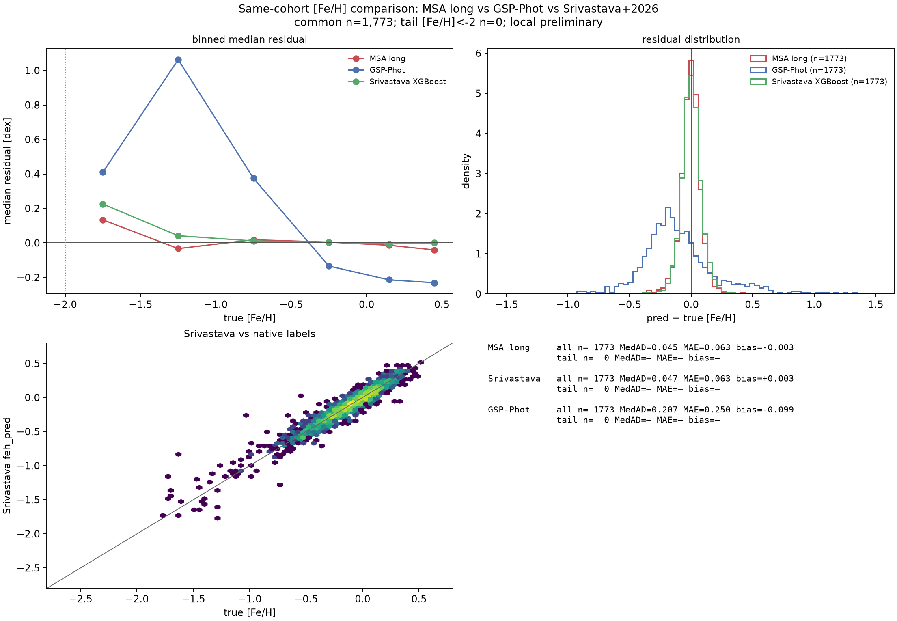
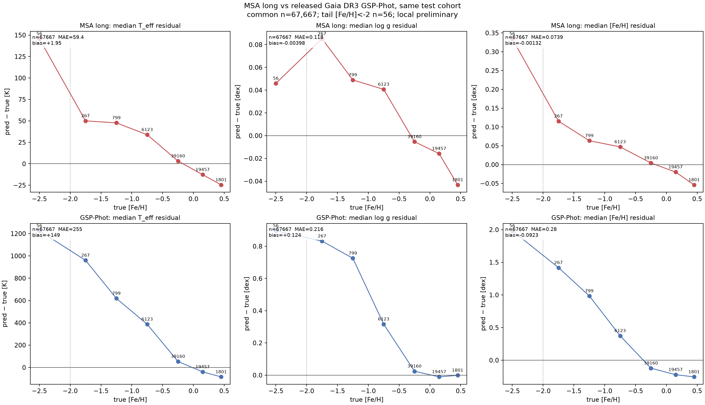

# Fair same-cohort comparison with released catalogues — first result

**Prepared:** 2026-10-22. Companion to
[released-stellar-parameter-benchmarks-20261022.md](released-stellar-parameter-benchmarks-20261022.md).

The earlier comparison used published summary numbers from different samples. Here we
crossmatch the **exact MSA test cohort** with released catalogues and recompute
identical metrics on the common stars. Both legs are now complete:
**Gaia DR3 GSP-Phot** and the **Srivastava+2026 XP [Fe/H] catalogue** (Zenodo
20645375).

---

## 1. Setup

- MSA test cohort: 97,695 stars with native APOGEE DR17 / GALAH DR3 labels.
- Predictions: long noise-aware Gaussian + reconstruction ("selected 99M") and the
  matched-budget 10M diagonal Gaussian.
- Released values: Gaia DR3 `gaiadr3.astrophysical_parameters`
  (`teff_gspphot`, `logg_gspphot`, `mh_gspphot`), fetched by Gaia TAP upload for the
  exact source IDs with `scripts/compare_released_gspphot.py`.
- Common sample with finite GSP-Phot values: **67,667 stars**; [Fe/H] < −2: **56 stars**.
- Residual = prediction − truth (native label); same truth and same stars for both
  methods.

**Important asymmetry:** MSA is trained on the same APOGEE/GALAH label families it is
tested against; GSP-Phot is a zero-shot isochrone/spectrum forward model. This is a
fair *same-star* comparison, but it measures the value of the label prior as much as
the method. It is not a truth benchmark.

---

## 2. Same-cohort metrics

### Long noise-aware Gaussian (selected 99M)

| Label | n | MedAD | MAE | bias | NMAD |
|---|---:|---:|---:|---:|---:|
| T_eff | 67,667 | 42.2 K | 59.4 K | +1.95 K | 62.5 K |
| log g | 67,667 | 0.0805 dex | 0.1176 dex | −0.0040 dex | 0.1187 dex |
| [Fe/H] | 67,667 | 0.0516 dex | 0.0739 dex | −0.0013 dex | 0.0762 dex |

Tail [Fe/H] < −2 (n=56): T_eff MedAD 151.9 K / MAE 168.2 K / bias +161.2 K;
log g 0.1336 / 0.1813 / +0.0748; [Fe/H] 0.3346 / 0.3805 / +0.3805.

### Matched-budget 10M diagonal Gaussian

| Label | MedAD | MAE | bias |
|---|---:|---:|---:|
| T_eff | 49.6 K | 70.8 K | −3.24 K |
| log g | 0.0960 dex | 0.1377 dex | −0.0085 dex |
| [Fe/H] | 0.0643 dex | 0.0929 dex | −0.0021 dex |

Tail n=56: T_eff MedAD 193.6 K / MAE 216.5 K / bias +213.2 K;
log g 0.2410 / 0.3694 / +0.3150; [Fe/H] 0.7505 / 0.8050 / +0.8050.

### Released GSP-Phot on the same stars

| Label | n | MedAD | MAE | bias | NMAD |
|---|---:|---:|---:|---:|---:|
| T_eff | 67,667 | 133.8 K | 255.3 K | +148.6 K | 207.0 K |
| log g | 67,667 | 0.0877 dex | 0.2155 dex | +0.1239 dex | 0.1365 dex |
| [M/H] | 67,667 | 0.2281 dex | 0.2801 dex | −0.0923 dex | 0.2652 dex |

Tail [Fe/H] < −2 (n=56): T_eff MedAD 1225 K / MAE 1148 K; log g 0.896 / 0.867;
[M/H] 1.982 / 1.849 (bias +1.80).

The GSP-Phot numbers are consistent with its published literature MedADs
(110–169 K, 0.059–0.218, 0.20–0.21), so the same-cohort check is behaving as expected.

### Second leg — Srivastava+2026 XP [Fe/H] (5M catalogue)

The released 5M catalogue overlaps only **1,773** of our 97,695 test stars (it is a
5M subset of Gaia XP stars, not the full 220M), and **none** of the metal-poor tail
(n=0 at [Fe/H] < −2). On that common subset:

| Method | n | MedAD | MAE | bias | NMAD |
|---|---:|---:|---:|---:|---:|
| MSA long | 1,773 | **0.0455** | **0.0629** | −0.0031 | 0.0676 |
| Srivastava+2026 XGBoost | 1,773 | 0.0471 | 0.0634 | +0.0032 | 0.0702 |
| GSP-Phot | 1,773 | 0.2067 | 0.2499 | −0.0985 | 0.2155 |

**MSA and Srivastava are statistically indistinguishable on this subset**, while
GSP-Phot is ~4× worse. The published Srivastava MAE is 0.052 on its LAMOST held-out
set; 0.063 here is consistent with the different truth labels (APOGEE/GALAH) and the
selected 5M subset. The common subset has no metal-poor stars, so this does **not**
validate the tail; it only establishes global parity with the best released [Fe/H]
catalogue on the stars where they overlap.



---

## 3. What it says

1. **On the same stars/labels, MSA long is substantially better than GSP-Phot** for
   T_eff, log g and [Fe/H], including the metal-poor tail. The matched-budget 10M model
   is also better, except its tail is wider. On the 1,773 stars shared with the
   Srivastava 5M catalogue, MSA and Srivastava have essentially identical [Fe/H]
   accuracy (MAE 0.063 vs 0.063); GSP-Phot is 4× worse.
2. **GSP-Phot degrades catastrophically for the metal-poor stars in this cohort**
   ([M/H] bias +1.8 dex at [Fe/H] < −2, T_eff +1.1e3 K). That is consistent with its
   known [M/H] limitations and with the reason its own paper says [M/H] is the weakest
   GSP-Phot parameter.
3. **This does not prove MSA is “more correct”**: it is supervised on these labels,
   while GSP-Phot is not. The right interpretation is that the label prior carries
   enormous information, and that any final claim must be validated on labels the
   model has not seen (new surveys, clusters, seismic anchors).
4. **Selection matters:** only 67,667/97,695 test stars have finite GSP-Phot values;
   the common subset is not random (extinction/quality cuts), and the tail common
   sample is only 56 stars.



---

## 4. Next legs

- **Andrae+2023 175M [M/H]** (Zenodo 7599788/7599789): the catalogues are 2.5–3.7 GB
  gz; feasible but lower priority than the completed Srivastava leg for [Fe/H].
- **Uncertainty comparison:** repeat with 16/84 released intervals and our conformal
  intervals; check coverage on the same stars, not just point residuals.
- **Independent anchors:** clusters/seismic; the only way to break the “trained on
  the labels” circularity and to validate the metal-poor tail (no released catalogue
  has a useful common tail sample).

---

## 5. Reproducibility

```bash
pixi run python scripts/compare_released_gspphot.py \
  --cohort experiments/xp/results-stellar-improvement/multi_gaussian_recon_s42_v1/paired-cohort.npz \
  --predictions experiments/xp/results-stellar-improvement/multi_gaussian_noise_recon_30e_v1/predictions.npz \
  --output docs/reports/fair-comparison-gspphot-long-20261022.png \
  --cache experiments/xp/results-stellar-improvement/fair-gspphot-20261022/gspphot-common.csv
```
