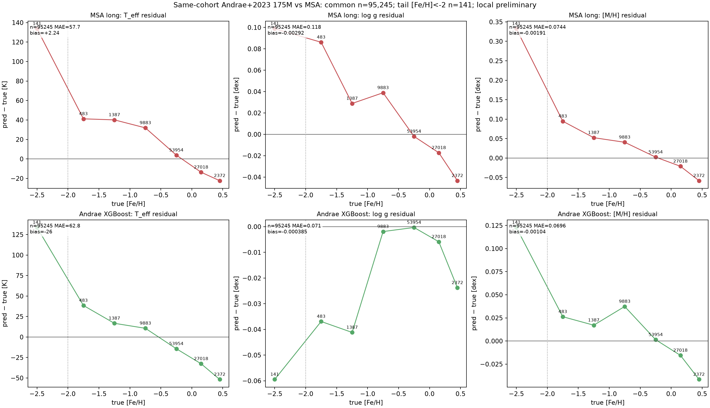

# Fair same-cohort comparison with released catalogues — first result

**Prepared:** 2026-10-22. Companion to
[released-stellar-parameter-benchmarks-20261022.md](released-stellar-parameter-benchmarks-20261022.md).

The earlier comparison used published summary numbers from different samples. Here we
crossmatch the **exact MSA test cohort** with released catalogues and recompute
identical metrics on the common stars. All three legs are now complete:
**Gaia DR3 GSP-Phot**, the **Srivastava+2026 XP [Fe/H] catalogue** (Zenodo 20645375),
and the **Andrae+2023 175M XGBoost catalogue**.

---

## 1. Setup

- MSA test cohort: 97,695 stars with native APOGEE DR17 / GALAH DR3 labels.
- Predictions: long noise-aware Gaussian + reconstruction ("selected 99M") and the
  matched-budget 10M diagonal Gaussian.
- Released values: Gaia DR3 `gaiadr3.astrophysical_parameters`
  (`teff_gspphot`, `logg_gspphot`, `mh_gspphot`), fetched by Gaia TAP upload for the
  exact source IDs with `scripts/compare_released_gspphot.py`.
- Common sample with finite GSP-Phot values: **67,667 stars**; [Fe/H] < −2: **56 stars**.
- Residual = prediction − truth (native label); same truth and same stars for both
  methods.

**Important asymmetry:** MSA is trained on the same APOGEE/GALAH label families it is
tested against; GSP-Phot is a zero-shot isochrone/spectrum forward model. This is a
fair *same-star* comparison, but it measures the value of the label prior as much as
the method. It is not a truth benchmark.

---

## 2. Same-cohort metrics

### Long noise-aware Gaussian (selected 99M)

| Label | n | MedAD | MAE | bias | NMAD |
|---|---:|---:|---:|---:|---:|
| T_eff | 67,667 | 42.2 K | 59.4 K | +1.95 K | 62.5 K |
| log g | 67,667 | 0.0805 dex | 0.1176 dex | −0.0040 dex | 0.1187 dex |
| [Fe/H] | 67,667 | 0.0516 dex | 0.0739 dex | −0.0013 dex | 0.0762 dex |

Tail [Fe/H] < −2 (n=56): T_eff MedAD 151.9 K / MAE 168.2 K / bias +161.2 K;
log g 0.1336 / 0.1813 / +0.0748; [Fe/H] 0.3346 / 0.3805 / +0.3805.

### Matched-budget 10M diagonal Gaussian

| Label | MedAD | MAE | bias |
|---|---:|---:|---:|
| T_eff | 49.6 K | 70.8 K | −3.24 K |
| log g | 0.0960 dex | 0.1377 dex | −0.0085 dex |
| [Fe/H] | 0.0643 dex | 0.0929 dex | −0.0021 dex |

Tail n=56: T_eff MedAD 193.6 K / MAE 216.5 K / bias +213.2 K;
log g 0.2410 / 0.3694 / +0.3150; [Fe/H] 0.7505 / 0.8050 / +0.8050.

### Released GSP-Phot on the same stars

| Label | n | MedAD | MAE | bias | NMAD |
|---|---:|---:|---:|---:|---:|
| T_eff | 67,667 | 133.8 K | 255.3 K | +148.6 K | 207.0 K |
| log g | 67,667 | 0.0877 dex | 0.2155 dex | +0.1239 dex | 0.1365 dex |
| [M/H] | 67,667 | 0.2281 dex | 0.2801 dex | −0.0923 dex | 0.2652 dex |

Tail [Fe/H] < −2 (n=56): T_eff MedAD 1225 K / MAE 1148 K; log g 0.896 / 0.867;
[M/H] 1.982 / 1.849 (bias +1.80).

The GSP-Phot numbers are consistent with its published literature MedADs
(110–169 K, 0.059–0.218, 0.20–0.21), so the same-cohort check is behaving as expected.

### Second leg — Srivastava+2026 XP [Fe/H] (5M catalogue)

The released 5M catalogue overlaps only **1,773** of our 97,695 test stars (it is a
5M subset of Gaia XP stars, not the full 220M), and **none** of the metal-poor tail
(n=0 at [Fe/H] < −2). On that common subset:

| Method | n | MedAD | MAE | bias | NMAD |
|---|---:|---:|---:|---:|---:|
| MSA long | 1,773 | **0.0455** | **0.0629** | −0.0031 | 0.0676 |
| Srivastava+2026 XGBoost | 1,773 | 0.0471 | 0.0634 | +0.0032 | 0.0702 |
| GSP-Phot | 1,773 | 0.2067 | 0.2499 | −0.0985 | 0.2155 |

**MSA and Srivastava have similar observed errors on this subset; no paired uncertainty analysis establishes statistical equivalence**, while
GSP-Phot is ~4× worse. The published Srivastava MAE is 0.052 on its LAMOST held-out
set; 0.063 here is consistent with the different truth labels (APOGEE/GALAH) and the
selected 5M subset. The common subset has no metal-poor stars, so this does **not**
validate the tail; it only describes similar point errors on these overlapping stars. It does not
establish equivalence, a catalogue-wide ranking, or identical [M/H] and [Fe/H] targets.


### Third leg — Andrae+2023 175M XGBoost (95,245 common stars)

The 175M catalogue covers almost the whole test cohort: **95,245 / 97,695** stars
have finite Andrae values; **69,414** are outside its training sample; the metal-poor
tail has **141** stars. Andrae reports `[M/H]`, not `[Fe/H]`, so the FeH comparison is
approximate.

| Label | MSA long MAE / MedAD / bias | Andrae MAE / MedAD / bias | Andrae held-out MAE |
|---|---:|---:|---:|
| T_eff | **57.7 / 41.0 K / +2.2 K** | 62.8 / 42.8 K / −26.0 K | 72.3 K |
| log g | 0.118 / 0.082 dex / −0.003 | **0.071 / 0.049 dex / −0.0004** | 0.073 dex |
| [Fe/H] | 0.074 / 0.052 dex / −0.002 | **0.070 / 0.049 dex / −0.001** | 0.070 dex |

Tail [Fe/H] < −2 (n=141): MSA long 161 K / 0.200 dex / 0.393 dex;
**Andrae 146 K / 0.152 dex / 0.209 dex**. Andrae is better on the tail, especially
`[M/H]`.



This is the most informative leg: on the same stars, **MSA wins T_eff (lower bias and
MAE), Andrae wins log g and [Fe/H], and Andrae is better in the metal-poor tail.**
So the current MSA model is competitive globally but is **not yet the best** on
log g, FeH and the tail — exactly the gap the A1/A2/A3 anchor work and the tail
correction programme are meant to close.

---

## 3. What it says

1. **MSA long is much better than GSP-Phot** for T_eff, log g and [Fe/H], including
   the metal-poor tail, but this is partly because MSA is trained on these labels and
   GSP-Phot is zero-shot.
2. **Against the best released data-driven catalogue (Andrae 175M), MSA is mixed**:
   better T_eff (MAE 57.7 vs 62.8 K, bias +2 vs −26 K), worse log g (0.118 vs 0.071)
   and slightly worse [Fe/H] (0.074 vs 0.070), and **worse in the metal-poor tail**
   (FeH 0.393 vs 0.209; log g 0.200 vs 0.152). The held-out Andrae subset gives the
   same ordering.
3. **This does not prove MSA is “more correct”** in either direction: it is supervised
   on these labels, while GSP-Phot is zero-shot and Andrae is trained on APOGEE plus a
   metal-poor augmentation. The right interpretation is that the label prior carries
   enormous information, and that any final claim must be validated on labels the
   model has not seen (new surveys, clusters, seismic anchors).
4. **Selection matters:** only 67,667/97,695 test stars have finite GSP-Phot values;
   the common subset is not random (extinction/quality cuts), and the tail common
   sample is only 56 stars.


---

## 4. Next legs

- **Uncertainty comparison:** done separately — see
  [uncertainty-comparison-20261022.md](uncertainty-comparison-20261022.md).
- **Independent anchors:** clusters/seismic; the only way to break the “trained on
  the labels” circularity and to validate the metal-poor tail. A1/A2/A3 plan:
  [11-anchors-a1-a2-a3.md](../plan-20261022/11-anchors-a1-a2-a3.md).

---

## 5. Reproducibility

```bash
pixi run python scripts/compare_released_gspphot.py \
  --cohort experiments/xp/results-stellar-improvement/multi_gaussian_recon_s42_v1/paired-cohort.npz \
  --predictions experiments/xp/results-stellar-improvement/multi_gaussian_noise_recon_30e_v1/predictions.npz \
  --output docs/reports/fair-comparison-gspphot-long-20261022.png \
  --cache experiments/xp/results-stellar-improvement/fair-gspphot-20261022/gspphot-common.csv
```
