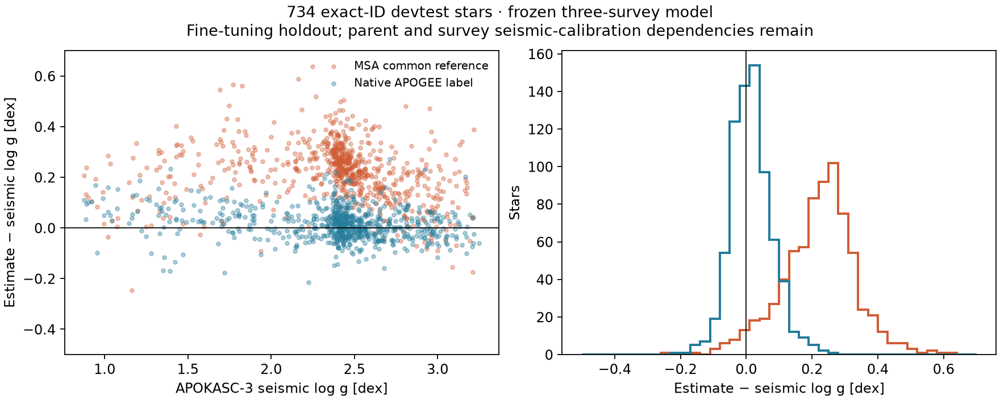

# Full Andrae coverage and seismic gravity investigation — 6 November 2026

The 2,432,999 Andrae matches previously reported are matches to existing frozen
MSA prediction exports across five roles. They are **not** the available
Gaia-XP population and do not establish a 2.4M ceiling on comparison. Andrae's
full table contains **174,922,161** stars. Our original input HDF5 contains
**218,131,884** rows; the reconstruction cache contains **150,000,000** rows.
Their exact ID overlap must be measured, not inferred from catalogue sizes.

| Count | Meaning | What it does not establish |
|---|---|---|
| 174,922,161 | Released Andrae estimates | Independent physical reference measurements |
| 218,131,884 | Rows in our original full input | Successful model predictions for every row |
| 150,000,000 | Reconstruction cache rows | Full original input footprint |
| 2,432,999 | Andrae matches to existing frozen prediction roles | Full attainable comparison population |
| 239,639 | Those matches in frozen devtest | Full-sky inference coverage |

The complete publisher-verified Andrae FITS file is already on ARC. New job
`andrae_full_footprint_census_20261106_v2` (session `qohdziqz`, 4 CPU/64 GB)
verifies its publisher checksum, joins every released ID to every raw input
shard and the cache, and writes sorted exact IDs, raw row locations, cache
membership and comparator estimates. The output distinguishes missing input
from not-yet-run inference. It performs no model inference or fitting.
Catalogue-wide model agreement requires a subsequent inference pass; accuracy
against spectroscopy/seismology uses their measured-reference subsets.

The initial v1 census invocation omitted its required output argument; its
session was explicitly stopped and its receipt records the reason. V2 is the
corrected submission; neither invocation performs model training.

## What currently explains part of the gravity problem

The old 25 October diagnosis concerns an earlier small FIT cohort (19,236
logg labels), not today's full eligible six-target pool (493,548 logg labels).
Do not conflate those experiments. The old diagnosis found exact ID joins and
faithful label projection, but severe failures when XP was removed. Changing
density heads did not remove those shared failures.

The frozen three-target model masks parallax. Andrae includes parallax and
GALAH gravities are parallax-conditioned. In the current controlled six-target
pilot, adding measured parallax lowers mixture logg CRPS from 0.08861 to
0.05605 dex on the same 6,147-star panel (36.7%). This identifies a consequential
input mismatch; it does **not** prove labels are clean, establish physical
calibration, or show that the three-target common reference is absolute truth.
The gauge of that common reference is relative to its original three surveys.

On 46,640 GALAH devtest stars outside Andrae's released training sample,
Andrae logg MAE is 0.07260 dex versus the frozen MSA's 0.10447 dex after the
proper GALAH survey mapping. This residual gap warrants direct external QA.

## Launched seismic QA

`seismic_gravity_qa_20261106_v1` (session `sz8tlqlt`, 4 CPU/32 GB) uses the
existing SHA-bound APOKASC-3 source, all 15,808 released rows before selection.
It selects Gold/Silver entries with finite positive seismic errors and exact
native Gaia DR3 identifiers. It compares saved frozen predictions against
**loggSeis**, never substituting **loggSpec**. No model is loaded or fitted.

The job reports, by FIT/TUNE/CAL/devtest/external role and evolutionary state
and gravity bin:

- Bias, MAE, NMAD and RMSE for the common gravity and, where already exported,
  APOGEE/DESI/GALAH mapped predictions.
- Native survey label minus seismic gravity on the identical stars, to locate
  label-scale disagreements separately from prediction disagreements.
- Exact mixture CRPS, PIT and central coverage against reference points, then
  separately with quoted seismic uncertainty convolved into the likelihood.
- Exact matched IDs, component arrays and references for reproducible paired QA.

It also stages the released Hon TESS table (~158k oscillating giants), K2-GAP
DR3 combined seismic parameters (~19k giants), and the current APOKASC-3 VizieR
schema. TIC/EPIC identifiers need an audited Gaia DR3 bridge before scoring;
no float-converted IDs or assumed DR2=DR3 joins. Acquisition failures are
recorded separately from completed APOKASC scoring.

A useful newer priority is Sreenivas et al. (2026), TESS CVZ sectors 1–87:
19,151 candidates, 17,617 retained unblended oscillators and 10,298 reliable
Delta-nu measurements. Its paper lists **Gaia DR2 IDs**, so a verified DR3
bridge is necessary. This release is identified, not yet acquired/scored.
The 132k-star Theodoridis TESS age catalogue inspected here uses Andrae
XGBoost temperatures; its gravity/age results must retain that dependence and
cannot be advertised as fully independent of Andrae.

## Remaining diagnosis and final-training gates

1. Compare common versus mapped predictions versus native labels versus
   seismic gravity on identical stars; split RGB/clump, gravity, Teff,
   metallicity, source, magnitude, parallax S/N, missing bands and quality.
2. Preserve calibration pedigrees: APOGEE gravity uses seismic calibration,
   seismic gravity depends weakly on adopted Teff, and model/teacher exposure
   must be checked. Current FIT stars are diagnostics, not unseen tests.
3. Compare matched parallax/no-parallax six-target arms on these same seismic
   IDs once identity/feature exports are bound, rather than comparing aggregate
   results from different populations or different model generations.
4. Investigate source flags, repeat scatter, cross-source conflict tails,
   sentinel/unit handling and survey-map derivatives; measure supervised versus
   reconstruction gradient conflict rather than assume reconstruction dominates.
5. Reserve a protected seismic subset at Gaia identity and dependency-family
   level across **all six targets**, before expanded FIT assignment. Age teacher
   use of the same star must not contaminate a claimed gravity holdout.
6. Require acceptable external gravity trends and noise-aware PDFs before the
   final large training decision. A larger head alone does not resolve an
   input mismatch or a biased reference gauge.

Sources: [Andrae release](https://zenodo.org/records/7945154),
[APOKASC-3](https://arxiv.org/abs/2410.00102),
[K2-GAP DR3](https://arxiv.org/abs/2108.05455),
[Hon TESS catalogue](https://cdsarc.cds.unistra.fr/viz-bin/cat/J/ApJ/919/131),
[TESS CVZ 2026](https://arxiv.org/abs/2604.00498),
[Theodoridis TESS source inspected](https://zenodo.org/records/15200448).

Local checks: exact-ID matcher distinguishes adjacent integers above 2^53 and
rejects floating IDs; seismic QA check distinguishes intrinsic coverage from
coverage convolved with quoted reference noise. Both tests and scoped Ruff
checks pass. Completed seismic results and independent readback verification are recorded below; the full-footprint census is still running.

## Completed first seismic result — independently verified

All **12,384** selected native APOKASC-3 entries agree by exact Gaia ID with
an independently parsed VizieR representation for seismic gravity, its error,
spectroscopic gravity, Teff and nu-max (allowing the VOTable float32 storage
rounding). All **734 devtest** saved IDs/references and the mixture mean bias
were independently recomputed. These are fine-tuning holdouts, not certified
unseen objects from the pretrained parent or survey calibration samples.

| Estimate versus seismic gravity, same 734 stars | Median residual [dex] | MAE [dex] | 90% coverage with quoted seismic error |
|---|---:|---:|---:|
| MSA common reference | +0.22871 | 0.22815 | 14.31% |
| MSA projected to APOGEE | -0.02632 | 0.08925 | 52.04% |
| MSA projected to GALAH | +0.03940 | 0.09356 | 48.37% |
| Native APOGEE label | +0.01258 | 0.04929 | Not a model PDF |

There are **no native GALAH or DESI labels** in this 734-star subset. The GALAH
projection is therefore a mapping diagnostic outside the native matched-source
reference subset, not direct validation of those survey labels. The DESI
projection is strongly displaced (+0.681 dex median); without native DESI
labels here, that can signal domain extrapolation and must not be called a
measured DESI catalogue bias.

The common-reference bias persists separately in RGB (+0.202 dex, 409 stars)
and clump (+0.260 dex, 324 stars). FIT also has +0.225 dex median bias (5,296
matches), so the pattern is not confined to devtest overfitting. Native APOGEE
labels are much closer to seismology than the common reference. This supports
a reference-gauge/observation-map problem as a major contributor; it does not
prove the complete causal chain or that every label is correct.

**The current common-scale gravity and its PDFs are not physically calibrated
on this seismic sample.** Quoted seismic-error convolution hardly changes the
common 90% coverage (14.17% intrinsic versus 14.31% convolved). The frozen
likelihood's source/noise treatment and relative common gauge must be examined
before using its tight Kiel relations as physical calibration evidence.
Do not silently shift released/archive outputs or recenter the historical
three-survey gauge. Compare explicitly versioned physically anchored variants,
using protected seismic and fundamental benchmark subsets, before final FIT.

Hon TESS **158,505** rows, K2-GAP DR3 **19,417** combined-parameter rows,
and APOKASC-3 **15,808** rows were successfully staged from VizieR. TESS/K2
have not yet been scored. New unattended worker
`decision_seismic_array_qa_20261106_v1` compares the eight current pilot arms'
saved development predictions to identical APOKASC identities as arms finish;
that smaller fixed panel is reported separately from the 734-star frozen-model
result. It loads no checkpoints and changes no training roles.

[Full source/QA manifest](msa-andrae-seismic-20261106/seismic_gravity_qa_20261106_v1-latest.json),
[independent reference and saved-array verification](msa-andrae-seismic-20261106/independent-readback-verification.json).

## Six-target matched controls and full seismic PDF follow-up

The saved development panels contain **87** common APOKASC stars in all four
completed Gaussian/mixture arms. This count is imposed by the old fixed pilot
export panel; it is not catalogue exhaustion. On these same stars:

| Six-target pilot | logg MAE [dex] | Median bias [dex] |
|---|---:|---:|
| Gaussian XP + photometry | 0.10276 | +0.03878 |
| Gaussian + measured parallax | 0.08720 | +0.02480 |
| Mixture XP + photometry | 0.11024 | +0.04166 |
| Mixture + measured parallax | 0.08008 | -0.02428 |

All four exact matched-ID hashes agree. These are a different pooled-label
six-target training recipe, so they do not isolate a causal fix for the frozen
three-survey common-reference problem. The parallax versus no-parallax
comparisons within each head are controlled. NF results remain pending.

To remove that 87-star export restriction, native CUDA worker
`decision_seismic_pdf_qa_20261106_v1` evaluates **all available eligible seismic
devtest IDs in the prepared source**, without the old hashed panel cap. It
waits for selected immutable checkpoints, binds source/reference/library/model
hashes, draws 1,024 whole six-vectors per star with bounded memory, and scores
physical logg marginal CRPS, bias and intrinsic/quoted-noise coverage on the
same IDs for each arm. This is evaluation only; no optimiser or role changes.

The full Andrae census has already processed 23,482,030 raw input rows and
found 22,062,869 matches; these are provisional partial progress, not final
coverage and not completed inference. The full catalogue remains the intended
comparison population.

Verification: five scoped/pipeline tests pass; scoped Ruff checks pass. The
independent VizieR/native and saved-array readback check also passes.

## Completed full Andrae input census

All **174,922,161 / 174,922,161** released Andrae IDs match the full
**218,131,884-row** raw input. **Zero** Andrae stars are absent from that raw
input. The reconstruction cache contains **120,181,886** of them;
**54,740,275** are present in the raw input but outside the 150M cache.
The publisher checksum and exact integer IDs were checked. The completed
inference index stores original raw shard/row locations and comparator values,
with a SHA-bound output artifact. These are input-availability counts, not
completed model-prediction counts or independent reference truth counts.
The earlier 2.4M comparator overlap was solely the existing prediction-export
scope. All released Andrae stars are available for a full inference/comparison
pass using the full raw input.
