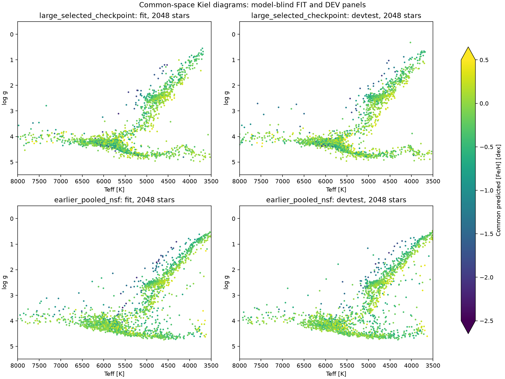
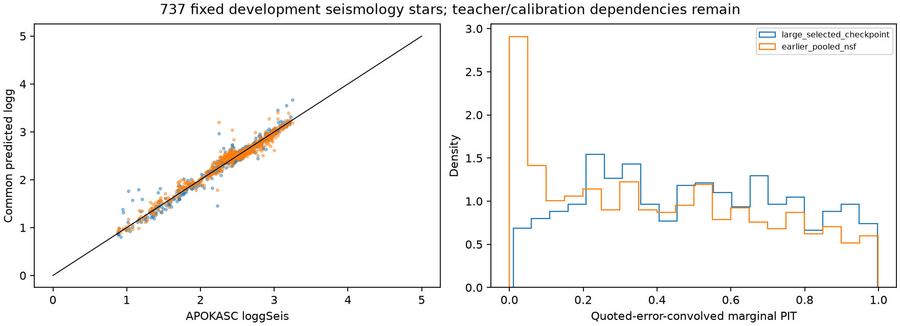
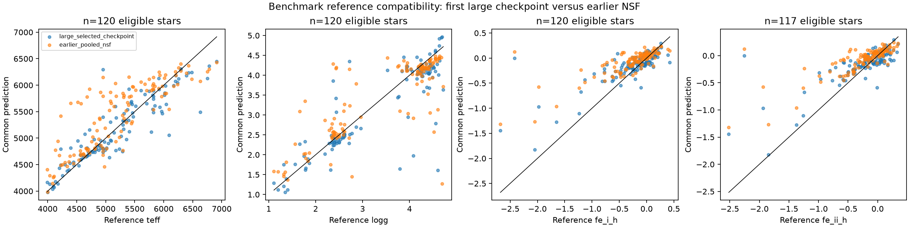

# Selected comparison-checkpoint QA

Selected final checkpoint of the older comparison architecture versus the earlier supervised-adapted six-target NSF. This does not fulfill the corrected full-Gaia architecture. Common predictions and native labels retain distinct conventions; benchmark/cluster ancestry, teacher dependencies and shared Gaia inputs remain. DEV is not a pristine final test.

Training snapshot: update 71906; epoch 2; snapshot kind final_selected.

| Model | Seismic stars | logg MAE | noisy-reference C90 |
|---|---:|---:|---:|
| large_selected_checkpoint | 737 | 0.0571 | 0.935 |
| earlier_pooled_nsf | 737 | 0.0692 | 0.825 |

Full single-star and population corner plots and source-native true-versus-predicted figures are saved beside this report. Age and distance remain posterior-teacher scales.
