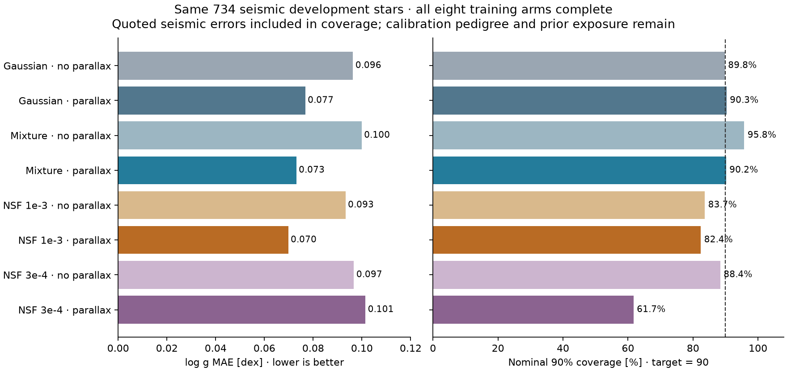

# Completed eight-arm decision wave — 6 November 2026

All eight training arms finished 10,000 updates. Selected-checkpoint PDF QA, the 734-star seismic comparison, random-panel mode QA and predeclared corner rendering are complete for all eight. These are historical pooled-label six-target pilots, not the expanded mapped-survey final training.

## Reconstruction versus label-noise covariance

The user reports that the earlier correlated-XP Gaussian reconstruction NLL did not improve downstream results and MAE performed better. Keep MAE reconstruction as the default. All eight current arms held MAE reconstruction and its 0.03 weight fixed, so this wave makes no causal comparison of reconstruction objectives. Covariance of spectroscopic label errors is a separate hypothesis, not an automatic improvement. Learned label covariance must outperform a diagonal control on held-out physical/reference diagnostics before adoption. Published covariance, where available, should not be silently discarded.

## Same-star seismic result

All rows use the same 734 APOKASC-3 development stars. Coverage includes quoted seismic errors. Stars are held out from this fine tuning, but historical parent/teacher exposure and APOGEE seismic-calibration dependencies remain. Lower MAE and CRPS are better; coverage should be assessed against nominal 90%, together with interval size.

| Recipe | Selected update | TUNE macro point score | Seismic logg MAE | Seismic CRPS | 90% coverage |
|---|---:|---:|---:|---:|---:|
| gaussian_parallax | 9000 | 0.20022 | 0.07676 | 0.05521 | 90.33% |
| gaussian_photxp | 9000 | 0.22791 | 0.09633 | 0.06854 | 89.78% |
| mdn_parallax | 8000 | 0.20325 | 0.07309 | 0.05131 | 90.19% |
| mdn_photxp | 8000 | 0.23085 | 0.09988 | 0.07219 | 95.78% |
| nsf_energy_lr3e4_parallax | 8000 | 0.20022 | 0.10144 | 0.07686 | 61.72% |
| nsf_energy_lr3e4_photxp | 9000 | 0.22760 | 0.09671 | 0.06837 | 88.42% |
| nsf_energy_parallax | 8000 | 0.19901 | 0.06977 | 0.05138 | 82.43% |
| nsf_energy_photxp | 9000 | 0.22769 | 0.09326 | 0.06756 | 83.65% |

## Lessons for model choice

1. **Retain measured parallax.** In matched input-profile controls it improves gravity point accuracy for Gaussian, mixture and the standard-rate NSF. This does not explain the separate physical-scale error in the older mapped-survey model.

2. **NSF is a serious candidate, not a failed family.** The standard-rate parallax NSF has the best observed macro TUNE point score (0.19901), seismic logg MAE (0.06977 dex) and masked standardized energy score (0.27660) in this wave. The mixture/parallax energy is 0.28051. These are recipe comparisons: NSF uses sample energy training while the analytic heads use their likelihood objectives.

3. **That NSF is underdispersed on seismic gravity.** Nominal 90% intervals cover 82.43%, versus 90.19% for mixture/parallax and 90.33% for Gaussian/parallax. On the broader 6,147-star sparse-reference PDF panel, NSF/parallax intrinsic gravity coverage is 64.95% and its median 90% width is 0.152 dex, versus mixture 85.56% and 0.233 dex. The latter comparison is against catalogue reference points without measurement-noise convolution; it is not itself a physical-calibration certificate. The seismic result independently makes calibration a real issue.

4. **No decisive NSF-versus-mixture predictive-score victory.** On seismic logg, the NSF-minus-mixture CRPS difference is +0.000074 dex, paired-star bootstrap 95% interval [-0.00238, +0.00251]. The MAE difference is -0.00331 dex, interval [-0.00700, +0.00040]. NSF is promising, but these small differences do not justify discarding the mixture control. Bootstrap uncertainty is conditional on fitted checkpoints/panel, not retraining/seed uncertainty.

5. **Lower learning rate did not fix the flow.** The parallax NSF at 3e-4 has seismic MAE 0.10144 dex and 61.72% coverage, worse than the 1e-3 recipe in this budget. Do not assume slower training means a better uncertainty model.

6. **Smoothness and unimodality do not establish quality.** The random 1,024-star logg peak diagnostic flags 29 standard-rate NSF/parallax stars (2.83%), seven mixture/parallax stars (0.68%), and zero lower-rate NSF/parallax stars. The last has the worst seismic calibration among these parallax arms. This is a descriptive gravity-mode check on an eligible development cohort, not an all-Gaia or general joint-mode frequency.

7. **Age tails improve with NSF but are not physically resolved.** Across the ten predeclared metal-poor external stress stars, standard NSF/parallax puts 0–1.11% of draws above 20 Gyr, versus 0.23–28.11% for mixture/parallax. Its largest saved age draw is still about 80 Gyr. Narrower distributions can suppress tails while under-covering references, so this is not proof of correct physical age uncertainty. Decide whether the output estimates physical age or reproduces posterior-teacher ages before choosing support constraints.

8. **The mapping problem remains separate.** The older zero-sum mapped-survey common gravity had +0.229 dex median seismic offset and 14.3% coverage. FIT/TUNE-only anchor controls removed the bias but still needed extra discrepancy spread. The completed eight-arm wave did not retrain alternative survey maps and did not test correlated label-error models.

## All six marginal proper scores

The PDF panel contains 6,147 unique stars with different observed subsets per target. There are only ten complete-six references in that panel. Age and distance scores are against posterior-reference targets. The following native-unit CRPS values summarize the parallax candidates; no significance claim is made from their small differences.

| Head | Teff [K] | logg [dex] | Fe/H [dex] | alpha [dex] | age [Gyr] | distance [kpc] |
|---|---:|---:|---:|---:|---:|---:|
| gaussian | 50.61307 | 0.05718 | 0.05370 | 0.04482 | 0.70439 | 0.05270 |
| mdn | 46.39913 | 0.05605 | 0.05189 | 0.04483 | 0.68489 | 0.05827 |
| nsf_energy | 48.86076 | 0.05835 | 0.05225 | 0.04503 | 0.67354 | 0.05282 |
| nsf_energy_lr3e4 | 53.26437 | 0.06923 | 0.05215 | 0.04472 | 0.67401 | 0.05270 |

## Next experiments, deliberately keeping reconstruction fixed

Keep NSF/parallax and mixture/parallax as candidates; no final family promotion yet. First isolate physical reference-scale choices with the same head and inputs. Then compare diagonal, regularized correlated and robust source-error treatments under the same anchored convention. Retain the simpler error model if correlation fails held-out validation. Do not let a covariance model absorb a biased mean calibration.

For the NSF calibration problem, compare the current energy-only objective with an explicit marginal proper-score objective, retaining identical source/error assumptions; use separate CAL identities for any post-hoc recalibration. Changing the loss, calibration and survey mapping simultaneously would obscure the cause. Since six marginals are acceptable, a marginal-first flow remains a valid alternative to forcing six-dimensional integration.

The mapped-survey formulation must cover all six targets with source-specific observed subsets and measurement definitions. The current mapped checkpoint still covers three atmospheric parameters, while these eight six-target pilots use pooled labels. Neither is already the final expanded-survey model. Correlated XP reconstruction, learned label covariance, contrastive-flow conformal and SLS were not stellar-training ablations in this completed wave; synthetic interface checks are not a substitute.

## Data and execution accounting

The complete exact-ID census confirms all 174,922,161 released Andrae stars exist in the 218,131,884-row raw input. The 150M reconstruction cache covers 120,181,886 of them, leaving 54,740,275 outside that cache. The earlier 2.4M comparison was limited by prediction exports. Full-footprint inference remains a separate task.

All original manifests, failed historical integration gates and source hashes remain preserved. The selected seismic NPZ files for the Gaussian, mixture and standard-rate parallax NSF were independently downloaded and producer-SHA verified. Their exact IDs and seismic reference values were checked before paired bootstrap comparisons. The report loader verified saved prediction artifacts separately in the completed array-QA job.

[Machine-readable summary](msa-completed-wave-20261106/summary.json) · [Mapping audit](msa-mapping-density-audit-20261106.md) · [Planned mapping ablations](../../configs/logg-mapping-ablation-plan-20261106.json)
