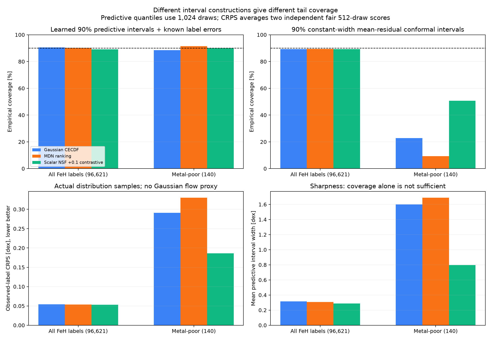
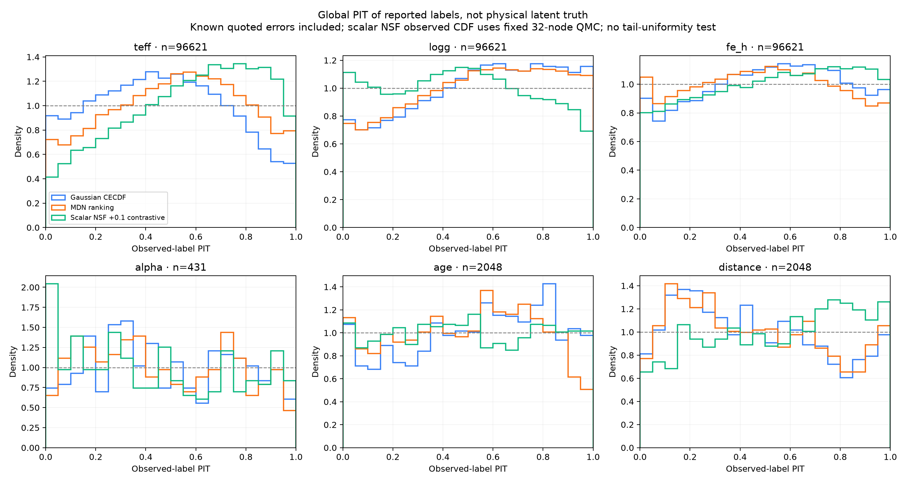
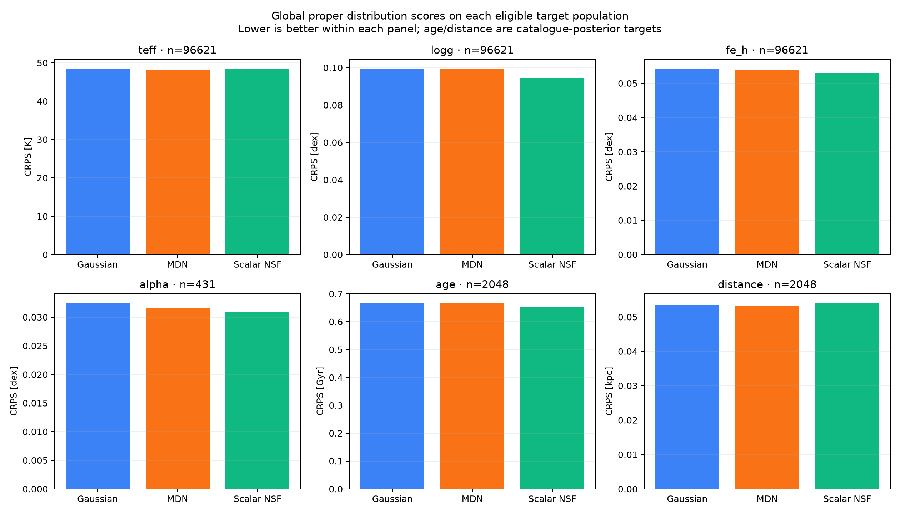

# Six-target distribution diagnostics — 24 October 2026

The learned predictive intervals are more useful in the metal-poor tail than the earlier constant-width mean-residual conformal intervals. For the fixed, tuning-selected scalar NSF plus 0.1 contrastive recipe, the learned 90% observed-label FeH interval covers 126/140 stars (90.0%) with mean width 0.798 dex. Its constant-width conformal interval covers only 50.7%. These are different constructions; neither establishes physical-truth calibration or arbitrary-tail guarantees.

The same learned interval comparison gives Gaussian 88.6% coverage / 1.600 dex width and MDN 91.4% / 1.688 dex. Observed-label tail CRPS is 0.18593 dex for NSF, 0.29099 Gaussian and 0.32987 MDN. Lower is better: the flow improves this proper score while using about half the interval width. Global CRPS differences are smaller (0.05306/0.05434/0.05375dex for NSF/Gaussian/MDN). MDN has a smaller global FeH PIT KS and slightly better distance CRPS. Keep both model families in the shortlist; this is not an isolated causal contrastive-loss comparison or a universal winner.

All three models were fixed using TUNE before these TEST metrics. CANFAR inference-only jobs a35z514d/j6cj12m5/f7hmdlse completed at source cfe1e23/library6bd8b93 without fitting. All 36 required artifacts were preserved with SHA/NPZCRC. CPU metadata-only export ck0j14rj at b756192 supplied omitted FIT normalization scalars from immutable state dictionaries; no model was constructed or executed, and no completed inference was repeated. Future evaluations now export these scalars directly.

Independent NumPy checks reproduced full-role masks, target identities, finite-sample quantiles/pinball/interval arithmetic, PIT ranges/KS, all reported counts/means, missing-error identities and Vario=-CRPS. Direct pairwise sample CRPS/energy/variogram references were checked on actually observed bounded CAL/TEST pilot rows. Existing independent head/source proofs transfer by exact model/input hashes. This is not a full independent network-CDF replay, an exact SGD-trajectory certificate or physical truth validation. SourceCI964passed/4skipped; synthetic and cache-preservation regressions passed.

Scores use the actual learned families. Gaussian/MDN intrinsic and observed marginal CDFs are analytic; scalar NSF intrinsic CDF is exact via its monotone transform, while its observed convolution uses the declared fixed 32-node approximation. Native CRPS/pinball/interval scores use two independent 512-draw score replicas and 1,024 pooled empirical quantiles. Energy uses 128 members per replica and variogram 512, in fixed FIT-standardized coordinates (natural-log age and distance). Vario rho1 is negative CRPS and higher is better; it is distinct from the multivariate variogram score. Replica half-gaps diagnose Monte Carlo variation, not model or population uncertainty.

Known quoted diagonal measurement errors are included in observed-label scores. Unknown errors are not known zero; StarHorse age/distance posterior widths are not measurement-error likelihoods. Intrinsic distributions scored against noisy labels do not directly establish latent-truth calibration. Conditioning on measured FeH below−2 changes the PIT null: tail PIT KS is descriptive, not a uniformity hypothesis test.

Only four TEST stars have all six reference targets, versus 96,621 native-three and 2,048 age-distance objects. There are no eligible metal-poor alpha, age or distance references. Full-six energy/variogram values are available as tiny-sample diagnostics, not a defensible six-dimensional ranking. Sparse data do not identify an empirical six-dimensional physical copula.

The [existing dashboard](msa-density-review-20261022.html#final-distribution-20261024) links the complete global/metal-poor/survey CAL+TEST CSV/JSON and vector PDFs. All three plotted figures were visually checked. Raw source arrays, proof scripts, fitted scalars, pilot draws and provenance remain under experiments/xp/results-stellar-improvement/final-six-distribution-metrics-20261024. Original failed reports are unchanged. Exploratory Monte Carlo median point metrics are separate diagnostics; a final point-functional choice must use TUNE, not these TEST differences.
