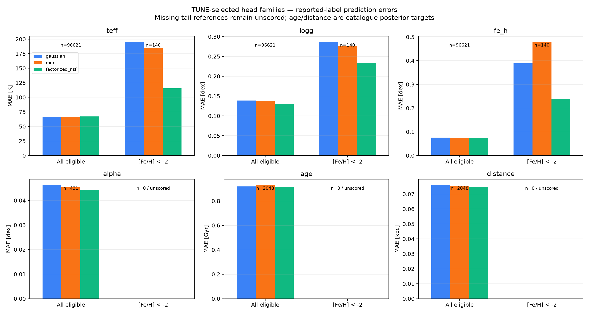
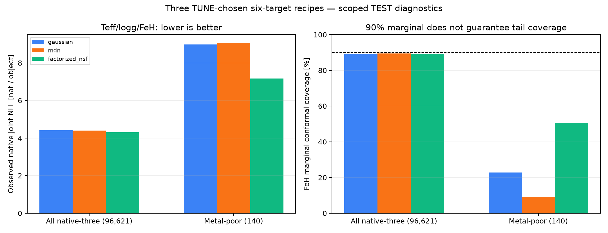

# Six-target comparison — 24 October 2026

All 40 candidate fits and their independent CANFAR numerical/source/conformal audits completed. The final large parent completed 4.5 billion presentations. All results and original failed historical reports are preserved. These checks do not certify exact CUDA optimization trajectories, physical truth, or an identified six-dimensional posterior.

Keep three candidate families for further training: Gaussian with CE/CDF auxiliary loss, MDN with per-label ranking, and scalar NSF with NLL plus 0.1 contrastive loss. Each was chosen by the lowest six-target tuning likelihood within its family before test comparisons. Different auxiliary objectives make this a recipe comparison rather than an isolated family ablation.

The chosen NSF has the strongest native-label tail results among these three: metal-poor FeH MAE 0.239 dex, versus 0.390 Gaussian and 0.480 MDN. Native-three observed joint NLL is 7.174 versus 8.979 and 9.053; lower is better, natural log density per object in K/dex/dex. Its global MAEs are 67.26 K, 0.1304 logg, 0.07347 FeH, 0.04424 alpha, 0.9129 Gyr and 0.07492 kpc, against each eligible reported-label population. Age and distance are StarHorse posterior targets.

Contrastive improvement is not uniform: matched seed49 slightly worsens tail NLL while seed50 improves it substantially. Both improve tail FeH MAE. Large-parent base models improve FeH errors over matched parent86 controls across both seeds and all three heads, but inherited FeH supervision and pretraining both differ.

Constant-width mean-residual conformal intervals remain inadequate in the tail: the chosen NSF covers only 50.7% of 140 metal-poor labels. **The newly evaluated learned 90% observed-label predictive intervals instead cover 90.0%, with width 0.798 dex**; these are different uncertainty constructions. See the [full distribution diagnostics](msa-final-six-distribution-metrics-20261024.md). There are no eligible metal-poor alpha, age or distance references in this crossmatch. No loss or attractive corner plot resolves that evidence gap.

[Browse all eight metal-poor stars and three models](msa-metalpoor-six-target-corners-20261024.html). Each figure uses 8,192 intrinsic predictive draws and common axes across models. Gaussian and scalar NSF coordinates are conditionally independent. MDN uses a shared component, with sparse pair-label support shown. Missing references are not imputed. Representative first-star panels were visually reviewed for all three models; all 24 saved sample/figure bundles passed hashes, finite-coordinate and shared-axis checks.

The existing [density dashboard](msa-density-review-20261022.html#final-six-20261024) links all 40 recipes' global, metal-poor and survey CSV/JSON plus vector PDFs. [CRPS, PIT, energy and variogram are now evaluated for the three fixed candidates](msa-final-six-distribution-metrics-20261024.md), without approximating non-Gaussian models by Gaussian moments. The complete six-target TEST block has only four objects and is not a robust joint-density ranking. [Provenance receipts](msa-final-six-evidence-20261024.json) bind all 40 checkpoint/prediction/calibration files to the independent reports.
