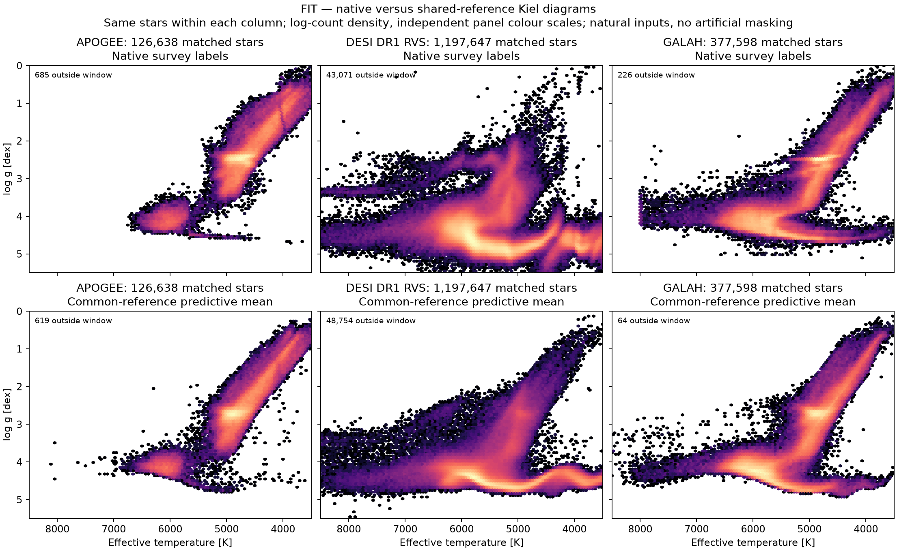
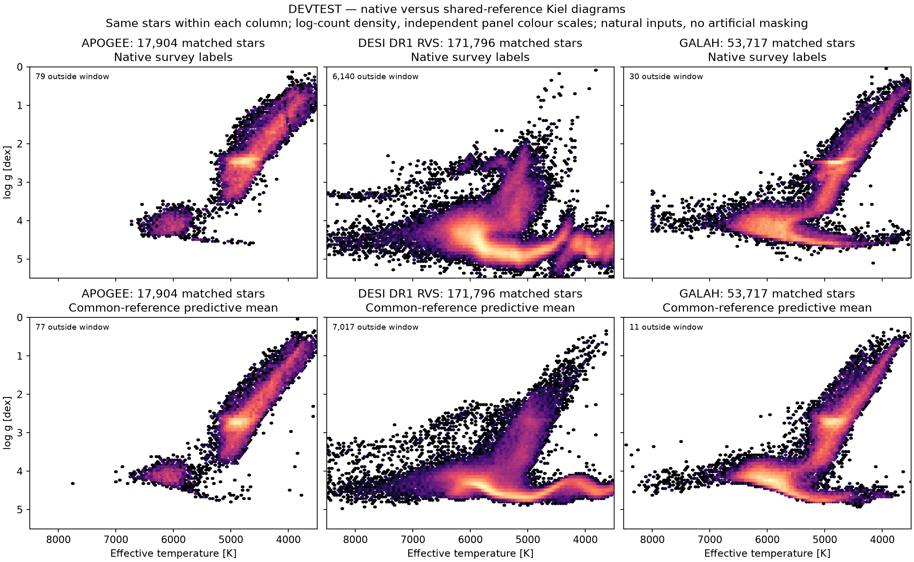

# Full-data common-reference MSA — completed 5 November 2026

The scaled run completed **three full FIT passes**, with masked reconstruction
active and joint training of the encoder, reconstruction decoder, stellar
mixture head and relative survey mappings. It then generated feature-only,
naturally unmasked predictions for **2,523,274 primary-input-eligible stars**.

This completes the requested supervised multi-survey adaptation and inference
stages using the existing pretrained MSA. It is the native MSA path, with a
four-component joint non-Gaussian mixture over Teff, logg and Fe/H. A frozen
Gaussian branch supplies coordinates; it does not constrain the prediction to
a single Gaussian. The scaled run did not train an autoregressive NF.

## Training and selection

- **1,736,618 FIT stars** per pass, shuffled without replacement; 1,698,746 have
  retained stellar measurements and 37,872 contribute reconstruction only.
- **5,131,568 retained scalar survey measurements per pass**, grouped by star
  in the joint likelihood. Three passes give 5,209,854 star presentations and
  15,394,704 scalar-label presentations, not that many unique stars.
- Batch 1,024, microbatch 128; **5,088 optimizer updates**. The final partial
  batch of every pass was retained.
- Separate natural-input supervised and masked reconstruction forwards share
  the encoder. Reconstruction masks 50% of available XP coefficients and 20%
  of other reconstruction-prefix features; its loss weight is 0.03.
- All three survey mappings train with an exact per-target zero-sum gauge.
  Thus the common reference is relative to APOGEE, DESI DR1 RVS raw and GALAH,
  rather than an independently certified physical scale.

Only the fixed 16,384-identity TUNE panel selected the epoch checkpoint;
unlabeled panel stars do not contribute to the label likelihood. Devtest
predictions were made after selection, without training or recalibration.

| Full FIT passes completed | Joint observed-data TUNE NLL |
|---|---:|
| 1 | 4.896801 |
| 2 | 4.809443 |
| 3, selected | **4.768035** |

These are comparable across this table, because the panel is fixed. They are
not directly comparable with the earlier 2,048-star pilot scores. Three passes
are a completed bounded run, not a demonstration of convergence. The value
4.768 is a TUNE score, not a devtest score.

## Kiel diagrams

Top rows are native survey labels. Bottom rows are **common-reference predictive
means for exactly the same stars in each column**. All plotted model predictions
use features alone; survey labels are not inputs to these predictions. The
plots use log counts, independent panel colour scales, matching axes, and
explicit counts outside the displayed temperature/gravity window.

### Training cohort



### Held-out devtest cohort



The main sequence is visibly tighter in the common-reference predictions,
particularly for DESI, and the FIT/devtest morphologies are similar. These are
predictive-mean diagrams: regression toward a learned population relation can
also narrow a sequence. This visual result alone does not establish physical
accuracy, valid rare-star uncertainties, or joint credible-region coverage.
The inherited model's historical exposure is not certified independent.

[Common FIT predictions by predicted metallicity](msa-fullfit-results-20261105/kiel-common-fit.png)
and [common devtest predictions by predicted metallicity](msa-fullfit-results-20261105/kiel-common-devtest.png)
separate the stellar populations without grouping stars by their native survey
metallicity. Those groups describe model predictions, not independent truth.

The [distribution diagnostic](msa-fullfit-results-20261105/kiel-devtest-distribution.png) compares these sharp predictive means with one intrinsic joint draw per devtest star. The sampled population is broader, as expected: a sharp mean sequence is not a narrow uncertainty distribution. No measurement-noise draw was added.

## Prediction exports

Every primary-input-eligible star in the following roles was predicted:

| Role | Stars |
|---|---:|
| FIT | 1,736,618 |
| TUNE | 248,113 |
| CAL | 247,705 |
| Devtest | 248,489 |
| External | 2,291 |
| Excluded from training, but input-eligible | 40,058 |
| **Total** | **2,523,274** |

Raw rows lacking primary-input eligibility were not assigned predictions.
The excluded role is retained explicitly; an export is not a science-quality
endorsement of those stars.

Full distributions are retained, not just Kiel points: each HDF5 contains exact
int64 source IDs, four mixture weights, physical component means and Cholesky
factors, exact mixture mean/covariance, and the native survey values/errors/masks.
Component target order is **Teff [K], logg [dex], Fe/H [dex]**; survey order is
**APOGEE, DESI DR1 RVS raw, GALAH**.

All files are under:

```
/arc/projects/k-pop/msa_runs/stellar-improvement-20261015/multisurvey_joint_fullfit_20261105_v1/
```

Selected full joint checkpoint:

```
checkpoint-00005088.pth
SHA256 9328ab102a54fae7fb541f08f4b478128f327834c4398bebccfff07112205fd7
```

It includes encoder/decoder/reference state, mixture state, survey mappings,
FIT context normalization, optimizer state and training position. Prediction
files are named `predictions-fit.h5`, `predictions-devtest.h5`, and analogously
for the other roles. Their paths, native producer hashes and identity digests
are in [exports.json](msa-fullfit-results-20261105/exports.json).

## Evidence and remaining limits

Code was pinned to `eef5e16e1ef4391c516774fe98c384f00e2c8ebc`, with torchregress
`2777b0de88121768434725ef227893cd35595d2a`. CANFAR session `anpmklw8` used one
H100 NVL 1g.12GB MIG allocation, eight requested CPU cores and 128 GiB RAM.
This scaled the data coverage; it was not a distributed multi-GPU run.

The full local suite passed **1,323 tests, four skipped**. Tests verify
role-restricted cache fidelity against source records, exclusion of other
roles, encoder gradients from stellar supervision, decoder gradients from
reconstruction, survey/mixture gradients and physical mixture moments. Native
first-update checks confirmed all four gradient paths active; finite-gradient
checks remained enabled for every optimizer update.

The complete devtest HDF5 byte hash was independently matched to its native producer receipt. All 248,489 devtest records passed finite-parameter, normalized-mixture-weight, positive component-Cholesky and exact mixture-moment checks. There are zero nonpositive mean Teff values and zero identity overlaps with the independently checked FIT stream. See the [independent audit](msa-fullfit-results-20261105/independent-audit.json). This is an integrity and mathematical-consistency check, not an accuracy or coverage certificate.

One complete actual FIT identity stream was independently checked locally:
1,736,618 unique IDs, with sorted digest exactly matching the preserved FIT
census. The native producer reports all three complete passes and all six
exports complete. Large FIT prediction-file hashes are producer-computed;
the full FIT catalogue was not downloaded for an independent byte rehash.

The observation model still uses illustrative [100 K, 0.1 dex, 0.1 dex] source
floors, diagonal catalogue-error covariance and first-order survey mappings.
Physical reference calibration and uncertainty calibration remain separate
validation work. No test-based checkpoint reselection was performed.

- [Completed native manifest](msa-fullfit-results-20261105/manifest.json)
- [Epoch scores and selected checkpoint receipts](msa-fullfit-results-20261105/epoch-scores.json)
- [Native log](msa-fullfit-results-20261105/native-session.txt)
- [Training design](msa-fullfit-programme-20261105.md)
