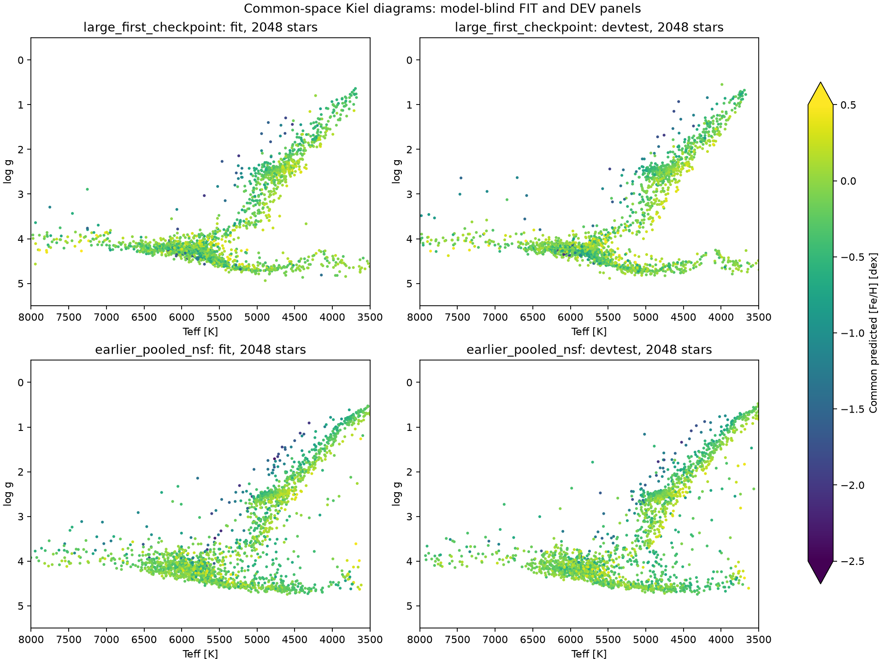

# Completed first-epoch external QA update

The epoch-one external QA has completed. The source-mapped production model at update 35,953 improves several point metrics over the older pooled NSF at update 8,000. This changes the earlier conclusion based on the early update-2,000 snapshot and 1,500-update controls. It does not isolate a causal benefit of mappings, because the production training also differs in data, sampling, supervision and training duration.

| Same-reference comparison | Stars | Older pooled NSF, no explicit survey maps | Epoch-one mapped model |
|---|---:|---:|---:|
| APOKASC DEV logg MAE [dex] | 737 | 0.069206 | 0.063075 |
| APOKASC DEV logg NMAD [dex] | 737 | 0.074441 | 0.059149 |
| APOKASC quoted-noise 90% inclusion | 737 | 82.50% | 91.45% |
| TESS DEV logg MAE [dex] | 12,017 | 0.086900 | 0.084741 |
| TESS DEV logg NMAD [dex] | 12,017 | 0.073464 | 0.089627 |
| TESS quoted-noise 90% inclusion | 12,017 | 86.87% | 78.89% |
| Benchmark logg MAE [dex] | 120 | 0.390271 | 0.430532 |
| Benchmark Teff MAE [K] | 120 | 324.586 | 250.977 |
| Benchmark Fe I/H MAE [dex] | 120 | 0.232397 | 0.197665 |
| Benchmark Fe II/H MAE [dex] | 117 | 0.214618 | 0.189757 |

The TESS point MAE gain is small and should not be described as better precision or better uncertainty calibration: robust residual scatter grows, and interval/reference inclusion falls well below 90%. APOKASC shows improvement in point error, robust scatter and interval compatibility, but shares the source scale used for FIT supervision. Reference uncertainties, derived-label dependencies and possible ancestor exposure remain. The benchmark comparison is not a certificate of fully independent physical truth either.

The old model had supervised encoder fine-tuning with a six-target NSF, pooled targets and no explicit learned source maps. The new production model uses a six-target NSF with learned spectroscopic observation maps and a fixed seismic identity reference, joint encoder/decoder fine-tuning, expanded native labels and repeated seismic supervision. These differences still prevent attributing the change specifically to mapping.

A direct mapping-effect experiment would keep native label records, weights, seismic treatment, encoder policy, initialization and update budget identical, changing only native-survey identity versus learned maps. The completed seismic-map controls do not provide that particular ablation.

[Completed epoch-one benchmark/cluster report](https://ws-uv.canfar.net/arc/files/projects/k-pop/msa_runs/stellar-improvement-20261015/expanded_epoch1_checkpoint_report_20261108_v1/report.md) · [TESS diagnostic manifest](https://ws-uv.canfar.net/arc/files/projects/k-pop/msa_runs/stellar-improvement-20261015/tess_epoch1_checkpoint_qa_20261108_v1/manifest.json)

