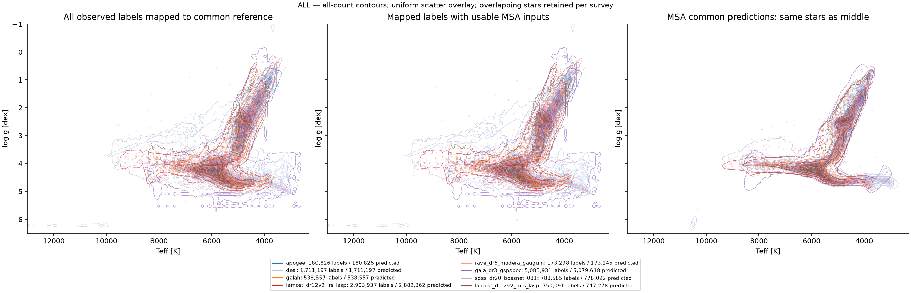
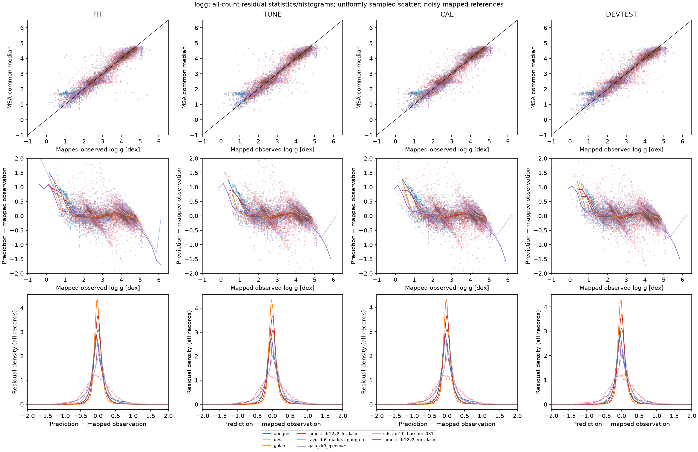

# Full label-union common-reference QA

Complete usable labelled-source registry, immutable first large checkpoint. All histogram counts and residual statistics use all eligible measurements; scatter overlays use fixed uniform samples. Inverse-mapped noisy survey observations are references, not physical truth. No averaging of overlapping surveys. CAL is diagnostic only here; no new correction is fitted.

Prediction stars: 10,427,497; unique usable spectroscopic-union stars: 10,403,916; checkpoint update: 2000.

An outer join retains all available labels; it does not define a unique true label. Each source measurement is transformed with the exact inverse of its learned monotone observation map. Overlap remains multiple measurements. Individual source maps do not establish an absolute physical reference.

Kiel panels require Teff and logg actually observed in the same survey. Predictions are shown on identical stars. Density contours use every in-range record; scatter is a fixed uniform overlay. Tail counts are recorded in the manifest. Teacher age/distance channels are shown separately in residual statistics and are not spectroscopic age/distance truth.

FIT residuals include optimization exposure; TUNE has selection exposure; DEV has development exposure. CAL is not used to adjust this model or intervals. Raw interval-reference inclusion omits measurement noise and is not a calibrated coverage claim. Full statistics: [CSV](residual-statistics.csv).

Cluster median distributions and equal-star posterior mixtures are different quantities. Narrower distributions alone do not establish better physical calibration.

