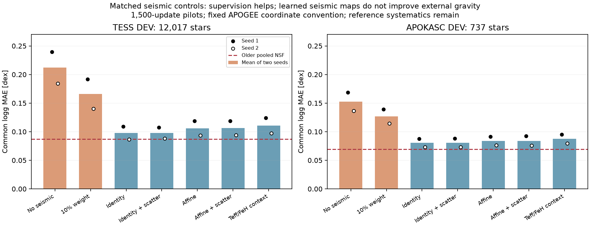
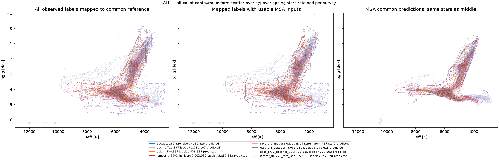

# Experimental insights — 8 November 2026

> **New completed-epoch results:** The update-35,953 mapped production model now beats the older NSF on APOKASC gravity MAE and slightly on TESS MAE, while benchmark gravity and TESS interval coverage remain worse. The earlier conclusions below concern short pilots/early snapshots. See [the completed-epoch update](epoch1-update.md).

> **Correction:** The contextual seismic map modestly improves held-out predictions **after projection onto the seismic catalogue scale**. The earlier “did not improve” conclusion concerned common gravity compared directly with raw seismic labels and was too broad. The older NSF also carries indirect seismic calibration through APOGEE `LOGG`. See [the coordinate-aware reanalysis and provenance clarification](seismic-mapping-clarification.md).

Checked approximately 11:40 Vancouver time. All 17 seismic-control fits and their paired comparison are complete. The large run is still training. Conclusions below distinguish the 1,500-update matched controls, the early update-2,000 full-registry QA and the completed-epoch model whose external readout has just been launched.

## Seismic supervision protects gravity in the matched controls

The following are arithmetic means across the two joint-training seeds, evaluated on identical fixed references. All controlled arms use an APOGEE gravity coordinate convention. The older NSF is the common initialization, not another arm trained for the same expanded-source budget. No CAL data enter these controls.

| Treatment | TESS DEV logg MAE, 12,017 stars | APOKASC DEV logg MAE, 737 stars |
|---|---:|---:|
| Older pooled NSF, before adaptation | 0.0870 dex | 0.0691 dex |
| Seismic loss off | 0.2119 dex | 0.1525 dex |
| Seismic weight ×0.1 | 0.1661 dex | 0.1269 dex |
| Identity seismic map, full weight | 0.0978 dex | 0.0805 dex |
| Identity + 0.02 dex extra independent scatter | 0.0979 dex | 0.0806 dex |
| Learned affine seismic map | 0.1059 dex | 0.0837 dex |
| Learned affine + extra scatter | 0.1066 dex | 0.0839 dex |
| Temperature/iron-dependent seismic correction | 0.1107 dex | 0.0875 dex |

Both joint seeds show large improvement from retaining the seismic loss relative to removing it. For TESS, identity-minus-off MAE changes are −0.1306 and −0.0976 dex. Their paired-star bootstrap intervals exclude zero, but these intervals are conditional on the fixed seeds and exclude shared reference systematics and broader training variance. Two seeds demonstrate direction consistency, not an exhaustive uncertainty assessment.

The frozen-encoder control shows the same pattern: TESS MAE 0.2200 dex without seismic loss versus 0.1033 with identity seismic supervision. Thus changing encoder weights is not required for the gravity drift. Head/source-map adaptation and source weighting/reference interactions are sufficient candidates; the experiment does not isolate which native survey or calibration defect causes it.

## Learned seismic calibration did not improve external gravity here

Affine and contextual seismic maps improve nonseismic native TUNE macro CRPS slightly relative to identity, but worsen common-reference TESS and APOKASC errors in both seeds. Mean TUNE CRPS is 0.158764 for identity and 0.158664 for affine, a difference of only 0.000100 (about 0.063%). Mean TESS error increases by 0.00812 dex. Aggregate survey-space fit is therefore insufficient by itself to select the physically useful common representation.

The 0.02 dex independent scatter control has no consistent benefit. This does not test every noise model and does not represent uncertainty in a shared instrument zero point. The learned calibration parameters are regularized point estimates; these results do not prove that seismic labels are unbiased or have no instrument/pipeline/model systematics.

The full-weight identity controls still do not consistently beat the older model: TESS errors are 0.1092 and 0.0864 dex, versus older 0.0870; both APOKASC errors exceed older 0.0691. Seismic supervision helps the new training recipe resist drift, but does not explain or eliminate the overall regression. Removing it is not supported by these controls; promoting a more flexible seismic map is not supported either.

## Abundance preservation needs separate attention

For the same 632 selected 47 Tuc stars, older common Fe/H NMAD is 0.166 dex. Frozen-encoder identity supervision gives 0.169 dex, while joint identity training gives 0.194 and 0.189 dex. This one-cluster, one-frozen-seed comparison suggests checking encoder adaptation when preserving abundance relations. It is not evidence that freezing universally improves physical predictions; tighter scatter can also result from shrinkage.

## Full-registry QA is complete, but describes the early checkpoint

The full source-v5 inference contains **10,427,497 usable stars**, including **10,403,916 unique stars in the spectroscopic-label union**. The complete spectroscopic label union, including stars without predictions, contains 10,438,779 IDs. Every retained native observation is inverse-mapped separately; overlapping survey measurements are not silently averaged. All-count density plots use every in-range observation, while their scatter overlays are uniformly bounded samples.

These products are bound to update **2,000**, not the newest training state. All six targets and FIT/TUNE/CAL/DEV residuals, mapped-label/prediction distributions, globular posterior mixtures and full-release Andrae/GaiaNet joins on this prediction footprint have completed.

Survey mapping does not uniformly reduce disagreement. On identical DEV overlap stars, gravity-difference NMAD changes as follows:

| Pair | Stars | Native | Mapped common |
|---|---:|---:|---:|
| APOGEE / Gaia GSP-Spec | 8,472 | 0.315 dex | 0.262 dex |
| APOGEE / GALAH | 1,519 | 0.093 dex | 0.089 dex |
| APOGEE / LAMOST LRS | 3,251 | 0.160 dex | 0.146 dex |
| APOGEE / RAVE | 375 | 0.324 dex | 0.372 dex |
| APOGEE / BOSSNet | 898 | 0.155 dex | 0.159 dex |

A zero median residual can coexist with wide scatter. For example, early-checkpoint DEV gravity MAE against mapped noisy labels is 0.092 dex for GALAH, 0.217 for GSP-Spec and 0.312 for RAVE. These quantities combine prediction errors, reference noise and systematics; they are not independent measurements of MSA physical error. Parameter-dependent native-survey corrections and source weighting are plausible next hypotheses, rather than a demonstrated cause.

## Large training and fresh evaluation

Latest inspected progress: 57,100 joint updates, one full FIT-record epoch completed, and 5,413,632/9,203,880 records (59%) through epoch two. Approximately 79% of the planned 71,906 updates are complete. At the observed early-average rate, roughly 10–11 hours of training remain, excluding final evaluation overhead. The first completed-epoch TUNE macro source-target CRPS is 0.138764; it is not directly comparable to the control table's differently aggregated metric.

New CUDA scoring is running on the selected completed-epoch checkpoint, with the same held-out stars, benchmarks, clusters and original NSF comparator. The immutable snapshot and its source binding are saved in `expanded_epoch1_checkpoint_qa_20261108_v1` (session `irttn21q`); benchmark/cluster report `expanded_epoch1_checkpoint_report_20261108_v1` (session `i7thtv1z`), and TESS report `tess_epoch1_checkpoint_qa_20261108_v1` (session `uof8qnrx`). Those external results are not available yet; the large model should not be judged solely from its early 2,000-update readout.

- [Completed matched experiment report](https://ws-uv.canfar.net/arc/files/projects/k-pop/msa_runs/stellar-improvement-20261015/seismic_supervision_comparison_20261107_v1/report.md)
- [Completed full-registry plot report, update 2,000](https://ws-uv.canfar.net/arc/files/projects/k-pop/msa_runs/stellar-improvement-20261015/full_label_union_report_20261107_v1/report.md)
- [Fresh completed-epoch QA progress](https://ws-uv.canfar.net/arc/files/projects/k-pop/msa_runs/stellar-improvement-20261015/expanded_epoch1_checkpoint_qa_20261108_v1/manifest.json)

The practical decision is to retain seismic supervision as the working control, withhold promotion of learned seismic calibration/noise changes, and assess the completed-epoch external readout before changing the large model. Neither a prettier Kiel diagram nor lower aggregate native loss establishes an unbiased common reference.
