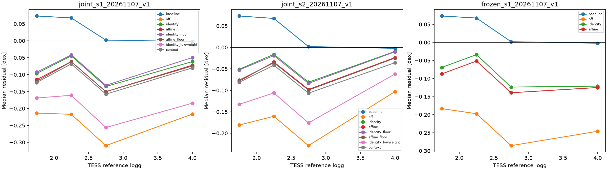

# Matched seismic supervision experiments

Fixed APOGEE gravity convention for all controlled arms, not the production seismic gauge. Neutral start before explicit APOKASC supervision. FIT only for gradients; terminal-budget TUNE and DEV diagnostics. CAL is not opened. No automatic production replacement.

Rows appear as terminal readouts finish. Positive paired ΔMAE means worse than seismic-off. Confidence intervals resample stars and do not capture uncertainty in instrument calibration or training variance.

| Suite | Arm | TESS N | TESS logg MAE | TESS median bias | APOKASC common MAE | Native nonseismic TUNE macro CRPS |
|---|---|---:|---:|---:|---:|---:|
| seismic_supervision_joint_s1_20261107_v1 | off | 12017 | 0.23975 | -0.23684 | 0.16839 | 0.158763 |
| seismic_supervision_joint_s1_20261107_v1 | identity | 12017 | 0.10919 | -0.06518 | 0.08784 | 0.158502 |
| seismic_supervision_joint_s1_20261107_v1 | affine | 12017 | 0.11845 | -0.08172 | 0.09132 | 0.158381 |
| seismic_supervision_joint_s1_20261107_v1 | identity_floor | 12017 | 0.10770 | -0.06236 | 0.08805 | 0.158589 |
| seismic_supervision_joint_s1_20261107_v1 | affine_floor | 12017 | 0.11894 | -0.08250 | 0.09218 | 0.158408 |
| seismic_supervision_joint_s1_20261107_v1 | identity_lowweight | 12017 | 0.19170 | -0.18186 | 0.13931 | 0.158686 |
| seismic_supervision_joint_s1_20261107_v1 | context | 12017 | 0.12407 | -0.08933 | 0.09526 | 0.158449 |
| seismic_supervision_joint_s2_20261107_v1 | off | 12017 | 0.18402 | -0.17528 | 0.13651 | 0.159644 |
| seismic_supervision_joint_s2_20261107_v1 | identity | 12017 | 0.08641 | -0.02908 | 0.07323 | 0.159025 |
| seismic_supervision_joint_s2_20261107_v1 | affine | 12017 | 0.09338 | -0.04686 | 0.07606 | 0.158946 |
| seismic_supervision_joint_s2_20261107_v1 | identity_floor | 12017 | 0.08817 | -0.03205 | 0.07324 | 0.159044 |
| seismic_supervision_joint_s2_20261107_v1 | affine_floor | 12017 | 0.09422 | -0.04839 | 0.07565 | 0.158897 |
| seismic_supervision_joint_s2_20261107_v1 | identity_lowweight | 12017 | 0.14043 | -0.12107 | 0.11458 | 0.159561 |
| seismic_supervision_joint_s2_20261107_v1 | context | 12017 | 0.09731 | -0.05471 | 0.07978 | 0.158954 |
| seismic_supervision_frozen_s1_20261107_v1 | off | 12017 | 0.21999 | -0.21727 | 0.15599 | 0.160936 |
| seismic_supervision_frozen_s1_20261107_v1 | identity | 12017 | 0.10329 | -0.05380 | 0.08343 | 0.160825 |
| seismic_supervision_frozen_s1_20261107_v1 | affine | 12017 | 0.11196 | -0.07126 | 0.08621 | 0.160681 |

TESS scaling-reference comparisons are diagnostic, not independent absolute truth. APOKASC common errors are shown separately from source-projected scores: a learned calibration can alter source agreement without certifying common physical gravity. Noise-floor arms add 0.02 dex independent per-star scatter; this does not represent a shared instrument zero-point uncertainty. Calibration offset/slope/context coefficients are regularized point estimates.

[Paired comparisons](paired-comparisons.csv) · [Detailed results](manifest.json)
