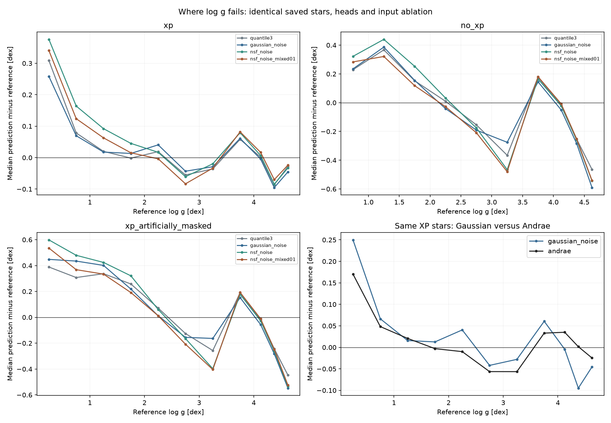

# Why log g is failing

The global averages hid structured failures. The present model is not reliable across the full gravity range, especially without XP. The evidence points to a restrictive input design and a small supervised training set; this audit did not find a wrong-column, unit-conversion or source-ID join bug. It does not prove all catalogue labels are unbiased.

## What the saved predictions establish

On the original 104,385-row benchmark, all four heads were joined by exact integer source ID. The artificial XP-masked set contains only the 99,646 original XP objects; it was explicitly joined to its natural-input counterparts, not assumed to share array positions. The figure includes only bins with at least 20 observed log g references. This is a newly computed saved-array diagnostic, with no native model/checkpoint execution.

1. **The severe no-XP dwarf failure is reproduced by removing XP from the same stars.** For reference log g 4.5–4.75, Gaussian MAE is 0.07115 dex on 5,331 XP stars, versus 0.73150 dex on those same stars with XP removed. Real no-XP objects in that bin have MAE 0.75462 dex (467 stars). Median residuals are −0.0454, −0.5473 and −0.5902 dex respectively. This strongly supports missing predictive information/modality degeneracy as a major contributor, rather than a completely different or corrupted no-XP label set alone.
2. **XP predictions still underperform.** On identical Andrae-matched stars at log g 4.25–4.5, Gaussian MAE is 0.11703 versus Andrae 0.04533 dex (13,530 stars). At 1.5–2.0, it is 0.15227 versus 0.07919 dex (7,056 stars). Andrae explicitly includes parallax as an input, while this MSA recipe masks it. This comparison identifies a performance gap but cannot assign it entirely to optimization, since the inputs and training populations differ. See [Andrae, Rix & Chandra 2023](https://arxiv.org/abs/2302.02611).
3. **Changing the density head did not remove the pattern.** XP log g residual correlations across the four heads range from 0.845 to 0.953. The two NSF variants correlate at 0.953. The true-no-XP and same-star XP-masked curves share large systematic structure. Head choice alone is therefore unlikely to be the primary correction; this is evidence, not a causal isolation of shared encoder, features or loss.

## Concrete design limitations

**The input lacks information used by the reference and comparator.** The allowed feature mask is W1, W2, G, BP, RP plus 110 XP coefficients (`scripts/prepare_six_target_wave.py:296–305`); all other features, including parallax, remain masked in expanded lookup. Genuine no-XP therefore uses five apparent magnitudes. GALAH log g is explicitly parallax-conditioned (`src/masked_stellar_autoencoder/training/joint_native_labels.py:168`). Its distance/luminosity information is unavailable to this model. Andrae also uses parallax. Neither comparison demonstrates label corruption.

**“Large training” meant large reconstruction exposure, not large labelled coverage.** The actual FIT contains 19,236 distinct log g labels. The 450M count is three passes over a 150M-row reconstruction cache; these do not create more labelled gravities. Logged log g supervision repeats these labels about 1,362 times per FIT star on average; that is not new labelled diversity. The sampler balances label availability, not gravity/temperature/metallicity/source coverage. Enlarging TEST preserved the original FIT/TUNE/CAL bytes. This was a limited supervised comparison on a large pretrained model, not a broad-supervision large-model training run.

The pinned parent native FIT before 63 exclusions has 19,299 stars, of which only seven have log g >=4.75 and 25 have Fe/H <−2. Those are upper bounds for the final subset, not exact final-bin counts. The 4.25–4.5 bin has 2,658 parent FIT objects, so poor performance there cannot simply be explained as an empty training bin. Source-specific raw native scales and different domains also matter.

**No-XP failures are not confined to one survey or one likelihood.** In the expanded primary evaluation, Gaussian log g MAE is 0.12230 dex with XP and 0.32056 without it. The source split is 0.10907 GALAH versus 0.16199 APOGEE with XP, and 0.31983 versus 0.40111 without XP. These are marginal populations, not a same-object survey calibration test; source/domain/quality effects remain entangled. Native source projection and quality-mask proofs establish faithful extraction, not unbiased physical truth.

**Checkpoint selection is also broader than log g.** It minimizes a macro six-label criterion with equal natural and XP-masked TUNE weighting. The selected checkpoint need not be best for natural-XP log g, or any difficult gravity bin. Gradient clipping is frequent, but separate reconstruction/supervised gradient norms and their conflict were not independently measured here; reconstruction dominance is not established.

## What to fix before further scaling

- Establish verified measured-parallax/error/zero-point provenance, then run a matched input-control comparison with and without astrometry. Do not create a distance feature by naïvely inverting uncertain parallaxes or leak posterior target distances into inputs.
- Expand the source-qualified supervised FIT cohort using legitimate unused labels, with splits redesigned before training. Balance and report gravity/Teff/FeH/source/modality coverage; keep immutable external tests. Repeating the existing 19k labels is not equivalent to expanding supervision.
- Compare a simple supervised baseline on the same features and splits against the current encoder/head, and isolate supervised versus reconstruction gradient contributions. These controls distinguish feature limitations from representation/optimization problems before changing flow families or increasing reconstruction epochs.
- Report a validity mask or abstention region for no-XP gravity until a calibrated, externally checked solution exists. Keep catalogue-source scales separate and examine high-residual objects/quality flags before changing labels.

No new CANFAR jobs, native model execution, scheduled tasks or persistent background work were started. The scheduled monitor remains deleted. These recommendations are not an automatic new training wave.

[Full binned metrics](msa-logg-failure-diagnosis-20261025/logg-bins.csv), [paired Andrae bins](msa-logg-failure-diagnosis-20261025/paired-andrae-bins.csv), [source summary](msa-logg-failure-diagnosis-20261025/source-summary.csv), [JSON](msa-logg-failure-diagnosis-20261025/diagnosis.json), [saved-array reproducer](msa-logg-failure-diagnosis-20261025/reproducer.txt).

Verification: exact integer-ID paired joins and independent scalar/NumPy MAE agree (0.7315005622741886 dex, n=5,331); source-weighted table checks pass all eight head/modality cases. Fresh repository lint passes with a temporary cache directory. [Verification evidence](msa-logg-failure-diagnosis-20261025/verification.json), [training audit](msa-logg-failure-diagnosis-20261025/training-audit.md), [label-source audit](msa-logg-failure-diagnosis-20261025/label-source-audit.md).
