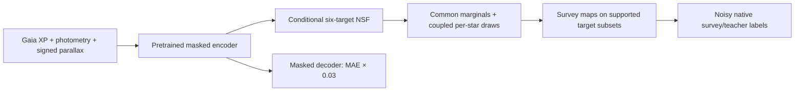

# MSA morning report

Updated 2026-11-07 07:54 Perth (23:54 UTC).

**Large training is armed but has not started optimizing:** waiting_for_decision. The CANFAR job chooses from TUNE results, checks its source, runs CUDA encoder/decoder/head gradient checks, warms new survey maps, then makes full FIT record passes.

The independent ESA audit matched stored values and formal errors to Gaia DR3 mas in the sampled old/new/negative-parallax groups. All 128 sampled old FIT stars with unavailable stored parallax had measurements at ESA. This is not a Gaia zeropoint or quality certificate.

Parallax inputs repaired by exact ID: FIT availability 4,035,167 → 5,279,400; 1,244,233 newly available. Every non-astrometry dataset was checked unchanged. Signed negative parallaxes are retained. Formal input errors are stored for QA; the encoder currently has no explicit parallax-precision context.

Local motion-aware seismic matching found 151,588 TESS and 3,974 conservative K2 counterparts in the full raw input. 151,316 TESS references have usable νmax scaling gravity. These are catalogue counts, not the number in our model DEV panel. TESS DEV gravity QA is queued by signed parallax S/N, RUWE and mass flag; K2 gravity awaits pipeline-specific solar convention verification. These QA candidates are not training identity promotion.

Matched fixed-terminal DESI logg on/off comparison on 512 seismic DEV stars: MAE(on) 0.06009, MAE(off) 0.06058; off−on paired 95% interval [-0.0007368624529150376, 0.0016767946420459866]. The exact source/star batch hashes agree. This is one seed with the frozen old encoder and historical parallax availability, not proof the catalogue is wrong.

The source registry contains 9,198,809 catalogue rows, of which **7,240,111 have usable inputs** and **5,303,250 are labelled FIT stars**. Registry rows include excluded/no-input objects and must not all be counted as usable stars. Base roles are inherited; new-star roles are stable ID splits. Benchmarks and selected globular members are reserved from this stage. Ancestor exposure is not erased.

These are 5,303,250 distinct labelled FIT stars, 6,492,763 source records per epoch, and 1,281 stars with all six observed targets across sources. These counts are different from repeated training presentations.

| Target | Distinct FIT stars |
|---|---:|
| teff | 5,235,869 |
| logg | 5,261,198 |
| fe_h | 3,209,807 |
| alpha | 1,197,569 |
| age | 115,834 |
| distance | 117,573 |

| Source | FIT source records |
|---|---:|
| apogee | 126,108 |
| desi | 1,197,575 |
| galah | 390,345 |
| StarHorse_apogee17_posterior_median | 35,825 |
| StarHorse_galahdr3_posterior_median | 79,086 |
| StarHorse_catalogue_posterior_median | 2,827 |
| lamost_dr12v2_lrs_lasp | 1,460,683 |
| rave_dr6_madera_gauguin | 88,537 |
| gaia_dr3_gspspec | 2,744,104 |
| sdss_dr20_bossnet_081 | 67,416 |
| lamost_dr12v2_mrs_lasp | 300,257 |

The six targets are Teff, logg, Fe/H, alpha/Fe, age and distance. Age and distance remain source-specific posterior-teacher estimands, not independent physical measurement likelihoods. The alpha reference is DESI alpha/Fe; M/H and alpha/M are not silently treated as Fe/H or alpha/Fe.

The architecture is the pretrained masked autoencoder, a conditional six-dimensional neural spline flow, and source-native forward maps on supported target subsets. Production fine-tuning keeps masked **MAE reconstruction at weight 0.03** and uses natural Gaia inputs for supervised prediction. The flow supplies flexible marginal distributions and genuine coupled single-star samples.

The common scale uses an explicit convention for temperature, iron, alpha and posterior teachers, plus FIT-only seismic gravity anchoring. Offset, positive affine and monotone own-target spline maps are compared; nonlinear maps act on samples exactly, without a Taylor approximation. A shared physical reference is not established by averaging surveys.

| Experiment | State | Updates | TUNE score |
|---|---|---:|---:|
| nsfconfirm_energy_s1_20261106_v1 | running | 5,375 | — |
| nsfconfirm_energy_s2_20261106_v1 | running | 4,900 | — |
| nsfconfirm_hybrid_s1_20261106_v1 | running | 5,250 | — |
| nsfconfirm_hybrid_s2_20261106_v1 | running | 5,100 | — |
| nsfconfirm_crps_s1_20261106_v1 | running | 4,825 | — |
| nsfconfirm_hybrid_floor003_20261106_v1 | running | 4,850 | — |
| nsfconfirm_hybrid_corrpos_20261106_v1 | running | 5,450 | — |
| nsfconfirm_hybrid_corrneg_20261106_v1 | running | 5,275 | — |
| nsfconfirm_hybrid_studentt_20261106_v1 | running | 4,100 | — |
| sixmap_equalweight_affine_20261107_v1 | complete | 4,200 | 0.14381054052375628 |
| sixmap_apogee_affine_20261107_v1 | complete | 4,200 | 0.14203359628361173 |
| sixmap_seismic_affine_20261107_v1 | complete | 4,200 | 0.14100153940632876 |
| sixmap_seismic_nodesig_20261107_v1 | complete | 4,200 | 0.13867476142134044 |
| sixmap_seismic_offset_20261107_v1 | complete | 4,200 | 0.14130309904349947 |
| sixmap_seismic_spline_20261107_v1 | complete | 4,200 | 0.14085887024991228 |

The paired-survey residual audit finds correlations among atmospheric labels. Relative TUNE negative log score improves with full versus diagonal residual covariance, and improves further with a covariance-matched t4 kernel:

| Survey pair | Full − diagonal TUNE NLL | t4 − full Gaussian |
|---|---:|---:|
| APOGEE__DESI | -0.622 | -0.506 |
| APOGEE__GALAH | -0.193 | -0.251 |
| DESI__GALAH | -0.388 | -0.423 |

These are combined residuals of two surveys, shared errors and remaining bias; they do not identify either survey’s measurement covariance. Correlation/heavy-tail controls test operational noise assumptions. They do not change the reconstruction loss.

Additional full-raw Gaia input recovery: **additional_full_raw_features_complete**. This addresses admitted label stars outside the current input union, including cache misses; it does not alter the pinned running candidate. Input absence from a cache is not absence of Gaia XP.

All 174,922,161 Andrae release stars were found in the 218,131,884-row raw input. Catalogue-wide prediction is separate from the smaller exported QA panels. A new first-checkpoint comparison covers available predicted stars; it does not imply the other raw stars cannot be compared.

Gaia-ESO and MaSTAR remain deferred pending validated identity or source-quality/dependency admission. TESS/K2 identities are not silently promoted. Existing APOKASC and benchmark calibration/teacher dependencies are retained.

- [Completed map/gauge Kiel and single-star corner report](https://ws-uv.canfar.net/arc/files/projects/k-pop/msa_runs/stellar-improvement-20261015/six_survey_map_report_20261107_v1/report.md) — complete.
- [All-sky NSF inference/storage benchmark](https://ws-uv.canfar.net/arc/files/projects/k-pop/msa_runs/stellar-improvement-20261015/six_nsf_inference_benchmark_20261107_v1/manifest.json) — failed.
- [Independent repaired-parallax audit](https://ws-uv.canfar.net/arc/files/projects/k-pop/msa_runs/stellar-improvement-20261015/gaia_parallax_release_unit_audit_20261107_v2/manifest.json) — failed.
- [TESS DEV gravity QA](https://ws-uv.canfar.net/arc/files/projects/k-pop/msa_runs/stellar-improvement-20261015/tess_first_checkpoint_gravity_qa_20261107_v1/manifest.json) — waiting_for_cuda_arrays.
- [Matched DESI gravity ablation](https://ws-uv.canfar.net/arc/files/projects/k-pop/msa_runs/stellar-improvement-20261015/matched_desi_logg_comparison_20261107_v1/manifest.json) — complete.
- [Random per-star mode/corner QA](https://ws-uv.canfar.net/arc/files/projects/k-pop/msa_runs/stellar-improvement-20261015/nsf_confirmation_random_modes_20261107_v1/manifest.json) — waiting_or_scoring.
- [Corrected CAL interval QA](https://ws-uv.canfar.net/arc/files/projects/k-pop/msa_runs/stellar-improvement-20261015/nsf_confirmation_intervals_20261107_v2/manifest.json) — waiting.
- [First-checkpoint benchmark, cluster, Kiel, seismic and corner report](https://ws-uv.canfar.net/arc/files/projects/k-pop/msa_runs/stellar-improvement-20261015/expanded_checkpoint_report_20261107_v1/report.md) — waiting_for_cuda_arrays.
- [First-checkpoint common PDF exports](https://ws-uv.canfar.net/arc/files/projects/k-pop/msa_runs/stellar-improvement-20261015/expanded_first_checkpoint_qa_20261107_v1/manifest.json) — waiting_for_first_checkpoint.
- [Large training manifest](https://ws-uv.canfar.net/arc/files/projects/k-pop/msa_runs/stellar-improvement-20261015/expanded_six_nsf_fullfit_20261107_v1/manifest.json) — waiting_for_decision.

CAL adjusts interval thresholds independently of the fitted density. It does not by itself make the latent six-target PDF physically calibrated. First-checkpoint QAs are development diagnostics and do not select production hyperparameters. No catalogue is automatically published.
