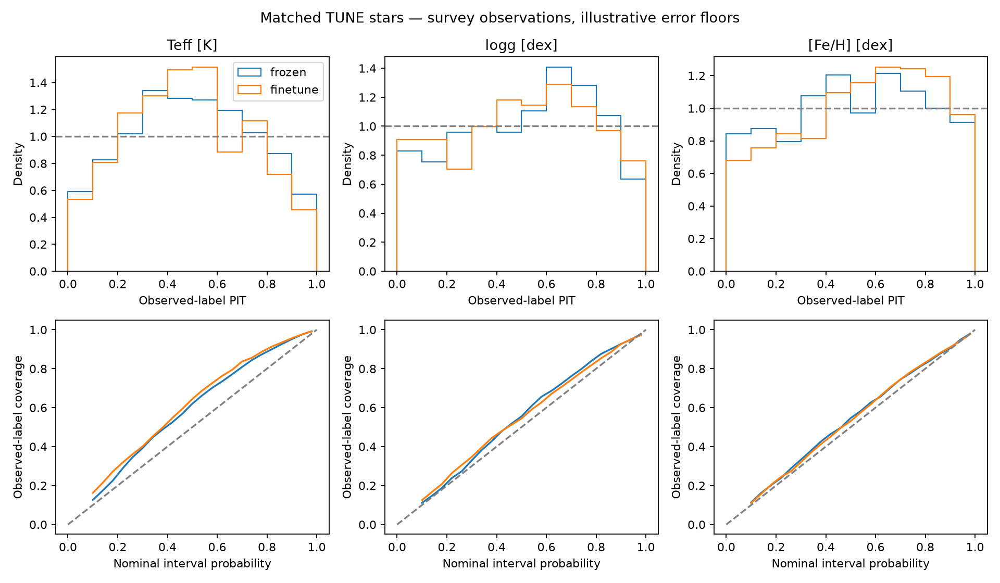
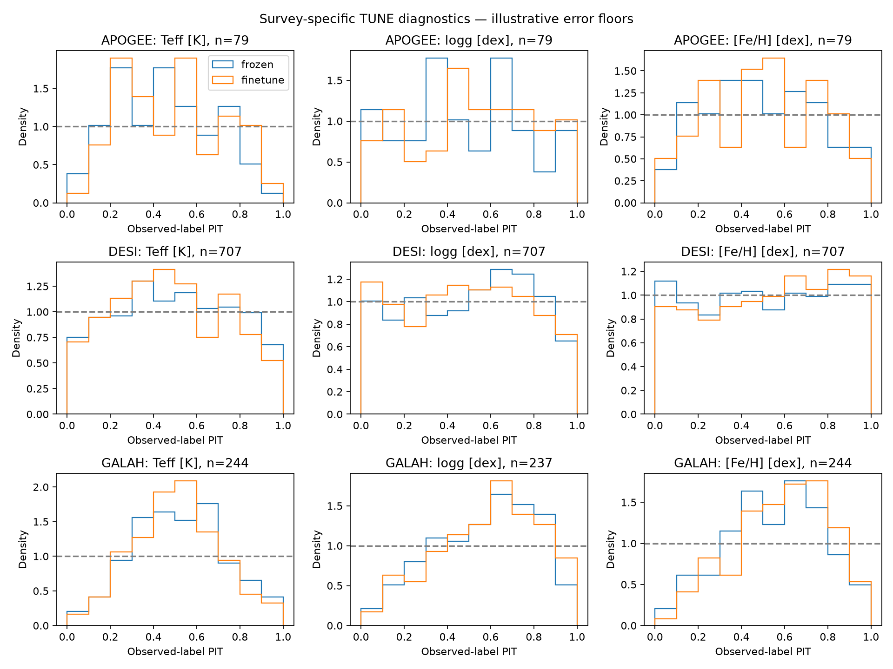
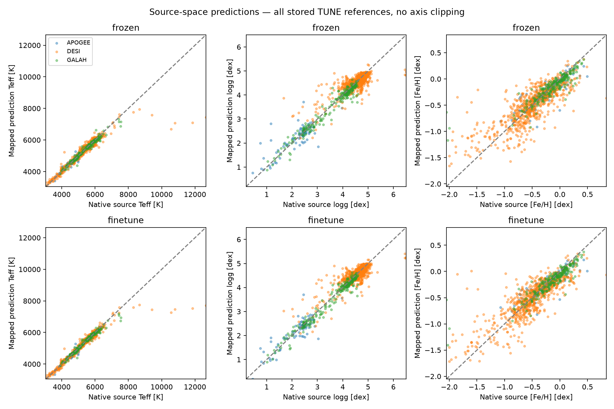
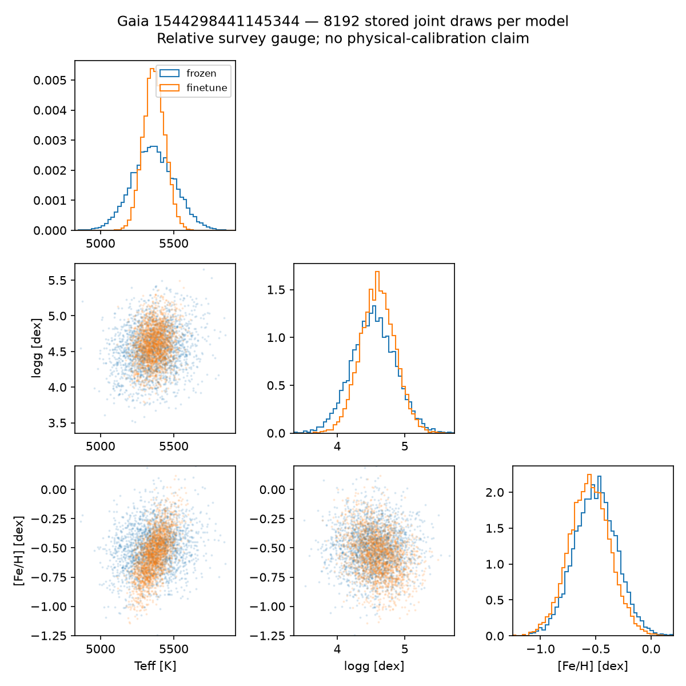
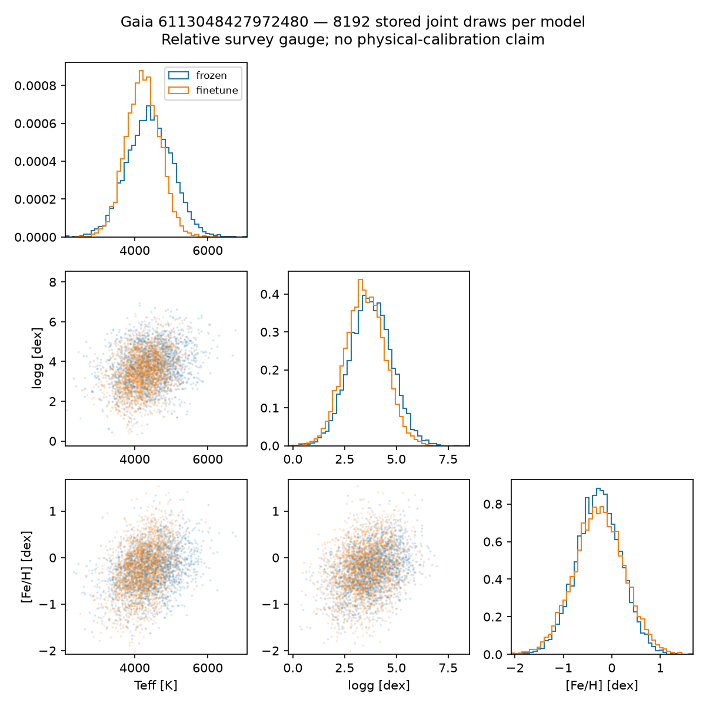
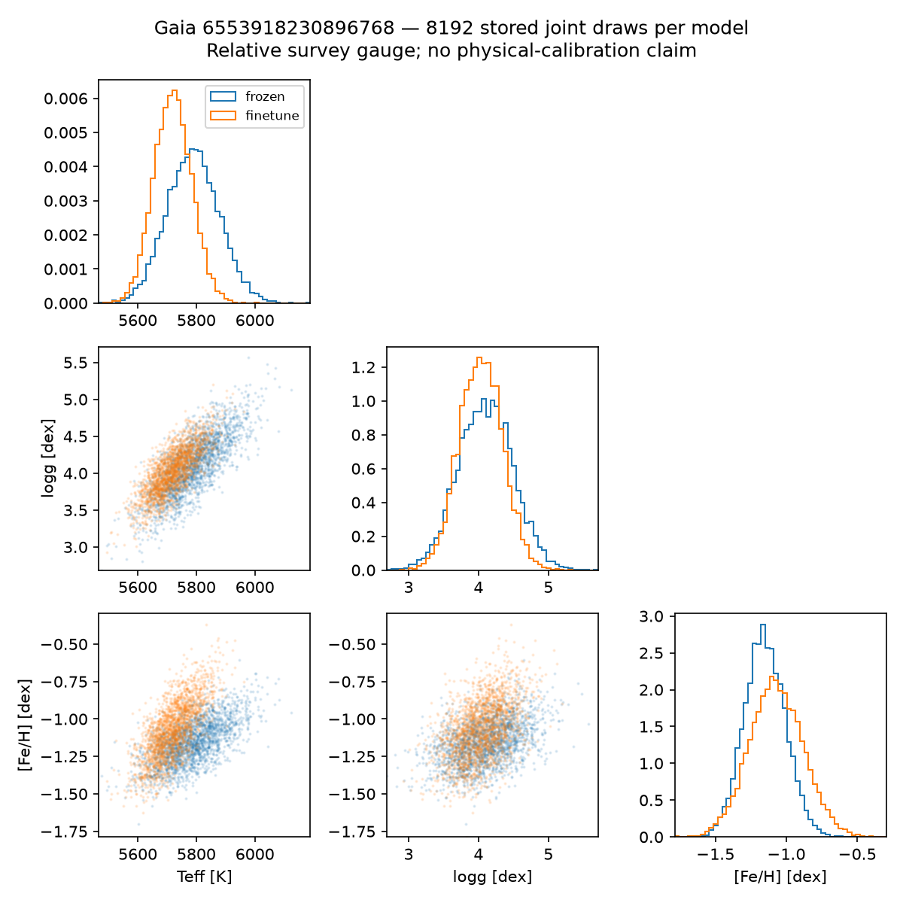

# Multi-survey joint distribution pilot results

Matched existing TUNE only, three targets, approximate first-order survey map and illustrative floors; not latent physical-truth calibration.

| Encoder | Initial joint observation NLL | Final joint observation NLL |
|---|---:|---:|
| frozen | 15.4072 | 5.6981 |
| finetune | 15.4072 | 5.4843 |

Lower NLL is better on this fixed panel. This pilot does not select between Gaussian and flow heads.

Initial scores use freshly initialized three-target heads, not the inherited Fe/H head. Joint Gaussian samples are unimodal and do not resolve arbitrary multimodal stellar degeneracies.

Paired final NLL difference (fine-tuned minus frozen): -0.2138; star-bootstrap 95% interval [-0.2582, -0.1687]. This interval excludes training-seed and survey-systematic uncertainty.

The full-range prediction panels retain large hot-star and low-metallicity residuals. Small source-reference tail counts and descriptive scores are preserved in `summary.json` (`tail_quicklook`); they do not establish tail calibration.

[Per-survey accuracy, CRPS, coverage and width](metrics.csv) · [Summary and checks](summary.json).

[Original frozen-run manifest](frozen-manifest.json) · [Original fine-tuned-run manifest](finetune-manifest.json). Checkpoint paths and SHA256 hashes are in the summary.
