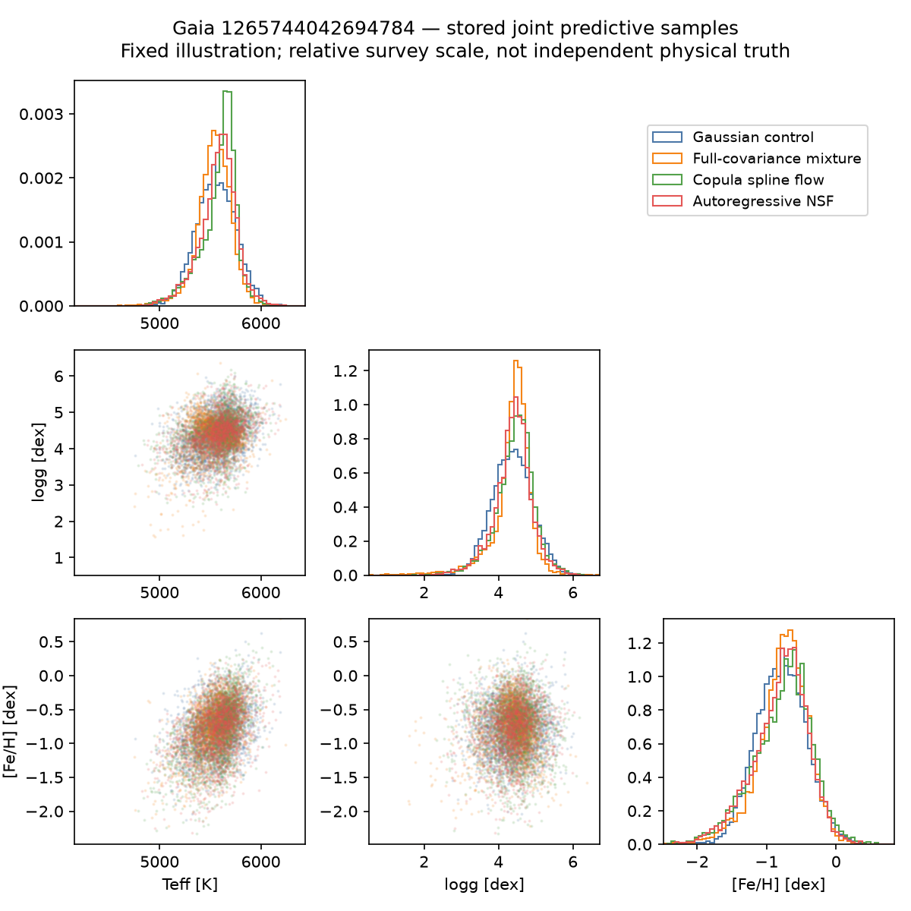
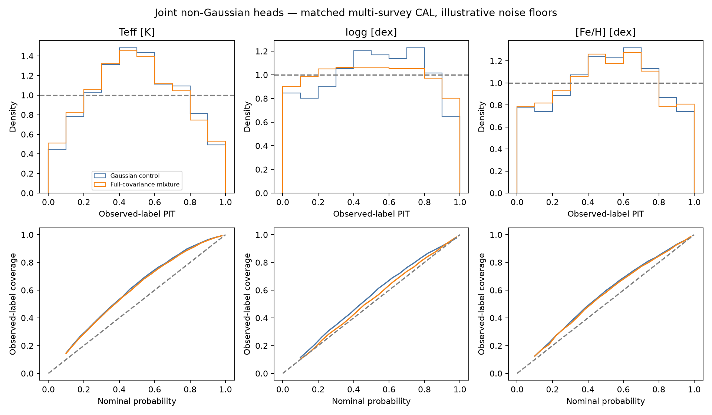

# Morning report — non-Gaussian multi-survey predictions, 5 November 2026

**Use the four-component joint mixture as the experimental density head.** It predicts a normalized joint distribution over Teff, logg and [Fe/H], with feature-dependent mixture weights, means and full component covariances. The stored examples show clear asymmetry. Both a genuine autoregressive neural spline flow and a copula spline flow were also trained and evaluated; their qualified TUNE checkpoints did not establish an advantage over the mixture.

The choice was committed before opening CAL. On 2,048 separate CAL stars, mixture joint observation NLL is **5.32210**, versus **5.39918** for the matched Gaussian. The paired difference is **−0.07708 nats/star**, with a star-bootstrap 95% interval **[−0.09989, −0.05600]**. This is a density-score improvement; point errors and calibration do not improve uniformly.

## What completed

Two four-head screens each performed 1,000 optimizer updates per head, batch 64, on the same shuffled stream of **64,000 unique FIT stars** from a 65,536-star cache. The feature encoder and relative survey map were frozen to isolate the head comparison. The second screen increased training particles from 256 to 1,024 and gate/scoring particles to 4,096. It is a numerical refinement at the same seed, not an independent replication. Gaussian and mixture analytic scores reproduced exactly across screens.

A separate evaluation-only job rescored saved flow snapshots with a defensive reference proposal. Finally, fixed selected heads were checked on 2,048 CAL stars without fitting, recalibration or reselection. Exact-ID checks found zero overlap between the actual FIT stream, TUNE and CAL panels. Independence from all ancestral training is not established. Devtest/external roles were not opened by this programme.

Active survey records are **APOGEE, DESI DR1 RVS raw, and GALAH**. TUNE has 16 multi-source stars and CAL has 21; most evaluation stars have one source. Global scores therefore do not by themselves establish cross-survey physical consistency.

## Head comparison

Lower NLL is better; only qualified predictions are scored. These 2,048-star scores are not directly comparable to the earlier 1,024-star Gaussian pilot.

| Head | Parameters | Selected update | TUNE NLL | CAL NLL/status |
|---|---:|---:|---:|---|
| Full-covariance mixture | 38,056 | 1000 | 5.28743 | 5.32210 |
| Copula spline flow | 52,246 | 600 | 5.38520 | Numerical gate failed |
| Gaussian control | 34,057 | 1000 | 5.39640 | 5.39918 |
| Autoregressive NSF | 203,943 | 300 | 5.41199 | Numerical gate failed |

On TUNE, mixture minus Gaussian is −0.10897 nats/star, bootstrap 95% interval [−0.14733, −0.07738]. The copula difference is −0.01120 [−0.03024, 0.00601]; the qualified NSF difference is +0.01559 [−0.00555, 0.03670]. Neither flow interval establishes a gain over Gaussian. Bootstrap intervals exclude training-seed and source-systematic uncertainty, and TUNE was used for selection.

The spline heads use torchregress 0.3.0: `GaussianCopulaSplineHead` and its NSF flow factory. The exact full-covariance joint mixture is implemented in the MSA adapter. Flow likelihoods use finite-QMC integration of all source measurements for the same latent star. Missing labels are integrated. Predictions and joint draws come from the feature-conditioned density, never the label-conditioned integration proposal.

## Calibration and tails

CAL source diagnostics below refer to **noisy native-source observations**, including the assumed catalogue errors/floors. They are not coverage against independent physical truth. Reported coverage is marginal; joint credible-region coverage has not been validated. Width and CRPS remain in the target's native units. Nominal coverage is 90%; lower CRPS is better.

| Source | Target | Records | Mixture MAE | Mixture 90% width | Gaussian → mixture coverage | Gaussian → mixture CRPS |
|---|---|---:|---:|---:|---|---|
| APOGEE | Teff [K] | 163 | 92.000 | 487.811 | 97.5% → 96.9% | 67.5707 → 67.5798 |
| APOGEE | logg [dex] | 163 | 0.223 | 0.908 | 92.0% → 90.8% | 0.1608 → 0.1610 |
| APOGEE | [Fe/H] [dex] | 163 | 0.112 | 0.575 | 98.2% → 98.2% | 0.0811 → 0.0805 |
| DESI | Teff [K] | 1440 | 89.769 | 453.125 | 95.6% → 94.7% | 64.8522 → 64.7164 |
| DESI | logg [dex] | 1440 | 0.180 | 0.782 | 90.8% → 90.6% | 0.1323 → 0.1298 |
| DESI | [Fe/H] [dex] | 1440 | 0.156 | 0.677 | 90.9% → 90.7% | 0.1130 → 0.1122 |
| GALAH | Teff [K] | 466 | 70.684 | 457.929 | 99.1% → 98.5% | 54.5685 → 54.3137 |
| GALAH | logg [dex] | 456 | 0.141 | 0.677 | 95.4% → 94.7% | 0.1038 → 0.1025 |
| GALAH | [Fe/H] [dex] | 466 | 0.084 | 0.474 | 97.0% → 96.8% | 0.0637 → 0.0635 |

Bulk Teff intervals remain too broad: mixture coverage is about 95–98.5% across sources. In the 62 native [Fe/H]<−1.5 records, coverage improves from **79.0% to 82.3%**, still below 90%; mean width rises from 1.153 to 1.205 dex. Mixture metallicity MAE is **0.384 dex** versus Gaussian 0.379, and tail CRPS is slightly worse (0.2756 versus 0.2739). The 90% interval score improves (2.139 versus 2.258). There is no blanket rare-tail calibration win.

For ten hot native Teff≥8,000 K records, mixture MAE is **889 K** and mean 90% width **5,397 K**. Coverage is 100% in this tiny sample because intervals are very wide. Both point accuracy and useful sharpness remain unresolved.

Among 24 CAL stars without staged XP, mixture minus Gaussian NLL is −0.399; among 2,024 with all 110 staged XP inputs it is −0.0733. These are small-cohort diagnostics, not a new selection rule. Per-source and input-availability results are retained in the linked detailed tables.

## Why the flows are not CAL-qualified

The predefined gate requires median relative ESS≥0.1, minimum≥0.01, and independent-replica and doubled-particle log-density gaps p95≤0.1. Thresholds were never relaxed. Both selected flow checkpoints pass independent TUNE gates after defensive rescoring, but **both fail CAL**:

| Flow | CAL median/minimum relative ESS | Replica gap p95 / max | Doubling gap p95 / max |
|---|---|---|---|
| Copula spline flow | 0.487 / 0.000264 | 0.046 / 2.367 | 0.040 / 2.807 |
| Autoregressive NSF | 0.475 / 0.000441 | 0.072 / 1.621 | 0.071 / 1.308 |

Both minima and largest doubling gaps identify Gaia **3895822142504190080**. Its DESI record is Teff 4,593 K, logg 4.91, [Fe/H] −1.98; the matched Gaussian control predicts observed medians near 5,227 K and −0.736 dex. It has all 110 staged XP inputs. This is not simply an XP-absence case. The record remains included; the mixture also misses it in its 90% Teff/metallicity intervals. An independent source-quality/physical-reference audit is needed before deciding whether this is model failure, source error, or both.

The failed gates mean no CAL flow NLL is published. The planned all-star 8,192-particle score refinement is skipped after these gate failures; the gates themselves include 4,096/8,192-particle checks on 128 stars. A successful p95 check would not certify the maximum error. Later flow snapshots with failed TUNE gates are retained and are not ranked as scientific wins. [Failure-star details](msa-nongaussian-morning-20261105/numerical-failure-stars.json) preserve the IDs and values.

## Checkpoints and next work

Recommended head:

```
/arc/projects/k-pop/msa_runs/stellar-improvement-20261015/multisurvey_flexible_refinement_20261105_v2/mixture-selected.pth
SHA256 448b7e00332b5133c55148ff2ed543df82c0e6822c764b3381ca3008e8b47184
```

This is a residual density head, not a standalone encoder checkpoint. Use it with the fine-tuned Gaussian reference:

```
/arc/projects/k-pop/msa_runs/stellar-improvement-20261015/multisurvey_gaussian_finetune_20261104_v1/final.pth
SHA256 efd575285789928d2e445d7c11429a7809a35a12e6be29424bd26c48e154c26d
```

Its backbone descends from the epoch-86 pretrain and the 4.5-billion-presentation residual-Huber checkpoint. The selected head stores its FIT context normalization and architecture configuration. Generate residual draws u, then use `theta = reference_mean + reference_lower @ u`. The intrinsic log density is `head.log_prob(context, solve(L_ref, theta-mu_ref)) - log|det L_ref|`. Preserve the native feature/scaler contract. The complete path/SHA list and parent-loading contract, including both real flow checkpoints, is in [checkpoints.json](msa-nongaussian-morning-20261105/checkpoints.json).

Training source is `6f1b3c790b921878e857e79b3d09b4baf3cdebbb`; defensive selection source is `b20ecf99e2fab75dd6a1380b764b757f6296e3c0`; pre-CAL selection/evaluation source is `bac51a61b17f049f35971e401816ea2c13935f6a`. Both locks pin torchregress commit `2777b0de88121768434725ef227893cd35595d2a`. All native runs used the project GPU environment on H100 NVL 1g.12GB MIG slices, 4 CPU cores and 64 GiB requested RAM. The catalogue pipeline CLI remains a separate path; this result belongs to native MSA multi-survey training.

The next useful work is to resolve the cold metal-poor DESI case and source/error modelling, then improve rare-tail supervision and test flow-aware encoder fine-tuning on larger FIT data. The current [100 K, 0.1 dex, 0.1 dex] floors are illustrative, native error covariance is assumed diagonal, and the survey map is a fixed first-order approximation. A flexible normalized density does not validate that physical observation model. Keep the mixture as the experimental candidate; reserve a fresh untouched evaluation cohort for subsequent model development.

## Verification and artifacts

**1,319 tests passed, four skipped.** Checks include independent Gaussian/mixture likelihood identities, correlated noise, missing/empty labels, gradients, unit Jacobians, CRPS, fresh-instance checkpoint reload, synthetic four-head training/prediction, defensive sampling and fixed launch policies. Local neural execution used synthetic data; native checkpoints ran only on CANFAR CUDA. Full tests used the previously restored archived registry evidence ([restoration receipt](../../experiments/xp/survey-registry-evidence-restoration-20261104.json)). Prediction SHA256/CRC, raw gate statistics, score reductions and exact int64 pairing were independently verified.

All four successful sessions are **Completed**; no watcher is left running. One earlier refinement bootstrap failed before training because the launcher defaulted to an obsolete branch. Its accepted ID and failure receipt remain preserved; the retry used a new run ID and explicit source branch. Source was pushed only to the `sfabbro` origin fork.

- [Initial screen](msa-nongaussian-morning-20261105/initial-tune/index.md), [higher-particle screen and failures](msa-nongaussian-morning-20261105/refined-tune/index.md), [defensive TUNE audit](msa-nongaussian-morning-20261105/defensive-tune/index.md), [fixed-head CAL report](msa-nongaussian-morning-20261105/cal/index.md).
- [CAL metrics](msa-nongaussian-morning-20261105/cal/metrics.csv), [CAL summary](msa-nongaussian-morning-20261105/cal/summary.json), [identity audit](msa-nongaussian-morning-20261105/identity-audit.json), [verification and session receipt](msa-nongaussian-morning-20261105/verification.json).
- All native producer manifests, numerical gates and failures are retained in those report folders. Full weights and frozen caches remain on ARC; only small prediction/evidence files were collected locally.




