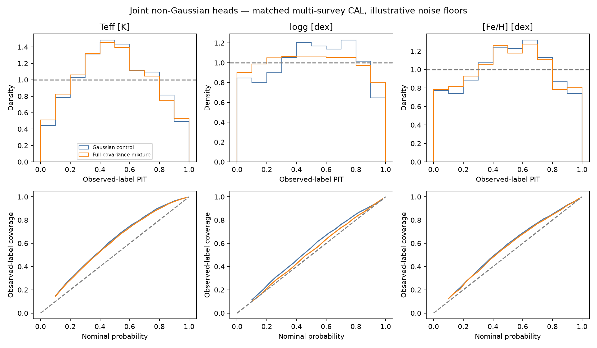
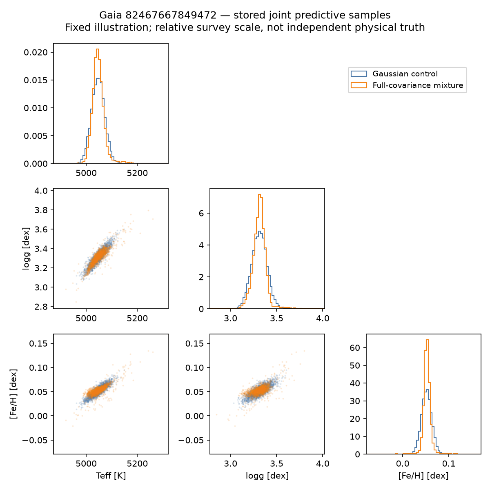
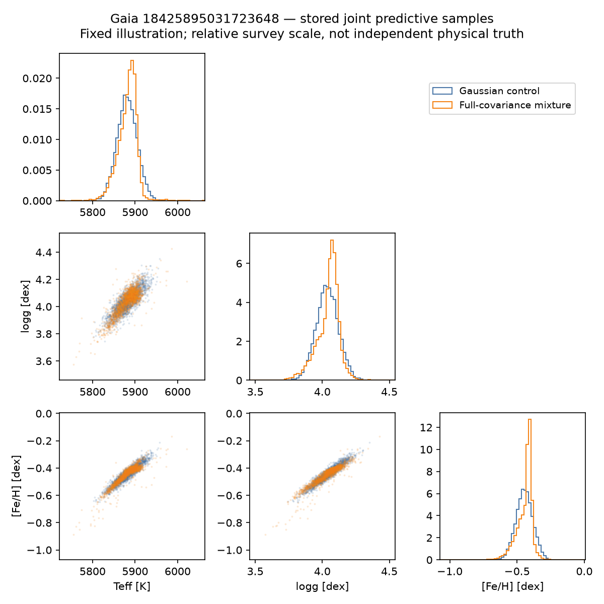
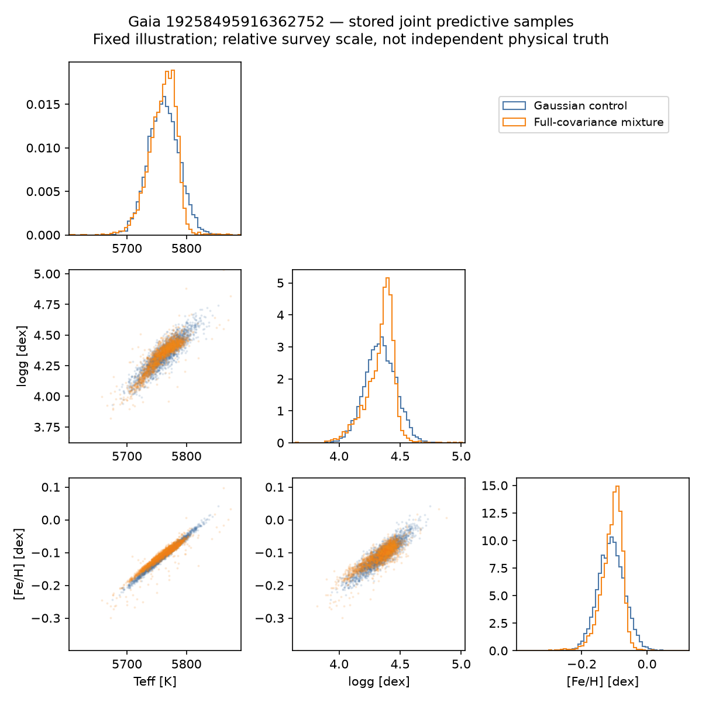

# Morning report: joint non-Gaussian multi-survey predictions

Previously assigned CAL; fixed TUNE-selected heads, no CAL fitting or selection; finite-QMC observation integrals for flows, Monte Carlo predictive quantiles/PIT, illustrative source floors and fixed affine survey map; not a physical-calibration certificate.

| Head | Joint observation NLL | Selected update | Parameters |
|---|---:|---:|---:|
| Full-covariance mixture | 5.32210 | 1000 | 38056 |
| Gaussian control | 5.39918 | 1000 | 34057 |

Lower NLL is better on this CAL panel. Gaussian/mixture likelihoods are analytic; flow scores use checked importance integration. These values are not comparable directly to the earlier 1024-star panel.

Primary candidate fixed before opening CAL: **Full-covariance mixture**. CAL comparisons below are diagnostics, not a new selection step.

| Head | Source/input subset | Stars | NLL difference vs Gaussian |
|---|---|---:|---:|
| Full-covariance mixture | GALAH | 450 | -0.02423 |
| Full-covariance mixture | DESI | 1432 | -0.08287 |
| Full-covariance mixture | DESI+GALAH | 3 | -2.38263 |
| Full-covariance mixture | APOGEE | 145 | -0.11764 |
| Full-covariance mixture | APOGEE+GALAH | 13 | -0.30038 |
| Full-covariance mixture | APOGEE+DESI | 5 | -0.03829 |
| Full-covariance mixture | all_110_XP_inputs | 2024 | -0.07327 |
| Full-covariance mixture | no_staged_XP_inputs | 24 | -0.39900 |

Source-pattern groups are disjoint stars; XP groups are a separate diagnostic. Global selection remains dominated by the available source mixture.

- Copula spline flow: cal_numerical_gate_failed; no eligible selected state.
- Autoregressive NSF: cal_numerical_gate_failed; no eligible selected state.

Full-covariance mixture minus Gaussian NLL: -0.07708; paired star-bootstrap 95% interval [-0.09989309345395399, -0.05599685792013854]. This excludes training-seed and source-systematic uncertainty.

Density families alone do not certify calibration or repair missing information, source-scale errors or weak tail supervision. See the per-source, tail and input-availability rows; narrow intervals are not automatically better.

[Detailed metrics](metrics.csv) · [Summary, checkpoints and sample shapes](summary.json) · [Producer manifest](producer-manifest.json) · [All numerical gates and failures](head-status.json).
