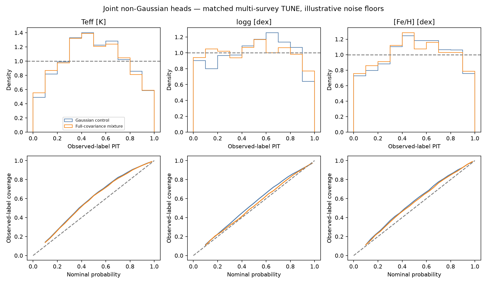
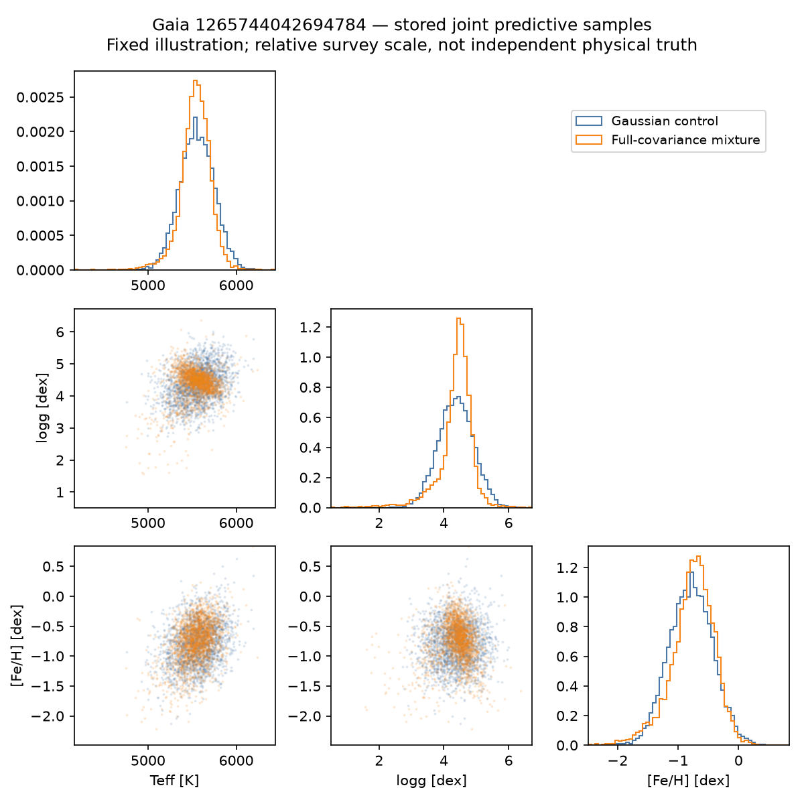
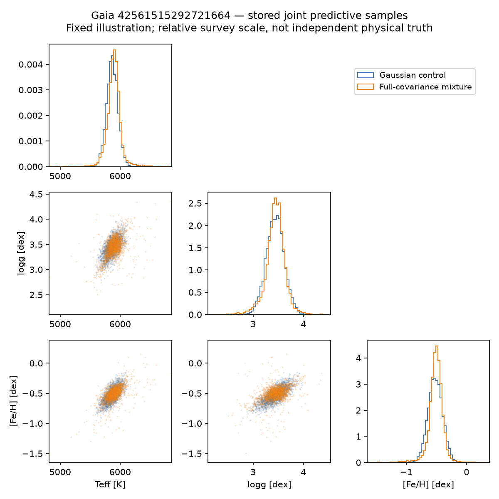
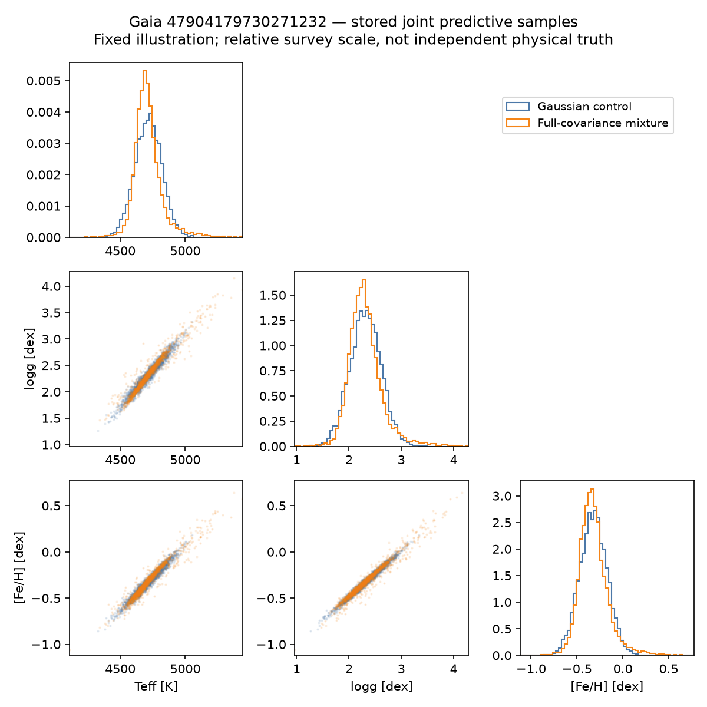

# Morning report: joint non-Gaussian multi-survey predictions

Previously assigned TUNE; snapshot selection on reused TUNE; finite-QMC observation integrals for flows, Monte Carlo predictive quantiles/PIT, illustrative source floors and fixed affine survey map; not a physical-calibration certificate.

| Head | Joint observation NLL | Selected update | Parameters |
|---|---:|---:|---:|
| Full-covariance mixture | 5.28743 | 1000 | 38056 |
| Gaussian control | 5.39640 | 1000 | 34057 |

Lower NLL is better on this TUNE panel. Gaussian/mixture likelihoods are analytic; flow scores use checked importance integration. These values are not comparable directly to the earlier 1024-star panel.

| Head | Source/input subset | Stars | NLL difference vs Gaussian |
|---|---|---:|---:|
| Full-covariance mixture | GALAH | 449 | -0.05100 |
| Full-covariance mixture | DESI | 1447 | -0.13677 |
| Full-covariance mixture | DESI+GALAH | 2 | 0.02694 |
| Full-covariance mixture | APOGEE | 136 | -0.01885 |
| Full-covariance mixture | APOGEE+GALAH | 14 | 0.01098 |
| Full-covariance mixture | all_110_XP_inputs | 2020 | -0.09868 |
| Full-covariance mixture | no_staged_XP_inputs | 28 | -0.85140 |

Source-pattern groups are disjoint stars; XP groups are a separate diagnostic. Global selection remains dominated by the available source mixture.

- Copula spline flow: selected_gate_failed; no eligible selected state.
- Autoregressive NSF: selected_gate_failed; no eligible selected state.

Full-covariance mixture minus Gaussian NLL: -0.10897; paired star-bootstrap 95% interval [-0.14733430170741665, -0.07738497845215483]. This excludes training-seed and source-systematic uncertainty.

Density families alone do not certify calibration or repair missing information, source-scale errors or weak tail supervision. See the per-source, tail and input-availability rows; narrow intervals are not automatically better.

[Detailed metrics](metrics.csv) · [Summary, checkpoints and sample shapes](summary.json) · [Producer manifest](producer-manifest.json) · [All numerical gates and failures](head-status.json).
