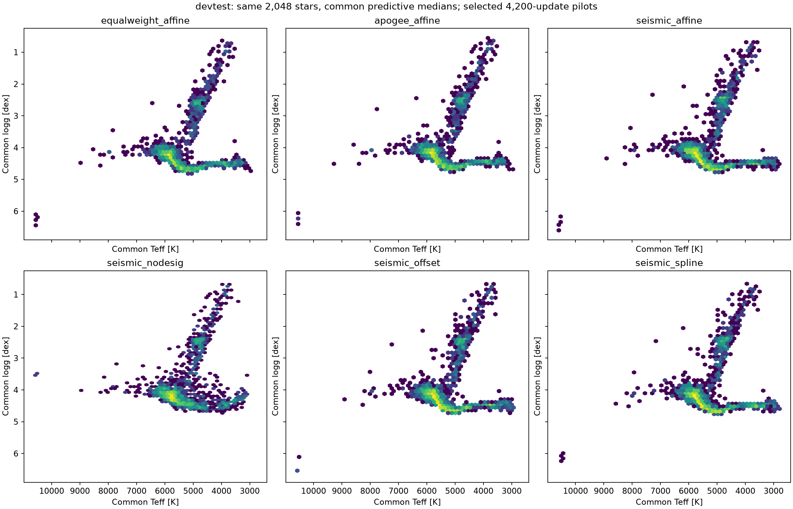
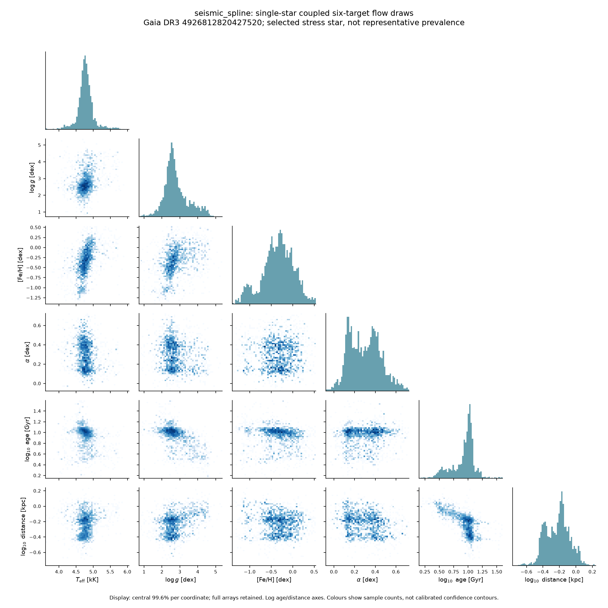

# Mapping control readout

Frozen common encoder; source maps and NSF head trained. These are the historical smaller-source pilots, not the expanded large run. Labels and posterior teachers keep their source definitions.

| Map/gauge | TUNE macro CRPS | Seismic DEV MAE | Seismic DEV bias | DEV C90 |
|---|---:|---:|---:|---:|
| equalweight_affine | 0.143811 | 0.10441 | 0.08646 | 0.648 |
| apogee_affine | 0.142034 | 0.07228 | -0.00386 | 0.844 |
| seismic_affine | 0.141002 | 0.06009 | 0.00042 | 0.914 |
| seismic_nodesig | 0.138675 | 0.05851 | 0.00506 | 0.895 |
| seismic_offset | 0.141303 | 0.05984 | 0.00022 | 0.910 |
| seismic_spline | 0.140859 | 0.06001 | -0.00077 | 0.908 |

TUNE scores select the candidate; DEV is descriptive. The three seismic map families are close in score. No common-space truth is established by an equal-weight gauge. The original no-DESI-g arm also changed gravity-stratified sampling; the separate matched on/off experiment is required to isolate supervision.

The following are single-star corner plots from genuine coupled draws, with identical limits across models for each identity. They are selected stress stars. Age and distance are posterior-teacher-scale predictions; six-dimensional physical dependence is not fully identified by sparse labels. No source-native label is overlaid as common-reference truth.

