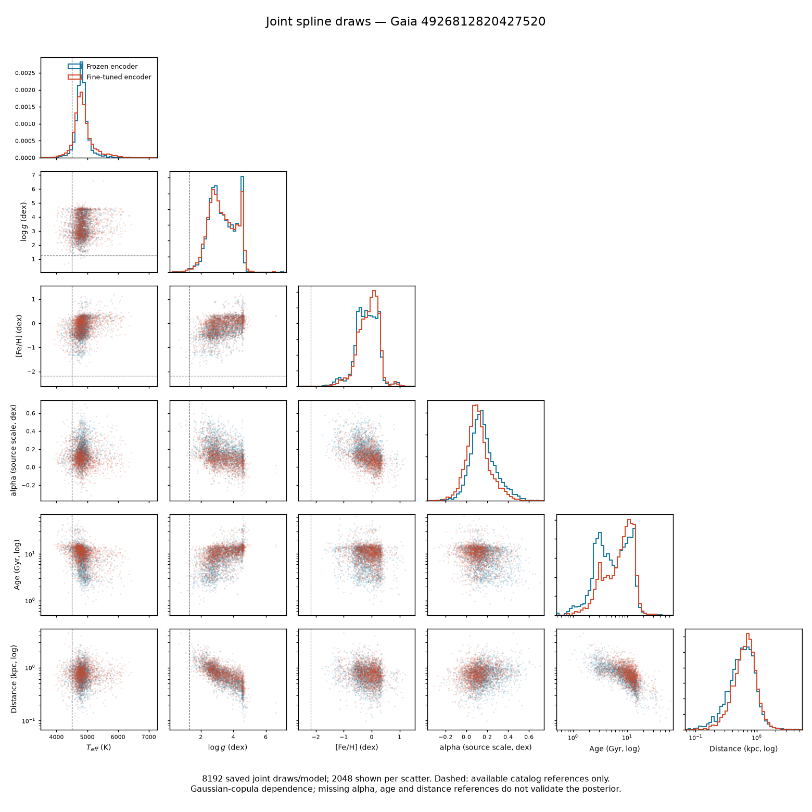
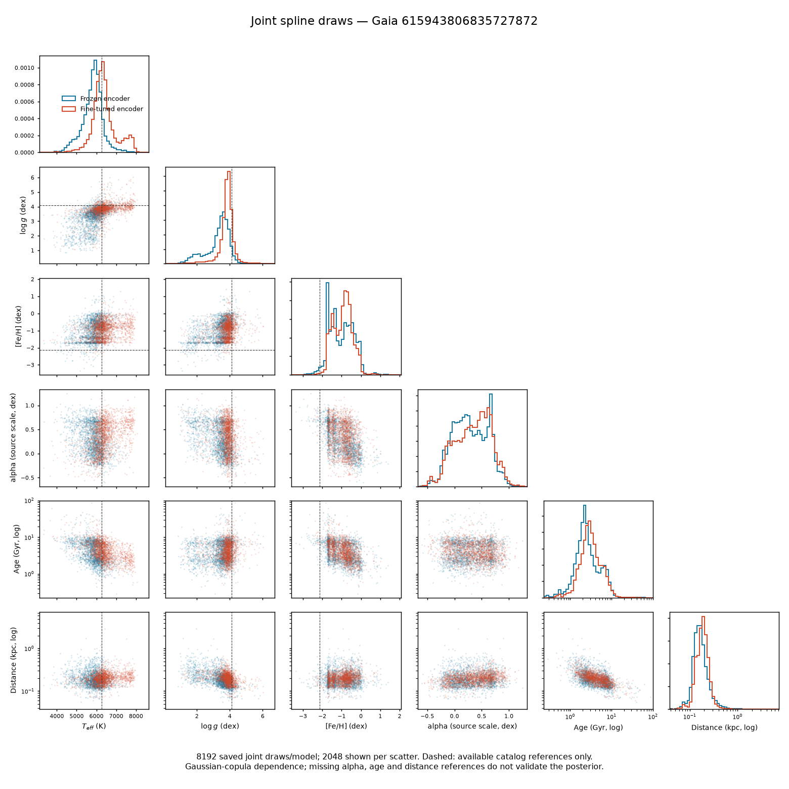
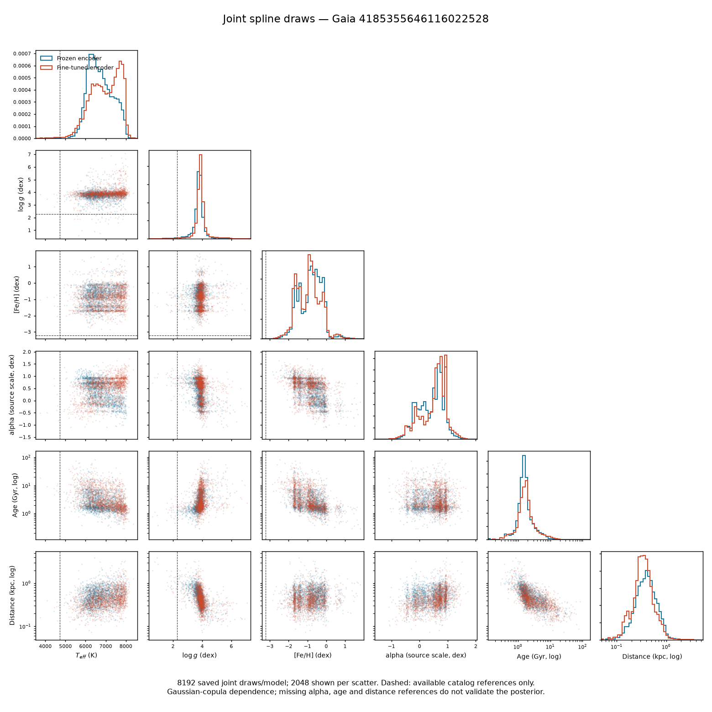

# Six-target spline pilots and DESI source — 27 October 2026

These are short engineering pilots, not a scientifically selected model. The [job and retrieval handoff](../msa-remediation-launch-handoff-20261026.md) records all submitted runs and their immutable source versions. The newer torchregress revision is `906a1c17639dcbf308fdb835270701bbc04f91e0`; these pilots use MSA `06d5438f8a2ac045940c0d5182b14bb2b7627032` (tag `msa-multisurvey-copula6-20261027`).

Two coupled Gaussian-copula spline pilots finished 1,000 finite-gradient updates and passed the fixed 128-row selected-checkpoint integration gate: frozen encoder `rstbv2c0` and fine-tuned encoder `u17b6yfr`. The fine-tuned plus reconstruction pilot `pg0qvelr` reached 1,000 updates but failed that gate: replica gap p95 0.119 and refinement gap p95 0.102, both above the unchanged 0.10 limit. Two older unrestricted NSF recoveries (`zzt96g5j`, `k557za1j`) also reached 1,000 updates and failed the same kind of gate by much larger margins. Their failures and diagnostic arrays are retained; they are not usable model results. The gate assesses finite Monte Carlo integration on a bounded panel, not scientific accuracy or the entire population.

The completed DESI source `ywde0t2t` has 3,683,136 quality-selected **measurement rows** with Teff, logg and Fe/H. This is not a count of unique stars, matched features, usable FIT stars or newly added training labels. Its raw sidecar is on ARC at the path in the preservation receipt, with producer SHA-256 `fe09ff1be95bb95884cbba9f008d02bc3e52e0debd143add5a5d28efad934ba3`. Feature joins, duplicate-dependence handling, existing-role/ancestry exclusions and leakage-safe splits must be completed before training on it.

## Whole-vector predictions

The following plots use the same saved 8,192 six-target draws per star and model, with 2,048 deterministic draws shown in each scatter panel. Axes cover all draws from both models and any available references; dashed lines are catalog references. The predictive dependence is a **Gaussian copula with spline marginals**; it is more restricted than a general neural spline flow. The ten source stars have no reference alpha, age or distance, so those dimensions and the physical cross-correlations are not validated by these plots. Age and distance reflect model-dependent reference scales, and some age draws exceed physical stellar ages.

For Gaia 4185355646116022528, the catalog references are logg 2.28 dex and Fe/H -3.23 dex. The fine-tuned joint samples have medians about 3.88 and -0.89 dex, respectively. This is one previously used development example, not a population comparison, but it makes clear that adding cross-target dependence alone has not fixed the metal-poor point predictions.

[Saved-array verification](verification.json) recomputes the five selected integration summaries and validates coordinate transformations and covariances for both completed models and all ten stars. The plot generator uses only saved arrays, not a model or checkpoint. Local hashes, producer hashes where available, NPZ checks, job bindings and ARC paths are in the [preservation receipt](../../../experiments/xp/remediation-copula6-preservation-20261027.json). Failed-gate arrays have locally computed hashes; no producer-side full-content receipt is claimed for those arrays.

## Implementation status

The new code adds an early three-target consensus trainer with natural, unmasked supervised inputs, a separate masked-reconstruction path, source/registry and FIT-identity checks, and versioned checkpoint contracts. A group-aware split builder propagates exclusions across declared connected groups. These are synthetic-tested building blocks, not a completed survey-scale trainer or physically anchored catalogue: parent and normalization hashes remain caller declarations, ancestor and anchor completeness must be independently established, and the per-batch source verification has not been benchmarked at survey scale. The prototype assumes diagonal catalog measurement covariance explicitly; its canonical predictive Gaussian has full covariance.

The existing experiment outputs and earlier failed gates remain unchanged. No held-out test promotion, new physical-correlation claim or retraining is implied by these plots.

The aggregate gate permits some individual integration outliers. In the 128-row selected panel, fine-tuned pilot `u17b6yfr` had a maximum replica log-density gap of 1.695 for Gaia 6637698340509774336 despite passing the p95 threshold. Its corresponding refinement gap was 1.008. These are warnings about the numerical likelihood estimate for that checked star; they do not invalidate the saved intrinsic joint draws, and they do prevent a claim that the integrated likelihood is uniformly reliable.
