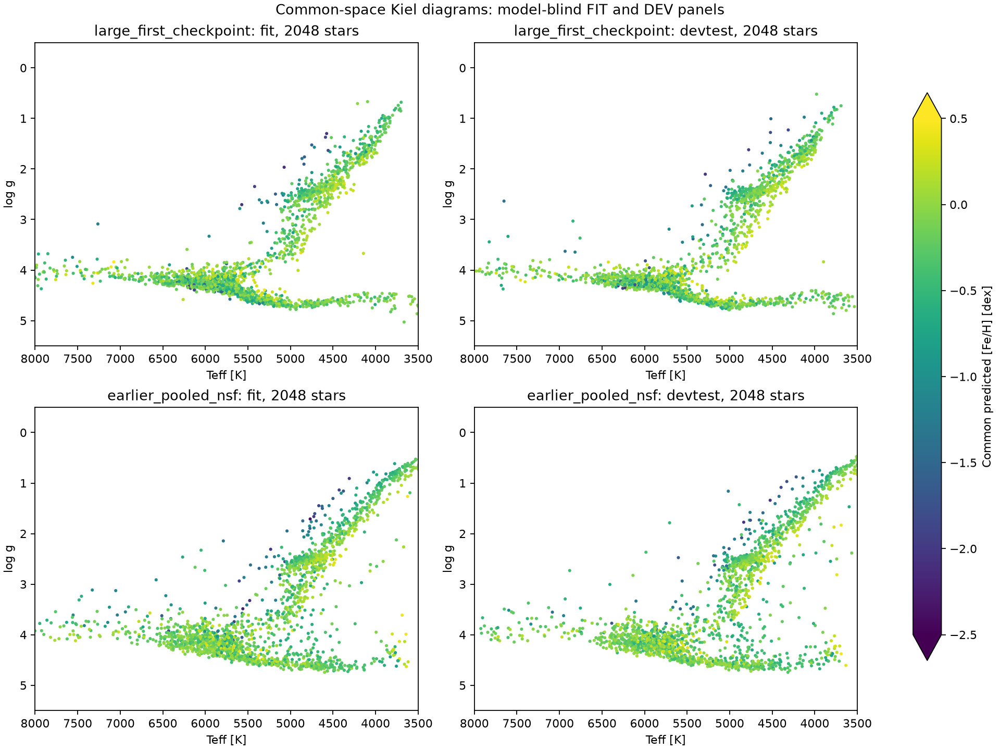

# First large-checkpoint QA

Preliminary first-checkpoint QA, not a selected final model. Catalogue/reference errors, calibration/teacher dependence, shared Gaia inputs and ancestor exposure remain. No DEV/benchmark outcome feeds training selection.

Training snapshot: update 2000; this may precede completion of a full FIT epoch.

| Model | Seismic stars | logg MAE | noisy-reference C90 |
|---|---:|---:|---:|
| large_first_checkpoint | 737 | 0.0774 | 0.963 |
| earlier_pooled_nsf | 737 | 0.0692 | 0.825 |

Full single-star and population corner plots and source-native true-versus-predicted figures are saved beside this report. Age and distance remain posterior-teacher scales.
