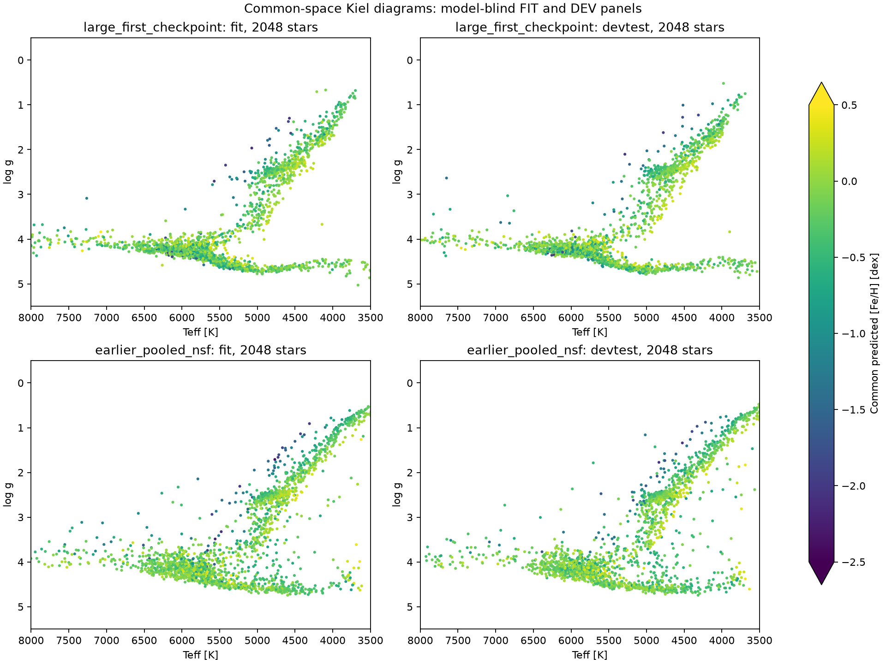

# Progress checked 7 November 2026, approximately 14:15 Perth

The main CANFAR training is running. Latest inspected manifest: 4,300 joint updates, after 1,000 new-map warm-up updates. It has presented 1,100,800 of 9,203,880 uniform FIT observation records in epoch one (12%). No full epoch has completed. There are 7,693,002 distinct FIT stars; record presentations are not a count of distinct stars already visited. Two epochs are planned, about 71,906 joint updates. At the observed early speed (~2.60 seconds/update), roughly 49 hours remain, excluding evaluation and other overhead.

The first immutable diagnostic snapshot is update 2,000, SHA `5333dfe148194f44e3adcc02cb9e7ee975b277d0fdc88b2c7fdc899e385f6a39`. It is not a final selected model. All comparisons below use that snapshot, not the newest in-memory update.

| Gravity reference | N | Earlier NSF MAE | New snapshot MAE | Earlier median bias | New median bias |
|---|---:|---:|---:|---:|---:|
| APOKASC DEV | 737 | 0.0692 dex | 0.0774 dex | +0.0240 dex | +0.0015 dex |
| TESS DEV | 12,017 | 0.0869 dex | 0.0980 dex | +0.0538 dex | −0.0369 dex |

The reference zero-point improves, but total absolute gravity error has not improved. APOKASC noisy-reference 90% interval inclusion increases from 82.5% to 96.3%, with median interval width increasing from 0.243 to 0.387 dex: this is broader than nominal coverage, not evidence of precise calibration. TESS inclusion is 85.4% (earlier 86.9%). The high-parallax-S/N TESS subset still has 0.0972 dex MAE: the remaining gravity issue is not confined to poor parallaxes. TESS values depend on the stated nu-max/Teff scaling reference and its systematics.

For 47 Tuc, the 86 matched APOGEE stars have iron NMAD 0.054 dex in the native reference and 0.245 dex in common MSA medians. The iron reference is APOGEE, so its own map is identity. The new full cluster sample also has wider iron NMAD than the earlier model (0.194 vs 0.167 dex over 632 stars). We have not achieved the hoped-for tighter cluster relations at this early checkpoint.

Completed first-checkpoint QA covers 21,561 stars: benchmarks, seismic references, clusters, paired Kiel diagrams, population and genuine single-star corners, and native-survey comparisons. The exact full-release catalogue joins yield 20,411 Andrae and 21,490 GaiaNet matches on this diagnostic panel. These counts describe this panel, not the availability of Gaia-XP stars in either catalogue. Andrae M/H is distinct from Fe/H. All APOKASC matches in the reported Andrae outside-training slice are absent, so that comparison does not establish independent generalization against Andrae.

Full-registry inference is running separately: 2,945,024 / 10,427,497 usable stars (28.2%), with 128 whole-vector draws per star and nine six-target marginal quantiles. Approximate remaining inference time at observed throughput is four hours, plus cluster draws and report generation. The full outer-join label plots, all-split residuals, cluster posterior mixtures and full-footprint comparator plots wait for those products. They will describe the fixed update-2,000 snapshot while the main training continues.

- [Completed first-checkpoint plot report](https://ws-uv.canfar.net/arc/files/projects/k-pop/msa_runs/stellar-improvement-20261015/expanded_checkpoint_report_20261107_v1/report.md)
- [TESS gravity diagnostics](https://ws-uv.canfar.net/arc/files/projects/k-pop/msa_runs/stellar-improvement-20261015/tess_first_checkpoint_gravity_qa_20261107_v1/tess-gravity-vs-parallax.png)
- [Full-registry inference progress](https://ws-uv.canfar.net/arc/files/projects/k-pop/msa_runs/stellar-improvement-20261015/full_label_union_inference_20261107_v1/manifest.json)

The current evidence supports continuing the baseline, retaining the previous checkpoint for comparison, and withholding a claim of improvement. The richer cross-target/noise mapping discussed subsequently has not been substituted into this running experiment.
