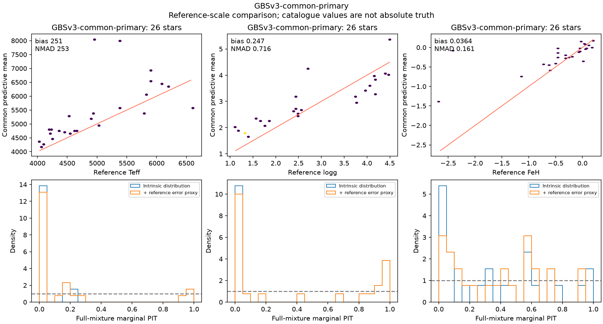
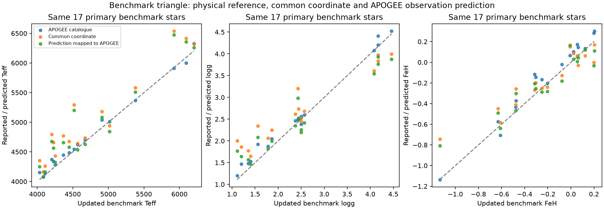

# Updated benchmarks and survey expansion — 5–6 November 2026

The first source-admission and benchmark-QA phase is complete. The trained
three-survey model is unchanged. New label candidates are staged, with source
receipts and explicit activation gaps; none of these new sources has yet been
fitted to the common model.

## LAMOST release correction — 6 November

The requested LAMOST expansion release is **DR12 v2.0**, not the DR8 v2 files
found on the mounted catalogue volume. The DR8 admission and Gaia+DR8 feature
union below are retained as historical receipts; their counts must not be
presented as DR12 results. The existing checkpoint has never been trained on
either LAMOST candidate.

**Reconciled earlier work:** the user correctly recalled completed DR12
acquisition. The earlier branch
`origin/codex/multisurvey-abundance-union-20261028` records completed source-only
LRS (`insknp6k`) and MRS (`ntidqyve`) jobs from 29 October, produced at
`ec104432bd8664bcde00b7f1f1bfa4adc7ae7d8f`. Their manifests have now been fetched
from ARC and preserved in this branch. The bounded inventory and current
checkout missed these earlier run outputs; choosing DR8 was a regression.

| Earlier completed DR12 source | Spectrum records | Distinct native Gaia IDs | IDs matched to 150M input cache |
|---|---:|---:|---:|
| LRS LASP | 8,376,135 | 5,829,702 | 3,334,358 |
| MRS (LASP and CNN retained separately) | 3,224,901 | 1,499,584 | 889,924 |

These counts precede quality selection and cross-product overlap removal; they
are neither additive independent-star counts nor actual training counts.
Both manifests explicitly record `training_performed=false` and
`model_loaded=false`. The current selected checkpoint uses three surveys only.

The redundant new download (`wb9kryln`) was stopped after this recovery; its
partial output is retained as superseded. A separate source admission reuses
the earlier LRS archive, verifies its recorded full SHA256 and gzip CRC,
then applies quality selection, repeat resolution and benchmark reservations.
Both earlier source-table hashes and the MRS archive hash were verified on
the worker. The new LRS quality admission is complete:

- **8,376,135** raw spectra; **8,226,110** with valid exact Gaia IDs.
- **4,607,044** quality-selected spectrum rows, reduced to **3,265,101 unique stars**.
- Selected finite labels with positive quoted errors: **3,237,842 Teff**,
  **3,264,956 log g**, **3,265,098 native feh** (9,767,896 scalar labels).
- **3,054,344** candidates lie outside the old base; no roles were assigned.
- **132,140** match eligible existing FIT identities; these are source
  matches, not additional trained stars. Benchmark-reserved selected IDs: zero.
- Cuts remain provisional: S/N(g)>=30, per-target domains and positive errors;
  highest-S/N spectrum per exact native Gaia ID, original-row tie break.
- Sidecar SHA256:
  `b30c05056ac154a3a8bd3f0d72ca70d5833e5693f321ec400f5b63a9d67fca23`.

[New LRS admission manifest](msa-survey-expansion-20261105/lamost-dr12-lrs-manifest.json),
[archive/schema/CRC proof](msa-survey-expansion-20261105/lamost-dr12-source-verification.json),
[prior source readback checks](msa-survey-expansion-20261105/lamost-dr12-prior-source-verification.json).

Session `h51q4ryy` completed these data outputs, then failed while copying
its environment metadata because the wrapper replaced its scratch-root variable
with the ARC root. The failed session is retained, and no source-admission job
was repeated. Its launch source hashes are in the receipt; an independently
saved executed-source-hashes file and its environment lock were not produced.
The completed HDF/manifest and full source checks are available independently.
The DR12 feature-union job binds the completed sidecar by SHA256.
The corrected Gaia+DR12 LRS feature union completed in session `v4qu8oco`:
**8,127,876** selected candidate IDs, of which **7,591,872** lie outside the
old base. Of those, **4,756,867** have recoverable complete XP plus the required
photometry; **2,835,005** remain unknown/unrecovered, not certified no-XP stars.
This supersedes the archived Gaia+DR8 union's 4,546,388 recoverable-star count.
No new roles, fitting or inference were performed. The worker's saved source
hashes match its launch receipt exactly.

Feature table SHA256:
`d4d8ea8e972625cb040c0fdcf4cc60675c03823b43826cef4b57d6d725e14f23`.
[Corrected feature manifest](msa-survey-expansion-20261105/feature-dr12-manifest.json),
[feature proof](msa-survey-expansion-20261105/feature-dr12-feature-proof.json).
Old Gaia+DR8 recovery counts remain historical only.

Earlier manifests: [LRS](msa-survey-expansion-20261105/lamost-dr12-lrs-prior-completion.json),
[MRS](msa-survey-expansion-20261105/lamost-dr12-mrs-prior-completion.json).

[Official DR12 catalogues](https://www.lamost.org/dr12/v2.0/catalogue),
[release notes](https://www.lamost.org/dr12/v2.0/doc/release_note).

## Updated benchmark references

The 2015 benchmark citation was outdated for selecting current reference values.
We acquired the **corrected GBSv3 parameter catalogue** from Soubiran et al.
(2024), including the December 2024 correction associated with the 2025 erratum,
and **Casamiquela et al. (2026)** recommended per-star abundances.

- Fundamental catalogue: **201 stars**, comprising **192 direct-diameter**
  benchmarks and **nine indirect-diameter** cases.
- Recommended abundance catalogue: **201 stars**, joined one-to-one by HIP
  identifier. The atmospheric parameters agree between the two catalogues.
- **192 exact Gaia DR3 IDs** are available. Missing IDs remain missing; there
  is no floating-point ID conversion or guessed positional match.
- Recommended **FeI/H and FeII/H remain separate**. The older literature Fe/H
  column is preserved, but is not used as the updated iron reference.
- The author's spectral overview has 521 spectrum rows for 202 named stars,
  including the Sun. Those repeated spectra are not additional independent
  benchmark stars or independent copies of the same recommended abundance.

Primary sources: [corrected fundamental catalogue and erratum history](https://cdsarc.cds.unistra.fr/viz-bin/ReadMe/J/A+A/682/A145?format=html&tex=true),
[2026 abundance catalogue](https://cdsarc.cds.unistra.fr/viz-bin/ReadMe/J/A+A/705/A167?format=html&tex=true),
and [benchmark-team library](https://www.blancocuaresma.com/s/benchmarkstars).
The exact downloaded TSV responses and hashes are retained in
[the sources folder](msa-survey-expansion-20261105/sources/) and
[staging manifest](msa-survey-expansion-20261105/staged/manifest.json).

### Role and independence audit

Across the existing full feature table, **33 benchmark IDs** are present:
30 in `external`, HIP7294 in FIT, HIP14086 in TUNE and HIP16537 in CAL.
No updated benchmark occurs in devtest or the input-eligible excluded export.
The remaining 168 catalogue rows are absent from this base, including rows
without Gaia IDs. An earlier partial-role census left TUNE/CAL unresolved;
the new native input audit resolves those two memberships.

We generated a **192-ID reservation list** for future FIT exclusion. It must
be bound into a future training bundle; the frozen current model has not been
retroactively changed. FIT/TUNE/CAL exposure remains explicitly tagged.
The 30 external-role stars are held out from the completed joint adaptation,
but inherited-model training and survey calibration ancestry are not certified
independent. Now-inspected stars are development evidence for subsequent
model decisions, not a fresh final confirmation set.

These references are independent of fitting our XP model, but they are not
independent of every input or physical model: bolometric flux estimates can use
Gaia photometry/XP, gravities use parallaxes and evolutionary masses, and the
new abundance analysis uses the fundamental atmospheric parameters. Preserve
those dependencies when interpreting the comparisons.

## Correct survey-space QA: the learned mappings matter

A frozen CUDA replay completed for all **248,489 devtest** and **2,291 external**
stars, with **zero optimizer updates**. It loaded the selected checkpoint by
SHA256, restored the exact trained affine observation maps at the per-star
reference Gaussian mean, and propagated every mixture component and covariance.
Replayed common means agree with the saved exports to at most **0.0025 K**,
0.0000025 dex in gravity and 0.000001 dex in iron. No weights were changed.

| Devtest source | Teff bias / NMAD [K] | log g bias / NMAD [dex] | Fe/H bias / NMAD [dex] |
|---|---:|---:|---:|
| APOGEE | −4.3 / 56.7 | −0.011 / 0.147 | −0.008 / 0.079 |
| DESI | +0.6 / 73.8 | −0.009 / 0.158 | −0.005 / 0.134 |
| GALAH | −1.6 / 61.7 | −0.014 / 0.116 | −0.005 / 0.072 |

These use native label masks/counts, not all stars for every target. Their full
counts are 17,904/17,904/17,898 for APOGEE; 171,796 for each DESI target; and
55,710/53,717/55,710 for GALAH.

| Devtest nominal 90% coverage in native observation coordinates | Teff | log g | Fe/H |
|---|---:|---:|---:|
| APOGEE | 97.9% | 91.6% | 96.0% |
| DESI | 97.2% | 90.9% | 92.2% |
| GALAH | 98.5% | 96.4% | 97.7% |

The observation distributions include the **same 100 K / 0.1 dex / 0.1 dex
floors used in training**, plus quoted random errors under the diagonal-noise
approximation. In particular, temperature intervals are conservative under
these assumptions. These are not measurements of intrinsic physical-parameter
coverage. The observed-data joint devtest NLL is **4.79031**; it is a held-out
score, not a new selection or a claim of convergence.

The deliberately reserved external panel behaves differently: APOGEE gravity
has **73.0%** nominal 90% native-observation coverage for 1,086 stars, even after
the proper map. Thus bulk native calibration does not establish calibration on
every reference population. The external panel and devtest have different
populations and observation patterns; their aggregate NLLs are not a controlled
like-for-like architecture comparison.

**Interpretation correction:** raw common-versus-native offsets in the preceding
audit are coordinate/scale comparisons. They cannot be read directly as errors
of the trained survey-prediction channel. Likewise, the unmapped RAVE coverage
figures do not isolate calibration of the common latent distribution. New
surveys need their own maps and measurement models, fitted on development
stars and evaluated on disjoint stars. This confirms the user's correction.

[Frozen replay metrics and assumptions](msa-survey-expansion-20261105/frozen-mapped-manifest.json)
and [executed code hashes](msa-survey-expansion-20261105/frozen-mapped-executed-hashes.json)
retain the evidence. This evaluates the exact affine approximation used in
training, not a new nonlinear push-forward approximation or a newly fitted map.

## Actual benchmark results

Of the 30 external-role matches, **26 have direct angular diameters and no
published spectral warning**. The four indirect cases are reported separately
through the all-star panel. No outlier was removed based on its residual.

| Common prediction versus benchmark, primary sample | N | Median bias | Residual NMAD | 90% reference compatibility |
|---|---:|---:|---:|---:|
| Teff | 26 | **+251.1 K** | **253.1 K** | 7/26 = **26.9%** |
| log g | 26 | **+0.247 dex** | **0.716 dex** | 8/26 = **30.8%** |
| FeI/H | 26 | +0.036 dex | 0.161 dex | 22/26 = 84.6% |

The compatibility calculation uses the full exported mixture and an independent
Gaussian proxy for the quoted reference uncertainty. It is marginal, not joint
credible-region coverage. Its sample is small, the common coordinates are still
a relative survey gauge, and shared-input/reference dependencies are not
included as cross-covariances. It is not a physical-truth calibration certificate.
The large temperature/gravity discrepancies nevertheless warrant investigation
before promoting the model.

### Native survey and common predictions on identical benchmark stars

| Reference subset | N | Parameter | Native bias / NMAD | Common bias / NMAD |
|---|---:|---|---:|---:|
| APOGEE | 17 | Teff [K] | +28.8 / 54.0 | +229.8 / 220.1 |
| APOGEE | 17 | log g [dex] | +0.091 / 0.063 | +0.248 / 0.447 |
| APOGEE | 17 | FeI/H [dex] | +0.080 / 0.034 | +0.028 / 0.116 |
| GALAH | 10 | Teff [K] | +27.9 / 98.0 | +369.1 / 667.3 |
| GALAH | 10 | FeI/H [dex] | +0.055 / 0.050 | +0.147 / 0.349 |

GALAH gravity is available for only one of these primary benchmark stars, so
we do not report a population-scatter estimate for that subset. DESI supplies
no matched native references in this primary panel. The completed frozen replay also supplies the mapped-common-to-native leg
below. No inverse survey correction was invented.

### Completed benchmark triangle

For the same primary benchmark stars, the learned observation map explains
part of the common-coordinate offsets:

| Subset / target | N | Native − benchmark median | Mapped prediction − native median | Mapped prediction − benchmark median |
|---|---:|---:|---:|---:|
| APOGEE Teff [K] | 17 | +28.8 | +90.2 | +133.1 |
| APOGEE log g [dex] | 17 | +0.091 | −0.067 | +0.039 |
| APOGEE FeI/H [dex] | 17 | +0.080 | −0.078 | −0.002 |
| GALAH Teff [K] | 10 | +27.9 | +232.9 | +329.3 |
| GALAH FeI/H [dex] | 10 | +0.055 | +0.133 | +0.133 |

Medians of differences do not add algebraically across stars. The mapping
largely explains the APOGEE-subset gravity coordinate shift; temperature
prediction discrepancies remain after mapping, particularly for this GALAH
subset. We should distinguish a relative gauge from a physical reference and
investigate population/input failures rather than assign every discrepancy to
intrinsic uncertainty or to survey systematics alone.

[Full triangle metrics](msa-survey-expansion-20261105/benchmark-triangle-final/metrics.json)
and [per-star values](msa-survey-expansion-20261105/benchmark-triangle-final/matched-stars.csv)
include both source and common predictions and retain the original masks.

The source-only native input audit finds **24/30** external matches have staged
XP inputs and six do not. Within the 26-star primary panel, **21 have XP and
five do not**. For the 21 with XP, median Teff residual remains +229.8 K and
NMAD 223.0 K; temperature RMSE is 957.9 K because several failures are severe.
Missing XP therefore cannot explain all the benchmark discrepancies.
Bright-star/input-domain effects, feature association, common-reference gauge,
and the prediction/mapping decomposition need targeted diagnosis.

Per-star references, flags, native labels, common means and sigmas are in
[matched-stars-with-input-audit.csv](msa-survey-expansion-20261105/benchmark-qa/matched-stars-with-input-audit.csv).
[Full metrics](msa-survey-expansion-20261105/benchmark-qa/metrics.json) and
[input subgroups](msa-survey-expansion-20261105/benchmark-qa/input-subgroups.json)
retain all counts and distribution scores.

## New survey source admission

### Archived DR8 LAMOST candidate (superseded for expansion)

The bounded native inventory found full **DR8 v2 LRS and MRS** catalogues already
mounted, rather than only the small CaT product identified in the older audit.
DR8 v2's LRS association is documented as Gaia DR3; older DR8 v1 associations
were Gaia DR2, so the version distinction matters.
[Publisher's DR8 v2 description](https://www.lamost.org/dr8/v2.0/doc/lr-data-production-description).

The LRS admission job processed and hashed the full **6,684,413-row** native
AFGK catalogue on CANFAR. The provisional selection requires g-band SNR ≥30,
valid exact Gaia IDs, and per-target valid values/domains and positive quoted
errors. It retains the highest-SNR spectrum per Gaia ID, with source row as the
stable tie-break. It does not use agreement with model predictions.

- **3,801,113 spectrum rows** survive the provisional selection.
- Deduplication leaves **2,827,370 unique stars**.
- Valid selected targets: **2,803,939 temperatures**, **2,827,347 gravities**,
  and **2,827,369 iron measurements**: **8,458,655 scalar records**.
- **116,321** stars match the existing primary-input-eligible FIT cohort;
  16,438 match TUNE, 16,619 CAL and 16,776 devtest.
- **2,642,086** selected stars lie outside the existing base identity table.
  They have not been assigned FIT roles or claimed to have recovered features.
- The mounted MRS catalogue has **1,230,307 rows**, but MRS labels are not yet
  admitted. LASP and CNN products and their quality/dependency policies remain
  separate.

The source-only LRS sidecar is persisted at:

`/arc/projects/k-pop/msa_runs/stellar-improvement-20261015/lamost_dr8v2_lrs_admission_20261105_v1/lamost-dr8v2-lrs-candidate.h5`

SHA256: `95d252e5f89d2a1db45edb172693167384a37b7ab72f4b0d12f533aea747fcd0`.
The full raw mounted-file SHA256 is recorded in the
[admission manifest](msa-survey-expansion-20261105/lamost-manifest.json).
It is a reproducible content pin, not a verified publisher checksum. Selection
remains provisional and training is disabled. The native CPU environment lock
and executed source hashes are retained alongside the report.

**Scaling implication:** the current input cohort is a limiting factor. Adding
survey mappings to the current table alone cannot use the other 2.64 million
LAMOST stars. The feature union must expand with exact Gaia association,
provenance and explicit input availability. Label counts alone must not be
reported as expanded training counts.

### Archived Gaia+DR8 feature recovery (superseded above)

The Gaia/LAMOST source union contains **7,733,571 selected candidate IDs**;
**7,220,701** lie outside the existing base. A completed source-only CANFAR job
recovered usable inputs for **4,546,388 additional stars**, all with complete
110-coefficient XP inputs and sufficient G/other photometry. **2,674,313** remain
unknown/unrecovered. Unknown is not an assertion that Gaia published no XP.

The recovered arrays preserve the validated parent-cache normalization and
missingness masks. The helper masks encoder fields outside XP and its five
supported photometry columns; it does not invent missing astrometry or other
modalities. The cache ID file was hashed and 128 recovered associations were
checked against original raw records. No full original-source scan was run.

The output `new-star-features.h5` retains all new candidate IDs and explicit
recoverability flags, with SHA256
`9865254eeaadf37f1bd214519aa0c4e6d3d2993de1b3a7dfcc9cff974ebd9370`.
Its native directory is
`/arc/projects/k-pop/msa_runs/stellar-improvement-20261015/multisurvey_feature_union_20261105_v1/`.
The current base is untouched. **No new FIT/test roles were assigned and no
predictions or training were run on these new stars.** The benchmark exclusion
list and group-aware evaluation split still need binding into the training
bundle. Feature availability is not a training count.

[Feature-union manifest](msa-survey-expansion-20261105/feature-union-manifest.json),
[full recovery proof](msa-survey-expansion-20261105/feature-union-proof.json), and
[executed source hashes](msa-survey-expansion-20261105/feature-union-executed-hashes.json)
record this expansion. The proof and executed-code hashes were independently
checked after collection.

### Gaia RVS: existing completed preparation recovered

A prior, complete four-source overlay was found and its summary hash verified.
It contains **5,591,594 GSP-Spec rows**, with **5,322,188** passing the provisional
joint Teff/log g tier. Among the existing primary-input-eligible FIT stars,
**268,483** have a Gaia match; **262,141** have selected temperatures and
**264,447** selected gravities. The devtest cohort has 38,313 Gaia ID matches.

The sidecar preserves the published percentiles and flags. It provides **no
direct Fe/H channel**: M/H and alpha remain separately named diagnostics, and
its random-error fields remain unknown rather than being invented from
percentiles. An appropriate observation-error model is needed before fitting.
It has not been used in the completed three-survey model.

[Recovered manifest](msa-survey-expansion-20261105/gaia-existing-manifest.json)
and [full role census](msa-survey-expansion-20261105/gaia-existing-summary.json)
bind the earlier source preparation. The attempted new preparation job stopped
at the existing-output guard; it overwrote nothing. No replacement was needed.

### RAVE: source candidate assembled

Using the previously acquired native MADERA and GAUGUIN catalogues and published
Gaia EDR3 crossmatch, we staged **188,943 unique selected stars** with 188,943
Teff, 188,943 log g and 151,160 iron measurements. **13,176** match the current
FIT cohort and 1,796 match devtest. The local candidate preserves original
source-row identities, random errors, error-known masks, SNR and separation.

The provisional tier is convergence0, SNR ≥40 and counterpart separation ≤1
arcsec; repeats are chosen by SNR, then separation, then observation ID.
Calibrated MADERA Teff/log g and GAUGUIN iron form one explicitly dependent
source block. BDASP is not mixed in, and M/H is not renamed to Fe/H.
The candidate is now persisted on CANFAR at
`rave_native_admission_20261105_v1/rave-candidate.h5` under the experiment root.
Its [native manifest](msa-survey-expansion-20261105/rave-native-manifest.json)
verifies both catalogue hashes against the audited snapshots. The regenerated
TAP crossmatch retains the actual row count and its own response hash. Training
remains disabled pending bundle/role admission.

### MaStar: recommended v2 acquired and verified

The **24,290-MaNGAID-row**, 73-column recommended goodstars v2 file was downloaded and
verified against the publisher's SHA1, with a separate local SHA256 retained.
Its valid-method star counts are JI 22,398, DL 23,876, LH 21,523 and YC 21,961.
These are alternative analyses of the same stars, not independent star counts.

The parameter file has **no direct Gaia ID column**. Its publisher Gaia VAC
has now been acquired and joined by exact MaNGAID as described below. DR3/input
association and cleanmatch/quality admission remain before training. Its method-specific raw iron and
APOGEE-calibrated master iron must remain distinct. Starting with one method,
for example DL, avoids treating four reductions plus their median as five
independent observations. [Native-source audit](msa-survey-expansion-20261105/mastar-source-audit.json).

### Gaia-ESO, SEGUE and legacy BOSS/eBOSS

The full 350-column Gaia-ESO DR5.1 native source was already acquired on the
earlier branch and privately preserved with SHA readback. Its Gaia association
remains unresolved; the current thin projection is not the only preserved
source. The earlier xmatcher three-row ESA probe returned eight Gaia
candidates and the same three matches at assumed epochs 2000/2010/2016;
these illustrative epochs do not establish catalogue-wide identities. Gaia-ESO
needs full candidate retrieval and epoch/ambiguity auditing before training.

SEGUE requires the explicit SSPP parameter/error product and an audited
spectrum/star-to-Gaia join. Legacy BOSS/eBOSS needs an appropriate documented
stellar-parameter product. **DR20 Astra explicitly excludes pre-SDSS-V BOSS
spectra**, so its BOSSNet output cannot silently stand in for legacy BOSS/eBOSS.
[Official Astra scope](https://www.sdss.org/dr20/mwm/astra/).
The bounded native scan did not identify those native parameter products;
that does not establish global absence from storage or public archives.

## SDSS DR20 release audit and crossmatching — 6 November

The release audit now starts from **DR20**. Its [completed-surveys page](https://www.sdss.org/dr20/completed_surveys/)
explicitly directs SEGUE, legacy BOSS/eBOSS and MaStar to their final DR17
products; those completed surveys have no newly released data after DR17.
The retained native filenames and release versions therefore remain explicit.
DR20's newer SDSS-V BOSS results are a separate channel: Astra **0.8.1**,
including `astraAllStarBossNet-0.8.1.fits.gz` (849,231,687 compressed bytes),
SLAM and other pipeline summaries. The official 0.8.1 archive index and
publisher checksum list are preserved here; no full DR20 label ingestion or
training is claimed. [DR20 Astra scope](https://www.sdss.org/dr20/mwm/astra/),
[product directory](https://data.sdss.org/sas/dr20/spectro/astra/0.8.1/summary/).
DR20's generic Astra download link currently opens the older 0.6.0 directory;
we explicitly inspected 0.8.1 rather than following that link blindly.

**MaStar identity progress:** the official Gaia EDR3 crossmatch VAC was acquired
and its publisher SHA1 verified (`2a3c82483e5807b615228a2e7be469fab13e7fb6`).
The publisher uses position, magnitude and proper-motion/epoch information.
Using **xmatcher 0.5.1**, an exact MANGAID join connects all **24,290** parameter
rows to the VAC. There are **24,289 positive Gaia-ID rows / 24,129 distinct IDs**;
**23,557 rows** carry publisher `GAIA_CLEANMATCH=1`, while 733 do not. Multiple
MaNGAIDs for the same star remain repeated identities; no additive star claim
or training promotion. Parameter-method quality/dependence and DR3 input
association checks remain before source activation.
[Publisher crossmatch method](https://www.sdss4.org/dr17/mastar/mastar-crossmatch/),
[join audit](msa-survey-expansion-20261105/mastar-gaia-identity/manifest.json).

**Gaia-ESO crossmatch:** xmatcher was installed with pip in an isolated temporary
environment, preserving an install receipt; it does not alter the training
environment. The earlier successful ESA probe and failed bulk/small CDS probes
were recovered. Full-source Gaia candidate acquisition and epoch/ambiguity QA
remain unfinished; no nearest positional candidate has been promoted to a
physical identity. Use xmatcher for declared-epoch propagation and ambiguity
retention; STILTS in `astroai/improc` is the user-specified alternative if the
archive route requires it. Installing either tool alone does not establish a
complete Gaia-ESO association catalogue.

## Deliverables, execution and remaining work

The new [versioned source registry](../../configs/survey-label-registry-20261105-v2.json)
records current evidence and activation gaps separately from the immutable
registry used by previous runs. It does not activate labels or change the
reference convention. The [QA plan](msa-expanded-survey-qa-plan-20261105.md)
now points to the updated benchmark references.

Completed native jobs:

- `ecsjetm3`: bounded source inventory. It examined 10,349 files in the catalogue
  root and 78,619 in the experiment root, finding 83 matching candidates.
  It reads FITS headers, not scientific table rows; a few unreadable or
  nonstandard files remain explicitly flagged. The directory-depth and file
  bounds define its scope. [Inventory](msa-survey-expansion-20261105/native-inventory.json).
- `qv2ukrvj`: full LAMOST LRS source admission and benchmark input audit, CPU only.
  Both the returned input-audit hash and executed-source hashes were verified.
- `wpa5i7o0`: completed expanded feature recovery and proof generation. Its first
  attempt `rprbxxzr` stopped at argument parsing before creating output.
- `xwu1g1p5`: completed native RAVE candidate persistence.
- `dwtji68c`: completed frozen CUDA observation-map QA. The first attempt
  `y49w5scn` stopped in a NumPy assertion API call; the corrected attempt kept
  the same scientific tolerances, checkpoint and zero-update policy.
- `hfns0h8n`: attempted Gaia preparation stopped because the output already
  existed. Its completed predecessor was recovered and reused without mutation.

The next integration work is completion of missing Gaia identity/product
contracts; benchmark/cluster-aware fresh role assignment and parent/input-contract
admission for the recovered feature union; and new frozen-model observation
mappings before joint adaptation. The benchmark temperature failures also need
a targeted input/domain diagnosis; the existing mapped-source replay is now
complete. No new survey mapping, encoder, mixture or NF was fitted in this
source-admission phase, and no final-test performance claim is made.

Verification: **24 source/pipeline tests, eight feature-recovery tests and three
distribution tests passed**, covering exact large IDs, catalogue/version
joins, separate ionization references, warning masks, deterministic repeat
selection, missing errors, bounded FITS header parsing, existing sparse-overlay
logic and the documented pipeline entrypoint. Ruff checks passed for all new
source-admission and QA scripts. The actual native LRS job additionally checked
the full row count and unchanged source-file identity, then wrote the candidate
through the existing sidecar validation API.

Verification for the 6 November correction: nine acquisition/admission/feature/pipeline
checks passed in the documented Pixi environment, plus one xmatcher native-ID
join test in its isolated environment. Ruff passed for the changed scripts and
tests. No new model weights were loaded or updated. All correction-phase
CANFAR sessions are terminal: redundant download stopped; admission data
completed with the separately recorded metadata-copy failure; feature union
completed successfully.

## Large Gaia-XP comparator QA — 6 November addition

The QA now includes Andrae's 175M XGBoost catalogue, Zhang/Green/Rix, SHBoost,
Gaia Net and Ye/FERRE. It requires both catalogue-wide common-ID agreement and
paired accuracy against identical spectroscopic/physical references, with
held-out/teacher-membership strata, input differences, metallicity definitions,
cluster tightness and proper uncertainty scores preserved. Published catalogue
sizes are not our measured overlap counts. The old Andrae measurements will be
recomputed for the selected checkpoint; no new comparison result is claimed.
See the [expanded QA contract](msa-expanded-survey-qa-plan-20261105.md) and
[comparator registry](../../configs/gaia-xp-comparator-qa-20261106.json).

## Offline decision experiments — 6 November

The [16-job decision wave](msa-decision-wave-20261106.md) is now submitted on
CANFAR: eight controlled six-target training experiments, native PDF QA and
unattended array reports, large-XP catalogue comparisons, frozen-source maps
and expanded data/input audits. DR20 BOSSNet and DR12 MRS LASP provisional
candidate admission has completed. The final large training job is not yet
started; final source/role/PDF/input gates remain explicit.
