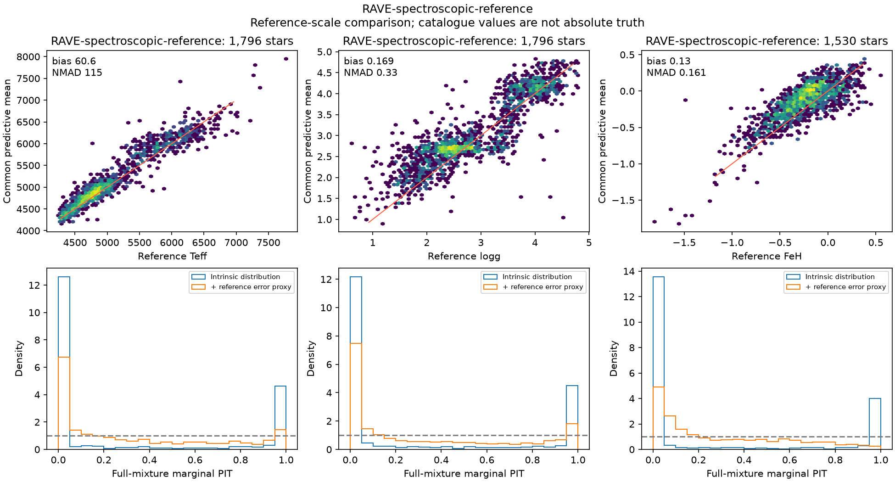
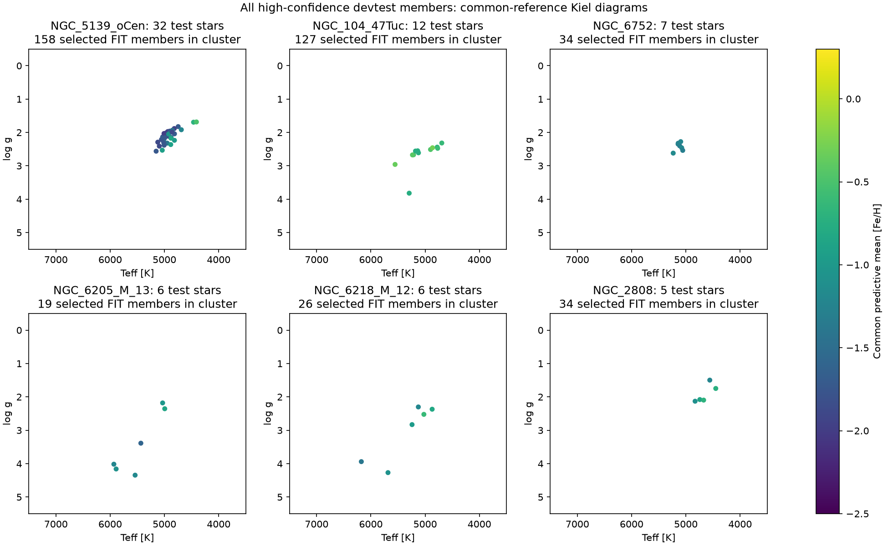
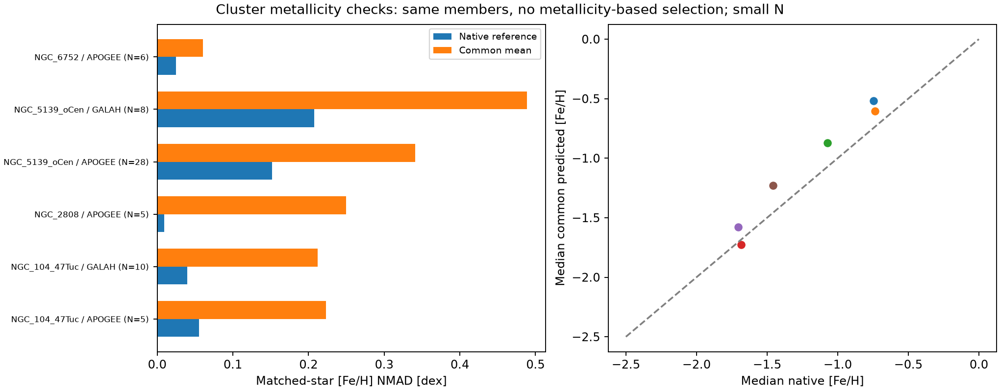

# Frozen-model validation — 5 November 2026

The completed common-reference model **does not yet demonstrate the calibrated,
cluster-consistent predictions we want**. Its overall Kiel diagrams can look
sharp while independent reference compatibility and cluster metallicities expose
problems. This audit leaves its predictions and checkpoint unchanged.

We checked all **248,489 devtest predictions**, compared their native APOGEE,
DESI and GALAH labels, joined an external RAVE spectroscopic reference, and
searched the astrometric membership catalogue of **170 globular clusters**.
There are **110 high-confidence devtest members across 30 clusters**; six
clusters have at least five. Those are the members present in the existing
prediction cohort, not a prediction of the entire cluster catalogue.

## External RAVE comparison

The selection uses MADERA convergence flag 0, S/N ≥ 40 and a published Gaia
EDR3 counterpart within 1 arcsec. Repeated observations are reduced to the
highest S/N, then the smallest separation, then observation ID. Selection never
uses agreement with our predictions. Temperatures and gravities use the
published calibrated MADERA columns; iron uses **GAUGUIN [Fe/H]**, not MADERA
[M/H]. All these stars are absent from the current FIT identity set.

| Parameter | Stars | Median prediction − reference | Residual NMAD | Nominal 90% reference coverage |
|---|---:|---:|---:|---:|
| Teff | 1,796 | +60.6 K | 115.1 K | **59.2%** |
| log g | 1,796 | +0.169 dex | 0.330 dex | **53.5%** |
| [Fe/H] | 1,530 | +0.130 dex | 0.161 dex | **74.4%** |

NMAD is 1.4826 times the median absolute deviation about the median residual.
Coverage uses the exact four-component marginal mixture CDF, convolved with
an independent Gaussian proxy using RAVE's reported random error. These are
central equal-tail intervals. No moment-matched single-Gaussian intervals or
new uncertainty scaling are used. Full NLL, CRPS, PIT histograms and
68/90/95% coverage are in [metrics.json](msa-validation-20261105/metrics.json).
The displayed 90% figures include that reference-error proxy.

This is a **reference-scale compatibility test**, not an absolute physical-truth
calibration certificate. RAVE has its own systematics and calibrated scale, and
our common coordinate is defined by the three fitted survey mappings. No RAVE
observation head was fitted. Offsets, reference errors and predictive dispersion
all affect coverage; these numbers alone cannot identify their separate causes.
Nevertheless, we cannot claim the exported distributions already give 90%
coverage for RAVE-like parameter measurements.

The weaknesses vary by population: among the RAVE-reference giants (log g < 3),
median gravity and iron residuals are +0.234 and +0.182 dex, respectively.
For RAVE-reference dwarfs (log g > 3.8), they are +0.057 and −0.072 dex.
Temperature scatter is 90.7 K for the giants and 181.1 K for the dwarfs.
A single global offset would therefore not settle the discrepancies.

## Globular-cluster checks

Membership comes from [Vasiliev & Baumgardt's Gaia EDR3 astrometric catalogue,
version 2](https://zenodo.org/records/4891252). The baseline requires membership
probability > 0.9 and the astrometric-quality bit to be set. We also checked
thresholds > 0.5 and > 0.99. No predicted or spectroscopic metallicity was used
to select members. The six largest test-member samples are unchanged across
these probability thresholds.

| Cluster | Test members | Selected FIT members | Median predicted [Fe/H] | Predicted-mean [Fe/H] NMAD |
|---|---:|---:|---:|---:|
| Omega Cen | 32 | 158 | −1.726 | 0.317 dex |
| 47 Tuc | 12 | 127 | −0.605 | 0.204 dex |
| NGC 6752 | 7 | 34 | −1.244 | 0.061 dex |
| M13 | 6 | 19 | −1.139 | 0.145 dex |
| M12 | 6 | 26 | −1.033 | 0.289 dex |
| NGC 2808 | 5 | 34 | −0.870 | 0.250 dex |

All six clusters have current FIT members. Thus these are tests on stars held
out from the current joint adaptation **within clusters represented in FIT**.
They are not whole-cluster held-out tests. Historical supervised exposure of
the inherited reference model is also not certified independent.

Same-star metallicity comparisons are more informative than comparing
unmatched cluster samples:

| Cluster / reference | Same stars | Native [Fe/H] NMAD | Common-mean [Fe/H] NMAD |
|---|---:|---:|---:|
| 47 Tuc / GALAH | 10 | **0.040** | **0.212** |
| 47 Tuc / APOGEE | 5 | 0.055 | 0.223 |
| NGC 6752 / APOGEE | 6 | 0.025 | 0.060 |
| NGC 2808 / APOGEE | 5 | 0.010 | 0.250 |
| Omega Cen / APOGEE | 28 | 0.152 | 0.341 |

The small samples limit precision, especially N=5–7. Omega Cen has a real
metallicity spread, so forcing it to be chemically narrow would be wrong.
These statistics do show that our predictions are **not consistently tighter
than the survey measurements**. For 47 Tuc the model's overall member-mean
scatter is 0.204 dex, while the median individual predictive sigma is 0.084 dex;
this motivates checking member-specific failures, label scales and crowding,
not imposing an artificial zero-scatter cluster loss.

We also measured temperature/gravity widths after subtracting medians in
shared 0.5-mag G bins, for the same red photometric-locus members (BP−RP > 0.8,
G < 18). Only Omega Cen/APOGEE has ≥20 matched stars: conditional temperature
NMAD is **81.3 K predicted versus 46.0 K native**; gravity is 0.146 versus
0.144 dex. Its multiple populations and small bin samples prevent a general
RGB-tightness conclusion. We did not treat a cluster's entire log g range as
measurement scatter.

[Member trends versus magnitude, radius, predicted temperature and gravity](msa-validation-20261105/cluster-trends.png)
are supplied for inspection. Their samples are too small to establish a
crowding correction or a radial physical gradient. The complete 170-cluster
census is in [clusters.csv](msa-validation-20261105/clusters.csv), with nested
matched-source and threshold statistics in the metrics file.

## Native survey reference versus common prediction

| Reference | Stars with Teff | Teff bias / NMAD [K] | log g bias / NMAD [dex] | [Fe/H] bias / NMAD [dex] |
|---|---:|---:|---:|---:|
| APOGEE | 17,904 | +85.7 / 63.7 | +0.206 / 0.181 | +0.033 / 0.093 |
| DESI | 171,796 | −100.3 / 85.1 | −0.186 / 0.180 | +0.055 / 0.154 |
| GALAH | 55,710 | +51.1 / 70.6 | +0.104 / 0.148 | −0.026 / 0.095 |

Availability differs by target; exact counts are in the metrics. These are
**raw native-reference versus common-coordinate differences**. We did not
apply the trained survey observation mappings, so systematic offsets can be
partly intentional consequences of the common-reference definition. These
are not the trained source-space likelihood residuals.

The metal-poor tail deserves attention: for **6,378 DESI test stars with native
[Fe/H] < −1.5**, the common prediction is a median **+0.273 dex more metal rich**,
with residual NMAD 0.211 dex. That scale-dependent shift is a warning to inspect
the tail and learned mapping before claiming rare-population performance.

[APOGEE comparison](msa-validation-20261105/APOGEE-native-reference.png),
[DESI comparison](msa-validation-20261105/DESI-native-reference.png), and
[GALAH comparison](msa-validation-20261105/GALAH-native-reference.png) show
reference versus prediction and residual trends. A reproducible
[largest-disagreement catalogue](msa-validation-20261105/largest-native-disagreements.csv)
contains the 30 largest absolute discrepancies per target and survey, retaining
integer Gaia IDs and predictive sigmas. These are candidates for inspection,
not automatically erroneous survey labels or model predictions.

## Distribution and domain checks

The mixtures genuinely use multiple components: **60.4%** of test stars assign
weight > 0.05 to at least two components. The median effective component count
(exp(weight entropy)) is 1.52. Median fractions of variance arising between
component means are 24.8% for Teff, 43.0% for gravity and 23.5% for iron. These
statistics do not prove multiple modes, calibrated tails, or an improvement
over a normalizing flow.

We integrated marginal probability outside broad inspection ranges:
2500–10000 K, −1–6.5 log g and −5–1 [Fe/H]. Respectively 973, 614 and 242 test
stars assign >1% probability outside these ranges; 533, 102 and zero predictive
means lie outside. These are inspection ranges, **not universal physical bounds**;
hot stars can legitimately fall outside the temperature window. No stars were
removed or clipped to make the diagrams look better.

[population-audit.json](msa-validation-20261105/population-audit.json) preserves
these results. The previous full-export audit already checked weights, finite
parameters, positive component factors, exact mixture moments, covariance
validity and zero current FIT/devtest overlap.

## Incomplete comparisons

- **Gaia DR3 GSP-Spec:** the staged full reference is identified, but its local
  transfer timed out, rejected resume, and a restart reset before completion.
  Its expected hash was never obtained. No partial catalogue was scored.
  [M/H] must remain separate from [Fe/H] when this check is completed.
- **Gaia-ESO DR5.1:** all 114,916 public records were retrieved, including
  reference values and flags. The release lacks direct Gaia IDs. The CDS
  candidate-matching service and alternate hostname failed to connect, so
  no unverified positional matches were accepted and no accuracy is claimed.
- **APOKASC3 seismic crosscheck:** the registered CDS reference download and
  ReadMe timed out; no new seismic result is claimed.
- **Mapped native-source likelihood, joint 3D credible-region coverage and
  whole-cluster held-out generalization** were not measured here. The exports
  lack the per-star reference Gaussian mean needed to replay the exact affine
  observation mappings. That requires a frozen native checkpoint replay on
  CANFAR CUDA, preserving the selected checkpoint and identity roles.

## What this changes

The present model should remain a baseline rather than be called physically
calibrated across all surveys. The next model work needs an exact mapped-source
replay to separate survey-coordinate offsets from prediction errors; independent
seismic/benchmark anchors; an explicit cluster-held-out split; and tail and
cluster diagnostics as evaluation gates. A richer NF alone will not resolve
scale identification, insufficient cluster coverage, or biased rare-star means.
Dense cluster diagrams also need feature-only inference for more astrometric
members with available XP/photometry inputs. The current export is the selected
2.52-million-star cohort, not every Gaia star; adding cluster predictions does
not require using their spectroscopic labels for fitting.

Any new survey-label fitting needs disjoint development/calibration/test stars
and cluster-group holdouts, with this frozen baseline retained for comparison.

No training, model selection, uncertainty scaling, external-head fitting or
checkpoint execution took place in this audit. Computation used the saved
physical distribution arrays on CPU. The exact selected checkpoint is
`9328ab102a54fae7fb541f08f4b478128f327834c4398bebccfff07112205fd7`.

## Reproduction and verification

[provenance.json](msa-validation-20261105/provenance.json) records source URLs,
hashes, query, row counts and unsuccessful checks. The RAVE live crossmatch
contains 517,357 rows, versus 517,340 in its metadata page; the retrieved file's
hash and actual row count are retained. The source tables are from the
[RAVE DR6 service](https://www.rave-survey.org/metadata/ravedr6/) and
[ESO's Gaia-ESO catalogue](https://www.eso.org/qi/catalog/show/411).

Run `scripts/validate_multisurvey_predictions.py --help` through Pixi. The
`--predictions` and `--fit-ids` inputs are bound to the completed devtest export
and exact FIT identity set. Optional source arguments produce the external
and cluster diagnostics; the RAVE crossmatch is bound to this query's row count.
No checkpoint weights are loaded. The exact marginal PIT, Gaussian reference
convolution, NLL and analytic Gaussian-mixture CRPS have runnable numerical
checks in `tests/test_export_mixture_diagnostics.py`.

Verification: `pixi run --no-install pytest tests/test_pipeline.py
tests/test_export_mixture_diagnostics.py tests/test_distribution_diagnostics.py -q`
— **13 passed**. Ruff checks passed for the new diagnostics and runner. The
existing distribution module and its tests are unchanged.
