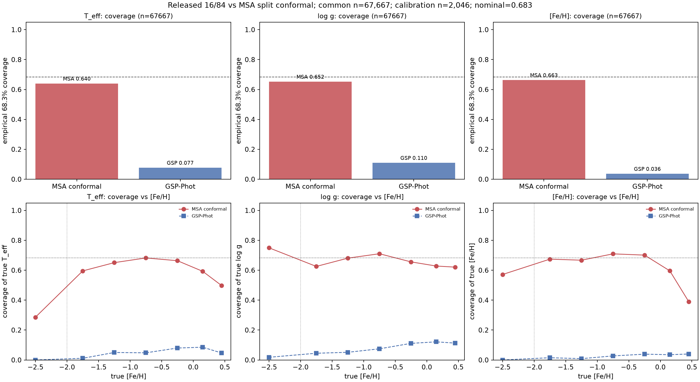

# Released 16/84 vs MSA split-conformal intervals — same-cohort test

**Prepared:** 2026-10-22. Companion to
[fair-comparison-released-20261022.md](fair-comparison-released-20261022.md).

The point-metric comparison is not enough: users need calibrated intervals. This
compares the released Gaia DR3 GSP-Phot 16/84 bounds with MSA split-conformal
intervals on the **same 67,667 stars** with finite GSP-Phot values.

---

## 1. Method

- MSA point model: long noise-aware Gaussian + reconstruction (selected 99M).
- Calibration set: the dedicated **2,046 calibration-role rows** (not test), with
  their saved means and variances.
- Conformal score per label: `|y_cal − pred_cal| / σ_cal`; the interval is
  `pred_test ± q_α σ_test`, with `q_α` the exact finite-sample
  `ceil((n+1)(1−α))` rank; nominal `1−α = 0.683` (16/84).
- GSP-Phot intervals: released `*_gspphot_lower/upper` columns (its nominal 16/84).
- Coverage/width evaluated on the common test stars; tail = `[Fe/H] < −2`
  (n=56).
- This is a **global** conformal threshold (no stratification yet), so the tail
  numbers are a diagnostic, not a calibrated product.

---

## 2. Results

### Global (n = 67,667, nominal = 68.3%)

| Label | MSA coverage | MSA median width | GSP-Phot coverage | GSP-Phot median width |
|---|---:|---:|---:|---:|
| T_eff | **64.0%** | 117.2 K | **7.7%** | 25.1 K |
| log g | **65.2%** | 0.257 dex | **11.0%** | 0.0295 dex |
| [Fe/H] | **66.3%** | 0.153 dex | **3.6%** | 0.0188 dex |

### Metal-poor tail (`[Fe/H] < −2`, n = 56)

| Label | MSA coverage | MSA median width | GSP-Phot coverage | GSP-Phot median width |
|---|---:|---:|---:|---:|
| T_eff | 28.6% | 202 K | 0.0% | 26 K |
| log g | 75.0% | 0.448 dex | 1.8% | 0.039 dex |
| [Fe/H] | 57.1% | 0.682 dex | 0.0% | 0.004 dex |



---

## 3. Interpretation

1. **GSP-Phot's quoted 16/84 intervals are drastically too narrow on this cohort**
   — 3.6% coverage for [M/H], 7.7% for T_eff, 11% for log g against a nominal
   68.3%. This is consistent with its published statement that its uncertainties
   are underestimated by factors 1.6–3.4 (and worse here because the same stars
   include the metal-poor tail). Its widths are so small that they cannot be used
   as a trust anchor.
2. **MSA global conformal coverage is close to nominal but not on target**:
   64.0–66.3% vs 68.3%. Possible causes: calibration/test covariate shift, the
   calibration-role distribution differing from the test-role population, and the
   fact that a **global** threshold is being applied across very different
   evolutionary regimes. The interval widths are much more realistic than GSP’s.
3. **The tail is not yet calibrated**: MSA coverage at [Fe/H] < −2 is 28.6% for
   T_eff, 57.1% for [Fe/H], despite very wide intervals; n=56 makes the estimate
   noisy, but this is exactly the regime where a global conformal threshold fails.
   It requires **Mondrian/stage-stratified calibration and more calibration
   stars**, and ultimately independent anchors.
4. This validates the R1 plan: **do not publish a single global conformal
   interval as the final uncertainty product.** Use stage/tier Mondrian strata,
   a minimum calibration count, and report the between-teacher/theory envelope
   separately.

---

## 4. Caveats

- Calibration n = 2,046; exact finite-sample rank but limited per-stratum support.
- The common subset is selected by finite GSP-Phot values (67,667/97,695), not random.
- GSP-Phot `mh_gspphot` is `[M/H]`, not `[Fe/H]`; the interval comparison uses its
  released bounds against the native `[Fe/H]` label.
- MSA intervals are diagnostic; no certificate or independent verification yet.
- The tail n=56 yields ±~6–13 percentage-point Poisson uncertainty per label; do not
  over-interpret individual tail coverage numbers.

---

## 5. Reproducibility

```bash
pixi run python scripts/compare_uncertainties.py \
  --predictions experiments/xp/results-stellar-improvement/multi_gaussian_noise_recon_30e_v1/predictions.npz \
  --cohort experiments/xp/results-stellar-improvement/multi_gaussian_recon_s42_v1/paired-cohort.npz \
  --gspphot-cache experiments/xp/results-stellar-improvement/fair-gspphot-20261022/gspphot-common.csv \
  --output docs/reports/uncertainty-comparison-gspphot-long-20261022.png
```
